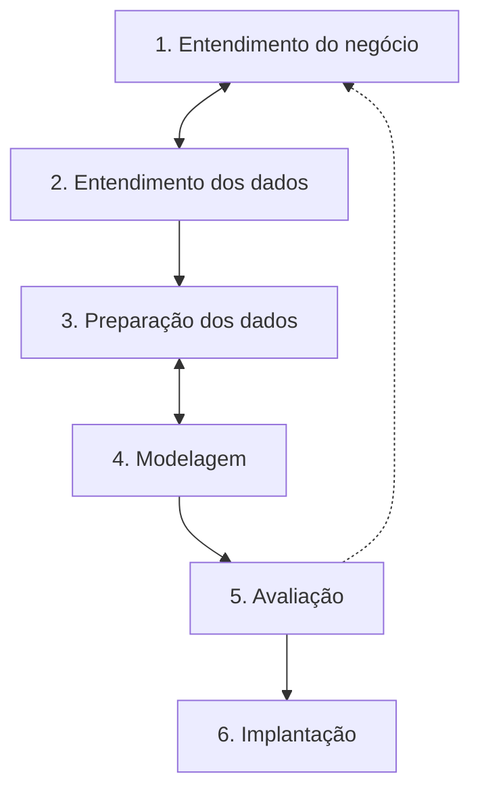

# O que é Ciência de Dados

## Definição

Ciência de dados é o trabalho de transformar dados em respostas úteis para alguém tomar uma decisão. Ela junta três coisas:

- **Estatística e matemática**, para medir, comparar e saber o quanto confiar num resultado
- **Programação**, para coletar, limpar e processar volumes de dados que não cabem numa planilha feita à mão
- **Conhecimento do domínio** (o negócio, a área de saúde, o varejo...), para saber que pergunta faz sentido e se a resposta é plausível

Tirar qualquer uma das três costuma dar problema. Sem domínio, você encontra padrões que ninguém precisa. Sem estatística, você tira conclusão de ruído. Sem programação, você não sai da amostra de 200 linhas.

Um exemplo concreto: uma loja online quer saber quais clientes estão prestes a cancelar a assinatura. A ciência de dados entra para juntar o histórico de compras e acessos, entender o que diferencia quem cancelou de quem ficou, construir um modelo que dá uma probabilidade de cancelamento para cada cliente e colocar isso num lugar onde o time de relacionamento consiga usar.

## Ciência de dados, análise, engenharia e machine learning

Esses nomes aparecem misturados em vagas e cursos. A divisão abaixo é a mais comum, mas na prática as fronteiras são borradas e uma mesma pessoa costuma fazer um pouco de tudo.

| Área                | Pergunta principal                            | Entregas típicas                                         | Ferramentas comuns                        |
| ------------------- | --------------------------------------------- | -------------------------------------------------------- | ----------------------------------------- |
| Análise de dados    | O que aconteceu e por quê?                    | Relatórios, dashboards, análises pontuais                | SQL, Excel, Power BI, pandas              |
| Engenharia de dados | Como o dado chega confiável e no prazo?       | Pipelines, data warehouse, qualidade de dados            | SQL, Python, Spark, Airflow, cloud        |
| Ciência de dados    | O que vai acontecer e o que fazer a respeito? | Modelos preditivos, experimentos, análises estatísticas  | Python, pandas, scikit-learn, estatística |
| Machine learning    | Como o computador aprende o padrão sozinho?   | Algoritmos e modelos treinados, muitas vezes em produção | scikit-learn, PyTorch, MLOps              |

Machine learning é uma das ferramentas da ciência de dados, não um sinônimo. Muita análise valiosa de ciência de dados não usa modelo nenhum, só uma boa pergunta, um `groupby` e um gráfico bem feito. Os algoritmos ficam para a seção [Machine Learning](/labs/data/machine-learning/01-algoritmos-de-machine-learning/).

## Por que isso importa

Empresas tomam decisões o tempo todo: quanto estoque comprar, para quem liberar crédito, qual campanha manter. Sem dados, a decisão vai pelo achismo de quem fala mais alto na reunião. Com dados bem tratados dá para:

- **Prever** demanda, inadimplência, falhas de equipamento
- **Entender comportamento**, como quais clientes compram juntos, quem está prestes a sair
- **Medir o efeito de uma mudança**, por exemplo se o novo layout do site vendeu mais ou foi coincidência

## Onde aparece

| Setor         | Exemplos de uso                                                   |
| ------------- | ----------------------------------------------------------------- |
| Finanças      | Detecção de fraude em cartão, score de crédito, análise de risco  |
| Saúde         | Apoio a diagnóstico por imagem, previsão de ocupação de leitos    |
| E-commerce    | Recomendação de produtos, segmentação de clientes, preço dinâmico |
| Redes sociais | Feed personalizado, moderação de conteúdo, análise de sentimento  |
| Indústria     | Manutenção preditiva (prever quando a máquina vai quebrar)        |
| Transporte    | Rotas, previsão de tempo de entrega, demanda por corridas         |
| Educação      | Identificar alunos com risco de evasão                            |
| Agronegócio   | Previsão de safra, monitoramento de lavoura por satélite          |

## O fluxo de trabalho

Quase todo projeto passa pelas mesmas etapas, e cada uma tem uma nota própria nesta seção:

1. **Entender o problema** - qual decisão o resultado vai apoiar e como saber se deu certo
2. **Coleta** - buscar os dados em arquivos, bancos e APIs ([Coleta de dados](/labs/data/ciencia-de-dados/03-coleta-de-dados/))
3. **Limpeza e pré-processamento** - tratar ausentes, duplicados, tipos e preparar as variáveis ([Limpeza e pré-processamento](/labs/data/ciencia-de-dados/04-limpeza-e-pre-processamento/))
4. **Análise exploratória (EDA)** - conhecer os dados com estatística descritiva e gráficos ([Análise exploratória](/labs/data/ciencia-de-dados/05-analise-exploratoria/))
5. **Modelagem** - treinar modelos ([Algoritmos de ML](/labs/data/machine-learning/01-algoritmos-de-machine-learning/))
6. **Avaliação** - medir se o modelo presta ([Métricas de avaliação](/labs/data/machine-learning/02-metricas-de-avaliacao/))
7. **Deploy** - colocar o resultado para funcionar no dia a dia ([Deploy com FastAPI e Docker](/labs/data/ml-em-producao/01-deploy-com-fastapi-e-docker/))

Repare nas setas tracejadas: o fluxo não é uma linha reta. É comum descobrir na EDA que a pergunta inicial estava mal formulada, ou ver na avaliação que faltou tratar alguma coisa na limpeza. Na prática, a maior parte do tempo vai para coleta e limpeza, não para o modelo.

## CRISP-DM: o modelo clássico

O fluxo acima é uma versão simplificada do **CRISP-DM** (Cross-Industry Standard Process for Data Mining), proposto no fim dos anos 1990 por um consórcio de empresas e até hoje a referência mais citada para organizar projetos de dados. Ele tem seis fases:

| Fase                    | O que se faz                                                                   |
| ----------------------- | ------------------------------------------------------------------------------ |
| Entendimento do negócio | Definir o objetivo, o critério de sucesso e as restrições (prazo, custo, LGPD) |
| Entendimento dos dados  | Coletar uma primeira versão, explorar, checar qualidade                        |
| Preparação dos dados    | Limpar, integrar fontes, criar e transformar variáveis                         |
| Modelagem               | Escolher técnicas, treinar, ajustar parâmetros                                 |
| Avaliação               | Conferir se o resultado atende o objetivo de negócio, não só a métrica técnica |
| Implantação             | Entregar: relatório, dashboard, API, modelo em produção                        |

A ideia mais útil do CRISP-DM para quem está começando é a primeira fase. Um modelo com 95% de acerto que responde a pergunta errada não vale nada. Antes de abrir o Jupyter, escreva em uma frase qual decisão vai mudar com o resultado.

## Papéis num time de dados

Em empresas maiores o trabalho é dividido entre várias pessoas:

- **Analista de dados** - consultas SQL, dashboards e análises para o negócio
- **Engenheira(o) de dados** - constrói e mantém os pipelines que trazem o dado para dentro
- **Cientista de dados** - análises estatísticas, experimentos e modelos preditivos
- **Engenheira(o) de machine learning / MLOps** - coloca modelos em produção e cuida do ciclo de vida deles ([MLOps](/labs/data/ml-em-producao/02-mlops/))
- **Pessoa de negócio / produto** - dona da pergunta, valida se a resposta faz sentido

Em empresas pequenas tudo isso pode ser uma pessoa só. Por isso vale aprender um pouco de cada parte, começando por SQL ([Introdução ao SQL](/labs/data/sql/01-introducao-ao-sql/)) e Python ([Ambiente Python e bibliotecas](/labs/data/ciencia-de-dados/02-ambiente-python-e-bibliotecas/)).

## Referências

- [O que é ciência de dados?](https://www.ibm.com/br-pt/topics/data-science) - IBM, pt-BR
- [Guia do IBM SPSS Modeler CRISP-DM (PDF)](https://www.ibm.com/docs/pt-br/SS3RA7_18.5.0/nl/pt/BR/pdf/ModelerCRISPDM.pdf) - IBM, pt-BR
- [Curso intensivo de machine learning](https://developers.google.com/machine-learning/crash-course?hl=pt-br) - Google for Developers, pt-BR
