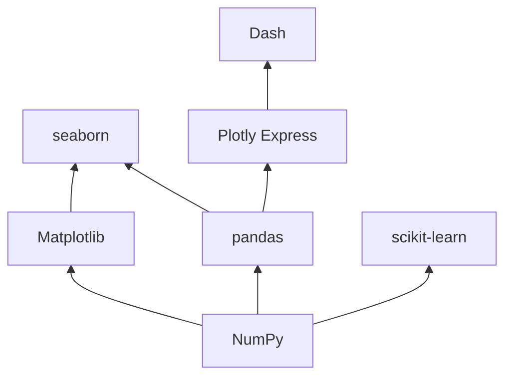
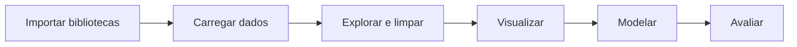

# Ambiente Python e Bibliotecas

## Por que Python

Python virou a linguagem padrão de ciência de dados por alguns motivos bem práticos:

- A sintaxe é curta e legível, então dá para focar no problema e não na linguagem
- Tem biblioteca pronta para quase tudo: ler planilha, fazer estatística, treinar modelo, montar dashboard
- A comunidade é enorme. Qualquer erro que você encontrar, alguém já perguntou antes
- Roda igual em Windows, Linux e macOS

R também é muito usado, principalmente em estatística acadêmica, e SQL continua indispensável para buscar os dados. Mas para o fluxo completo, do CSV ao modelo em produção, Python é o caminho mais comum.

## As bibliotecas principais

| Biblioteca           | Para que serve                                                    | Import usual                      |
| -------------------- | ----------------------------------------------------------------- | --------------------------------- |
| NumPy                | Arrays numéricos e operações matemáticas rápidas                  | `import numpy as np`              |
| pandas               | Tabelas (DataFrames): ler, filtrar, agrupar, limpar               | `import pandas as pd`             |
| Matplotlib           | Gráficos estáticos, base de quase todas as outras libs de gráfico | `import matplotlib.pyplot as plt` |
| seaborn              | Gráficos estatísticos com menos código, em cima do Matplotlib     | `import seaborn as sns`           |
| Plotly               | Gráficos interativos para web                                     | `import plotly.express as px`     |
| scikit-learn         | Pré-processamento, modelos clássicos de ML, métricas              | `from sklearn... import ...`      |
| Jupyter              | Notebooks: código, resultado e texto no mesmo documento           | -                                 |
| TensorFlow / PyTorch | Deep learning (redes neurais)                                     | `import torch`                    |

Outras que aparecem com frequência: **XGBoost** e **LightGBM** (gradient boosting, muito fortes em dados tabulares), **statsmodels** (modelos estatísticos e séries temporais), **OpenCV** (imagens), **NLTK** e **spaCy** (texto).

Uma forma de enxergar como elas se encaixam:



Quase tudo se apoia no NumPy. O pandas usa arrays NumPy por baixo, e o scikit-learn recebe tanto arrays quanto DataFrames.

### NumPy em 30 segundos

O NumPy guarda números num array de tipo único, o que deixa as contas muito mais rápidas que uma lista Python e permite operar no array inteiro sem `for`:

```python
import numpy as np

pesos = np.array([3750, 3800, 3250, 3450, 3650])  # massa de pinguins, em gramas

print(pesos.mean())       # média
print(pesos / 1000)       # converte tudo para kg de uma vez
print(pesos[pesos > 3500])  # filtra com uma condição
```

Essa forma de trabalhar, uma operação aplicada ao array todo, se chama **vetorização** e é o que você deve preferir no pandas também. As noções básicas de pandas (`read_csv`, `head`, filtros, `groupby`) estão em [Conceitos básicos](/labs/data/fundamentos/02-conceitos-basicos/).

## Qual versão do Python usar

Use **Python 3.12 ou mais novo**. Muitos tutoriais ainda mostram 3.10, mas essa versão chegou ao fim de vida em outubro de 2026 e não recebe mais correções de segurança. As bibliotecas também vão largando versões antigas: o pandas 3.0, por exemplo, exige Python 3.11+.

Uma regra que funciona bem: use a versão estável mais recente que já tenha alguns meses de lançamento (hoje, 3.13 ou 3.14). A versão lançada há poucas semanas às vezes ainda não tem pacote pronto de todas as bibliotecas. A página [Status of Python versions](https://devguide.python.org/versions/) mostra o que está suportado e até quando.

## Ambiente virtual: por que e como

Cada projeto precisa das suas versões de bibliotecas. Se você instala tudo no Python do sistema, um dia o projeto A precisa do pandas 2 e o projeto B do pandas 3, e um quebra o outro. O **ambiente virtual** é uma pasta isolada com seu próprio Python e suas próprias bibliotecas, uma por projeto.

Há dois caminhos populares.

### Opção 1: venv + pip (vem com o Python)

```bash
# cria o ambiente na pasta .venv
python -m venv .venv

# ativa no Linux/macOS
source .venv/bin/activate

# ativa no Windows (PowerShell)
.venv\Scripts\Activate.ps1

# instala as bibliotecas
pip install numpy pandas matplotlib seaborn plotly scikit-learn jupyter
```

Com o ambiente ativo, o nome dele aparece no começo do prompt do terminal. Para sair, `deactivate`.

Depois de instalar, registre as versões num arquivo para outra pessoa (ou você daqui a seis meses) conseguir recriar o ambiente:

```bash
pip freeze > requirements.txt     # salva
pip install -r requirements.txt   # recria em outra máquina
```

> No PowerShell, se aparecer erro de "execução de scripts desabilitada" ao ativar, rode uma vez `Set-ExecutionPolicy -Scope CurrentUser RemoteSigned`.

### Opção 2: Anaconda / conda

O **conda** é um gerenciador de pacotes e ambientes muito usado em ciência de dados. A distribuição Anaconda já vem com centenas de bibliotecas; o Miniconda (ou Miniforge) vem só com o básico e você instala o que precisa.

```bash
conda create -n ds python=3.13
conda activate ds
conda install numpy pandas matplotlib seaborn plotly scikit-learn jupyter
```

Qual escolher? Se você está começando e quer algo que "só funcione", conda resolve bem, principalmente no Windows. Se já usa Python para outras coisas, venv + pip é mais leve e é o que você vai encontrar em projetos de produção. Evite misturar os dois no mesmo ambiente.

## Conferindo a instalação

```python
import numpy as np
import pandas as pd
import matplotlib.pyplot as plt
import seaborn as sns
import sklearn

print(np.__version__, pd.__version__, sns.__version__, sklearn.__version__)
```

Se não deu `ModuleNotFoundError`, está tudo certo. Esses aliases (`np`, `pd`, `plt`, `sns`) são convenção da comunidade, use os mesmos para o seu código ficar parecido com o da documentação.

## Jupyter Notebook

O Jupyter permite escrever código em **células** e ver o resultado logo abaixo de cada uma, junto com texto e gráficos. Isso é perfeito para explorar dados, porque você testa uma ideia, olha o resultado e decide o próximo passo.

```bash
jupyter notebook   # interface clássica
jupyter lab        # interface mais completa
```

O VS Code também abre arquivos `.ipynb` direto, com a extensão Jupyter. Alguns cuidados:

- As células podem ser executadas fora de ordem, e isso gera notebooks que só funcionam "na sua máquina". Antes de compartilhar, use **Reiniciar kernel e executar tudo**
- Notebook é ótimo para explorar; para código que vai rodar todo dia (um pipeline, uma API), passe a lógica para arquivos `.py`

## O fluxo típico num notebook



Um esqueleto que você vai repetir muito ao longo desta seção, usando o dataset de pinguins que vem com o seaborn (dados reais de 344 pinguins de três espécies da Antártida):

```python
import pandas as pd
import seaborn as sns
import matplotlib.pyplot as plt

df = sns.load_dataset("penguins")   # baixa o CSV na primeira vez (precisa de internet)

df.info()
df.head()

sns.scatterplot(data=df, x="flipper_length_mm", y="body_mass_g", hue="species")
plt.show()
```

As colunas são: `species` (espécie), `island` (ilha), `bill_length_mm` e `bill_depth_mm` (comprimento e profundidade do bico), `flipper_length_mm` (nadadeira), `body_mass_g` (massa) e `sex`. Ele tem alguns valores ausentes de propósito, o que o torna ótimo para praticar limpeza.

## Referências

- [venv - Criação de ambientes virtuais](https://docs.python.org/pt-br/3/library/venv.html) - Python Software Foundation, pt-BR
- [Status of Python versions](https://devguide.python.org/versions/) - Python Developer's Guide, en
- [Getting started with conda](https://docs.conda.io/projects/conda/en/stable/user-guide/getting-started.html) - conda, en
- [NumPy: the absolute basics for beginners](https://numpy.org/doc/stable/user/absolute_beginners.html) - NumPy, en
