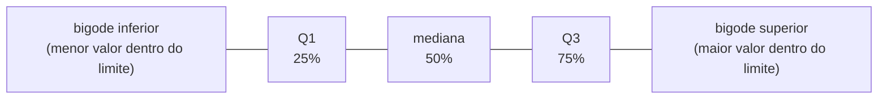
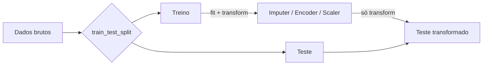

# Limpeza e Pré-processamento

## Por que limpar dados

Dados do mundo real chegam com buraco, repetição, erro de digitação e formato errado. Um modelo ou um gráfico feito em cima disso herda todos os problemas, e o pior é que o resultado não avisa: ele só sai errado com cara de certo. É o "garbage in, garbage out".

Esta nota vai além do básico de [Avançando](/labs/data/fundamentos/03-avancando/) (onde aparecem `isnull`, `dropna` e `drop_duplicates`) e cobre as decisões que vêm depois: como imputar, o que fazer com outliers, como transformar categorias em números e como evitar vazamento de dados.

Os exemplos usam o dataset de pinguins do seaborn, que tem valores ausentes reais:

```python
import numpy as np
import pandas as pd
import seaborn as sns

df = sns.load_dataset("penguins")
df.isna().sum()
```

```text
species               0
island                0
bill_length_mm        2
bill_depth_mm         2
flipper_length_mm     2
body_mass_g           2
sex                  11
```

## Problemas comuns de qualidade

| Problema         | Exemplo                                               | Como detectar                    |
| ---------------- | ----------------------------------------------------- | -------------------------------- |
| Valores ausentes | Campo de sexo vazio                                   | `df.isna().sum()`                |
| Duplicados       | Mesmo pedido importado duas vezes                     | `df.duplicated().sum()`          |
| Inconsistências  | "SP", "sp", "São Paulo" e "Sao Paulo" na mesma coluna | `df["uf"].value_counts()`        |
| Tipos errados    | Preço lido como texto por causa da vírgula            | `df.dtypes`, `df.info()`         |
| Outliers         | Idade 230, salário negativo                           | `df.describe()`, box plot        |
| Ruído            | Leituras de sensor oscilando por interferência        | gráficos de linha, médias móveis |

Para inconsistências de texto e tipo, quase sempre a solução é padronizar:

```python
df["island"] = df["island"].str.strip().str.title()     # espaços e maiúsculas
df["preco"] = pd.to_numeric(df["preco"], errors="coerce")  # texto inválido vira NaN
df["data"] = pd.to_datetime(df["data"], errors="coerce")
```

(As colunas `preco` e `data` são ilustrativas, o dataset de pinguins não as tem.)

## Valores ausentes

Antes de decidir o que fazer, pergunte **por que** o valor está faltando. Se o campo "renda" fica em branco justamente para quem ganha mais, preencher com a média esconde exatamente o padrão que interessa. Às vezes a ausência é informação e vale criar uma coluna `renda_ausente` (verdadeiro/falso).

As opções, da mais simples para a mais elaborada:

| Estratégia                  | Quando faz sentido                                                 |
| --------------------------- | ------------------------------------------------------------------ |
| Remover linhas              | Poucas linhas afetadas e sem padrão na ausência                    |
| Remover a coluna            | A coluna está quase toda vazia e não é essencial                   |
| Média                       | Numérica com distribuição simétrica, sem outliers fortes           |
| Mediana                     | Numérica assimétrica ou com outliers (renda, preço)                |
| Moda (valor mais frequente) | Categórica                                                         |
| Valor constante             | Quando a ausência tem significado (ex.: 0 compras, "desconhecido") |
| Forward / backward fill     | Séries temporais: repete o último (ou próximo) valor conhecido     |
| Imputação por modelo        | Estima o valor a partir das outras colunas (KNN, regressão)        |

```python
# remover linhas onde a coluna-alvo está vazia
df = df.dropna(subset=["species"])

# mediana para numérica
df["body_mass_g"] = df["body_mass_g"].fillna(df["body_mass_g"].median())

# moda para categórica
df["sex"] = df["sex"].fillna(df["sex"].mode()[0])

# série temporal: repete o último valor válido
serie = pd.Series([10.0, None, 12.0, None])
serie.ffill()   # 10, 10, 12, 12
```

### Atenção: `inplace=True` e o pandas 3.0

Muito material ainda ensina assim:

```python
# NÃO FAÇA: no pandas 3.0 isso não altera o df
df["body_mass_g"].fillna(df["body_mass_g"].mean(), inplace=True)
```

A partir do pandas 3.0 (lançado em janeiro de 2026), o comportamento **Copy-on-Write** virou padrão: `df["body_mass_g"]` devolve um objeto que se comporta como cópia, então o `inplace=True` altera essa cópia e o `df` original fica intacto, sem erro. A forma certa é atribuir o resultado de volta:

```python
df["body_mass_g"] = df["body_mass_g"].fillna(df["body_mass_g"].mean())
```

Pelo mesmo motivo, `df["coluna"][0] = valor` (atribuição encadeada) não funciona mais. Use `df.loc[0, "coluna"] = valor`. E repare que métodos como `fillna` e `drop_duplicates` **devolvem** um novo objeto: chamar `df.drop_duplicates()` sem atribuir não muda nada.

## Duplicados

```python
df.duplicated().sum()                                   # linhas 100% iguais
df.duplicated(subset=["id_pedido"]).sum()               # mesmo id, conteúdo diferente
df = df.drop_duplicates(subset=["id_pedido"], keep="last")  # mantém o registro mais recente
```

Nem toda repetição é erro. Dois pinguins podem ter exatamente as mesmas medidas. Duplicado de verdade é quando o identificador se repete onde não deveria.

## Outliers

Outlier é um valor muito distante dos demais. Ele pode ser **erro** (idade 230, digitação de 5000 em vez de 50,00) ou **real e importante** (a compra gigante de um cliente corporativo, a transação fraudulenta). Por isso não se remove outlier no automático: primeiro entenda de onde veio.

### Lendo um box plot



A caixa vai do primeiro quartil (Q1) ao terceiro (Q3) e contém os 50% centrais dos dados. A linha dentro dela é a mediana. Os bigodes vão até o último ponto que ainda está dentro do limite do IQR, e os pontos soltos além deles são os candidatos a outlier.

### Regra do IQR

O IQR (intervalo interquartil) é `Q3 - Q1`. São considerados outliers os valores:

- abaixo de **Q1 - 1,5 × IQR**, ou
- acima de **Q3 + 1,5 × IQR**

```python
q1 = df["body_mass_g"].quantile(0.25)
q3 = df["body_mass_g"].quantile(0.75)
iqr = q3 - q1
limite_inf = q1 - 1.5 * iqr
limite_sup = q3 + 1.5 * iqr

outliers = df[(df["body_mass_g"] < limite_inf) | (df["body_mass_g"] > limite_sup)]
len(outliers)   # nos pinguins, nenhum
```

### Z-score

O z-score mede quantos desvios-padrão um valor está da média: `z = (x - média) / desvio`. Uma convenção comum é tratar `|z| > 3` como outlier.

```python
z = (df["body_mass_g"] - df["body_mass_g"].mean()) / df["body_mass_g"].std()
df[z.abs() > 3]
```

O z-score usa média e desvio-padrão, que são puxados pelos próprios outliers, então funciona melhor em dados mais ou menos simétricos. Para dados assimétricos, o IQR é mais confiável.

Depois de identificar, as saídas são: corrigir (se for erro com valor recuperável), remover (erro sem conserto), limitar ao valor do limite (_capping_ ou _winsorização_, com `clip`), transformar (log) ou manter (se for real e relevante).

## Encoding de variáveis categóricas

Modelos de machine learning fazem contas, então precisam de números. Colunas como `island` ("Biscoe", "Dream", "Torgersen") precisam ser convertidas. A técnica depende de a categoria ter ordem ou não.

| Técnica         | Como transforma                                    | Use em                                             | Classe no scikit-learn |
| --------------- | -------------------------------------------------- | -------------------------------------------------- | ---------------------- |
| One-hot         | Uma coluna 0/1 para cada categoria                 | Categorias **sem ordem** (ilha, cor, cidade)       | `OneHotEncoder`        |
| Ordinal         | Um inteiro por categoria, na ordem que você define | Categorias **com ordem** (P < M < G, escolaridade) | `OrdinalEncoder`       |
| Target encoding | Substitui a categoria pela média do alvo nela      | Muitas categorias (ex.: milhares de CEPs)          | `TargetEncoder`        |
| Label encoding  | Um inteiro por classe                              | **Só a variável-alvo (y)** de classificação        | `LabelEncoder`         |

Um erro comum é usar `LabelEncoder` nas features. Ele numera as categorias em ordem alfabética (Biscoe=0, Dream=1, Torgersen=2), e um modelo linear vai entender que Torgersen é "maior" que Dream, uma ordem que não existe. A documentação do scikit-learn é explícita: `LabelEncoder` é para codificar o alvo `y`, não as entradas `X`.

```python
from sklearn.preprocessing import LabelEncoder, OneHotEncoder, OrdinalEncoder

# one-hot para categoria sem ordem
onehot = OneHotEncoder(handle_unknown="ignore", sparse_output=False)
onehot.fit_transform(df[["island"]])

# ordinal com a ordem explícita
tamanhos = pd.DataFrame({"tamanho": ["M", "G", "P"]})
ordinal = OrdinalEncoder(categories=[["P", "M", "G"]])
ordinal.fit_transform(tamanhos)   # M=1, G=2, P=0

# label encoding só no alvo
le = LabelEncoder()
y = le.fit_transform(df["species"])
le.classes_   # ['Adelie', 'Chinstrap', 'Gentoo']
```

O `handle_unknown="ignore"` evita erro quando aparece, em produção, uma categoria que não existia no treino. Para exploração rápida, `pd.get_dummies(df, columns=["island"])` faz one-hot no pandas, mas ele não "lembra" as categorias vistas, então para modelos prefira o `OneHotEncoder`.

O `TargetEncoder` (disponível desde o scikit-learn 1.3) usa o próprio alvo para codificar, o que é um convite a vazamento. Por isso o `fit_transform` dele faz _cross fitting_: cada linha do treino é codificada com médias calculadas nas outras partes dos dados, nunca com o próprio alvo. Use `fit_transform` no treino e `transform` no teste.

## Escalonamento de features (feature scaling)

Quando uma coluna vai de 2.700 a 6.300 (massa em gramas) e outra de 13 a 21 (profundidade do bico em mm), algoritmos que calculam distância ou usam gradiente dão peso desproporcional à primeira. Escalonar coloca tudo numa faixa comparável.

| Técnica        | Fórmula                      | Resultado                                       | Classe           |
| -------------- | ---------------------------- | ----------------------------------------------- | ---------------- |
| Padronização   | z = (x - μ) / σ              | média 0, desvio-padrão 1                        | `StandardScaler` |
| Min-max        | x' = (x - min) / (max - min) | valores entre 0 e 1                             | `MinMaxScaler`   |
| Robust scaling | x' = (x - mediana) / IQR     | centrado na mediana, pouco afetado por outliers | `RobustScaler`   |

Onde μ é a média e σ o desvio-padrão. Alguns pontos práticos:

- A padronização **não exige** que os dados tenham distribuição normal. É simplesmente o padrão mais usado para modelos sensíveis à escala
- Min-max é bom quando você precisa de uma faixa fixa, mas um único outlier espreme todos os outros valores perto de 0
- Com outliers fortes, prefira o `RobustScaler`

Quem precisa de escalonamento: KNN, SVM, regressão linear/logística com regularização, redes neurais, K-Means, PCA. Quem não precisa: árvores de decisão e seus derivados (random forest, gradient boosting), porque elas só comparam valores dentro da mesma coluna.

## Data leakage: o erro silencioso

**Data leakage** (vazamento de dados) acontece quando informação que o modelo não teria no mundo real entra no treino. O resultado é um modelo que vai muito bem na avaliação e mal em produção.

A forma mais comum é sutil: calcular a média para imputar, ou o μ e σ do `StandardScaler`, usando **o dataset inteiro** antes de separar treino e teste. Aí o teste "vazou" para dentro do pré-processamento e deixou de ser um teste justo.

A regra é: **separe treino e teste primeiro**, e ajuste (`fit`) imputers, encoders e scalers **só no treino**. No teste, apenas `transform`.



Fazer isso à mão para cada transformação é trabalhoso e fácil de errar. É para isso que existem `Pipeline` e `ColumnTransformer`.

## Pipeline e ColumnTransformer

- `ColumnTransformer` aplica transformações diferentes em grupos de colunas diferentes (numéricas recebem imputação + escalonamento; categóricas, imputação + one-hot)
- `Pipeline` encadeia passos em ordem e se comporta como um modelo só: `fit` ajusta tudo no treino, `predict`/`score` só aplica as transformações já aprendidas

Exemplo completo com os pinguins, prevendo a espécie a partir das outras colunas:

```python
import seaborn as sns
from sklearn.compose import ColumnTransformer
from sklearn.impute import SimpleImputer
from sklearn.linear_model import LogisticRegression
from sklearn.model_selection import train_test_split
from sklearn.pipeline import Pipeline
from sklearn.preprocessing import OneHotEncoder, StandardScaler

df = sns.load_dataset("penguins").dropna(subset=["species"])
X = df.drop(columns="species")
y = df["species"]

X_train, X_test, y_train, y_test = train_test_split(
    X, y, test_size=0.2, random_state=42, stratify=y
)

numericas = ["bill_length_mm", "bill_depth_mm", "flipper_length_mm", "body_mass_g"]
categoricas = ["island", "sex"]

preprocessamento = ColumnTransformer([
    ("num", Pipeline([
        ("imputar", SimpleImputer(strategy="median")),
        ("escalar", StandardScaler()),
    ]), numericas),
    ("cat", Pipeline([
        ("imputar", SimpleImputer(strategy="most_frequent")),
        ("onehot", OneHotEncoder(handle_unknown="ignore")),
    ]), categoricas),
])

modelo = Pipeline([
    ("prep", preprocessamento),
    ("clf", LogisticRegression(max_iter=1000)),
])

modelo.fit(X_train, y_train)          # medianas, modas, μ, σ e categorias aprendidos só no treino
print(modelo.score(X_test, y_test))   # acurácia no teste
```

Vantagens além de evitar vazamento: o mesmo objeto `modelo` pode ser salvo e usado em produção, recebendo dados brutos e aplicando exatamente o mesmo pré-processamento. E na validação cruzada (`cross_val_score(modelo, X, y)`) o pipeline inteiro é reajustado a cada fold, o que mantém a avaliação honesta. Validação, tuning e métricas estão em [Validação, tuning e regularização](/labs/data/machine-learning/03-validacao-tuning-e-regularizacao/) e [Métricas de avaliação](/labs/data/machine-learning/02-metricas-de-avaliacao/).

## Referências

- [Working with missing data](https://pandas.pydata.org/docs/user_guide/missing_data.html) - pandas, en
- [Copy-on-Write (CoW)](https://pandas.pydata.org/docs/user_guide/copy_on_write.html) - pandas, en
- [Preprocessing data](https://scikit-learn.org/stable/modules/preprocessing.html) - scikit-learn, en
- [Common pitfalls and recommended practices](https://scikit-learn.org/stable/common_pitfalls.html) - scikit-learn, en (data leakage)
- [Dados categóricos](https://developers.google.com/machine-learning/crash-course/categorical-data?hl=pt-br) - Google for Developers, pt-BR
