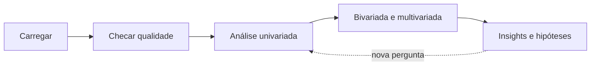

# Análise Exploratória de Dados (EDA)

## O que é EDA

Análise exploratória de dados (EDA, do inglês _Exploratory Data Analysis_) é a fase em que você conhece os dados antes de tirar conclusões ou treinar modelos. É uma conversa: você faz uma pergunta, olha um número ou um gráfico, e a resposta puxa a próxima pergunta.

Os objetivos são:

- Entender a **estrutura**: quantas linhas, que colunas, de que tipo
- Ver a **distribuição** de cada variável: onde se concentra, quanto varia, se é simétrica
- Achar **ausentes, outliers e inconsistências** que precisam de tratamento
- Descobrir **padrões e relações** entre variáveis
- Levantar **hipóteses** para testar depois
- Guiar o **pré-processamento** e a criação de variáveis (feature engineering)

Pular a EDA é a receita para treinar um modelo em cima de um erro que um histograma teria mostrado em dois segundos.

## Fluxo de trabalho



Os exemplos seguem com o dataset de pinguins:

```python
import pandas as pd
import seaborn as sns
import matplotlib.pyplot as plt

df = sns.load_dataset("penguins")
```

## Checando a estrutura e a qualidade

```python
df.shape          # (344, 7)
df.info()         # tipos e quantidade de não nulos por coluna
df.isna().sum()   # ausentes por coluna
df.head()
```

No pandas 3.0, colunas de texto aparecem com o tipo `str` (antes era `object`). Se uma coluna que deveria ser número aparece como `str`, tem texto misturado nela, e isso precisa ser resolvido na [limpeza](/labs/data/ciencia-de-dados/04-limpeza-e-pre-processamento/).

## Estatística descritiva básica

Antes de ler a saída do `describe()`, vale entender as medidas que ele mostra. Elas se dividem em dois grupos: onde os dados se concentram (**tendência central**) e quanto eles se espalham (**dispersão**).

### Tendência central

- **Média**: soma dos valores dividida pela quantidade. É puxada por valores extremos: se nove pessoas ganham R$ 3 mil e uma ganha R$ 300 mil, a média é R$ 32,7 mil, um valor que não representa ninguém
- **Mediana**: o valor do meio quando os dados estão ordenados. Metade fica abaixo, metade acima. Não se abala com extremos, no exemplo acima seria R$ 3 mil
- **Moda**: o valor mais frequente. É a única das três que funciona para categorias ("a ilha com mais pinguins")

Se média e mediana estão próximas, a distribuição tende a ser simétrica. Se a média é bem maior que a mediana, há uma cauda longa à direita (assimetria positiva), comum em renda, preço e tempo de espera.

### Dispersão

- **Amplitude**: máximo menos mínimo. Simples, mas depende só de dois valores
- **Variância**: média dos quadrados das distâncias até a média. Fica numa unidade estranha (gramas ao quadrado)
- **Desvio-padrão**: raiz quadrada da variância, de volta à unidade original. Diz, grosso modo, o quanto os valores costumam se afastar da média
- **Quartis**: dividem os dados ordenados em quatro partes. Q1 (25%) é o valor abaixo do qual está um quarto dos dados, Q2 (50%) é a mediana, Q3 (75%) deixa três quartos abaixo
- **IQR** (intervalo interquartil): Q3 - Q1, a faixa dos 50% centrais. É a base da regra de outliers vista na nota de limpeza

> O `std()` do pandas calcula o desvio-padrão **amostral** (divide por n - 1), enquanto o `np.std()` do NumPy usa por padrão o **populacional** (divide por n). Com muitos dados a diferença é pequena, mas é por isso que às vezes os números não batem.

### Lendo o `describe()`

```python
df.describe().round(1)
```

```text
       bill_length_mm  bill_depth_mm  flipper_length_mm  body_mass_g
count           342.0          342.0              342.0        342.0
mean             43.9           17.2              200.9       4201.8
std               5.5            2.0               14.1        802.0
min              32.1           13.1              172.0       2700.0
25%              39.2           15.6              190.0       3550.0
50%              44.4           17.3              197.0       4050.0
75%              48.5           18.7              213.0       4750.0
max              59.6           21.5              231.0       6300.0
```

O que dá para tirar só disso, olhando `body_mass_g`:

- `count` é 342, não 344: há 2 ausentes
- A média (4.201,8 g) está acima da mediana (4.050 g), sinal de leve assimetria à direita, há alguns pinguins bem mais pesados puxando a média
- O desvio-padrão de cerca de 800 g é grande perto da média, os pinguins variam bastante de tamanho (spoiler: porque são três espécies diferentes)
- Metade dos pinguins pesa entre 3.550 g (Q1) e 4.750 g (Q3)

Para colunas de texto, `df.describe(include="str")` mostra `count`, `unique` (quantas categorias), `top` (a mais frequente) e `freq`.

Outras medidas úteis:

```python
df["body_mass_g"].median()
df["body_mass_g"].mode()
df["body_mass_g"].skew()                  # assimetria: > 0 cauda à direita, < 0 à esquerda
df["species"].value_counts(normalize=True)  # proporção de cada categoria
```

## Análise univariada

Uma variável de cada vez. Para numéricas, o objetivo é ver a forma da distribuição; para categóricas, a frequência de cada categoria.

```python
fig, axes = plt.subplots(1, 3, figsize=(15, 4))

sns.histplot(data=df, x="body_mass_g", bins=20, ax=axes[0])     # distribuição
sns.boxplot(data=df, y="body_mass_g", ax=axes[1])               # mediana, quartis, outliers
sns.countplot(data=df, x="island", ax=axes[2])                  # frequência por categoria

plt.tight_layout()
plt.show()
```

| Gráfico    | Para que olhar                                                |
| ---------- | ------------------------------------------------------------- |
| Histograma | Forma da distribuição: simétrica, assimétrica, com dois picos |
| Box plot   | Mediana, quartis e outliers num resumo compacto               |
| Count plot | Quantidade por categoria, desequilíbrio entre classes         |

Um histograma com **dois ou mais picos** (bimodal) é um aviso de que há grupos diferentes misturados. É o que acontece com a massa dos pinguins: os Gentoo são bem mais pesados que as outras duas espécies.

## Análise bivariada

Duas variáveis juntas. O gráfico certo depende do tipo de cada uma:

| Combinação              | Gráficos                                    | Números                               |
| ----------------------- | ------------------------------------------- | ------------------------------------- |
| Numérica x numérica     | Dispersão (scatter)                         | Correlação                            |
| Categórica x numérica   | Box plot, violin, barras com média          | `groupby` com média, mediana e desvio |
| Categórica x categórica | Barras agrupadas, heatmap da tabela cruzada | `pd.crosstab`                         |

```python
# numérica x numérica
sns.scatterplot(data=df, x="flipper_length_mm", y="body_mass_g", hue="species")
plt.show()

# categórica x numérica
sns.boxplot(data=df, x="species", y="body_mass_g")
plt.show()
df.groupby("species")["body_mass_g"].agg(["mean", "median", "std"]).round(1)
```

```text
             mean  median    std
species
Adelie     3700.7  3700.0  458.6
Chinstrap  3733.1  3700.0  384.3
Gentoo     5076.0  5000.0  504.1
```

Aí está a explicação do desvio-padrão alto no `describe()`: dentro de cada espécie a variação é bem menor, a dispersão geral vinha da mistura.

```python
# categórica x categórica
tabela = pd.crosstab(df["species"], df["island"])
sns.heatmap(tabela, annot=True, fmt="d", cmap="Blues")
plt.show()
```

A tabela cruzada mostra que os Gentoo só aparecem em Biscoe e os Chinstrap só em Dream. Isso importa para modelagem: a ilha sozinha já "entrega" boa parte da espécie.

## Correlação

O **coeficiente de correlação de Pearson** mede a força de uma relação **linear** entre duas variáveis numéricas. Vai de -1 a 1:

- Perto de **1**: quando uma sobe, a outra sobe junto, quase em linha reta
- Perto de **-1**: quando uma sobe, a outra desce
- Perto de **0**: sem relação linear (pode haver outro tipo de relação)

```python
corr = df.corr(numeric_only=True)

sns.heatmap(corr, annot=True, fmt=".2f", cmap="coolwarm", vmin=-1, vmax=1)
plt.show()
```

```text
                   bill_length_mm  bill_depth_mm  flipper_length_mm  body_mass_g
bill_length_mm               1.00          -0.24               0.66         0.60
bill_depth_mm               -0.24           1.00              -0.58        -0.47
flipper_length_mm            0.66          -0.58               1.00         0.87
body_mass_g                  0.60          -0.47               0.87         1.00
```

O `numeric_only=True` ignora as colunas de texto (sem ele, o pandas atual gera erro). Fixar `vmin=-1, vmax=1` e um mapa de cores divergente faz o zero ficar neutro, o que facilita a leitura.

Nadadeira e massa têm correlação de 0,87: pinguins com nadadeira maior são mais pesados, o que faz sentido. Não existe uma tabela universal do que é correlação "forte", isso depende da área. Olhe sempre o gráfico de dispersão junto.

### Três cuidados com correlação

**1. Pearson só enxerga relação linear.** Uma relação em forma de U pode ter correlação perto de zero. Para relações que só sobem (ou só descem) mas não em linha reta, a **correlação de Spearman**, baseada na ordem dos valores, é mais adequada: `df.corr(method="spearman", numeric_only=True)`. Ela também é menos sensível a outliers.

**2. Correlação não implica causalidade.** Venda de sorvete e afogamentos sobem juntos, porque os dois aumentam no verão. Uma terceira variável (o calor) explica ambos. Para afirmar causa você precisa de experimento ou de métodos específicos, não de uma correlação.

**3. Grupos misturados podem inverter o sinal.** Nos pinguins, comprimento e profundidade do bico têm correlação **negativa** (-0,24) no dataset inteiro. Calculando por espécie, ela é **positiva** em todas as três:

```python
df.groupby("species")[["bill_length_mm", "bill_depth_mm"]].corr()
```

Isso é o **paradoxo de Simpson**: os Gentoo têm bicos longos e rasos, as outras espécies bicos curtos e profundos, e a mistura cria uma tendência geral oposta à de cada grupo. Colorir o scatter por espécie (`hue="species"`) deixa isso visível na hora.

## Análise multivariada

Para ver várias relações de uma vez:

```python
sns.pairplot(df, hue="species")
plt.show()
```

O `pairplot` desenha um scatter para cada par de colunas numéricas e a distribuição de cada uma na diagonal. É lento em datasets grandes (use uma amostra com `df.sample(1000)`), mas é uma ótima primeira olhada.

## Registrando os insights

EDA sem anotação se perde. Ao final, escreva em poucas linhas o que encontrou, por exemplo:

- `sex` tem 11 ausentes; as medidas físicas, 2 (as mesmas linhas, vale checar)
- Gentoo é bem mais pesado; a massa geral é bimodal por causa disso
- Nadadeira e massa são muito correlacionadas, talvez uma seja redundante para o modelo
- A ilha quase determina a espécie para Gentoo e Chinstrap

Essas anotações viram decisões de pré-processamento e de modelagem. Os tipos de gráfico e como deixá-los apresentáveis estão em [Visualização de dados](/labs/data/ciencia-de-dados/06-visualizacao-de-dados/).

## Referências

- [Estatística descritiva](https://pt.khanacademy.org/math/statistics-probability/summarizing-quantitative-data) - Khan Academy, pt-BR
- [10 minutes to pandas](https://pandas.pydata.org/docs/user_guide/10min.html) - pandas, en
- [pandas.DataFrame.corr](https://pandas.pydata.org/docs/reference/api/pandas.DataFrame.corr.html) - pandas, en
- [Visualizing statistical relationships](https://seaborn.pydata.org/tutorial/relational.html) - seaborn, en
