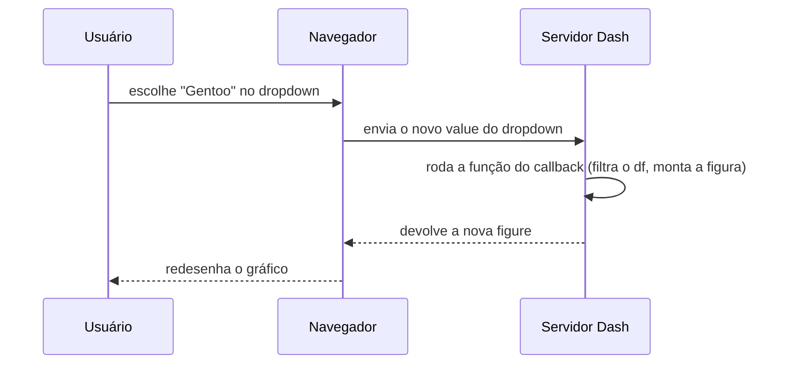

# Dashboards com Dash

## O que é Dash

Dash é um framework da Plotly para criar aplicações web de dados **só com Python**. Você descreve a página com componentes Python, conecta filtros a gráficos com funções, e o Dash gera o HTML, o JavaScript (React por baixo) e o servidor (Flask por baixo). Não precisa saber front-end.

É a escolha natural quando o gráfico já está em Plotly ([Visualização de dados](/labs/data/ciencia-de-dados/06-visualizacao-de-dados/)) e você quer que outras pessoas filtrem e explorem sem abrir um notebook.

Os recursos principais:

- **Componentes** prontos: títulos, textos, gráficos, dropdowns, sliders, abas, tabelas
- **Callbacks**: funções que rodam quando o usuário mexe num componente e atualizam outros
- **Layout** livre com HTML e CSS
- **Atualização periódica** com o componente `dcc.Interval`, para painéis que precisam se renovar sozinhos

Dash x Power BI? O Power BI é mais rápido para montar painéis arrastando campos e tem compartilhamento corporativo pronto ([Power BI](/labs/data/power-bi/01-introducao-e-licencas/)). O Dash ganha quando você precisa de lógica em Python no meio (um modelo de ML, um cálculo customizado) ou quer controle total do resultado.

## Instalação

```bash
pip install dash pandas seaborn
```

O Plotly vem junto como dependência. Os exemplos desta nota foram testados com Dash 4.

### Mudanças recentes que quebram tutoriais antigos

Muito material na internet foi escrito para o Dash 2. Fique atento a:

| Antes                                 | Agora                                | Desde                                          |
| ------------------------------------- | ------------------------------------ | ---------------------------------------------- |
| `app.run_server(debug=True)`          | `app.run(debug=True)`                | Removido no Dash 3.0                           |
| `import dash_html_components as html` | `from dash import html`              | Dash 2.0                                       |
| `import dash_core_components as dcc`  | `from dash import dcc`               | Dash 2.0                                       |
| `dash_table.DataTable`                | Dash AG Grid (`dash_ag_grid.AgGrid`) | Deprecado no Dash 3.3, sai do núcleo no Dash 5 |

O Dash 4 também redesenhou o visual de vários componentes do `dcc` (Dropdown, Slider, Tabs, Input, DatePicker). Se você tinha CSS customizado mirando esses componentes, pode precisar ajustar.

## Estrutura de um app

Todo app Dash tem três partes: criar o app, definir o layout e rodar o servidor.

```python
import plotly.express as px
import seaborn as sns
from dash import Dash, dcc, html

df = sns.load_dataset("penguins").dropna()

app = Dash(__name__)

app.layout = html.Div([
    html.H1("Pinguins de Palmer"),
    html.P("Relação entre nadadeira e massa corporal"),
    dcc.Graph(
        figure=px.scatter(df, x="flipper_length_mm", y="body_mass_g", color="species")
    ),
])

if __name__ == "__main__":
    app.run(debug=True)
```

Salve como `app.py`, rode `python app.py` e abra `http://127.0.0.1:8050` no navegador.

O `debug=True` recarrega a página quando você salva o arquivo e mostra erros num painel no navegador. Ótimo para desenvolver, **nunca** para produção, porque expõe detalhes do código.

## Componentes

Os componentes vêm de dois módulos:

- `dash.html` - um componente para cada tag HTML: `html.Div`, `html.H1`/`H2`/`H3`, `html.P`, `html.Label`, `html.Button`
- `dash.dcc` (Dash Core Components) - componentes interativos

| Componente                       | O que faz                                              |
| -------------------------------- | ------------------------------------------------------ |
| `dcc.Graph`                      | Mostra uma figura Plotly                               |
| `dcc.Dropdown`                   | Lista de opções (uma ou várias com `multi=True`)       |
| `dcc.Slider` / `dcc.RangeSlider` | Escolher um valor ou uma faixa numérica                |
| `dcc.Input`                      | Campo de texto ou número                               |
| `dcc.DatePickerRange`            | Escolher um intervalo de datas                         |
| `dcc.Tabs` / `dcc.Tab`           | Abas                                                   |
| `dcc.Interval`                   | Dispara um callback a cada N milissegundos             |
| `dcc.Store`                      | Guarda dados no navegador para outros callbacks usarem |

Todo componente aceita `id` (para ser usado em callbacks), `style` (CSS como dicionário Python, com nomes em camelCase: `fontFamily`, `maxWidth`) e `className` (classe CSS).

### Tabelas: AG Grid em vez de DataTable

O `dash_table.DataTable` foi o componente de tabela do Dash por anos, mas está **deprecado desde o Dash 3.3** e vai sair do núcleo do Dash na versão 5. O substituto recomendado é o **Dash AG Grid**, com ordenação, filtros, paginação e muito mais:

```bash
pip install "dash[ag-grid]"
```

```python
import dash_ag_grid as dag

dag.AgGrid(
    rowData=df.to_dict("records"),
    columnDefs=[{"field": coluna} for coluna in df.columns],
    defaultColDef={"sortable": True, "filter": True},
    dashGridOptions={"pagination": True, "paginationPageSize": 10},
)
```

## Interatividade com callbacks

Um **callback** é uma função Python decorada com `@app.callback`, que diz:

- **Output**: qual propriedade de qual componente vai ser atualizada
- **Input**: qual propriedade de qual componente, quando mudar, dispara a função



A função recebe os valores dos `Input`, na mesma ordem em que foram declarados, e devolve os valores dos `Output`, também na mesma ordem. Os IDs precisam bater com os `id` do layout.

## App completo: filtros, gráficos e tabela

Juntando tudo: um dropdown de espécies e um slider de faixa de massa filtram dois gráficos, uma tabela e um contador.

```python
import dash_ag_grid as dag
import plotly.express as px
import seaborn as sns
from dash import Dash, Input, Output, dcc, html

df = sns.load_dataset("penguins").dropna()
especies = sorted(df["species"].unique())

app = Dash(__name__)
server = app.server  # usado pelo Gunicorn em produção

app.layout = html.Div(
    [
        html.H1("Pinguins de Palmer"),
        html.Div(
            [
                html.Div(
                    [
                        html.Label("Espécies"),
                        dcc.Dropdown(id="filtro-especie", options=especies,
                                     value=especies, multi=True),
                    ],
                    style={"flex": 1},
                ),
                html.Div(
                    [
                        html.Label("Massa corporal (g)"),
                        dcc.RangeSlider(id="filtro-massa", min=2500, max=6500, step=250,
                                        value=[2500, 6500],
                                        marks={v: str(v) for v in range(2500, 6501, 1000)}),
                    ],
                    style={"flex": 1},
                ),
            ],
            style={"display": "flex", "gap": "24px"},
        ),
        html.H3(id="total"),
        dcc.Tabs(
            [
                dcc.Tab(label="Gráficos", children=[
                    dcc.Graph(id="grafico-dispersao"),
                    dcc.Graph(id="grafico-barras"),
                ]),
                dcc.Tab(label="Tabela", children=[
                    dag.AgGrid(
                        id="tabela",
                        columnDefs=[{"field": c} for c in df.columns],
                        defaultColDef={"sortable": True, "filter": True},
                        dashGridOptions={"pagination": True, "paginationPageSize": 10},
                    ),
                ]),
            ]
        ),
    ],
    style={"maxWidth": "1000px", "margin": "0 auto", "fontFamily": "sans-serif"},
)


@app.callback(
    Output("grafico-dispersao", "figure"),
    Output("grafico-barras", "figure"),
    Output("tabela", "rowData"),
    Output("total", "children"),
    Input("filtro-especie", "value"),
    Input("filtro-massa", "value"),
)
def atualizar(especies_escolhidas, faixa_massa):
    minimo, maximo = faixa_massa
    filtrado = df[
        df["species"].isin(especies_escolhidas or [])
        & df["body_mass_g"].between(minimo, maximo)
    ]

    dispersao = px.scatter(
        filtrado, x="flipper_length_mm", y="body_mass_g", color="species",
        labels={"flipper_length_mm": "Nadadeira (mm)", "body_mass_g": "Massa (g)"},
        template="plotly_white",
    )

    contagem = filtrado.groupby(["island", "species"], as_index=False).size()
    barras = px.bar(
        contagem, x="island", y="size", color="species", barmode="group",
        labels={"size": "Quantidade", "island": "Ilha"}, template="plotly_white",
    )

    return dispersao, barras, filtrado.to_dict("records"), f"{len(filtrado)} pinguins no filtro"


if __name__ == "__main__":
    app.run(debug=True)
```

Detalhes que costumam pegar quem está começando:

- **Não altere o `df` global dentro do callback.** Filtre numa variável nova (`filtrado`). O mesmo processo atende vários usuários ao mesmo tempo, e mudar o global faz um usuário afetar o painel do outro
- **Trate o valor vazio.** Quando o usuário limpa um dropdown com `multi=True`, o valor chega como `None` ou lista vazia; por isso o `especies_escolhidas or []`
- **O callback roda uma vez ao carregar a página**, com os valores iniciais dos componentes. Por isso os gráficos já aparecem preenchidos
- **Carregue os dados uma vez, fora do callback.** Ler um CSV grande a cada clique deixa o painel lento

Na documentação atual você também vai ver `from dash import callback` e o decorador `@callback(...)` sem o `app.` na frente. Funciona igual e é útil quando o app tem várias páginas em arquivos diferentes.

## Deploy

Para outras pessoas acessarem, o app precisa rodar num servidor. O `app.run` usa o servidor de desenvolvimento do Flask, que não é feito para produção. Em produção se usa o **Gunicorn**, apontando para o `server = app.server` que aparece no exemplo:

```bash
pip install gunicorn
gunicorn app:server --workers 2 --bind 0.0.0.0:8050
```

O `app:server` quer dizer "arquivo `app.py`, variável `server`". O Gunicorn roda em Linux e macOS; no Windows, use o `waitress` (`waitress-serve --port=8050 app:server`) para testar localmente.

Opções de onde hospedar:

| Opção                          | Como funciona                                                          |
| ------------------------------ | ---------------------------------------------------------------------- |
| Local / rede interna           | Roda numa máquina da empresa; bom para times pequenos                  |
| Render (e similares)           | Conecta o repositório do GitHub, define o comando do Gunicorn e pronto |
| AWS EC2 (ou outra VM)          | Você configura a máquina, o Gunicorn e um proxy reverso (Nginx)        |
| Docker                         | Empacota o app numa imagem que roda igual em qualquer nuvem            |
| Plotly Cloud / Dash Enterprise | Hospedagem da própria Plotly, com autenticação e recursos corporativos |

Muitos tutoriais antigos indicam o Heroku "grátis", mas o Heroku acabou com os planos gratuitos em novembro de 2022. Hoje ele é pago.

Um `Dockerfile` mínimo para o app:

```dockerfile
FROM python:3.13-slim
WORKDIR /app
COPY requirements.txt .
RUN pip install --no-cache-dir -r requirements.txt
COPY . .
EXPOSE 8050
CMD ["gunicorn", "app:server", "--workers", "2", "--bind", "0.0.0.0:8050"]
```

Docker, imagens e publicação na nuvem são explicados com calma em [Deploy com FastAPI e Docker](/labs/data/ml-em-producao/01-deploy-com-fastapi-e-docker/); o processo para um app Dash é o mesmo.

Antes de publicar, lembre: o Dash não tem login embutido na versão gratuita. Se o painel mostra dado sensível, coloque autenticação na frente (proxy com login, rede interna, ou o pacote `dash-auth` para algo simples).

## Referências

- [Dash tutorial](https://dash.plotly.com/tutorial) - Plotly, en
- [Dash 3.0 migration](https://dash.plotly.com/dash-3-0-migration) - Plotly, en
- [What's new in Dash 4](https://dash.plotly.com/whats-new-in-dash-4) - Plotly, en
- [What's new in Dash 3.3.0](https://plotly.com/blog/whats-new-dash-3-3-0/) - Plotly, en
- [Dash AG Grid](https://dash.plotly.com/dash-ag-grid) - Plotly, en
