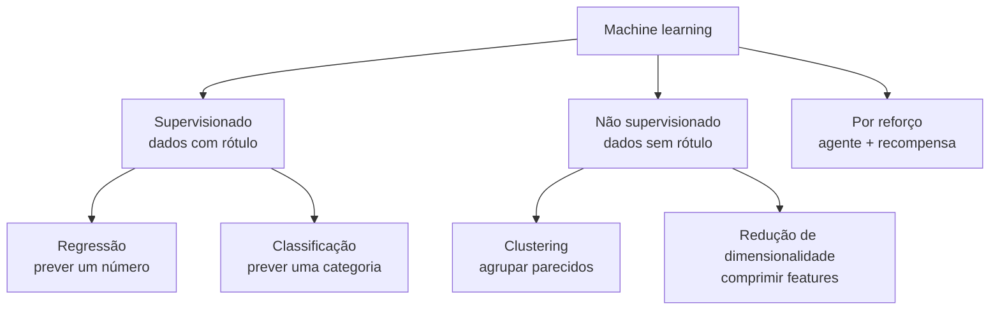
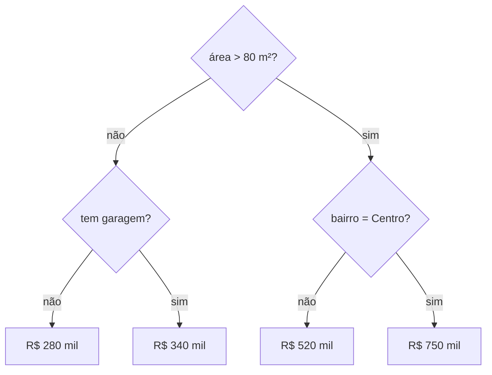
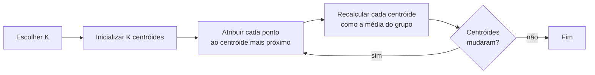

# Algoritmos de Machine Learning

## O que é machine learning

Machine learning (aprendizado de máquina) é o jeito de fazer o computador aprender padrões a partir de exemplos, em vez de programar cada regra na mão. Em vez de escrever "se o e-mail tem a palavra 'promoção' e veio de domínio desconhecido, é spam", você mostra milhares de e-mails já marcados como spam ou não spam e deixa o algoritmo descobrir as regras sozinho.

Esse processo tem duas fases:

- **Treino**: o algoritmo olha os dados de exemplo e ajusta seus parâmetros internos (pesos, coeficientes, regras de divisão) para errar o mínimo possível nesses exemplos.
- **Generalização**: o modelo treinado é usado em dados que ele nunca viu. É aqui que se descobre se ele aprendeu o padrão de verdade ou só decorou os exemplos.

O objetivo real é sempre a generalização. Um modelo que acerta 100% no treino e erra muito em dados novos não serve para nada (isso tem nome, _overfitting_, e é tratado em [Validação, tuning e regularização](/labs/data/machine-learning/03-validacao-tuning-e-regularizacao/)).

Alguns termos que vão aparecer em todas as notas desta seção:

- **Feature** (atributo, variável de entrada): cada coluna usada para prever. Em um dataset de imóveis, área, número de quartos e bairro são features.
- **Target** (alvo, rótulo, `y`): o que queremos prever, como o preço do imóvel.
- **Amostra** (linha, exemplo): um registro, como um imóvel específico.
- **Modelo**: o resultado do treino, a "função" que recebe features e devolve uma previsão.

## Tipos de aprendizado



### Supervisionado

Os dados vêm com a resposta certa. O algoritmo aprende a mapear features para o alvo. Ele se divide em dois problemas:

- **Regressão**: o alvo é um número contínuo. Exemplos: preço de um imóvel, demanda de vendas da próxima semana, tempo de entrega.
- **Classificação**: o alvo é uma categoria. Exemplos: spam ou não spam, cliente vai cancelar ou não (churn), qual dígito aparece numa imagem.

Um jeito rápido de saber qual é o seu caso: pergunte "faz sentido calcular a média da resposta?". Média de preços faz sentido (regressão); média entre "spam" e "não spam" não (classificação).

### Não supervisionado

Não há resposta certa nos dados. O algoritmo procura estrutura por conta própria:

- **Clustering**: agrupa amostras parecidas, como segmentar clientes por comportamento de compra sem saber de antemão quais grupos existem.
- **Redução de dimensionalidade**: resume muitas features em poucas, mantendo o máximo de informação. O PCA (análise de componentes principais) é o exemplo clássico, útil para visualizar dados com dezenas de colunas num gráfico 2D.

### Por reforço

Um agente toma ações num ambiente e recebe recompensas ou punições, aprendendo por tentativa e erro qual sequência de ações dá mais recompensa. É o que está por trás de robôs que aprendem a andar e de programas que jogam xadrez ou Go. Fica fora do escopo deste lab, que foca em supervisionado e não supervisionado.

## Como todo modelo do scikit-learn funciona

O scikit-learn padroniza a interface de quase todos os algoritmos. Depois de aprender um, você usa qualquer outro do mesmo jeito:

```python
modelo = AlgumAlgoritmo(hiperparametro=valor)  # 1. cria
modelo.fit(X_treino, y_treino)                 # 2. treina
previsoes = modelo.predict(X_teste)            # 3. prevê
```

`X` é a tabela de features (linhas = amostras, colunas = features) e `y` é o vetor com o alvo. Em clustering não existe `y`, então o `fit` recebe só `X`.

Antes de treinar, os dados precisam estar limpos, sem nulos e com variáveis categóricas convertidas em números. Esse preparo (imputação, encoding, escalonamento e o cuidado com _data leakage_) está em [Limpeza e pré-processamento](/labs/data/ciencia-de-dados/04-limpeza-e-pre-processamento/). Se ainda não configurou o ambiente, veja [Ambiente Python e bibliotecas](/labs/data/ciencia-de-dados/02-ambiente-python-e-bibliotecas/).

## Algoritmos de regressão

### Regressão linear

A ideia é traçar a reta que melhor passa pelo meio dos pontos. Com uma feature só:

```text
y = θ₀ + θ₁·x
```

- `θ₀` é o **intercepto**: o valor previsto quando `x = 0`.
- `θ₁` é o **coeficiente** (inclinação): quanto `y` muda quando `x` aumenta 1 unidade.

Com várias features, cada uma ganha seu coeficiente: `y = θ₀ + θ₁·x₁ + θ₂·x₂ + ... + θₙ·xₙ`.

Para escolher os valores de `θ`, o algoritmo minimiza uma **função de custo**, uma medida de quanto ele está errando. Na regressão linear a função padrão é o erro quadrático médio (MSE):

```text
J(θ) = (1/m) · Σ (yᵢ - ŷᵢ)²
```

Onde `m` é o número de amostras, `yᵢ` é o valor real e `ŷᵢ` (lê-se "y chapéu") é o valor previsto. Elevar ao quadrado faz erros positivos e negativos não se cancelarem e pune mais os erros grandes.

```python
import numpy as np
from sklearn.linear_model import LinearRegression

# área em m² e preço em milhares de reais (dados de brinquedo)
X = np.array([[50], [70], [90], [110], [130]])
y = np.array([300, 410, 500, 620, 700])

modelo = LinearRegression()
modelo.fit(X, y)

print("intercepto:", round(modelo.intercept_, 2))
print("coeficiente:", round(modelo.coef_[0], 2))
print("previsão para 100 m²:", round(modelo.predict([[100]])[0], 2))
```

É um modelo simples, rápido e fácil de explicar ("cada m² a mais soma X reais"), por isso costuma ser o primeiro a testar. A limitação é assumir relação linear entre features e alvo.

### Regressão polinomial

Quando a relação é curva, dá para criar novas features elevando as originais a potências (`x²`, `x³`) e aplicar regressão linear em cima delas. O modelo continua "linear nos coeficientes", mas desenha uma curva. No scikit-learn isso é um `PolynomialFeatures` seguido de `LinearRegression`. Cuidado com graus altos: uma curva de grau 10 passa por todos os pontos de treino e faz previsões absurdas fora deles.

### Árvore de decisão

Uma árvore de decisão faz uma sequência de perguntas sobre as features ("área > 80 m²?", "bairro = Centro?") e, em cada folha, devolve uma previsão. Na regressão, a folha devolve a média dos valores de treino que caíram ali.



Árvores captam relações não lineares, não precisam de escalonamento e são fáceis de visualizar. O ponto fraco é a tendência a overfitting: deixada solta, a árvore cresce até ter uma folha por amostra. Limitar a profundidade (`max_depth`) ou o mínimo de amostras por folha (`min_samples_leaf`) resolve boa parte disso.

### Random forest

Random forest treina várias árvores, cada uma num pedaço sorteado dos dados (com reposição) e olhando só um subconjunto aleatório de features em cada divisão. A previsão final é a média das árvores (regressão) ou o voto da maioria (classificação). Como cada árvore erra de um jeito diferente, os erros se compensam e o conjunto generaliza bem melhor que uma árvore sozinha. É um dos algoritmos mais usados como ponto de partida para dados tabulares.

### SVR (Support Vector Regression)

A versão de regressão da SVM (explicada mais abaixo). Em vez de minimizar todos os erros, ela tenta encaixar as previsões dentro de uma "faixa de tolerância" de largura `epsilon` e só penaliza os pontos que ficam fora. Com _kernels_ (como o RBF), capta relações não lineares. É sensível à escala das features e fica lenta com datasets grandes (dezenas de milhares de linhas para cima).

## Algoritmos de classificação

### Regressão logística

Apesar do nome, é um algoritmo de **classificação**. Ela calcula uma combinação linear das features (igual à regressão linear) e passa o resultado pela **função sigmoide**, que espreme qualquer número no intervalo entre 0 e 1:

```text
p = 1 / (1 + e^-(θ₀ + θ₁·x))
```

O resultado `p` é interpretado como a probabilidade de a amostra pertencer à classe positiva. Para virar uma decisão, compara-se `p` com um **limiar**: por padrão, `p >= 0.5` vira classe 1.

O limiar de 0.5 é só o padrão, não uma regra. Num detector de fraude, deixar passar uma fraude custa muito mais que bloquear uma compra legítima por engano, então faz sentido baixar o limiar (por exemplo para 0.2) e pegar mais fraudes, aceitando mais alarmes falsos. A escolha do limiar se apoia nas métricas de [Métricas de avaliação](/labs/data/machine-learning/02-metricas-de-avaliacao/), e o scikit-learn tem o `TunedThresholdClassifierCV` para ajustá-lo com validação cruzada.

```python
from sklearn.datasets import load_breast_cancer
from sklearn.linear_model import LogisticRegression
from sklearn.model_selection import train_test_split
from sklearn.pipeline import make_pipeline
from sklearn.preprocessing import StandardScaler

X, y = load_breast_cancer(return_X_y=True)
X_treino, X_teste, y_treino, y_teste = train_test_split(
    X, y, test_size=0.2, stratify=y, random_state=42
)

modelo = make_pipeline(StandardScaler(), LogisticRegression())
modelo.fit(X_treino, y_treino)

probas = modelo.predict_proba(X_teste)[:, 1]   # probabilidade da classe 1
pred_padrao = modelo.predict(X_teste)          # limiar 0.5
pred_limiar_baixo = (probas >= 0.3).astype(int)  # limiar ajustado na mão

print("positivos com limiar 0.5:", pred_padrao.sum())
print("positivos com limiar 0.3:", pred_limiar_baixo.sum())
```

### Árvore de decisão e random forest

Funcionam como na regressão, só que cada folha devolve a classe mais frequente (ou a proporção de cada classe, que vira probabilidade). No scikit-learn: `DecisionTreeClassifier` e `RandomForestClassifier`.

### SVM (Support Vector Machine)

A SVM procura a fronteira que separa as classes com a **maior margem possível**, ou seja, o mais longe possível dos pontos mais próximos de cada lado (os _vetores de suporte_). Com kernels, a fronteira pode ser curva. O hiperparâmetro `C` controla o equilíbrio entre margem larga e acertar todos os pontos de treino. Funciona bem em datasets pequenos e médios com muitas features, mas exige escalonamento.

### KNN (K-Nearest Neighbors)

O KNN não "aprende" nada no treino: ele guarda os dados. Para classificar uma amostra nova, procura as `k` amostras de treino mais próximas e devolve a classe mais comum entre elas. É intuitivo, mas fica lento para prever em datasets grandes e depende muito da escala das features (uma feature em reais domina outra em anos se não forem escalonadas).

### Naive Bayes

Usa o teorema de Bayes para calcular a probabilidade de cada classe, assumindo (de forma "ingênua", daí o nome) que as features são independentes entre si. Essa suposição quase nunca é verdade, mas o algoritmo funciona surpreendentemente bem em texto, como classificação de spam, além de ser muito rápido. Aparece de novo em [Processamento de linguagem natural](/labs/data/machine-learning/06-processamento-de-linguagem-natural/).

### Gradient boosting (XGBoost, LightGBM)

Enquanto a random forest treina árvores independentes e tira a média, o _boosting_ treina árvores **em sequência**: cada árvore nova tenta corrigir os erros das anteriores. O resultado costuma ser o melhor desempenho em dados tabulares, e por isso XGBoost e LightGBM dominam competições do Kaggle. O preço é ter mais hiperparâmetros para ajustar e mais risco de overfitting se a taxa de aprendizado (`learning_rate`) e o número de árvores não forem bem escolhidos.

O scikit-learn tem sua própria implementação rápida, `HistGradientBoostingClassifier` (e `HistGradientBoostingRegressor`), que lida com valores ausentes nativamente. XGBoost e LightGBM são bibliotecas separadas (`pip install xgboost lightgbm`) com interface compatível com o scikit-learn.

### Comparando os classificadores

```python
from sklearn.datasets import load_breast_cancer
from sklearn.ensemble import HistGradientBoostingClassifier, RandomForestClassifier
from sklearn.linear_model import LogisticRegression
from sklearn.model_selection import cross_val_score
from sklearn.naive_bayes import GaussianNB
from sklearn.neighbors import KNeighborsClassifier
from sklearn.pipeline import make_pipeline
from sklearn.preprocessing import StandardScaler
from sklearn.svm import SVC
from sklearn.tree import DecisionTreeClassifier

X, y = load_breast_cancer(return_X_y=True)

modelos = {
    "Regressão logística": make_pipeline(StandardScaler(), LogisticRegression()),
    "Árvore de decisão": DecisionTreeClassifier(max_depth=4, random_state=42),
    "Random forest": RandomForestClassifier(random_state=42),
    "SVM": make_pipeline(StandardScaler(), SVC()),
    "KNN": make_pipeline(StandardScaler(), KNeighborsClassifier(n_neighbors=5)),
    "Naive Bayes": GaussianNB(),
    "Gradient boosting": HistGradientBoostingClassifier(random_state=42),
}

for nome, modelo in modelos.items():
    notas = cross_val_score(modelo, X, y, cv=5, scoring="f1")
    print(f"{nome:22s} F1 médio = {notas.mean():.3f}")
```

Repare que os algoritmos sensíveis à escala (regressão logística, SVM, KNN) estão dentro de um `Pipeline` com `StandardScaler`, assim o escalonamento é ajustado só nos dados de treino de cada rodada. O `cross_val_score` e a métrica F1 são explicados nas próximas notas.

| Algoritmo           | Precisa escalonar? | Interpretável?                    | Bom para                                     |
| ------------------- | ------------------ | --------------------------------- | -------------------------------------------- |
| Regressão logística | sim                | sim (coeficientes)                | linha de base, problemas lineares            |
| Árvore de decisão   | não                | sim (regras)                      | explicar decisões                            |
| Random forest       | não                | parcial (importância de features) | ponto de partida em dados tabulares          |
| SVM                 | sim                | pouco                             | datasets pequenos/médios com muitas features |
| KNN                 | sim                | sim (vizinhos)                    | datasets pequenos, protótipos                |
| Naive Bayes         | não                | sim                               | texto, linha de base rápida                  |
| Gradient boosting   | não                | parcial                           | melhor desempenho em dados tabulares         |

Não existe algoritmo que ganhe sempre. O caminho prático é começar por um modelo simples como linha de base e testar outros com validação cruzada.

## Clustering

Em clustering, a pergunta é "quais amostras se parecem entre si?". Os algoritmos mais comuns:

- **K-Means**: divide os dados em `K` grupos ao redor de centróides. Rápido e o mais usado.
- **Hierárquico (aglomerativo)**: começa com cada ponto sozinho e vai juntando os grupos mais próximos, formando uma árvore (dendrograma). Bom para ver a estrutura em vários níveis.
- **DBSCAN**: agrupa regiões densas e marca pontos isolados como ruído. Encontra grupos de formato irregular e não exige escolher `K`, mas exige escolher o raio de vizinhança (`eps`).
- **Gaussian Mixture Model (GMM)**: assume que os dados vêm de uma mistura de distribuições normais e dá a cada ponto uma probabilidade de pertencer a cada grupo (agrupamento "suave").
- **Mean Shift**: desloca pontos em direção às regiões mais densas; também descobre o número de grupos sozinho, mas é lento em datasets grandes.

### K-Means passo a passo



O K-Means busca minimizar a soma das distâncias ao quadrado entre cada ponto e o centróide do seu grupo, chamada de WCSS (_within-cluster sum of squares_, ou inércia):

```text
WCSS = Σ (para cada grupo i) Σ (para cada ponto x do grupo i) ‖x - μᵢ‖²
```

Onde `μᵢ` é o centróide do grupo `i`. Quanto menor, mais compactos são os grupos.

A inicialização importa: centróides iniciais ruins levam a grupos ruins. Por isso o scikit-learn usa por padrão a inicialização **k-means++**, que espalha os centróides iniciais para longe uns dos outros, e roda o algoritmo mais de uma vez (`n_init`), ficando com o melhor resultado.

### Como escolher K

Dois métodos populares:

- **Método do cotovelo**: treina o K-Means com vários valores de K e plota a WCSS. A WCSS sempre cai quando K aumenta, mas a partir de certo ponto a queda fica pequena. Esse "cotovelo" na curva é um bom candidato.
- **Silhouette score**: mede, para cada ponto, o quanto ele está mais perto do próprio grupo do que do grupo vizinho. Vai de -1 a 1; quanto maior, mais bem separados os grupos. Escolhe-se o K com maior silhouette médio.

```python
from sklearn.cluster import KMeans
from sklearn.datasets import make_blobs
from sklearn.metrics import silhouette_score

X, _ = make_blobs(n_samples=500, centers=4, random_state=42)

for k in range(2, 8):
    km = KMeans(n_clusters=k, n_init="auto", random_state=42)
    rotulos = km.fit_predict(X)
    print(f"K={k}  WCSS={km.inertia_:9.1f}  silhouette={silhouette_score(X, rotulos):.3f}")
```

Como os dados de exemplo foram gerados com 4 grupos, o silhouette deve ser maior em K=4. Com dados reais a resposta raramente é tão limpa, e o conhecimento do negócio pesa na decisão ("faz sentido ter 4 segmentos de clientes ou 7?"). Lembre também que o K-Means usa distância, então escalone as features antes.

## Referências

- [Curso intensivo de machine learning](https://developers.google.com/machine-learning/crash-course?hl=pt-br) - Google for Developers, pt-BR
- [Regressão logística](https://developers.google.com/machine-learning/crash-course/logistic-regression?hl=pt-br) - Google for Developers, pt-BR
- [Clustering](https://developers.google.com/machine-learning/clustering?hl=pt-br) - Google for Developers, pt-BR
- [Supervised learning](https://scikit-learn.org/stable/supervised_learning.html) - scikit-learn, en
- [Clustering](https://scikit-learn.org/stable/modules/clustering.html) - scikit-learn, en
