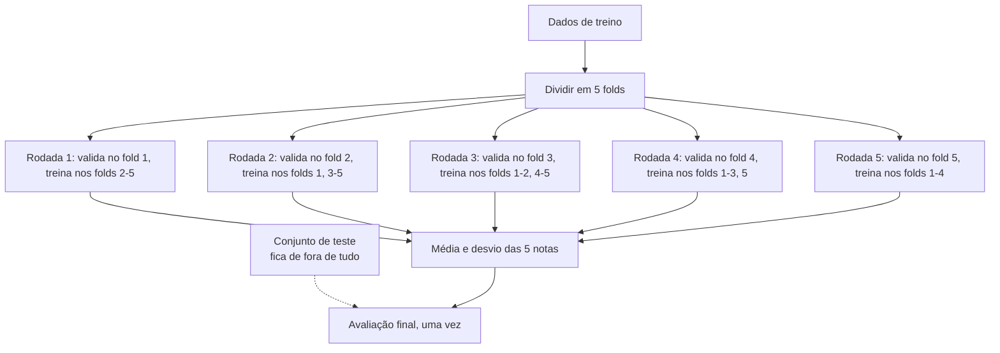

# Validação, Tuning e Regularização

## Overfitting e underfitting

Todo modelo vive entre dois problemas:

- **Underfitting** (subajuste): o modelo é simples demais para o padrão dos dados. Erra muito no treino e no teste. Exemplo: uma reta tentando descrever uma curva.
- **Overfitting** (sobreajuste): o modelo é complexo demais e decora o treino, inclusive o ruído. Acerta quase tudo no treino e erra bastante em dados novos. Exemplo: uma árvore de decisão sem limite de profundidade, com uma folha para cada amostra.

O sinal clássico de overfitting é a distância entre o desempenho no treino e o desempenho em dados novos. Se o F1 no treino é 0.99 e no teste é 0.70, o modelo aprendeu detalhes que não se repetem fora do treino.

Para combater overfitting, as ferramentas são: conseguir mais dados, simplificar o modelo (menos features, árvores mais rasas), aplicar **regularização** e parar o treino mais cedo (_early stopping_). Para combater underfitting: modelo mais flexível, features melhores, menos regularização.

E tudo isso só dá para medir se você separar bem os dados, que é o assunto da próxima seção.

## Separando treino, validação e teste

A regra é simples: **o modelo não pode ser avaliado com os mesmos dados usados para treiná-lo**. Por isso os dados são divididos:

- **Treino** (cerca de 60-70%): onde o modelo aprende os parâmetros.
- **Validação** (cerca de 10-20%): onde você compara modelos e escolhe hiperparâmetros.
- **Teste** (cerca de 10-20%): guardado a sete chaves e usado **uma única vez**, no final, para estimar o desempenho real.

Por que separar validação e teste? Se você testa 50 combinações de hiperparâmetros no conjunto de teste e escolhe a melhor, o número final fica otimista: você ajustou as escolhas para aquele conjunto específico. O teste deixa de ser "dados nunca vistos". Essa separação simples (um treino, uma validação, um teste) é chamada de **holdout**.

```python
from sklearn.datasets import load_breast_cancer
from sklearn.model_selection import train_test_split

X, y = load_breast_cancer(return_X_y=True)

# 1º corte: separa 20% para teste
X_resto, X_teste, y_resto, y_teste = train_test_split(
    X, y, test_size=0.2, stratify=y, random_state=42
)
# 2º corte: dos 80% restantes, 25% viram validação (20% do total)
X_treino, X_val, y_treino, y_val = train_test_split(
    X_resto, y_resto, test_size=0.25, stratify=y_resto, random_state=42
)

print(len(X_treino), len(X_val), len(X_teste))  # aproximadamente 60% / 20% / 20%
```

- `stratify=y` mantém a proporção das classes igual em todos os pedaços. Sempre use em classificação, principalmente com classes desbalanceadas.
- `random_state` fixa o sorteio para o resultado ser reproduzível.

Dois cuidados que causam muito resultado bonito e falso:

- **Data leakage** (vazamento de dados): quando informação do teste vaza para o treino. O caso mais comum é ajustar um `StandardScaler` ou um imputer com a média de **todos** os dados antes de separar. A solução é colocar o pré-processamento dentro de um `Pipeline`, para que ele seja ajustado só no treino. Os detalhes estão em [Limpeza e pré-processamento](/labs/data/ciencia-de-dados/04-limpeza-e-pre-processamento/).
- **Dados com ordem no tempo**: em séries temporais não se embaralha nada, o treino precisa vir antes do teste. Veja [Séries temporais](/labs/data/machine-learning/05-series-temporais/).

## Validação cruzada

O holdout tem um problema: o resultado depende de quais amostras caíram na validação. Com azar, o pedaço de validação é mais fácil ou mais difícil que o normal. A **validação cruzada k-fold** resolve isso usando todos os dados de treino para validar, em rodízio:

1. Divide o conjunto de treino em `k` partes (_folds_) de tamanho parecido.
2. Treina o modelo em `k - 1` folds e avalia no fold que ficou de fora.
3. Repete `k` vezes, mudando o fold de validação a cada rodada.
4. O resultado final é a média (e o desvio padrão) das `k` notas.



Valores comuns são `k = 5` ou `k = 10`. Mais folds dão estimativas mais estáveis, ao custo de treinar o modelo mais vezes.

```python
from sklearn.datasets import load_breast_cancer
from sklearn.linear_model import LogisticRegression
from sklearn.model_selection import StratifiedKFold, cross_val_score
from sklearn.pipeline import make_pipeline
from sklearn.preprocessing import StandardScaler

X, y = load_breast_cancer(return_X_y=True)

modelo = make_pipeline(StandardScaler(), LogisticRegression())
cv = StratifiedKFold(n_splits=5, shuffle=True, random_state=42)

notas = cross_val_score(modelo, X, y, cv=cv, scoring="f1")
print("F1 por fold:", notas.round(3))
print(f"F1 médio: {notas.mean():.3f} ± {notas.std():.3f}")
```

O `StratifiedKFold` mantém a proporção das classes em cada fold. Quando você passa `cv=5` para um classificador, o scikit-learn já usa a versão estratificada (sem embaralhar). O desvio padrão é tão informativo quanto a média: um F1 de 0.90 ± 0.01 é bem mais confiável que 0.90 ± 0.08.

Um ponto que muita gente confunde: **a validação cruzada não reduz overfitting**. Ela é uma ferramenta de _medição_: estima com mais confiança como o modelo vai se sair em dados novos e ajuda a escolher hiperparâmetros sem queimar o conjunto de teste. Quem reduz overfitting são as escolhas que você faz com base nessa medição, como regularizar, simplificar o modelo ou juntar mais dados.

Outros esquemas de validação do scikit-learn:

- `KFold`: o k-fold simples, para regressão.
- `GroupKFold`: quando há várias linhas do mesmo cliente ou paciente, garante que o mesmo grupo não apareça em treino e validação ao mesmo tempo (senão o modelo "reconhece" a pessoa).
- `TimeSeriesSplit`: para dados ordenados no tempo, sempre treina no passado e valida no futuro.

## Curvas de aprendizado

Uma curva de aprendizado (_learning curve_) mostra o desempenho no treino e na validação conforme aumenta o tamanho do conjunto de treino. Ela ajuda a responder "vale a pena coletar mais dados?":

- **Underfitting**: as duas curvas ficam próximas, mas ambas com desempenho ruim. Mais dados não vão ajudar; precisa de um modelo mais flexível ou de features melhores.
- **Overfitting**: o treino fica muito bom e a validação bem pior, com uma distância grande entre as curvas. Se a validação ainda está subindo no final, mais dados provavelmente ajudam.
- **Bom ajuste**: as curvas convergem para um desempenho alto, com pouca distância entre elas.

```python
from sklearn.datasets import load_breast_cancer
from sklearn.model_selection import learning_curve
from sklearn.tree import DecisionTreeClassifier

X, y = load_breast_cancer(return_X_y=True)

tamanhos, notas_treino, notas_val = learning_curve(
    DecisionTreeClassifier(random_state=42),  # árvore sem limite: tende a overfitting
    X, y, cv=5, scoring="accuracy", train_sizes=[0.2, 0.4, 0.6, 0.8, 1.0],
)

for n, t, v in zip(tamanhos, notas_treino.mean(axis=1), notas_val.mean(axis=1)):
    print(f"{n:4d} amostras  treino={t:.3f}  validação={v:.3f}")
```

Com a árvore sem limite de profundidade, o treino fica em 1.000 o tempo todo e a validação bem abaixo disso, o retrato do overfitting. Para desenhar o gráfico, o `LearningCurveDisplay.from_estimator` faz tudo de uma vez.

## Tuning de hiperparâmetros

### Parâmetros x hiperparâmetros

- **Parâmetros** são aprendidos pelo próprio algoritmo durante o `fit`: os coeficientes da regressão linear, as divisões de uma árvore, os pesos de uma rede neural.
- **Hiperparâmetros** são escolhidos por você **antes** do treino e controlam como o algoritmo aprende.

Alguns hiperparâmetros comuns:

| Hiperparâmetro         | Onde aparece                     | O que controla                                                   |
| ---------------------- | -------------------------------- | ---------------------------------------------------------------- |
| `max_depth`            | árvores, random forest, boosting | profundidade máxima das árvores                                  |
| `n_estimators`         | random forest, boosting          | número de árvores                                                |
| `learning_rate`        | gradient boosting, redes neurais | tamanho de cada passo de correção                                |
| `C`                    | regressão logística, SVM         | inverso da força da regularização (C menor = mais regularização) |
| `alpha`                | Ridge, Lasso                     | força da regularização (alpha maior = mais regularização)        |
| `n_clusters`           | K-Means                          | número de grupos                                                 |
| `batch_size`, `epochs` | redes neurais                    | amostras por passo e passadas pelo dataset                       |

Tuning é o processo de procurar a combinação de hiperparâmetros que dá o melhor desempenho na **validação** (de preferência, validação cruzada).

### Técnicas de busca

- **Ajuste manual**: muda um valor, treina, olha o resultado. Bom para ganhar intuição, ruim para ser sistemático.
- **Grid search**: testa **todas** as combinações de uma grade de valores. Com 3 valores de `max_depth` e 4 de `n_estimators` são 12 combinações, cada uma treinada `k` vezes na validação cruzada. Fica caro rápido.
- **Random search**: sorteia um número fixo de combinações dentro de faixas ou distribuições. Na prática costuma achar resultados tão bons quanto o grid com bem menos treinos, porque geralmente só alguns hiperparâmetros importam muito.
- **Successive halving** (`HalvingGridSearchCV`, `HalvingRandomSearchCV`): começa testando muitas combinações com poucos dados e vai eliminando as piores, dando mais recursos às que sobrevivem. Ainda é experimental no scikit-learn e precisa de um import especial.
- **Otimização bayesiana**: usa os resultados anteriores para decidir qual combinação testar em seguida, focando nas regiões promissoras. Não está no scikit-learn; bibliotecas como o [Optuna](https://optuna.org/) fazem isso.

```python
from scipy.stats import randint
from sklearn.datasets import load_breast_cancer
from sklearn.ensemble import RandomForestClassifier
from sklearn.model_selection import GridSearchCV, RandomizedSearchCV, train_test_split

X, y = load_breast_cancer(return_X_y=True)
X_treino, X_teste, y_treino, y_teste = train_test_split(
    X, y, test_size=0.2, stratify=y, random_state=42
)

# Grid search: todas as combinações (3 x 3 = 9, cada uma 5 vezes)
grade = {"max_depth": [3, 5, None], "n_estimators": [100, 200, 300]}
grid = GridSearchCV(
    RandomForestClassifier(random_state=42), grade, cv=5, scoring="f1", n_jobs=-1
)
grid.fit(X_treino, y_treino)
print("grid   - melhores:", grid.best_params_, "F1 CV:", round(grid.best_score_, 3))

# Random search: 10 combinações sorteadas das distribuições
distribuicoes = {
    "max_depth": randint(2, 15),
    "n_estimators": randint(50, 400),
    "min_samples_leaf": randint(1, 10),
}
busca = RandomizedSearchCV(
    RandomForestClassifier(random_state=42), distribuicoes,
    n_iter=10, cv=5, scoring="f1", n_jobs=-1, random_state=42,
)
busca.fit(X_treino, y_treino)
print("random - melhores:", busca.best_params_, "F1 CV:", round(busca.best_score_, 3))

# só agora, uma vez, no teste
print("F1 no teste:", round(busca.score(X_teste, y_teste), 3))
```

Por padrão, depois da busca o `GridSearchCV` e o `RandomizedSearchCV` retreinam o melhor modelo com todo o conjunto de treino (`refit=True`), então o objeto já está pronto para `predict` e `score`.

Quando há pré-processamento, coloque o `Pipeline` inteiro dentro da busca e nomeie os hiperparâmetros com o prefixo da etapa (`"modelo__C"`). Assim o scaler é reajustado dentro de cada fold e não há vazamento.

```python
from sklearn.linear_model import LogisticRegression
from sklearn.pipeline import Pipeline
from sklearn.preprocessing import StandardScaler

pipe = Pipeline([("escala", StandardScaler()), ("modelo", LogisticRegression(max_iter=1000))])
grade = {"modelo__C": [0.01, 0.1, 1, 10]}
busca_pipe = GridSearchCV(pipe, grade, cv=5, scoring="f1").fit(X_treino, y_treino)
print(busca_pipe.best_params_)
```

## Regularização

Regularização é adicionar à função de custo uma penalidade pelo tamanho dos coeficientes. O modelo passa a ter dois objetivos ao mesmo tempo: errar pouco **e** manter os coeficientes pequenos. Coeficientes pequenos deixam o modelo menos sensível a detalhes do treino, o que reduz overfitting.

Tomando a regressão linear como exemplo, com `w` sendo os coeficientes e `α` a força da penalidade:

```text
Ridge (L2):   custo = MSE + α · Σ wⱼ²
Lasso (L1):   custo = MSE + α · Σ |wⱼ|
Elastic Net:  custo = MSE + α · (r · Σ |wⱼ| + (1 - r)/2 · Σ wⱼ²)
```

(As fórmulas exatas do scikit-learn têm constantes de escala um pouco diferentes, mas a ideia é essa.)

- **L2 (Ridge)**: encolhe todos os coeficientes em direção a zero, sem zerar nenhum. Bom quando muitas features contribuem um pouco e quando há features correlacionadas entre si.
- **L1 (Lasso)**: consegue zerar coeficientes, funcionando como seleção automática de features. Bom quando você suspeita que só algumas features importam.
- **Elastic Net**: mistura L1 e L2. O parâmetro `l1_ratio` (o `r` acima) define a proporção. Útil quando há muitas features correlacionadas e você ainda quer alguma seleção.
- **Dropout** (redes neurais): durante o treino, desliga aleatoriamente uma fração dos neurônios a cada passo, forçando a rede a não depender de nenhum neurônio específico.

Como a penalidade depende do tamanho dos coeficientes, e o tamanho depende da escala das features, **escalone os dados antes de regularizar**. Senão, uma feature medida em milhares é penalizada de um jeito e outra medida em decimais de outro.

```python
import numpy as np
from sklearn.datasets import make_regression
from sklearn.linear_model import Lasso, LinearRegression, Ridge
from sklearn.model_selection import cross_val_score
from sklearn.pipeline import make_pipeline
from sklearn.preprocessing import StandardScaler

# 100 amostras, 50 features, só 5 realmente úteis
X, y = make_regression(n_samples=100, n_features=50, n_informative=5,
                       noise=10, random_state=42)

modelos = {
    "Sem regularização": LinearRegression(),
    "Ridge (L2)": Ridge(alpha=1.0),
    "Lasso (L1)": Lasso(alpha=1.0),
}

for nome, reg in modelos.items():
    pipe = make_pipeline(StandardScaler(), reg)
    r2 = cross_val_score(pipe, X, y, cv=5, scoring="r2").mean()
    pipe.fit(X, y)
    zerados = np.sum(np.abs(pipe[-1].coef_) < 1e-6)
    print(f"{nome:18s} R² CV={r2:.3f}  coeficientes zerados={zerados}/50")
```

O Lasso deve zerar boa parte das 45 features inúteis, enquanto Ridge e a regressão sem penalidade mantêm todas. O valor de `alpha` é um hiperparâmetro como qualquer outro: escolha com validação cruzada (o scikit-learn tem `RidgeCV`, `LassoCV` e `ElasticNetCV`, que fazem isso direto).

Na regressão logística e na SVM do scikit-learn a regularização já vem ligada (L2 por padrão) e é controlada por `C`, que funciona ao contrário do `alpha`: **C menor significa regularização mais forte**.

## Referências

- [Overfitting](https://developers.google.com/machine-learning/crash-course/overfitting?hl=pt-br) - Google for Developers, pt-BR
- [Overfitting: regularização L2](https://developers.google.com/machine-learning/crash-course/overfitting/regularization?hl=pt-br) - Google for Developers, pt-BR
- [Cross-validation: evaluating estimator performance](https://scikit-learn.org/stable/modules/cross_validation.html) - scikit-learn, en
- [Tuning the hyper-parameters of an estimator](https://scikit-learn.org/stable/modules/grid_search.html) - scikit-learn, en
- [Common pitfalls and recommended practices](https://scikit-learn.org/stable/common_pitfalls.html) - scikit-learn, en
