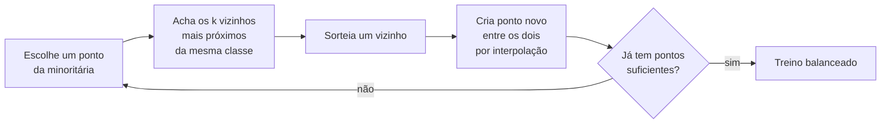
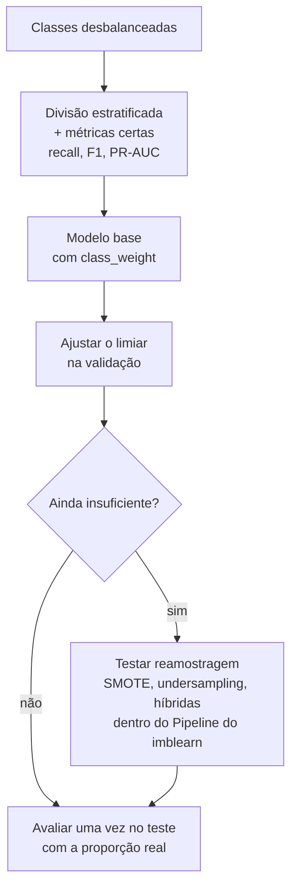

# Dados Desbalanceados

## O que são dados desbalanceados

Um dataset é desbalanceado quando uma classe aparece muito mais que a outra. A classe frequente é a **majoritária** e a rara é a **minoritária**, que quase sempre é justamente a que interessa:

- **Fraude em cartão**: bem menos de 1% das transações.
- **Diagnóstico de doenças raras**: poucos pacientes positivos entre milhares de exames.
- **Churn**: a maioria dos clientes fica, só uma parte cancela no mês.
- **Spam e detecção de falhas em máquinas**: o "normal" domina.

Pense num exemplo com 95% de transações legítimas e 5% de fraudes. Não existe um número mágico a partir do qual o dataset "vira" desbalanceado; o problema aparece quando a classe rara tem tão poucos exemplos que o modelo aprende a ignorá-la.

## Por que isso é um problema

Durante o treino, a maioria dos algoritmos tenta minimizar o erro total. Se 95% dos exemplos são "legítimo", o caminho mais fácil para errar pouco é dizer "legítimo" quase sempre. O modelo fica **enviesado para a classe majoritária** e vê tão poucas fraudes que não aprende o que as caracteriza.

O pior é que a métrica mais conhecida esconde o problema. Um "modelo" que responde "legítimo" para tudo tem **95% de accuracy** e recall zero para fraude: não pega nenhuma.

```python
import numpy as np
from sklearn.dummy import DummyClassifier
from sklearn.metrics import accuracy_score, recall_score

y = np.array([0] * 950 + [1] * 50)  # 95% legítimas, 5% fraudes
X = np.zeros((len(y), 1))           # features irrelevantes para o exemplo

chute = DummyClassifier(strategy="most_frequent").fit(X, y)
y_pred = chute.predict(X)

print("accuracy:", accuracy_score(y, y_pred))          # 0.95
print("recall da fraude:", recall_score(y, y_pred))    # 0.0
```

## Métricas adequadas

Com classes desbalanceadas, troque a accuracy por métricas que olham para a classe minoritária. As fórmulas estão em [Métricas de avaliação](/labs/data/machine-learning/02-metricas-de-avaliacao/); aqui vai o que muda na prática:

- **Matriz de confusão**: sempre olhe. Ela mostra quantas fraudes foram pegas e quantas passaram.
- **Precision e recall da classe minoritária**: recall diz quantas fraudes o modelo encontrou; precision diz quantos alarmes eram fraude mesmo.
- **F1-score**: equilíbrio entre os dois, calculado para a classe positiva (ou a média _macro_, que dá o mesmo peso às duas classes).
- **ROC-AUC**: avalia a ordenação em todos os limiares, mas pode parecer otimista quando os negativos são muitos, porque um número grande de falsos positivos ainda vira um FPR pequeno.
- **PR-AUC** (área sob a curva precision-recall; no scikit-learn, `average_precision_score`): foca só na classe positiva e costuma ser a métrica mais honesta para eventos raros. A linha de base de um modelo aleatório é a proporção de positivos (0.05 no exemplo), não 0.5.

Outra alavanca simples, e muitas vezes esquecida: o **limiar de decisão**. Um modelo pode ordenar bem as transações (AUC alta) e ainda assim pegar poucas fraudes com o limiar padrão de 0.5. Ajustar o limiar com dados de validação, ou com o `TunedThresholdClassifierCV` do scikit-learn, às vezes resolve sem mexer nos dados.

## Divisão estratificada

Antes de qualquer técnica de balanceamento, garanta que treino, validação e teste tenham a mesma proporção de classes. Com 5% de fraudes, um sorteio sem cuidado pode deixar o teste com 2% ou 8%, e as métricas ficam instáveis.

- Na divisão: `train_test_split(..., stratify=y)`.
- Na validação cruzada: `StratifiedKFold` (é o padrão quando você passa `cv=5` para um classificador).

```python
from sklearn.datasets import make_classification
from sklearn.model_selection import StratifiedKFold, train_test_split

X, y = make_classification(n_samples=5000, weights=[0.95, 0.05], random_state=42)

X_treino, X_teste, y_treino, y_teste = train_test_split(
    X, y, test_size=0.2, stratify=y, random_state=42
)
print("proporção de positivos - treino:", y_treino.mean().round(3),
      "teste:", y_teste.mean().round(3))

cv = StratifiedKFold(n_splits=5, shuffle=True, random_state=42)
```

## Técnicas no nível dos dados (reamostragem)

A ideia é mudar a proporção das classes **no conjunto de treino** antes de ajustar o modelo. A biblioteca padrão para isso é a [imbalanced-learn](https://imbalanced-learn.org/) (`pip install imbalanced-learn`, importada como `imblearn`), que segue a mesma interface do scikit-learn.

### Undersampling

Remove exemplos da classe majoritária.

- **Aleatório** (`RandomUnderSampler`): sorteia e descarta exemplos da majoritária até chegar na proporção desejada. Rápido, mas joga informação fora; com poucos dados, pode piorar o modelo.
- **Tomek Links** (`TomekLinks`): um _Tomek link_ é um par de pontos de classes diferentes que são vizinhos mais próximos um do outro. Esses pares ficam na fronteira entre as classes, e o método remove o ponto da majoritária, "limpando" a fronteira. Remove poucos exemplos, então é mais uma limpeza do que um balanceamento.
- **ENN, Edited Nearest Neighbours** (`EditedNearestNeighbours`): remove exemplos da majoritária cuja classe discorda da maioria dos seus vizinhos mais próximos, ou seja, os que parecem ruído ou estão "invadindo" a região da outra classe.

### Oversampling

Cria exemplos da classe minoritária.

- **Aleatório** (`RandomOverSampler`): duplica exemplos da minoritária. Simples, mas o modelo vê os mesmos pontos repetidos e pode decorá-los.
- **SMOTE** (`SMOTE`): cria exemplos **sintéticos** em vez de copiar, como explicado abaixo.
- **ADASYN** (`ADASYN`): parecido com o SMOTE, mas gera mais exemplos sintéticos nas regiões onde a minoritária é mais difícil de aprender (onde está cercada de pontos da majoritária).

### Como o SMOTE funciona

SMOTE significa _Synthetic Minority Over-sampling Technique_. Para cada exemplo novo:

1. Escolhe um exemplo da classe minoritária.
2. Encontra seus `k` vizinhos mais próximos que também são da minoritária (o padrão é `k = 5`).
3. Sorteia um desses vizinhos.
4. Cria um ponto novo em algum lugar da linha reta entre os dois: `novo = x + λ · (vizinho - x)`, com `λ` sorteado entre 0 e 1.



Como usa distância, o SMOTE é sensível à escala das features, então escalone antes. Ele também não lida diretamente com variáveis categóricas (interpolar entre "SP" e "RJ" não faz sentido); para isso existem as variantes `SMOTENC` (mistura numéricas e categóricas) e `SMOTEN` (só categóricas).

### Técnicas híbridas

Combinam oversampling e limpeza: primeiro o SMOTE cria exemplos sintéticos, depois um método de undersampling remove os pontos ambíguos da fronteira (que podem incluir sintéticos mal posicionados).

- `SMOTETomek`: SMOTE seguido de Tomek Links.
- `SMOTEENN`: SMOTE seguido de ENN, que costuma limpar mais.

### Regra de ouro: reamostrar só o treino

Reamostragem é uma etapa de **treino**. Ela nunca deve ser aplicada antes do `train_test_split`, nem no conjunto de teste, nem nos folds de validação.

- Se você aplica SMOTE antes de separar, pontos sintéticos criados a partir de exemplos do teste vão parar no treino (e vice-versa). O modelo vê "quase cópias" das respostas do teste, e as métricas ficam otimistas demais. É um caso clássico de _data leakage_ (veja [Limpeza e pré-processamento](/labs/data/ciencia-de-dados/04-limpeza-e-pre-processamento/)).
- Se você reamostra o teste, ele deixa de representar a proporção real que o modelo vai encontrar em produção, e precision e PR-AUC perdem o sentido.

A forma segura é usar o **`Pipeline` da imbalanced-learn** (`imblearn.pipeline.Pipeline` ou `make_pipeline`). Ele se comporta como o do scikit-learn, com uma diferença: as etapas de reamostragem só rodam durante o `fit`. No `predict` e no `score`, elas são puladas. Assim, dentro de um `cross_val_score` ou `GridSearchCV`, cada fold de treino é reamostrado e o fold de validação fica intacto.

```python
from imblearn.over_sampling import SMOTE
from imblearn.pipeline import make_pipeline
from sklearn.datasets import make_classification
from sklearn.linear_model import LogisticRegression
from sklearn.model_selection import StratifiedKFold, cross_val_score
from sklearn.preprocessing import StandardScaler

X, y = make_classification(n_samples=5000, n_features=10, weights=[0.95, 0.05],
                           random_state=42)
cv = StratifiedKFold(n_splits=5, shuffle=True, random_state=42)

sem_balanceamento = make_pipeline(StandardScaler(), LogisticRegression())
com_smote = make_pipeline(StandardScaler(), SMOTE(random_state=42), LogisticRegression())

for nome, pipe in [("sem balanceamento", sem_balanceamento), ("com SMOTE", com_smote)]:
    recall = cross_val_score(pipe, X, y, cv=cv, scoring="recall").mean()
    pr_auc = cross_val_score(pipe, X, y, cv=cv, scoring="average_precision").mean()
    print(f"{nome:18s} recall={recall:.3f}  PR-AUC={pr_auc:.3f}")
```

Repare que o `make_pipeline` vem de `imblearn.pipeline`, não de `sklearn.pipeline`. O pipeline do scikit-learn não aceita etapas de reamostragem.

Espere ver o recall subir com o SMOTE, normalmente com alguma queda de precision: o modelo passa a dizer "fraude" mais vezes. A PR-AUC, que não depende de limiar, pode mudar pouco. Isso é comum: reamostrar muitas vezes tem efeito parecido com mover o limiar, e nem sempre melhora a capacidade do modelo de ordenar os casos.

## Técnicas no nível do algoritmo

Em vez de mexer nos dados, dá para mudar como o algoritmo pesa os erros.

### Class weighting

Muitos modelos do scikit-learn aceitam o parâmetro `class_weight`. Com `class_weight="balanced"`, cada classe recebe um peso inversamente proporcional à sua frequência (`n_amostras / (n_classes · n_amostras_da_classe)`). Errar um exemplo da minoritária passa a "doer" mais no treino. Não cria nem remove dados, então não tem risco de vazamento, e costuma ser a primeira coisa a testar.

```python
from sklearn.ensemble import RandomForestClassifier
from sklearn.linear_model import LogisticRegression

LogisticRegression(class_weight="balanced")
RandomForestClassifier(class_weight="balanced", random_state=42)
LogisticRegression(class_weight={0: 1, 1: 10})  # pesos definidos à mão
```

### Cost-sensitive learning

É a generalização do class weighting: definir explicitamente quanto custa cada tipo de erro. Se deixar passar uma fraude custa, em média, R$ 2.000 e bloquear uma compra legítima custa R$ 20 em atendimento e atrito com o cliente, esses custos guiam os pesos e, principalmente, a escolha do limiar. Pensar em custo de negócio costuma levar a decisões melhores do que buscar "classes 50/50".

### Ensembles para dados desbalanceados

- **Balanced Random Forest** (`BalancedRandomForestClassifier`, da imbalanced-learn): cada árvore é treinada numa amostra com undersampling da majoritária, então todas as árvores veem as classes equilibradas.
- **EasyEnsemble** (`EasyEnsembleClassifier`, da imbalanced-learn): treina vários modelos AdaBoost, cada um com um undersampling diferente da majoritária, e junta as previsões. Compensa a informação perdida no undersampling usando subconjuntos diferentes.
- **AdaBoost com pesos**: o boosting já aumenta o peso dos exemplos que o modelo erra a cada rodada, o que tende a dar mais atenção à minoritária. Dá para combinar com `sample_weight` no `fit`.
- **XGBoost com `scale_pos_weight`**: multiplica o peso dos exemplos positivos. Um valor de partida comum é `negativos / positivos` (19 no exemplo 95/5). O LightGBM tem parâmetros equivalentes (`scale_pos_weight` ou `is_unbalance`).

```python
from imblearn.ensemble import BalancedRandomForestClassifier
from sklearn.datasets import make_classification
from sklearn.model_selection import StratifiedKFold, cross_val_score

X, y = make_classification(n_samples=5000, n_features=10, weights=[0.95, 0.05],
                           random_state=42)
cv = StratifiedKFold(n_splits=5, shuffle=True, random_state=42)

brf = BalancedRandomForestClassifier(
    n_estimators=200, sampling_strategy="all", replacement=True,
    bootstrap=False, random_state=42,
)
print("PR-AUC:", cross_val_score(brf, X, y, cv=cv, scoring="average_precision").mean().round(3))
```

Os parâmetros `sampling_strategy="all"`, `replacement=True` e `bootstrap=False` reproduzem o comportamento do artigo original do Balanced Random Forest e evitam avisos nas versões recentes da imbalanced-learn.

## Qual caminho seguir



Comece pelo que é barato e não distorce os dados (métricas certas, `class_weight`, limiar) e só depois teste reamostragem, sempre comparando com validação cruzada estratificada. Nenhuma técnica ganha sempre; o que funciona num dataset de fraude pode não funcionar num de churn.

## Referências

- [Conjuntos de dados desequilibrados](https://developers.google.com/machine-learning/crash-course/overfitting/imbalanced-datasets?hl=pt-br) - Google for Developers, pt-BR
- [imbalanced-learn User Guide](https://imbalanced-learn.org/stable/user_guide.html) - imbalanced-learn, en
- [Common pitfalls and recommended practices (imbalanced-learn)](https://imbalanced-learn.org/stable/common_pitfalls.html) - imbalanced-learn, en
- [Metrics and scoring](https://scikit-learn.org/stable/modules/model_evaluation.html) - scikit-learn, en
