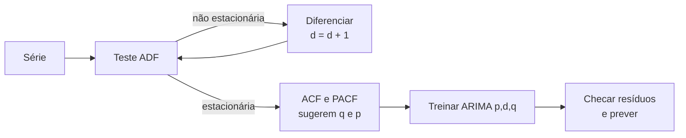
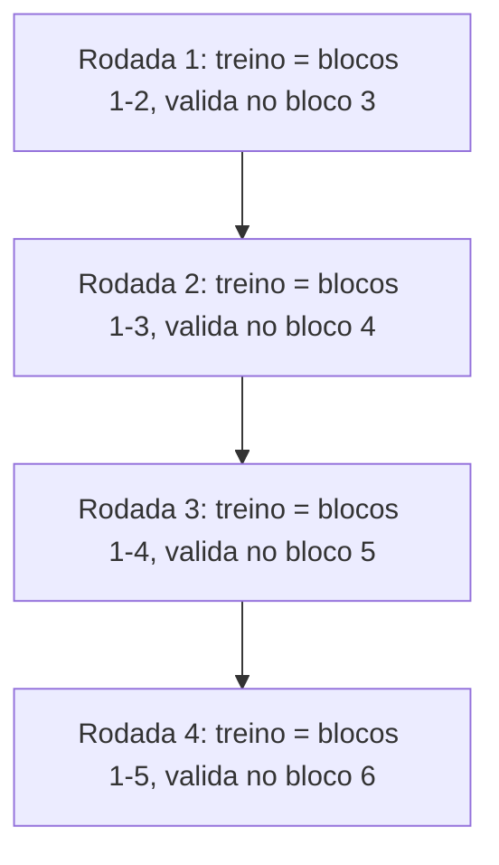

# Séries Temporais e Previsão

## O que é uma série temporal

Uma série temporal é uma sequência de observações registradas em intervalos de tempo regulares: vendas diárias de uma loja, temperatura por hora, número de passageiros por mês, cotação de uma moeda a cada minuto.

A diferença para os datasets das notas anteriores é que **a ordem importa**. Numa tabela de imóveis, embaralhar as linhas não muda nada. Numa série temporal, o valor de hoje depende dos valores de ontem e da semana passada, e embaralhar destrói justamente a informação que se quer usar para prever.

Por isso as séries temporais têm ferramentas, modelos e formas de validação próprias.

## Componentes de uma série

Quase toda série pode ser vista como uma combinação de quatro componentes:

- **Tendência**: a direção de longo prazo. As vendas de um e-commerce que crescem ano após ano.
- **Sazonalidade**: padrões que se repetem em intervalos **fixos e conhecidos**. Sorvete vende mais no verão, o tráfego de um site cai nos fins de semana, o varejo explode em dezembro.
- **Ciclo**: subidas e descidas sem período fixo, geralmente longas e ligadas a fatores econômicos (expansão e recessão). A diferença para a sazonalidade é justamente a falta de um calendário previsível.
- **Ruído** (resíduo): a variação aleatória que sobra depois de tirar os outros componentes.

O statsmodels separa esses componentes com `seasonal_decompose` (ou com o `STL`, mais flexível):

```python
import numpy as np
import pandas as pd
from statsmodels.tsa.seasonal import seasonal_decompose

# série mensal sintética: tendência + sazonalidade anual + ruído
rng = np.random.default_rng(42)
datas = pd.date_range("2018-01-01", periods=84, freq="MS")  # MS = início do mês
tendencia = np.linspace(100, 200, 84)
sazonalidade = 15 * np.sin(2 * np.pi * np.arange(84) / 12)
ruido = rng.normal(0, 5, 84)
serie = pd.Series(tendencia + sazonalidade + ruido, index=datas, name="vendas")

decomposicao = seasonal_decompose(serie, model="additive", period=12)
print(decomposicao.seasonal.head(12).round(1))  # o padrão que se repete a cada 12 meses
# decomposicao.plot() desenha os quatro painéis (precisa do matplotlib)
```

O modelo **aditivo** (`série = tendência + sazonalidade + ruído`) serve quando a amplitude da sazonalidade é constante. Quando a sazonalidade cresce junto com a série (o pico de dezembro fica maior a cada ano), o modelo **multiplicativo** (`model="multiplicative"`) é mais adequado.

## Tipos de série

- **Univariada**: uma única variável ao longo do tempo, como as vendas mensais. É o foco desta nota.
- **Multivariada**: várias variáveis medidas juntas, como vendas, preço e gasto com marketing. Uma pode ajudar a prever a outra (as variáveis auxiliares são chamadas de _exógenas_).
- **Estacionária**: média, variância e correlação com o passado não mudam ao longo do tempo.
- **Não estacionária**: alguma dessas propriedades muda, como uma série com tendência (a média sobe) ou com variância crescente.

## Estacionariedade

Muitos modelos clássicos, como o ARIMA, assumem que a série é estacionária (ou que pode ficar estacionária com alguma transformação). A intuição: se o comportamento estatístico da série muda o tempo todo, o passado não serve para prever o futuro.

### Como verificar

- **Inspeção visual**: plote a série. Tendência clara ou sazonalidade forte são sinais de não estacionariedade.
- **Média e desvio móveis**: calcule a média e o desvio padrão numa janela deslizante (`serie.rolling(12).mean()` e `.std()`). Se eles mudam bastante ao longo do tempo, a série não é estacionária.
- **Teste ADF (Augmented Dickey-Fuller)**: teste estatístico em que a hipótese nula é "a série **não** é estacionária" (tem raiz unitária). Um p-valor baixo (abaixo de 0.05, por convenção) é evidência para rejeitar a hipótese nula e tratar a série como estacionária.

```python
from statsmodels.tsa.stattools import adfuller

# continua do exemplo anterior
estatistica, p_valor, *_ = adfuller(serie)
print(f"série original:   p-valor = {p_valor:.3f}")

# diferenciação: troca cada valor pela variação em relação ao anterior
diferenciada = serie.diff().dropna()
estatistica, p_valor, *_ = adfuller(diferenciada)
print(f"após 1 diferença: p-valor = {p_valor:.3f}")
```

A série com tendência tende a dar p-valor alto; a diferenciada, p-valor baixo. Testes estatísticos ajudam, mas não substituem olhar o gráfico: o ADF pode se confundir com sazonalidade forte ou com séries curtas.

### Como tornar estacionária

- **Diferenciação**: `yₜ - yₜ₋₁` remove tendência. Às vezes é preciso diferenciar duas vezes.
- **Diferenciação sazonal**: `yₜ - yₜ₋₁₂` (em dados mensais) remove a sazonalidade anual.
- **Transformações** como logaritmo estabilizam variância que cresce com o nível da série.

## Modelos de previsão

### Modelos de base

Antes de qualquer modelo sofisticado, calcule uma linha de base. Se o seu ARIMA não ganha delas, algo está errado.

- **Naive**: a previsão para amanhã é o valor de hoje.
- **Naive sazonal**: a previsão para janeiro é o valor do último janeiro.
- **Média móvel**: a previsão é a média dos últimos `n` valores.

### Autorregressivo (AR)

O valor atual é uma combinação linear dos `p` valores anteriores. Um AR(2) prevê `yₜ` a partir de `yₜ₋₁` e `yₜ₋₂`. É uma regressão linear em que as features são o próprio passado da série (os _lags_).

### ARIMA(p, d, q)

ARIMA junta três ideias, uma para cada letra:

- **AR (p)**: quantos valores passados da série entram no modelo.
- **I (d)**: quantas vezes a série é diferenciada para ficar estacionária (o "I" vem de _integrated_).
- **MA (q)**: quantos **erros de previsão** passados entram no modelo (_moving average_, que aqui não é a média móvel simples da seção anterior, apesar do nome).

É comum ver a notação "ARIMA = AR(p) + I(d) + MA(q)", mas ela é só um jeito de lembrar das partes, não uma soma literal de três modelos. O ARIMA é um modelo único em que a diferenciação é aplicada à série e os termos AR e MA são estimados juntos sobre a série diferenciada.

O fluxo típico para montar um ARIMA:



- **ACF** (função de autocorrelação): correlação da série com ela mesma deslocada em 1, 2, 3... passos. Um corte brusco depois do lag `q` sugere um termo MA(q).
- **PACF** (autocorrelação parcial): a correlação com cada lag descontando o efeito dos lags intermediários. Um corte brusco depois do lag `p` sugere um termo AR(p).

No statsmodels, `plot_acf` e `plot_pacf` (em `statsmodels.graphics.tsaplots`) desenham esses gráficos. Na prática, muita gente testa algumas combinações de `(p, d, q)` e escolhe a de menor AIC (critério de informação que equilibra ajuste e complexidade).

```python
from statsmodels.tsa.arima.model import ARIMA

# continua do exemplo anterior: separa os últimos 12 meses para teste
treino, teste = serie[:-12], serie[-12:]

modelo = ARIMA(treino, order=(1, 1, 1)).fit()
previsao = modelo.forecast(steps=12)

print("AIC:", round(modelo.aic, 1))
print(previsao.head(3).round(1))
```

### SARIMA(p, d, q)(P, D, Q, s)

O ARIMA não lida bem com sazonalidade. O SARIMA acrescenta uma segunda parte, sazonal, com a mesma lógica:

- `(p, d, q)`: a parte não sazonal, como no ARIMA.
- `(P, D, Q)`: termos AR, diferenciação e MA aplicados no **lag sazonal** (por exemplo, o mesmo mês do ano anterior).
- `s`: o tamanho do período sazonal. 12 para dados mensais com padrão anual, 7 para dados diários com padrão semanal, 4 para trimestrais.

```python
from statsmodels.tsa.statespace.sarimax import SARIMAX

sarima = SARIMAX(treino, order=(1, 1, 1), seasonal_order=(1, 1, 1, 12)).fit(disp=False)
previsao_sarima = sarima.forecast(steps=12)
```

O `SARIMAX` do statsmodels também aceita variáveis exógenas (o "X" do nome), como feriados ou investimento em marketing. O próprio `ARIMA` do statsmodels aceita `seasonal_order`, então dá para usar qualquer um dos dois.

### Suavização exponencial

A ideia é fazer uma média ponderada do passado em que as observações recentes pesam mais que as antigas, e o peso cai exponencialmente. A versão simples é:

```text
Sₜ = α · Yₜ + (1 - α) · Sₜ₋₁
```

Onde `Yₜ` é o valor observado, `Sₜ` é o valor suavizado (e a previsão para o próximo passo) e `α`, entre 0 e 1, controla a memória: `α` perto de 1 reage rápido às mudanças, `α` perto de 0 suaviza bastante.

Há três variações, cada uma acrescentando um componente:

- **Simples**: só o nível. Serve para séries sem tendência nem sazonalidade.
- **Holt**: nível + tendência.
- **Holt-Winters**: nível + tendência + sazonalidade.

```python
from statsmodels.tsa.holtwinters import ExponentialSmoothing

hw = ExponentialSmoothing(
    treino, trend="add", seasonal="add", seasonal_periods=12
).fit()
previsao_hw = hw.forecast(12)
```

### Prophet e LSTM

- **Prophet**: biblioteca de código aberto da **Meta** (antigo Facebook) que modela a série como tendência + sazonalidades (anual, semanal, diária) + efeito de feriados. Lida bem com dados faltantes e mudanças de tendência, e exige pouco ajuste manual. Recebe um DataFrame com as colunas `ds` (data) e `y` (valor). Instalação: `pip install prophet`.
- **LSTM** (_Long Short-Term Memory_): tipo de rede neural recorrente que aprende dependências longas em sequências. Pode capturar padrões complexos, mas precisa de bastante dados, é mais difícil de ajustar e, em muitas séries de negócio, não ganha de um SARIMA ou Holt-Winters bem configurado.

## Métricas de previsão

As métricas são as mesmas da regressão (MAE, MSE, RMSE), explicadas em [Métricas de avaliação](/labs/data/machine-learning/02-metricas-de-avaliacao/), mais uma muito usada em negócio:

```text
MAPE = (100% / n) · Σ |(yᵢ - ŷᵢ) / yᵢ|
```

O **MAPE** (erro percentual absoluto médio) é fácil de comunicar: "a previsão erra, em média, 8%". Mas tem pegadinhas:

- **É indefinido quando algum valor real é zero** (divisão por zero), e explode quando os valores reais são próximos de zero. Séries de vendas de produtos com dias sem venda são o caso típico. A função `mean_absolute_percentage_error` do scikit-learn não dá erro nesse caso: ela troca o zero do denominador por um número minúsculo e devolve um valor gigantesco, o que pode passar despercebido.
- Pune mais as previsões acima do valor real do que as abaixo, por causa do denominador.

Quando há zeros, prefira MAE, RMSE ou métricas como o MASE (erro escalado pelo erro do modelo naive), descrito no livro _Forecasting: Principles and Practice_.

```python
from sklearn.metrics import mean_absolute_error, mean_absolute_percentage_error, root_mean_squared_error

# continua do exemplo anterior
for nome, prev in [("ARIMA", previsao), ("SARIMA", previsao_sarima), ("Holt-Winters", previsao_hw)]:
    mae = mean_absolute_error(teste, prev)
    rmse = root_mean_squared_error(teste, prev)
    mape = mean_absolute_percentage_error(teste, prev) * 100
    print(f"{nome:12s} MAE={mae:6.2f}  RMSE={rmse:6.2f}  MAPE={mape:5.2f}%")
```

## Validação em séries temporais

Aqui está o erro mais comum de quem vem de outros problemas de ML: usar `train_test_split` com embaralhamento ou um `KFold` normal. Isso coloca dados do futuro no treino e dados do passado no teste. O modelo "espia" o futuro, e as métricas ficam boas demais para ser verdade. É um caso de _data leakage_.

As regras são:

- **Não embaralhe.** O teste sempre vem depois do treino no tempo, como no `serie[:-12]` e `serie[-12:]` acima.
- **Para validação cruzada, use `TimeSeriesSplit`** ou janelas deslizantes, que sempre treinam no passado e validam no futuro.
- **Cuidado com features que olham para frente.** Uma média móvel centralizada ou uma feature calculada com o mês inteiro, usada para prever o próprio mês, vaza informação. Ao criar lags e médias móveis com pandas, use só valores passados (`shift(1)` antes do `rolling`).

O `TimeSeriesSplit` divide a série em blocos consecutivos. Em cada rodada, o treino é tudo o que vem antes do bloco de validação, então ele cresce a cada rodada (janela expansível):



Com o parâmetro `max_train_size`, o treino passa a ter tamanho fixo e "desliza" para frente (janela deslizante), útil quando dados muito antigos já não representam o presente. O parâmetro `gap` deixa um intervalo entre treino e validação, para simular a situação real em que o dado mais recente ainda não está disponível no momento da previsão.

```python
import numpy as np
from sklearn.model_selection import TimeSeriesSplit

tscv = TimeSeriesSplit(n_splits=4, test_size=6)
indices = np.arange(36)  # 36 meses

for i, (idx_treino, idx_val) in enumerate(tscv.split(indices), start=1):
    print(f"rodada {i}: treino meses {idx_treino[0]}-{idx_treino[-1]}, "
          f"validação meses {idx_val[0]}-{idx_val[-1]}")
```

O `TimeSeriesSplit` funciona com qualquer função de validação do scikit-learn (`cross_val_score`, `GridSearchCV`) quando você monta o problema como regressão com features de lag. Para modelos do statsmodels, a forma equivalente é um laço manual: treina até o ponto `t`, prevê os próximos passos, avança `t` e repete (validação _walk-forward_).

## Referências

- [Forecasting: Principles and Practice (3ª ed.)](https://otexts.com/fpp3/) - Rob J. Hyndman e George Athanasopoulos, en
- [Time Series Analysis (tsa)](https://www.statsmodels.org/stable/tsa.html) - statsmodels, en
- [TimeSeriesSplit](https://scikit-learn.org/stable/modules/generated/sklearn.model_selection.TimeSeriesSplit.html) - scikit-learn, en
- [Prophet](https://facebook.github.io/prophet/) - Meta, en
