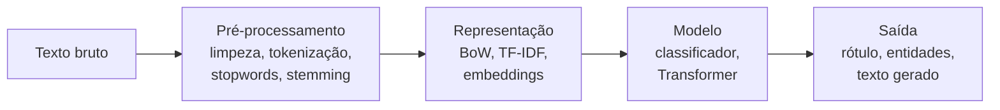
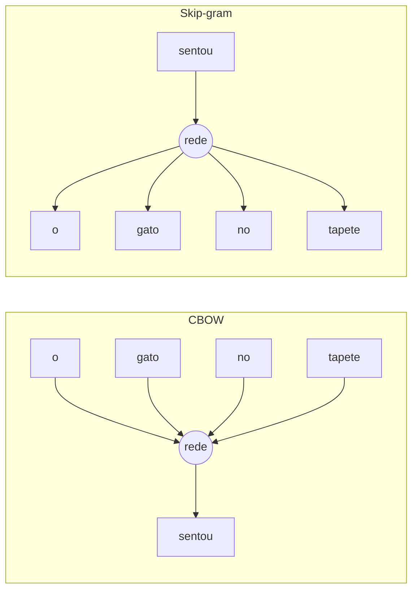

# Processamento de Linguagem Natural (NLP)

## O que é NLP

Processamento de linguagem natural (NLP, do inglês _Natural Language Processing_) é a área que ensina o computador a trabalhar com texto e fala humanos: classificar uma avaliação como positiva ou negativa, extrair nomes de empresas de uma notícia, traduzir, resumir, responder perguntas.

O desafio é que modelos de machine learning trabalham com números, e texto não é número. Além disso, a linguagem é ambígua ("manga" pode ser fruta ou parte da camisa), depende de contexto e tem ironia, gírias e erros de digitação. Quase todo o trabalho de NLP gira em torno de transformar texto em números que preservem o significado.

## O pipeline de NLP

Um projeto clássico de NLP segue mais ou menos este caminho:



Com modelos modernos baseados em Transformers (mais adiante), as etapas de pré-processamento e representação ficam em grande parte dentro do próprio modelo. Mas entender o pipeline clássico ajuda a saber o que está acontecendo por trás e continua sendo a escolha certa para muitos problemas simples.

## Pré-processamento de texto

O objetivo é reduzir variações que não mudam o significado, para que "Ótimo", "ótimo!!!" e "OTIMO" não virem três coisas diferentes para o modelo.

- **Lowercasing**: converter tudo para minúsculas.
- **Remoção de caracteres especiais e URLs**: tirar links, menções, pontuação repetida, emojis (ou convertê-los em palavras, se carregarem sentimento).
- **Tokenização**: quebrar o texto em unidades menores, os _tokens_. Normalmente palavras, mas podem ser pedaços de palavras ou caracteres.
- **Remoção de stopwords**: tirar palavras muito frequentes que carregam pouco significado sozinhas, como "o", "de", "que", "e".
- **Stemming**: cortar a palavra até um radical por regras, sem se preocupar se o resultado existe no dicionário. "correndo", "correu" e "corrida" podem virar "corr".
- **Lematização**: reduzir a palavra à forma de dicionário (o _lema_) usando vocabulário e análise gramatical. "correndo" e "correu" viram "correr"; "melhores" vira "melhor". É mais precisa que o stemming e mais lenta.

Um exemplo de tokenização:

```text
Texto:   "O atendimento foi ótimo, mas a entrega atrasou!"
Tokens:  ["o", "atendimento", "foi", "ótimo", ",", "mas", "a", "entrega", "atrasou", "!"]
Sem stopwords e pontuação: ["atendimento", "ótimo", "entrega", "atrasou"]
```

Repare numa armadilha: listas de stopwords costumam incluir "não" e "mas". Em análise de sentimento, remover o "não" transforma "não gostei" em "gostei". Revise a lista antes de usar.

Em código, com expressões regulares e a biblioteca NLTK (que tem stopwords e um stemmer para português, o RSLP):

```python
import re

import nltk
from nltk.corpus import stopwords
from nltk.stem import RSLPStemmer

nltk.download("stopwords", quiet=True)
nltk.download("rslp", quiet=True)

texto = "O atendimento foi ÓTIMO, mas a entrega atrasou!!! Veja: https://exemplo.com"

texto = texto.lower()
texto = re.sub(r"https?://\S+", " ", texto)   # remove URLs
tokens = re.findall(r"\w+", texto)             # tokeniza (só palavras)

stop_pt = set(stopwords.words("portuguese")) - {"não", "mas"}  # mantém negação
tokens = [t for t in tokens if t not in stop_pt]

stemmer = RSLPStemmer()
print(tokens)
print([stemmer.stem(t) for t in tokens])
```

Para lematização em português, a biblioteca [spaCy](https://spacy.io/models/pt) tem modelos prontos (`python -m spacy download pt_core_news_sm`), que também fazem tokenização, classe gramatical e reconhecimento de entidades.

Quanto pré-processamento fazer depende da representação. Para Bag of Words e TF-IDF, limpar ajuda bastante. Para modelos como o BERT, quase não se pré-processa: o modelo tem seu próprio tokenizador e usa as stopwords e a pontuação como contexto.

## Representação de texto

### Bag of Words

O Bag of Words (saco de palavras) monta um vocabulário com todas as palavras do conjunto de textos e representa cada texto como um vetor de contagens: quantas vezes cada palavra aparece. A ordem das palavras é descartada, daí o "saco".

```text
Textos:  1. "gostei do produto"   2. "não gostei do atendimento"
Vocabulário: [atendimento, do, gostei, não, produto]
Texto 1:     [0, 1, 1, 0, 1]
Texto 2:     [1, 1, 1, 1, 0]
```

É simples e funciona bem em várias tarefas de classificação. Os limites: o vetor fica enorme (uma coluna por palavra do vocabulário), quase todo de zeros, e não sabe que "ótimo" e "excelente" significam quase a mesma coisa.

### TF-IDF

O TF-IDF melhora o Bag of Words dando menos peso às palavras que aparecem em quase todos os textos e mais peso às que são características de poucos:

```text
TF-IDF(termo, documento) = TF(termo, documento) · IDF(termo)
IDF(termo) = log(N / df(termo))
```

Onde `TF` é a frequência do termo no documento, `N` é o número de documentos e `df` é em quantos documentos o termo aparece. Uma palavra que está em todos os documentos tem IDF perto de zero. (O scikit-learn usa uma versão suavizada, `log((1 + N) / (1 + df)) + 1`, e normaliza cada vetor, mas a ideia é a mesma.)

Com o scikit-learn, `CountVectorizer` faz o Bag of Words e `TfidfVectorizer` faz o TF-IDF. Eles já tokenizam e colocam em minúsculas:

```python
from sklearn.feature_extraction.text import CountVectorizer, TfidfVectorizer

textos = ["gostei do produto", "não gostei do atendimento", "produto chegou quebrado"]

bow = CountVectorizer()
X_bow = bow.fit_transform(textos)
print(bow.get_feature_names_out())
print(X_bow.toarray())

tfidf = TfidfVectorizer()
X_tfidf = tfidf.fit_transform(textos)
print(X_tfidf.toarray().round(2))
```

O resultado é uma matriz esparsa (guarda só os valores diferentes de zero), pronta para qualquer classificador. O parâmetro `ngram_range=(1, 2)` inclui pares de palavras ("não gostei") como features, o que recupera um pouco da ordem e ajuda muito com negações.

### Word embeddings (Word2Vec e GloVe)

_Embeddings_ são vetores densos, com poucas centenas de dimensões, em que palavras de significado parecido ficam próximas no espaço. Em vez de uma coluna por palavra, cada palavra vira um ponto num espaço onde "ótimo" fica perto de "excelente" e longe de "péssimo".

O **Word2Vec** (Mikolov et al., Google, 2013) aprende esses vetores treinando uma rede neural rasa numa tarefa de prever palavras pelo contexto. Ele tem duas variantes:

- **CBOW** (_Continuous Bag of Words_): dadas as palavras ao redor, prevê a palavra do meio. Mais rápido e bom com palavras frequentes.
- **Skip-gram**: dada uma palavra, prevê as palavras ao redor. Mais lento, mas lida melhor com palavras raras.



O exemplo famoso de que os vetores capturam relações de significado é a analogia vetorial:

```text
vetor("king") - vetor("man") + vetor("woman") ≈ vetor("queen")
```

Ou seja, a diferença entre "king" e "man" se parece com a diferença entre "queen" e "woman", algo como uma "direção de realeza". Na prática, a palavra mais próxima do resultado costuma ser "queen" (excluindo as palavras usadas na conta).

O **GloVe** (Stanford, 2014) chega a vetores parecidos por outro caminho: em vez de prever contexto, fatora uma matriz com as contagens de quantas vezes cada par de palavras aparece junto no corpus.

Com a biblioteca Gensim dá para treinar um Word2Vec no seu próprio texto. Com um corpus minúsculo como o abaixo os vetores não fazem sentido de verdade; para resultados úteis são necessários milhões de frases ou vetores pré-treinados.

```python
from gensim.models import Word2Vec

frases = [
    ["o", "rei", "governa", "o", "reino"],
    ["a", "rainha", "governa", "o", "reino"],
    ["o", "homem", "trabalha", "na", "cidade"],
    ["a", "mulher", "trabalha", "na", "cidade"],
]

# sg=0 usa CBOW, sg=1 usa skip-gram
modelo = Word2Vec(frases, vector_size=50, window=3, min_count=1, sg=1, seed=42)

print(modelo.wv["rei"][:5])                  # as 5 primeiras dimensões do vetor
print(modelo.wv.most_similar("rei", topn=3))  # palavras mais próximas
```

A grande limitação do Word2Vec e do GloVe é que cada palavra tem **um único vetor**, não importa o contexto. "Banco" em "sentei no banco da praça" e em "abri conta no banco" recebe exatamente o mesmo vetor.

### Transformers e BERT

Os **Transformers** (Vaswani et al., 2017, artigo _Attention Is All You Need_) resolveram essa limitação com o mecanismo de **self-attention** (autoatenção). Ao processar cada palavra, o modelo olha para todas as outras palavras da frase e decide quanto cada uma importa para entender aquela palavra.

Em "abri conta no banco", a atenção da palavra "banco" se concentra em "conta" e "abri", e o vetor resultante fica perto do significado "instituição financeira". Em "sentei no banco da praça", ela se concentra em "sentei" e "praça", e o vetor vai para o significado "assento". Esses vetores que mudam conforme a frase são os **embeddings contextuais**.

O **BERT** (Google, 2018) é um Transformer pré-treinado em enormes volumes de texto para prever palavras escondidas olhando para os dois lados da frase. Depois do pré-treino, ele é ajustado (_fine-tuning_) com poucos exemplos para tarefas específicas, como classificação de sentimento. Para português existe o BERTimbau (`neuralmind/bert-base-portuguese-cased`), e há modelos multilíngues que também cobrem o português.

A biblioteca `transformers`, da Hugging Face, deixa usar modelos prontos em poucas linhas. O código abaixo baixa um modelo multilíngue de sentimento na primeira execução (algumas centenas de MB) e precisa do PyTorch instalado (`pip install transformers torch`):

```python
from transformers import pipeline

classificador = pipeline(
    "sentiment-analysis",
    model="nlptown/bert-base-multilingual-uncased-sentiment",  # nota de 1 a 5 estrelas
)
print(classificador(["Adorei o produto, chegou antes do prazo!",
                     "Péssimo atendimento, nunca mais compro aqui."]))
```

Os grandes modelos de linguagem (LLMs) usados em chatbots também são Transformers, numa escala bem maior.

## Tarefas comuns de NLP

| Tarefa                                     | O que faz                                            | Exemplo                                               |
| ------------------------------------------ | ---------------------------------------------------- | ----------------------------------------------------- |
| Classificação de texto                     | atribui uma categoria ao texto inteiro               | separar tickets de suporte por assunto, detectar spam |
| Análise de sentimento                      | classifica a opinião expressa                        | avaliação positiva, negativa ou neutra                |
| NER (reconhecimento de entidades nomeadas) | encontra e classifica nomes no texto                 | "Petrobras" = organização, "Recife" = local           |
| Sumarização                                | gera um resumo mais curto                            | resumir uma notícia ou um contrato                    |
| Tradução automática                        | converte de um idioma para outro                     | português para inglês                                 |
| Geração de texto                           | produz texto novo a partir de um início ou instrução | autocompletar, responder perguntas                    |

## Exemplo completo: classificação de sentimento com TF-IDF

Para muitos problemas de classificação de texto, um pipeline TF-IDF + classificador linear ainda é uma linha de base forte, rápida e barata, antes de partir para um Transformer. O Naive Bayes, apresentado em [Algoritmos de machine learning](/labs/data/machine-learning/01-algoritmos-de-machine-learning/), é uma escolha clássica aqui.

```python
from sklearn.feature_extraction.text import TfidfVectorizer
from sklearn.linear_model import LogisticRegression
from sklearn.naive_bayes import MultinomialNB
from sklearn.pipeline import make_pipeline

textos = [
    "adorei o produto, chegou rápido",
    "excelente qualidade, recomendo",
    "muito bom, superou as expectativas",
    "ótimo atendimento e entrega no prazo",
    "produto veio quebrado, péssimo",
    "não gostei, qualidade horrível",
    "atrasou muito e ninguém respondeu",
    "não recomendo, dinheiro jogado fora",
]
rotulos = [1, 1, 1, 1, 0, 0, 0, 0]  # 1 = positivo, 0 = negativo

for clf in [MultinomialNB(), LogisticRegression()]:
    modelo = make_pipeline(TfidfVectorizer(ngram_range=(1, 2)), clf)
    modelo.fit(textos, rotulos)
    novos = ["entrega rápida, adorei", "veio quebrado e não recomendo"]
    print(type(clf).__name__, modelo.predict(novos))
```

O vetorizador fica dentro do `Pipeline` pelo mesmo motivo do escalonamento: o vocabulário e os pesos de IDF devem ser aprendidos só com os textos de treino (veja [Limpeza e pré-processamento](/labs/data/ciencia-de-dados/04-limpeza-e-pre-processamento/)). Num projeto real, com centenas ou milhares de exemplos, separe treino e teste e avalie com as métricas de [Métricas de avaliação](/labs/data/machine-learning/02-metricas-de-avaliacao/); oito frases servem só para ver o fluxo funcionando.

## Aplicações reais

- **Chatbots e assistentes virtuais**: entendem a intenção do usuário e respondem, de atendimento bancário a suporte técnico.
- **Busca**: mecanismos de busca e buscas internas de e-commerce usam embeddings para achar resultados pelo significado, não só pela palavra exata.
- **Análise de sentimento**: monitorar o que clientes dizem sobre uma marca em avaliações e redes sociais.
- **Classificação de documentos**: triagem de e-mails, roteamento de tickets, organização de processos jurídicos.
- **Tradução automática**: tradutores online e legendas automáticas.

## Referências

- [Curso de NLP da Hugging Face](https://huggingface.co/learn/llm-course/pt/chapter1/1) - Hugging Face, pt-BR (parcial)
- [Embeddings](https://developers.google.com/machine-learning/crash-course/embeddings?hl=pt-br) - Google for Developers, pt-BR
- [Text feature extraction](https://scikit-learn.org/stable/modules/feature_extraction.html#text-feature-extraction) - scikit-learn, en
- [Natural Language Processing with Python (NLTK Book)](https://www.nltk.org/book/) - Steven Bird, Ewan Klein e Edward Loper, en
