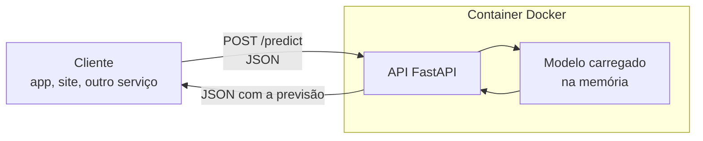
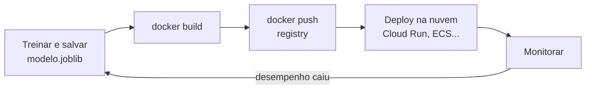

# Deploy de Modelos com FastAPI e Docker

## Por que fazer deploy de um modelo

Um modelo que só existe dentro de um notebook não ajuda ninguém. Ele passa a gerar valor quando outro sistema consegue mandar dados e receber uma previsão de volta: o app do banco pergunta "essa compra parece fraude?", o site da imobiliária pergunta "quanto vale esse apartamento?".

**Fazer deploy** é colocar o modelo num lugar onde ele fica disponível para ser usado, normalmente atrás de uma API HTTP. O caminho mais comum para quem trabalha com Python tem três peças:

1. Salvar o modelo treinado num arquivo
2. Escrever uma API que carrega esse arquivo e responde a requisições
3. Empacotar tudo numa imagem Docker, que roda igual no seu notebook e na nuvem



O exemplo desta nota usa o dataset California Housing (que já vem no scikit-learn) para prever o valor mediano de casas por quarteirão. É o mesmo tipo de problema do projeto de preço de imóveis em [Projetos de ciência de dados](/labs/data/projetos/02-projetos-de-ciencia-de-dados/).

## Salvando o modelo treinado

O primeiro passo é treinar e gravar o modelo em disco. A dica que evita muita dor de cabeça: salve o **Pipeline inteiro** (pré-processamento + modelo), não só o estimador. Assim a API recebe os dados crus e aplica exatamente as mesmas transformações do treino. Se precisar relembrar como montar um `Pipeline`, veja [Limpeza e pré-processamento](/labs/data/ciencia-de-dados/04-limpeza-e-pre-processamento/).

```python
# treinar.py
import joblib
from sklearn.datasets import fetch_california_housing
from sklearn.ensemble import HistGradientBoostingRegressor
from sklearn.metrics import mean_absolute_error
from sklearn.model_selection import train_test_split
from sklearn.pipeline import make_pipeline

dados = fetch_california_housing(as_frame=True)
X, y = dados.data, dados.target  # y em centenas de milhares de dólares

X_treino, X_teste, y_treino, y_teste = train_test_split(
    X, y, test_size=0.2, random_state=42
)

modelo = make_pipeline(HistGradientBoostingRegressor(random_state=42))
modelo.fit(X_treino, y_treino)

mae = mean_absolute_error(y_teste, modelo.predict(X_teste))
print(f"MAE no teste: {mae:.3f}")

joblib.dump(modelo, "app/modelo.joblib")
```

O `joblib` é a forma mais usada de salvar objetos do scikit-learn. Dois cuidados que a própria documentação do scikit-learn destaca:

- ⚠️ **Segurança**: arquivos pickle e joblib podem executar código arbitrário quando são carregados. Só carregue artefatos que você mesmo gerou ou que vêm de uma fonte confiável. Nunca aceite um `.joblib` enviado por usuário
- **Versões**: carregue o modelo com a mesma versão do scikit-learn usada no treino. Uma versão diferente pode emitir avisos, quebrar ou, pior, gerar previsões diferentes sem avisar. Por isso o `requirements.txt` da API deve fixar as versões (mais sobre isso na seção do Docker)

Se o modelo for consumido por outra linguagem ou você quiser evitar o pickle, existem alternativas como o formato **ONNX** (ver [Design de sistemas de ML](/labs/data/ml-em-producao/03-design-de-sistemas-de-ml/)) e a biblioteca **skops**, que salva modelos do scikit-learn num formato que pode ser inspecionado antes de carregar.

## Flask x FastAPI

As duas são frameworks web em Python e as duas servem para expor um modelo. A diferença está no que vem pronto:

| Critério             | Flask                                   | FastAPI                                                    |
| -------------------- | --------------------------------------- | ---------------------------------------------------------- |
| Validação de entrada | Manual ou com extensões                 | Automática, a partir de type hints e modelos Pydantic      |
| Documentação da API  | Precisa de extensão                     | Gerada sozinha (Swagger UI em `/docs` e ReDoc em `/redoc`) |
| Código assíncrono    | Suporte mais recente e limitado         | Nativo (`async def`), roda sobre ASGI                      |
| Curva de aprendizado | Muito simples                           | Simples, exige conhecer type hints                         |
| Ecossistema          | Mais antigo, muitos tutoriais e plugins | Mais novo, virou padrão para APIs de ML                    |

Para APIs de modelo, o FastAPI costuma ganhar por um motivo bem prático: se alguém mandar `"idade": "trinta"` em vez de um número, a requisição é rejeitada com uma mensagem clara antes de chegar ao modelo. No Flask você escreveria essa validação na mão.

## Criando a API com FastAPI

Instale o FastAPI com os extras padrão (que incluem o servidor Uvicorn e o comando `fastapi`) e as bibliotecas do modelo:

```bash
pip install "fastapi[standard]" scikit-learn joblib pandas
```

A estrutura do projeto fica assim:

```text
api-imoveis/
├── app/
│   ├── __init__.py
│   ├── main.py
│   └── modelo.joblib
├── treinar.py
├── requirements.txt
└── Dockerfile
```

E o código da API:

```python
# app/main.py
from contextlib import asynccontextmanager
from pathlib import Path

import joblib
import pandas as pd
from fastapi import FastAPI
from pydantic import BaseModel, Field

CAMINHO_MODELO = Path(__file__).parent / "modelo.joblib"
modelos = {}


class Imovel(BaseModel):
    MedInc: float = Field(gt=0, description="Renda mediana do quarteirão, em dezenas de milhares de dólares")
    HouseAge: float = Field(ge=0, description="Idade mediana das casas, em anos")
    AveRooms: float = Field(gt=0, description="Média de cômodos por domicílio")
    AveBedrms: float = Field(gt=0, description="Média de quartos por domicílio")
    Population: float = Field(ge=0, description="População do quarteirão")
    AveOccup: float = Field(gt=0, description="Média de moradores por domicílio")
    Latitude: float = Field(ge=32, le=42)
    Longitude: float = Field(ge=-125, le=-114)


class Previsao(BaseModel):
    valor_estimado: float = Field(description="Em centenas de milhares de dólares")


@asynccontextmanager
async def lifespan(app: FastAPI):
    # Carrega o modelo uma única vez, quando a API sobe
    modelos["imoveis"] = joblib.load(CAMINHO_MODELO)
    yield
    modelos.clear()


app = FastAPI(title="API de preço de imóveis", lifespan=lifespan)


@app.get("/health")
def health():
    return {"status": "ok"}


@app.post("/predict", response_model=Previsao)
def predict(imovel: Imovel):
    entrada = pd.DataFrame([imovel.model_dump()])
    valor = modelos["imoveis"].predict(entrada)[0]
    return Previsao(valor_estimado=float(valor))
```

Algumas decisões que valem explicar:

- O corpo da requisição é um **modelo Pydantic** (`Imovel`), e não um `dict` solto. É isso que dá validação automática (`gt=0` recusa renda negativa) e faz os campos aparecerem documentados em `/docs`
- O modelo é carregado no **lifespan**, que roda uma vez quando a aplicação inicia. Carregar o arquivo dentro do `/predict` funcionaria, mas leria o disco a cada requisição
- O `/health` não toca no modelo. Ele existe para o orquestrador (Docker, Kubernetes, Cloud Run) saber se o container está vivo
- O `predict` é `def` e não `async def` de propósito: a previsão do scikit-learn é código síncrono que usa CPU, e o FastAPI roda funções `def` num pool de threads separado, sem travar o servidor

## Testando a API localmente

Treine o modelo e suba a API em modo de desenvolvimento (com recarga automática ao salvar o arquivo):

```bash
python treinar.py
fastapi dev app/main.py
```

Abra `http://127.0.0.1:8000/docs` no navegador. A Swagger UI lista os endpoints e tem um botão "Try it out" para mandar requisições sem escrever código 🎉

Pelo terminal, com `curl`:

```bash
curl -X POST http://127.0.0.1:8000/predict \
  -H "Content-Type: application/json" \
  -d '{"MedInc": 8.3, "HouseAge": 41, "AveRooms": 6.9, "AveBedrms": 1.0,
       "Population": 322, "AveOccup": 2.5, "Latitude": 37.88, "Longitude": -122.23}'
```

Se mandar um campo faltando ou com tipo errado, a resposta vem com status `422` e a lista dos problemas.

Para testes automatizados, o FastAPI tem o `TestClient`. Usá-lo dentro de um `with` garante que o lifespan rode e o modelo seja carregado:

```python
# test_main.py
from fastapi.testclient import TestClient

from app.main import app

EXEMPLO = {
    "MedInc": 8.3, "HouseAge": 41, "AveRooms": 6.9, "AveBedrms": 1.0,
    "Population": 322, "AveOccup": 2.5, "Latitude": 37.88, "Longitude": -122.23,
}


def test_predict_retorna_valor():
    with TestClient(app) as client:
        resposta = client.post("/predict", json=EXEMPLO)
    assert resposta.status_code == 200
    assert resposta.json()["valor_estimado"] > 0


def test_predict_rejeita_renda_negativa():
    with TestClient(app) as client:
        resposta = client.post("/predict", json={**EXEMPLO, "MedInc": -1})
    assert resposta.status_code == 422
```

Rode com `pip install pytest` e depois `pytest`. Esses testes vão ser reaproveitados no pipeline de CI em [MLOps](/labs/data/ml-em-producao/02-mlops/).

## Empacotando com Docker

"Na minha máquina funciona" é a frase que o Docker veio aposentar. Um **container** empacota a aplicação junto com o Python, as bibliotecas e os arquivos de que ela precisa. Quem roda o container não precisa instalar nada além do Docker.

Dois termos para não confundir:

- **Imagem** é o pacote pronto, só leitura, gerado a partir de um `Dockerfile` (pense na receita já cozinhada e congelada)
- **Container** é uma imagem em execução. Da mesma imagem você pode subir vários containers

### requirements.txt

Gere a lista a partir do ambiente onde o modelo foi treinado, para fixar as versões exatas:

```bash
pip freeze | grep -iE "^(fastapi|scikit-learn|joblib|pandas|numpy)=" > requirements.txt
```

No Windows (PowerShell), troque o `grep` por `Select-String`:

```powershell
pip freeze | Select-String -Pattern "^(fastapi|scikit-learn|joblib|pandas|numpy)=" | ForEach-Object { $_.Line } > requirements.txt
```

O `fastapi` aparece como `fastapi==<versão>`. Edite a linha para `fastapi[standard]==<versão>`, assim o comando `fastapi run` vem junto na imagem.

### Dockerfile

```dockerfile
FROM python:3.13-slim

WORKDIR /code

# Dependências primeiro: essa camada fica em cache enquanto o requirements.txt não mudar
COPY ./requirements.txt /code/requirements.txt
RUN pip install --no-cache-dir --upgrade -r /code/requirements.txt

# O código muda com mais frequência, por isso vem por último
COPY ./app /code/app

EXPOSE 80

CMD ["fastapi", "run", "app/main.py", "--port", "80"]
```

Linha por linha:

- `FROM python:3.13-slim` parte da imagem oficial do Python na variante `slim`, bem menor que a completa. Evite o 3.10, que chega ao fim de vida em outubro de 2026
- `WORKDIR` define a pasta de trabalho dentro do container
- Copiar o `requirements.txt` antes do código é o truque de cache: o Docker reaproveita camadas que não mudaram, então trocar uma linha do `main.py` não reinstala todas as bibliotecas
- `--no-cache-dir` evita guardar o cache do pip dentro da imagem, que só ocuparia espaço
- `EXPOSE 80` documenta a porta usada. Ele não publica a porta sozinho, isso é feito no `docker run`
- O `CMD` está na **forma exec** (lista JSON). A documentação do FastAPI recomenda essa forma porque ela permite que a aplicação seja desligada corretamente e que os eventos de lifespan rodem. Na forma shell (`CMD fastapi run ...`) o container demora para parar

O comando `fastapi run` usa o Uvicorn por baixo dos panos. Se preferir chamar o Uvicorn direto, o equivalente é `CMD ["uvicorn", "app.main:app", "--host", "0.0.0.0", "--port", "80"]`.

💡 Você pode encontrar tutoriais que usam a imagem `tiangolo/uvicorn-gunicorn-fastapi`. Ela está deprecada; a recomendação atual é montar a sua a partir da imagem oficial do Python, como acima.

Crie também um `.dockerignore` para não mandar lixo para dentro da imagem:

```text
.venv/
__pycache__/
*.ipynb
.git/
data/
```

### Build e execução

```bash
docker build -t ml-app .
docker run -d --name ml-app -p 8000:80 ml-app
```

O `-p 8000:80` liga a porta 8000 da sua máquina à porta 80 do container. A API fica em `http://localhost:8000/docs`, igual ao teste local. Para ver os logs e parar:

```bash
docker logs -f ml-app
docker stop ml-app
```

Uma observação sobre processos: dentro de um container, rode **um processo do Uvicorn só**. Para atender mais requisições, suba mais containers (o Kubernetes, o ECS e o Cloud Run fazem isso por você). A opção `--workers` do `fastapi run` existe para quando você tem um servidor único sem orquestrador.

## Publicando a imagem e subindo na nuvem

Com a imagem pronta, o próximo passo é enviá-la para um **registry**, um repositório de imagens de onde a plataforma de nuvem vai baixá-la:

```bash
docker tag ml-app seu-usuario/ml-app:1.0.0
docker push seu-usuario/ml-app:1.0.0
```

O exemplo usa o Docker Hub. Cada nuvem tem o seu registry (Amazon ECR, Google Artifact Registry, Azure Container Registry), e o processo é o mesmo: autenticar, marcar a imagem com o endereço do registry e dar `push`. Use tags de versão (`1.0.0`) em vez de depender só de `latest`, assim você sabe exatamente qual versão está rodando e consegue voltar para a anterior.

Onde rodar o container:

| Opção                              | Como funciona                                                       | Bom para                              |
| ---------------------------------- | ------------------------------------------------------------------- | ------------------------------------- |
| Google Cloud Run                   | Serverless: você entrega a imagem, ele escala (inclusive para zero) | Começar rápido, tráfego irregular     |
| AWS ECS (Fargate)                  | Orquestrador de containers gerenciado, sem administrar servidores   | Quem já está na AWS                   |
| AWS EC2                            | Uma máquina virtual onde você instala o Docker                      | Controle total, mais trabalho manual  |
| Azure App Service / Container Apps | Serviços gerenciados que rodam containers                           | Quem já está no Azure                 |
| Render                             | Plataforma simples que faz deploy a partir do repositório           | Projetos de portfólio                 |
| Kubernetes (EKS, GKE, AKS)         | Orquestração completa, com auto-scaling e rollout gradual           | Times com vários serviços em produção |

Sobre o **Heroku**, que aparece em muitos tutoriais antigos como opção gratuita: os planos gratuitos acabaram em novembro de 2022. Ele ainda funciona, mas é pago.

Antes de criar qualquer recurso, configure um alerta de orçamento na conta de nuvem. As mesmas regras de sobrevivência de [Projetos de engenharia de dados](/labs/data/projetos/01-projetos-de-engenharia-de-dados/) valem aqui.

## O fluxo completo



Fazer isso tudo na mão uma vez é ótimo para aprender. Repetir toda semana não é: automatizar treino, testes, build e deploy é assunto de [MLOps](/labs/data/ml-em-producao/02-mlops/). E a seta "Monitorar" tem nota própria, em [Monitoramento e observabilidade](/labs/data/ml-em-producao/04-monitoramento-e-observabilidade/).

## Referências

- [Tutorial - Guia de Usuário](https://fastapi.tiangolo.com/pt/tutorial/) - FastAPI, pt-BR
- [Corpo da Requisição](https://fastapi.tiangolo.com/pt/tutorial/body/) - FastAPI, pt-BR
- [FastAPI em contêineres - Docker](https://fastapi.tiangolo.com/pt/deployment/docker/) - FastAPI, pt-BR
- [Model persistence](https://scikit-learn.org/stable/model_persistence.html) - scikit-learn, en
- [What is Docker?](https://docs.docker.com/get-started/docker-overview/) - Docker, en
