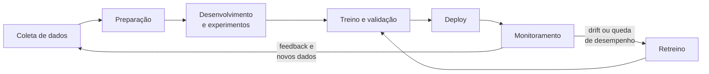
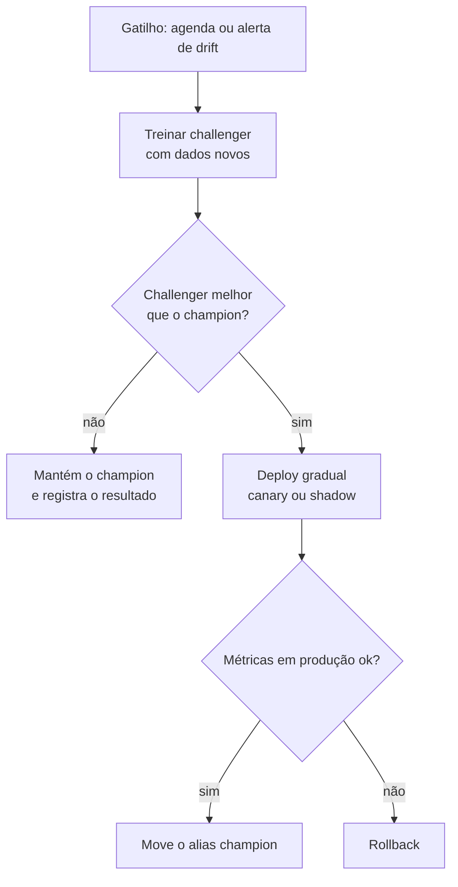

# MLOps

## O que é MLOps

Colocar um modelo no ar uma vez, como em [Deploy com FastAPI e Docker](/labs/data/ml-em-producao/01-deploy-com-fastapi-e-docker/), é a parte fácil. O difícil vem depois: três meses mais tarde alguém pergunta "qual versão dos dados treinou o modelo que está em produção?", "dá para voltar para o modelo da semana passada?" ou "por que as previsões pioraram?", e ninguém sabe responder.

**MLOps** (Machine Learning Operations) é o conjunto de práticas para construir, colocar em produção e manter modelos de forma confiável e repetível. Ele junta três mundos:

- **Machine learning**: experimentos, treino e avaliação de modelos
- **DevOps**: versionamento, testes automatizados, integração e entrega contínuas (CI/CD)
- **Engenharia de dados**: pipelines que entregam dados limpos e atualizados

A ideia é a mesma do DevOps para software comum, com uma diferença importante: num sistema de ML, o comportamento depende do **código** e também dos **dados**. Um modelo pode piorar sem que ninguém tenha mudado uma linha de código, só porque o mundo mudou (os clientes mudaram de hábito, a inflação mexeu nos preços). Por isso MLOps adiciona práticas que o DevOps tradicional não tem, como versionar dados, registrar experimentos e retreinar modelos de forma contínua.

Um jeito de ver o tamanho do problema: num sistema de ML real, o código que treina o modelo é uma parte pequena. Em volta dele há coleta e validação de dados, extração de features, infraestrutura de serving, monitoramento, configuração. MLOps cuida de tudo isso.

## O ciclo de vida de um modelo



Repare que não existe um "fim". O modelo em produção gera dados novos e sinais de desempenho, que alimentam a próxima versão. As etapas iniciais (coleta, limpeza, EDA, modelagem) estão em [O que é ciência de dados](/labs/data/ciencia-de-dados/01-o-que-e-ciencia-de-dados/); esta nota foca no que acontece para o ciclo girar sem trabalho manual.

## Níveis de maturidade

O guia do Google Cloud sobre MLOps descreve três níveis de automação. Eles ajudam a entender onde um time está e qual é o próximo passo:

| Nível | Como funciona                                                                                                              | Sinal típico                                                           |
| ----- | -------------------------------------------------------------------------------------------------------------------------- | ---------------------------------------------------------------------- |
| 0     | **Processo manual**. Cientista treina no notebook e entrega um arquivo para alguém colocar no ar                           | Novo modelo a cada poucos meses, ninguém monitora depois do deploy     |
| 1     | **Pipeline de ML automatizado**. O treino vira um pipeline que roda sozinho com dados novos (**treinamento contínuo**, CT) | O modelo é retreinado toda semana sem intervenção                      |
| 2     | **CI/CD do pipeline**. Mudanças no código do pipeline são testadas, empacotadas e implantadas automaticamente              | O time testa ideias novas e coloca em produção com segurança e rapidez |

Ninguém precisa começar no nível 2. Para um projeto pessoal ou um time pequeno, sair do nível 0 com tracking de experimentos, versionamento e um retreino agendado já resolve a maior parte das dores.

## Componentes de uma plataforma de MLOps

- **Pipeline de dados**: ingestão, limpeza e validação dos dados que vão para o treino. É o mesmo assunto de pipelines e orquestração em [Projetos de engenharia de dados](/labs/data/projetos/01-projetos-de-engenharia-de-dados/), com Airflow, dbt e testes de qualidade
- **Experiment tracking**: registro de cada treino (parâmetros, métricas, artefatos), para comparar tentativas e reproduzir a melhor
- **Model registry**: catálogo central das versões de modelo, com qual versão está aprovada para produção
- **CI/CD**: testes e deploy automáticos a cada mudança no código
- **Monitoramento**: acompanhamento da API, das entradas e das previsões em produção, incluindo **data drift** (os dados de entrada mudaram) e **concept drift** (a relação entre entrada e resposta mudou). Detalhado em [Monitoramento e observabilidade](/labs/data/ml-em-producao/04-monitoramento-e-observabilidade/)
- **Pipeline de retreino**: treina, avalia e promove um modelo novo quando necessário
- **Infraestrutura**: containers, orquestração (Kubernetes), armazenamento de artefatos

As próximas seções mostram as peças mais comuns na prática: MLflow para tracking e registry, DVC para dados e GitHub Actions para CI/CD.

## Experiment tracking com MLflow

Quem já treinou modelos sabe como é: `modelo_final.joblib`, `modelo_final_v2.joblib`, `modelo_final_agora_vai.joblib` e uma planilha com as métricas de cada um. O **MLflow** substitui essa bagunça. Cada execução de treino vira um **run**, com parâmetros, métricas e o modelo salvo, agrupados num **experimento**.

```bash
pip install mlflow scikit-learn pandas
```

```python
# treinar_mlflow.py
import mlflow
from sklearn.datasets import fetch_california_housing
from sklearn.ensemble import HistGradientBoostingRegressor
from sklearn.metrics import mean_absolute_error, root_mean_squared_error
from sklearn.model_selection import train_test_split

mlflow.set_tracking_uri("sqlite:///mlflow.db")
mlflow.set_experiment("preco-imoveis")

dados = fetch_california_housing(as_frame=True)
X_treino, X_teste, y_treino, y_teste = train_test_split(
    dados.data, dados.target, test_size=0.2, random_state=42
)

params = {"learning_rate": 0.1, "max_iter": 200, "max_depth": 6}

with mlflow.start_run(run_name="hgb-baseline"):
    modelo = HistGradientBoostingRegressor(random_state=42, **params)
    modelo.fit(X_treino, y_treino)
    previsoes = modelo.predict(X_teste)

    mlflow.log_params(params)
    mlflow.log_metric("mae", mean_absolute_error(y_teste, previsoes))
    mlflow.log_metric("rmse", root_mean_squared_error(y_teste, previsoes))

    mlflow.sklearn.log_model(
        sk_model=modelo,
        name="modelo",
        input_example=X_teste.head(3),
        registered_model_name="HousePriceModel",
    )
```

O que cada parte faz:

- `set_tracking_uri("sqlite:///mlflow.db")` guarda os metadados num arquivo SQLite local. O Model Registry precisa de um banco por trás, e o SQLite basta para estudar
- `log_params` e `log_metric` registram o que foi testado e o resultado. As métricas usadas são as de regressão vistas em [Métricas de avaliação](/labs/data/machine-learning/02-metricas-de-avaliacao/)
- `log_model` salva o modelo como artefato. No MLflow 3, o parâmetro se chama `name` (o antigo `artifact_path` está deprecado). O `input_example` faz o MLflow inferir a **assinatura** do modelo, ou seja, quais colunas e tipos ele espera
- `registered_model_name` já cadastra o modelo no registry, criando a versão 1, 2, 3... a cada execução

Rode o script algumas vezes mudando os parâmetros e abra a interface:

```bash
mlflow ui --backend-store-uri sqlite:///mlflow.db
```

Em `http://127.0.0.1:5000` dá para ordenar os runs por métrica, comparar parâmetros lado a lado e ver gráficos. Combinado com a busca de hiperparâmetros de [Validação, tuning e regularização](/labs/data/machine-learning/03-validacao-tuning-e-regularizacao/), isso evita perder o registro de qual combinação deu o melhor resultado.

## Model registry e aliases

O **Model Registry** é o catálogo de versões. Cada vez que um modelo é registrado com o mesmo nome, nasce uma versão nova. A pergunta que o registry responde é: "qual versão a API deve usar agora?".

A resposta moderna no MLflow são os **aliases**, apelidos móveis que apontam para uma versão. Os mais usados são `champion` (o modelo em produção) e `challenger` (o candidato a substituí-lo).

```python
from mlflow import MlflowClient

client = MlflowClient(tracking_uri="sqlite:///mlflow.db")

# A versão 3 passou na avaliação: vira o modelo de produção
client.set_registered_model_alias("HousePriceModel", "champion", version="3")

# A versão 4 vai ser comparada com o champion antes de assumir
client.set_registered_model_alias("HousePriceModel", "challenger", version="4")
```

E a API (ou qualquer outro código) carrega pelo alias, sem saber o número da versão:

```python
import mlflow

mlflow.set_tracking_uri("sqlite:///mlflow.db")
modelo = mlflow.sklearn.load_model("models:/HousePriceModel@champion")
```

Para promover um modelo novo, basta mover o alias `champion` para outra versão. Para voltar atrás, mova de volta. O código que carrega o modelo não muda.

⚠️ Muitos tutoriais ainda usam os **stages** (`Staging`, `Production`, `Archived`) e chamadas como `transition_model_version_stage` ou URIs `models:/HousePriceModel/Production`. Os stages estão deprecados desde o MLflow 2.9. Use aliases e, se precisar separar ambientes, tags ou registries diferentes.

## Versionando dados com DVC

O Git é ótimo para código, mas péssimo para um CSV de 2 GB. O **DVC** (Data Version Control) resolve isso: o arquivo grande vai para um armazenamento externo (S3, Google Drive, uma pasta de rede) e o Git guarda só um arquivo pequeno `.dvc` com o hash do conteúdo. Assim cada commit aponta para a versão exata dos dados usada naquele momento.

```bash
pip install dvc
git init
dvc init

dvc add data/imoveis.csv
git add data/imoveis.csv.dvc data/.gitignore
git commit -m "chore: adiciona dataset de imóveis"

# Configura onde os dados ficam guardados e envia
dvc remote add -d armazenamento /caminho/para/pasta-compartilhada
dvc push
```

Quem clona o repositório roda `dvc pull` para baixar os dados na versão daquele commit. Se você trocar o CSV, roda `dvc add` de novo, faz commit do novo `.dvc` e o histórico fica completo. Voltar para os dados antigos é um `git checkout` seguido de `dvc checkout`.

Código no Git, dados no DVC, experimentos no MLflow: com as três peças, dá para responder "com quais dados e qual código esse modelo foi treinado?".

## CI/CD para modelos

**CI** (integração contínua) roda testes automaticamente a cada push. **CD** (entrega contínua) gera e publica o artefato pronto para deploy. Em ML existe ainda o **CT** (treinamento contínuo), o retreino automático com dados novos.

Um primeiro pipeline com GitHub Actions pode rodar os testes da API e construir a imagem Docker a cada push na `main`:

```yaml
# .github/workflows/ci.yml
name: ci

on:
  push:
    branches: [main]
  pull_request:

jobs:
  testes:
    runs-on: ubuntu-latest
    steps:
      - uses: actions/checkout@v4
      - uses: actions/setup-python@v5
        with:
          python-version: "3.13"
      - run: pip install -r requirements.txt pytest
      - run: python treinar.py
      - run: pytest

  imagem:
    needs: testes
    runs-on: ubuntu-latest
    steps:
      - uses: actions/checkout@v4
      - run: docker build -t ml-app:${{ github.sha }} .
```

O job `imagem` só roda se os testes passarem (`needs: testes`). A partir daqui o caminho natural é fazer `docker push` para um registry e disparar o deploy. Os testes usados são os de [Deploy com FastAPI e Docker](/labs/data/ml-em-producao/01-deploy-com-fastapi-e-docker/).

Em ML, além dos testes de código, vale ter testes de modelo no pipeline:

- O modelo novo tem métrica pelo menos tão boa quanto a do `champion` no mesmo conjunto de teste?
- As previsões para alguns exemplos conhecidos estão numa faixa razoável?
- A assinatura (colunas e tipos de entrada) continua compatível com o que a API envia?

## Retreino

Modelos envelhecem. Existem duas estratégias principais para decidir quando treinar de novo:

- **Periódico**: retreinar num intervalo fixo (toda semana, todo mês). Simples de agendar com Airflow ou cron e funciona bem quando os dados mudam num ritmo previsível
- **Por gatilho**: retreinar quando o monitoramento detecta drift ou queda de desempenho. Mais eficiente, mas depende de um bom monitoramento

Nos dois casos, o modelo novo não deve substituir o antigo direto. O fluxo seguro é:



As estratégias de deploy gradual (canary, blue-green, shadow) estão em [Design de sistemas de ML](/labs/data/ml-em-producao/03-design-de-sistemas-de-ml/).

## Ferramentas do ecossistema

| Ferramenta                 | Para que serve                                    | Observação                                                                                      |
| -------------------------- | ------------------------------------------------- | ----------------------------------------------------------------------------------------------- |
| MLflow                     | Tracking de experimentos, registry, empacotamento | Open source, o mais usado para começar                                                          |
| DVC                        | Versionamento de dados e pipelines                | Funciona em cima do Git                                                                         |
| Airflow                    | Orquestração de pipelines (dados e treino)        | Visto nos projetos de engenharia de dados                                                       |
| Kubeflow                   | Pipelines de ML sobre Kubernetes                  | Faz sentido quando o time já usa Kubernetes                                                     |
| Docker e Kubernetes        | Empacotar e orquestrar containers                 | Base de quase todo deploy moderno                                                               |
| Prometheus e Grafana       | Métricas e dashboards de monitoramento            | Ver a nota de monitoramento                                                                     |
| BentoML                    | Empacotar e servir modelos                        | Open source (Apache 2.0)                                                                        |
| Seldon Core                | Servir modelos em Kubernetes                      | Desde janeiro de 2024 está sob Business Source License: uso em produção exige licença comercial |
| Evidently                  | Relatórios de data drift e qualidade de modelos   | Open source                                                                                     |
| GitHub Actions / GitLab CI | CI/CD                                             | Integrados ao repositório                                                                       |

Não precisa usar todas. Uma stack inicial bem razoável é Git + DVC + MLflow + Docker + GitHub Actions.

## Boas práticas

- Versione código (Git), dados (DVC) e modelos (registry). Todo modelo em produção deve ter rastro até os dados e o commit que o geraram
- Registre todo experimento, inclusive os que deram errado. Eles evitam que alguém repita a mesma tentativa
- Fixe versões de bibliotecas no treino e no serving, e rode os dois na mesma imagem base sempre que possível
- Automatize primeiro o que você faz com mais frequência e mais medo de errar (normalmente o deploy)
- Nunca promova um modelo sem compará-lo com o atual no mesmo conjunto de avaliação
- Configure alertas para drift e erro da API antes de precisar deles

## Referências

- [MLOps: entrega contínua e pipelines de automação no machine learning](https://cloud.google.com/architecture/mlops-continuous-delivery-and-automation-pipelines-in-machine-learning?hl=pt-br) - Google Cloud, pt-BR
- [O que é MLOps?](https://aws.amazon.com/pt/what-is/mlops/) - AWS, pt-BR
- [MLflow Model Registry](https://mlflow.org/docs/latest/ml/model-registry/) - MLflow, en
- [MLflow 3](https://mlflow.org/docs/latest/ml/mlflow-3/) - MLflow, en
- [Get Started with DVC](https://dvc.org/doc/start) - DVC, en
