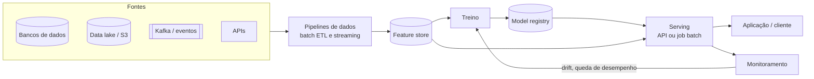
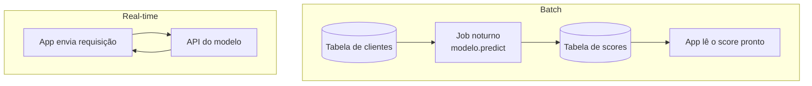
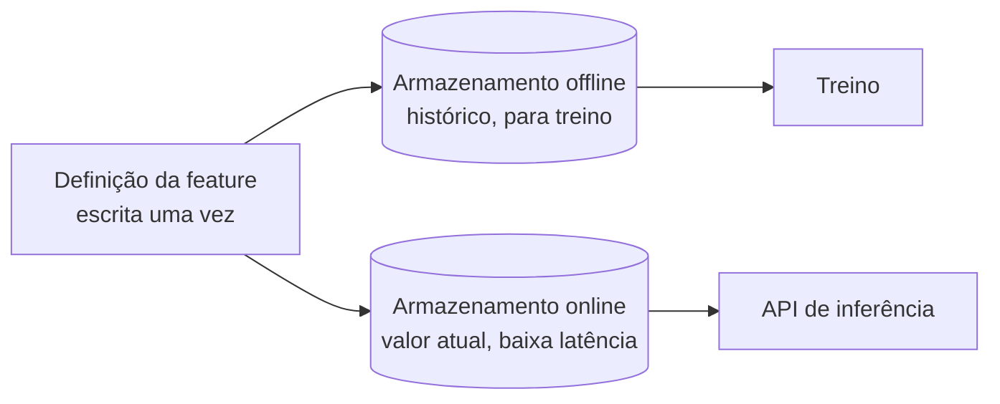
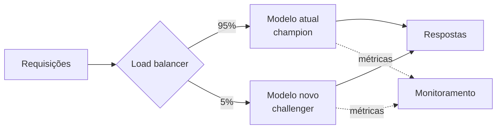

# Design de Sistemas de ML

## O que é design de sistemas de ML

Treinar um modelo com boa métrica no notebook é metade da história. A outra metade é responder perguntas como: quantas previsões por segundo o sistema precisa aguentar? A resposta precisa chegar em 50 milissegundos ou pode chegar amanhã de manhã? O que acontece se o servidor do modelo cair?

**Design de sistemas de ML** é planejar a arquitetura completa em volta do modelo: de onde vêm os dados, como as features são calculadas, como o modelo é treinado, servido, monitorado e atualizado. As decisões giram em torno de alguns requisitos:

- **Latência**: quanto tempo o cliente pode esperar pela previsão
- **Throughput**: quantas previsões por segundo (ou por dia) o sistema precisa entregar
- **Disponibilidade**: quanto tempo fora do ar é aceitável
- **Custo**: GPUs, clusters e armazenamento custam dinheiro todo mês
- **Governança**: quem pode ver os dados, como explicar uma decisão do modelo, o que a LGPD exige

Esse assunto também é tema frequente de entrevista para cargos de ML engineer e cientista de dados sênior, no formato "desenhe um sistema de recomendação para um e-commerce".

## Perguntas antes de desenhar

Antes de escolher ferramenta, vale responder:

1. **Qual é o problema de negócio?** "Reduzir cancelamentos" é diferente de "prever quem vai cancelar". O modelo é um meio
2. **Como a previsão vai ser usada?** Uma tela que mostra o resultado na hora, um e-mail enviado no dia seguinte, uma regra que bloqueia uma transação
3. **Qual a latência aceitável?** Isso decide entre inferência batch e real-time (próxima seção)
4. **Quando chega o rótulo verdadeiro?** Em fraude, o cliente contesta a compra semanas depois. Em previsão de demanda, você sabe no dia seguinte. Isso afeta o monitoramento e o retreino
5. **Qual o custo de cada erro?** Um falso positivo em fraude irrita o cliente; um falso negativo dá prejuízo. Isso define a métrica e o limiar, como visto em [Métricas de avaliação](/labs/data/machine-learning/02-metricas-de-avaliacao/)
6. **Existe um plano B?** Se o modelo cair, o sistema usa uma regra simples, o último resultado conhecido ou devolve erro?

## Arquitetura de referência

Quase todo sistema de ML em produção tem as mesmas peças, mesmo que com nomes e ferramentas diferentes:

- **Fontes e pipelines de dados**: a parte de engenharia de dados, com ingestão batch e streaming. Os projetos de [Projetos de engenharia de dados](/labs/data/projetos/01-projetos-de-engenharia-de-dados/) cobrem essas peças (data lake, Kafka, Airflow)
- **Feature store**: guarda as features prontas para treino e para inferência (seção própria abaixo)
- **Treino e registry**: o ciclo de experimentos e versões visto em [MLOps](/labs/data/ml-em-producao/02-mlops/)
- **Serving**: onde o modelo responde, como a API de [Deploy com FastAPI e Docker](/labs/data/ml-em-producao/01-deploy-com-fastapi-e-docker/)
- **Monitoramento**: fecha o ciclo, assunto de [Monitoramento e observabilidade](/labs/data/ml-em-producao/04-monitoramento-e-observabilidade/)

## Inferência batch, real-time e streaming

A primeira grande decisão é **quando** a previsão é calculada.

| Tipo      | Como funciona                                                                                                            | Latência      | Exemplos                                                                    | Ferramentas comuns                          |
| --------- | ------------------------------------------------------------------------------------------------------------------------ | ------------- | --------------------------------------------------------------------------- | ------------------------------------------- |
| Batch     | Um job roda de tempos em tempos e calcula previsões para muitos registros de uma vez. O resultado fica salvo numa tabela | Horas ou dias | Score de churn de todos os clientes toda noite, previsão de demanda semanal | Spark, Airflow, SQL no warehouse            |
| Real-time | Cada requisição chega numa API, que calcula a previsão na hora                                                           | Milissegundos | Aprovação de crédito no app, estimativa de preço ao preencher um formulário | FastAPI, TF Serving, Kubernetes, serverless |
| Streaming | Um consumidor lê eventos de um fluxo contínuo e gera previsões conforme eles chegam                                      | Segundos      | Detecção de fraude em transações, alertas de sensores industriais           | Kafka, Flink, Spark Structured Streaming    |

Uma regra prática: **comece por batch se der**. É mais simples de construir, testar e depurar, e o custo é previsível. Muita coisa que parece precisar de tempo real (recomendações na home do site, por exemplo) funciona bem com previsões pré-calculadas uma vez por dia e lidas de um banco rápido.

## Opções de serving

Servir o modelo é deixá-lo disponível para receber entradas e devolver previsões. As opções mais comuns:

| Opção                              | Quando faz sentido                                                                                         |
| ---------------------------------- | ---------------------------------------------------------------------------------------------------------- |
| API REST própria (FastAPI, Flask)  | Modelos do scikit-learn, XGBoost e afins; controle total da lógica; o ponto de partida para a maioria      |
| TensorFlow Serving                 | Modelos TensorFlow em produção, com versionamento e alta performance                                       |
| ONNX Runtime                       | Modelo convertido para o formato aberto ONNX, que roda rápido em várias linguagens e plataformas           |
| NVIDIA Triton Inference Server     | Vários frameworks no mesmo servidor, uso intenso de GPU                                                    |
| BentoML, KServe                    | Empacotar e servir modelos com menos código de infraestrutura (KServe roda em Kubernetes)                  |
| Serverless (AWS Lambda, Cloud Run) | Tráfego irregular, modelos leves; paga só pelo uso, mas pode ter "cold start" (demora na primeira chamada) |
| Containers em Kubernetes           | Muitos modelos e serviços, necessidade de auto-scaling e rollout gradual                                   |

⚠️ O **TorchServe** aparece em muitos materiais como a opção padrão para PyTorch, mas está em manutenção limitada e o repositório foi arquivado em agosto de 2025. Para projetos novos, prefira exportar o modelo para ONNX, servir com uma API própria ou usar Triton, BentoML ou KServe.

## Feature store e training-serving skew

Imagine que o modelo de churn usa a feature "número de reclamações nos últimos 30 dias". No treino, alguém calculou isso em SQL no data warehouse. Na API, outro desenvolvedor reescreveu o cálculo em Python, contando 30 dias a partir de outra data. As duas versões dão resultados um pouco diferentes, e o modelo, que foi bem na avaliação, vai mal em produção.

Esse problema tem nome: **training-serving skew**, a diferença entre os dados que o modelo viu no treino e os que recebe na inferência. É uma das causas mais comuns (e mais difíceis de achar) de modelo que piora ao ir para produção.

Uma **feature store** ataca o problema guardando as features num lugar só, com a mesma definição para treino e inferência:

- O **armazenamento offline** guarda o histórico, para montar datasets de treino sem vazamento (pegando o valor da feature como ele era na data de cada exemplo, o chamado _point-in-time correctness_)
- O **armazenamento online** (Redis, DynamoDB e similares) guarda o valor mais recente, para a API buscar em milissegundos

Ferramentas: **Feast** (open source), SageMaker Feature Store (AWS), Databricks Feature Store e Vertex AI Feature Store (Google Cloud). Para um projeto pequeno, uma feature store é exagero: compartilhar o mesmo código de transformação no treino e na API (por exemplo, salvando o `Pipeline` inteiro do scikit-learn) já evita boa parte do skew.

## Escalabilidade e confiabilidade

Algumas técnicas de engenharia de software que aparecem em qualquer sistema de ML sério:

- **Servidores stateless**: a API não guarda estado entre requisições (nada de "lembrar" o usuário anterior na memória). Assim qualquer réplica atende qualquer requisição e dá para subir ou derrubar réplicas à vontade
- **Auto-scaling**: a plataforma aumenta o número de réplicas quando a CPU ou o número de requisições sobe, e reduz quando cai
- **Load balancer**: distribui as requisições entre as réplicas
- **Cache**: se a mesma entrada se repete (o preço estimado do mesmo imóvel, a recomendação do mesmo usuário), guardar o resultado num Redis evita recalcular
- **Timeout, retry e circuit breaker**: quem chama o modelo deve desistir depois de um tempo (timeout), tentar de novo com espera crescente (retry com backoff) e parar de chamar um serviço que está falhando sem parar (circuit breaker), para não derrubar tudo junto
- **Fallback**: se o modelo não responder, usar uma alternativa simples (a média histórica, uma regra de negócio, o último valor calculado)
- **Múltiplas zonas de disponibilidade (multi-AZ)**: réplicas em data centers diferentes da mesma região, para o sistema sobreviver à queda de um deles

## Estratégias de deploy de um modelo novo

Trocar o modelo em produção de uma vez é arriscado. As estratégias abaixo reduzem o estrago se a versão nova tiver problema:

- **Shadow (sombra)**: o modelo novo recebe uma cópia das requisições reais e gera previsões, mas ninguém usa a resposta dele. Serve para comparar com o atual sem risco nenhum
- **Canary**: uma fatia pequena do tráfego (5%, por exemplo) vai para o modelo novo. Se as métricas ficarem boas, a fatia aumenta até 100%
- **Blue-green**: duas versões completas rodam lado a lado (azul é a atual, verde a nova). A troca é feita de uma vez no load balancer, e o rollback é voltar a chave
- **Teste A/B**: dividir usuários entre os dois modelos por um período e comparar uma métrica de negócio (conversão, cancelamentos), com análise estatística

## Desafios por domínio

| Domínio    | Exemplo de sistema               | Desafio típico                                                                          |
| ---------- | -------------------------------- | --------------------------------------------------------------------------------------- |
| E-commerce | Recomendação de produtos         | Catálogo enorme, usuários novos sem histórico (cold start), latência na página          |
| Finanças   | Detecção de fraude, crédito      | Latência de milissegundos, classes muito desbalanceadas, exigência de explicar decisões |
| Saúde      | Apoio a diagnóstico              | Privacidade dos dados, validação clínica, custo alto de falso negativo                  |
| Mídia      | Recomendação de vídeos e músicas | Volume de eventos em streaming, gosto do usuário muda rápido                            |
| Varejo     | Previsão de demanda              | Sazonalidade, feriados, promoções, milhares de séries ao mesmo tempo                    |

O caso de fraude junta vários temas do lab: classes desbalanceadas ([Dados desbalanceados](/labs/data/machine-learning/04-dados-desbalanceados/)), inferência em streaming e rótulos que chegam com atraso.

## Como praticar

Pegue um dos projetos de [Projetos de ciência de dados](/labs/data/projetos/02-projetos-de-ciencia-de-dados/) e escreva, antes de codar, uma página respondendo:

- Batch ou real-time? Por quê?
- Quais features, de onde vêm e quando são atualizadas?
- Como o modelo novo entra em produção e como volta atrás?
- O que é monitorado e quem recebe o alerta?
- Qual o plano B se o modelo cair?

Desenhe a arquitetura em Mermaid no README. É exatamente esse raciocínio que entrevistas de system design avaliam.

## Referências

- [Sistemas de ML de produção](https://developers.google.com/machine-learning/crash-course/production-ml-systems?hl=pt-br) - Google for Developers, pt-BR
- [MLOps: entrega contínua e pipelines de automação no machine learning](https://cloud.google.com/architecture/mlops-continuous-delivery-and-automation-pipelines-in-machine-learning?hl=pt-br) - Google Cloud, pt-BR
- [Feast documentation](https://docs.feast.dev/) - Feast, en
- [TorchServe - Limited Maintenance notice](https://docs.pytorch.org/serve/) - PyTorch, en
