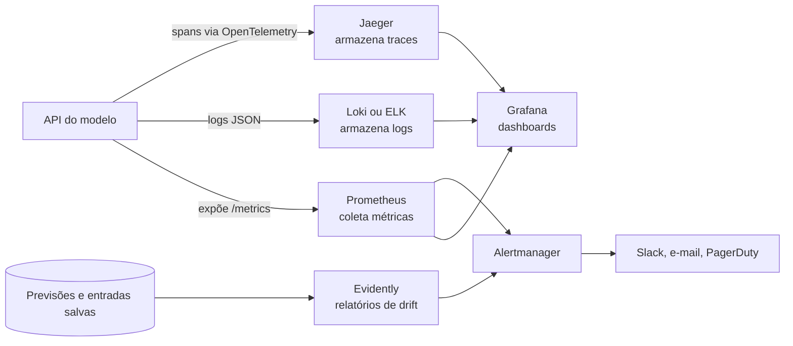
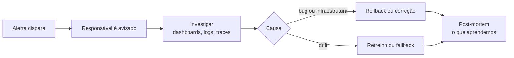

# Monitoramento e Observabilidade de Modelos

## Por que monitorar um modelo

Quando uma API comum quebra, ela costuma avisar: dá erro 500, alguém reclama, o log fica vermelho. Um modelo de ML pode falhar em silêncio. A API continua respondendo `200 OK` em 40 milissegundos, só que as previsões ficaram ruins porque os dados de entrada mudaram. Ninguém percebe até o time de negócio perguntar por que as vendas do canal recomendado caíram.

Por isso monitorar ML tem duas camadas:

- **A camada de software**: a API está de pé? Está rápida? Está dando erro?
- **A camada do modelo**: os dados que chegam se parecem com os do treino? As previsões continuam fazendo sentido? Quando o rótulo verdadeiro chega, o modelo ainda acerta?

Esta nota usa como exemplo a API de preço de imóveis de [Deploy com FastAPI e Docker](/labs/data/ml-em-producao/01-deploy-com-fastapi-e-docker/).

## Monitoramento x observabilidade

As duas palavras andam juntas, mas não são a mesma coisa:

- **Monitoramento** é acompanhar sinais que você já sabe que importam e disparar alertas quando saem do normal ("a latência passou de 500 ms")
- **Observabilidade** é a capacidade de entender o que está acontecendo dentro do sistema a partir do que ele emite, inclusive para problemas que você não previu ("por que só as requisições do estado X estão lentas?")

Um sistema observável costuma emitir três tipos de sinal, os chamados **três pilares**:

| Pilar    | O que é                                                                             | Pergunta que responde               | Exemplo                                                       |
| -------- | ----------------------------------------------------------------------------------- | ----------------------------------- | ------------------------------------------------------------- |
| Métricas | Números agregados ao longo do tempo                                                 | "Quanto?" e "com que frequência?"   | 120 requisições/s, latência p95 de 80 ms                      |
| Logs     | Registros de eventos individuais, com detalhes                                      | "O que aconteceu nessa requisição?" | `{"evento": "previsao", "valor": 4.52, "request_id": "a1b2"}` |
| Traces   | O caminho de uma requisição passando por vários serviços, com o tempo de cada etapa | "Onde o tempo foi gasto?"           | API 5 ms → feature store 30 ms → modelo 10 ms                 |

## Arquitetura de monitoramento

Uma stack open source bem comum:



- **Prometheus** coleta métricas: de tempos em tempos ele faz uma requisição ao endpoint `/metrics` de cada serviço (modelo _pull_) e guarda os valores como séries temporais
- **Grafana** monta dashboards em cima do Prometheus, do Loki e de outras fontes
- **ELK** (Elasticsearch, Logstash, Kibana) ou **Loki** guardam e indexam logs para busca
- **Jaeger** ou **Zipkin** guardam traces. Hoje o caminho padrão para gerar traces é o **OpenTelemetry**, um padrão aberto que funciona com vários backends
- **Alertmanager** recebe os alertas do Prometheus, agrupa e envia para o canal certo
- **Evidently** compara os dados de produção com os de referência e detecta drift

## O que medir

| Tipo      | Métricas                                                                                                                                                     |
| --------- | ------------------------------------------------------------------------------------------------------------------------------------------------------------ |
| Aplicação | Requisições por segundo (throughput), latência (p50, p95, p99), taxa de erros 4xx e 5xx                                                                      |
| Modelo    | Distribuição das features de entrada, distribuição das previsões, data drift, prediction drift, métricas de qualidade (MAE, recall...) quando o rótulo chega |
| Sistema   | CPU, memória, disco, uso de GPU, número de réplicas (pods) e reinícios                                                                                       |

Para a camada de aplicação, o livro de SRE do Google propõe os **quatro sinais de ouro**: latência, tráfego, erros e saturação (quão perto do limite o recurso está). Se você só tiver tempo de monitorar quatro coisas, comece por essas.

💡 Prefira percentis à média na latência. Uma média de 50 ms pode esconder 1% de requisições levando 5 segundos. O **p99** (o tempo abaixo do qual ficam 99% das requisições) mostra esse pior caso.

## Métricas com Prometheus

A biblioteca `prometheus-fastapi-instrumentator` adiciona ao FastAPI um endpoint `/metrics` com contagem de requisições e histogramas de latência por rota. Com o `prometheus-client` dá para criar métricas próprias do modelo, como a distribuição dos valores previstos.

```bash
pip install prometheus-fastapi-instrumentator prometheus-client python-json-logger
```

A API da nota de deploy, agora instrumentada com métricas e logs estruturados:

```python
# app/main.py
import logging
import time
import uuid
from contextlib import asynccontextmanager
from pathlib import Path

import joblib
import pandas as pd
from fastapi import FastAPI
from prometheus_client import Histogram
from prometheus_fastapi_instrumentator import Instrumentator
from pydantic import BaseModel, Field
from pythonjsonlogger.json import JsonFormatter

# Logs estruturados em JSON
handler = logging.StreamHandler()
handler.setFormatter(JsonFormatter("{asctime}{levelname}{name}{message}", style="{"))
logger = logging.getLogger("api-imoveis")
logger.addHandler(handler)
logger.setLevel(logging.INFO)

# Métricas do modelo
VALOR_PREVISTO = Histogram(
    "modelo_valor_previsto",
    "Distribuição dos valores previstos (centenas de milhares de dólares)",
    buckets=[0.5, 1, 1.5, 2, 2.5, 3, 4, 5],
)
TEMPO_INFERENCIA = Histogram(
    "modelo_tempo_inferencia_segundos",
    "Tempo gasto só no model.predict",
)

CAMINHO_MODELO = Path(__file__).parent / "modelo.joblib"
VERSAO_MODELO = "1.0.0"
modelos = {}


class Imovel(BaseModel):
    MedInc: float = Field(gt=0)
    HouseAge: float = Field(ge=0)
    AveRooms: float = Field(gt=0)
    AveBedrms: float = Field(gt=0)
    Population: float = Field(ge=0)
    AveOccup: float = Field(gt=0)
    Latitude: float = Field(ge=32, le=42)
    Longitude: float = Field(ge=-125, le=-114)


class Previsao(BaseModel):
    valor_estimado: float
    request_id: str


@asynccontextmanager
async def lifespan(app: FastAPI):
    modelos["imoveis"] = joblib.load(CAMINHO_MODELO)
    logger.info("modelo carregado", extra={"versao_modelo": VERSAO_MODELO})
    yield
    modelos.clear()


app = FastAPI(title="API de preço de imóveis", lifespan=lifespan)
Instrumentator().instrument(app).expose(app)


@app.get("/health")
def health():
    return {"status": "ok"}


@app.post("/predict", response_model=Previsao)
def predict(imovel: Imovel):
    request_id = str(uuid.uuid4())
    entrada = pd.DataFrame([imovel.model_dump()])

    inicio = time.perf_counter()
    valor = float(modelos["imoveis"].predict(entrada)[0])
    TEMPO_INFERENCIA.observe(time.perf_counter() - inicio)
    VALOR_PREVISTO.observe(valor)

    logger.info(
        "previsao",
        extra={
            "request_id": request_id,
            "versao_modelo": VERSAO_MODELO,
            "entrada": imovel.model_dump(),
            "valor_estimado": valor,
        },
    )
    return Previsao(valor_estimado=valor, request_id=request_id)
```

Suba a API e acesse `http://localhost:8000/metrics`. Aparecem métricas como `http_requests_total` (com rótulos de rota, método e status agrupado em `2xx`, `4xx`, `5xx`), `http_request_duration_seconds` e as duas métricas do modelo.

Para o Prometheus coletar essas métricas, crie um `prometheus.yml`:

```yaml
global:
  scrape_interval: 15s

rule_files:
  - alertas.yml

scrape_configs:
  - job_name: "api-imoveis"
    static_configs:
      - targets: ["api:80"]
```

E um `compose.yaml` que sobe a API, o Prometheus e o Grafana juntos:

```yaml
services:
  api:
    build: .
    ports:
      - "8000:80"
  prometheus:
    image: prom/prometheus
    volumes:
      - ./prometheus.yml:/etc/prometheus/prometheus.yml
      - ./alertas.yml:/etc/prometheus/alertas.yml
    ports:
      - "9090:9090"
  grafana:
    image: grafana/grafana
    ports:
      - "3000:3000"
```

Antes de subir, acrescente `prometheus-fastapi-instrumentator`, `prometheus-client` e `python-json-logger` (com as versões fixadas) ao `requirements.txt`, e crie o `alertas.yml` mostrado na seção de alertas mais abaixo, porque o Prometheus não inicia se o arquivo de regras não existir. Depois rode `docker compose up --build`. Dentro da rede do Compose, o nome do serviço (`api`) funciona como endereço, por isso o alvo é `api:80`. Em `http://localhost:9090` teste uma consulta em PromQL, a linguagem do Prometheus:

```text
histogram_quantile(0.95, sum(rate(http_request_duration_seconds_bucket[5m])) by (le))
```

Ela devolve a latência p95 dos últimos 5 minutos. No Grafana (`http://localhost:3000`), adicione o Prometheus como fonte de dados com a URL `http://prometheus:9090` e monte um painel com essa consulta.

## Logging estruturado

Um log em texto livre (`Previsão feita: 4.52 para o cliente X`) é fácil de ler e difícil de pesquisar. Um log em **JSON** tem campos com nome, e as ferramentas de log conseguem filtrar por eles (`valor_estimado > 5 AND versao_modelo = "1.0.0"`).

Com a API acima, cada previsão gera uma linha assim:

```json
{
  "asctime": "2026-10-25 14:03:12,481",
  "levelname": "INFO",
  "name": "api-imoveis",
  "message": "previsao",
  "request_id": "6f1c...",
  "versao_modelo": "1.0.0",
  "entrada": { "MedInc": 8.3, "HouseAge": 41.0, "...": "..." },
  "valor_estimado": 4.52
}
```

Algumas regras para os logs ajudarem de verdade:

- Use o `JsonFormatter` de `pythonjsonlogger.json`. O import antigo `from pythonjsonlogger import jsonlogger`, comum em tutoriais, está deprecado desde a versão 3.2 da biblioteca
- Inclua um **request_id** em todas as linhas de uma requisição e devolva o mesmo id na resposta. Quando o cliente reclamar de uma previsão estranha, você acha o log em segundos
- Registre a **versão do modelo**. Sem ela, não dá para saber se uma previsão ruim veio do modelo antigo ou do novo
- **Não registre dados pessoais** (nome, CPF, e-mail) nem segredos. Se a entrada tiver esse tipo de dado, mascare ou remova antes de logar, como pede a LGPD
- Os logs das previsões, com entrada e saída, são a matéria-prima da detecção de drift. Em produção, costuma valer mandar esses eventos também para uma tabela, onde fica mais fácil analisar depois

## Traces

Quando a previsão envolve vários serviços (a API busca features numa feature store, que consulta um banco, e depois chama o modelo), um trace mostra quanto tempo cada etapa levou. Cada etapa vira um **span**, e os spans de uma mesma requisição compartilham um id.

Para uma API única como a desta nota, métricas e logs bastam. Traces passam a valer a pena quando há vários serviços conversando. O ponto de partida é o **OpenTelemetry**, que tem instrumentação automática para FastAPI e exporta os dados para Jaeger, Zipkin, Grafana Tempo ou serviços de nuvem.

## Drift: quando o mundo muda

Drift é a mudança, ao longo do tempo, nos dados ou na relação que o modelo aprendeu. Os três tipos mais citados:

| Tipo             | O que muda                             | Exemplo no modelo de imóveis                                                        | Como detectar                                         |
| ---------------- | -------------------------------------- | ----------------------------------------------------------------------------------- | ----------------------------------------------------- |
| Data drift       | A distribuição das features de entrada | A API passa a receber muitos imóveis de uma região que quase não aparecia no treino | Comparar entradas de produção com o treino            |
| Prediction drift | A distribuição das previsões           | A média dos valores previstos sobe 30% em um mês                                    | Comparar previsões recentes com as antigas            |
| Concept drift    | A relação entre entrada e alvo         | Os juros sobem e imóveis com as mesmas características passam a valer menos         | Comparar previsões com o valor real, quando ele chega |

Data drift e prediction drift dá para medir na hora, porque só dependem do que chega e do que sai. Concept drift exige o **rótulo verdadeiro** (o preço de venda real, se o cliente cancelou ou não), que às vezes só chega semanas depois. Enquanto ele não chega, data drift e prediction drift servem como alerta antecipado.

Nem todo drift é problema. Um aumento de compras em dezembro é sazonalidade esperada. Por isso vale escolher a janela de referência com cuidado (comparar dezembro com dezembro do ano anterior, por exemplo).

## Detectando drift com Evidently

O **Evidently** é uma biblioteca open source que compara dois conjuntos de dados (referência e atual) e aplica testes estatísticos coluna a coluna para dizer se houve drift.

```bash
pip install evidently
```

```python
# relatorio_drift.py
import pandas as pd
from evidently import DataDefinition, Dataset, Report
from evidently.presets import DataDriftPreset
from sklearn.datasets import fetch_california_housing

dados = fetch_california_housing(as_frame=True).data

# Referência: dados parecidos com os do treino
referencia = dados.sample(2000, random_state=1)

# "Produção": simula uma mudança, com mais imóveis de renda alta
atual = dados[dados["MedInc"] > 4].sample(2000, random_state=2)

definicao = DataDefinition(numerical_columns=list(dados.columns))
ds_referencia = Dataset.from_pandas(referencia, data_definition=definicao)
ds_atual = Dataset.from_pandas(atual, data_definition=definicao)

relatorio = Report([DataDriftPreset()])
resultado = relatorio.run(ds_atual, ds_referencia)
resultado.save_html("drift.html")
```

Abra o `drift.html` no navegador: ele mostra quais colunas tiveram drift, o teste usado e os histogramas das duas distribuições. Na ordem dos argumentos de `run`, o primeiro é o conjunto atual e o segundo, a referência. Para automatizar, o resultado também pode ser exportado como dicionário (`resultado.dict()`) ou JSON (`resultado.json()`), e um job agendado pode ler esses valores e disparar o retreino descrito em [MLOps](/labs/data/ml-em-producao/02-mlops/).

## Alertas e incidentes

Dashboard que ninguém olha não protege nada. Os sinais importantes viram **alertas**. Uma regra do Prometheus para taxa de erro alta, no arquivo `alertas.yml` referenciado no `prometheus.yml`:

```yaml
groups:
  - name: api-imoveis
    rules:
      - alert: TaxaDeErroAlta
        expr: |
          sum(rate(http_requests_total{status="5xx"}[5m]))
            / sum(rate(http_requests_total[5m])) > 0.05
        for: 10m
        labels:
          severity: critical
        annotations:
          summary: "Mais de 5% das requisições da API de imóveis estão falhando"
```

O `for: 10m` evita alarme falso: o alerta só dispara se a condição se mantiver por 10 minutos seguidos. O Prometheus manda o alerta para o Alertmanager, que cuida do envio (Slack, e-mail, PagerDuty) e agrupa alertas parecidos. Para isso funcionar, o Alertmanager precisa ser adicionado ao `compose.yaml` e configurado no `prometheus.yml`, o que fica como exercício.

O fluxo de um incidente costuma seguir estes passos:



Duas dicas que poupam noites mal dormidas:

- Cada alerta deve ter um **runbook**, um texto curto dizendo o que verificar e o que fazer. Alerta sem ação clara vira ruído
- Alerte sobre sintomas que afetam o usuário (erro, latência, drift relevante), não sobre tudo o que é possível medir. Alerta demais faz o time ignorar todos

## Ferramentas por categoria

| Categoria                | Ferramentas                                               |
| ------------------------ | --------------------------------------------------------- |
| Métricas e dashboards    | Prometheus, Grafana                                       |
| Logs                     | ELK (Elasticsearch, Logstash, Kibana), Grafana Loki       |
| Traces                   | OpenTelemetry, Jaeger, Zipkin                             |
| Alertas                  | Alertmanager, PagerDuty, Opsgenie                         |
| Monitoramento de modelos | Evidently, Fiddler, whylogs                               |
| Serviços de nuvem        | Amazon CloudWatch, Google Cloud Monitoring, Azure Monitor |

Sobre o **WhyLabs**, que aparece em listas de ferramentas de monitoramento de ML: a plataforma hospedada foi encerrada em 2025, e o código foi aberto no projeto whylabs-oss. A biblioteca **whylogs**, que gera perfis estatísticos dos dados, continua disponível.

## Referências

- [Introdução à observabilidade](https://opentelemetry.io/pt/docs/concepts/observability-primer/) - OpenTelemetry, pt-BR
- [Prometheus - Overview](https://prometheus.io/docs/introduction/overview/) - Prometheus, en
- [Monitoring Distributed Systems](https://sre.google/sre-book/monitoring-distributed-systems/) - Google SRE Book, en
- [Evidently AI documentation](https://docs.evidentlyai.com/) - Evidently AI, en
- [python-json-logger](https://nhairs.github.io/python-json-logger/latest/) - nhairs, en
