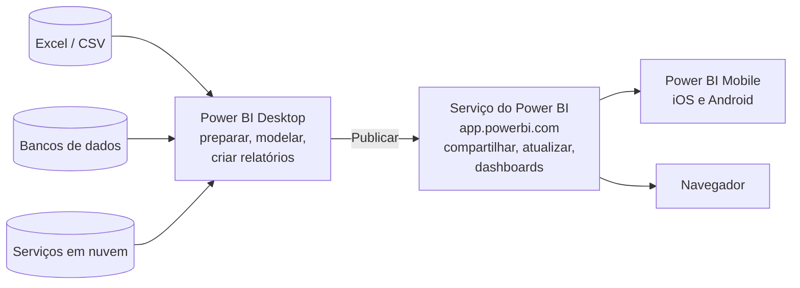
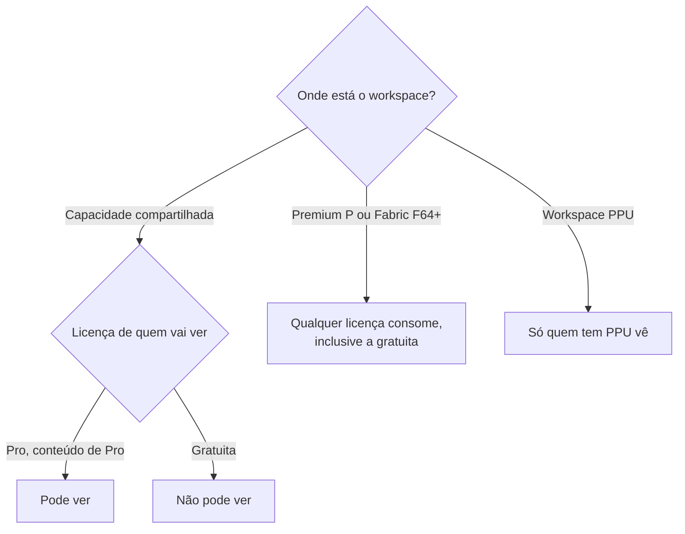

# Introdução ao Power BI e Licenças

## O que é o Power BI

O Power BI é a ferramenta de Business Intelligence (BI) da Microsoft. Com ela você conecta fontes de dados (planilhas, bancos, APIs, serviços em nuvem), limpa e transforma esses dados, monta um modelo com tabelas relacionadas e cálculos, cria relatórios interativos e compartilha tudo com outras pessoas.

Se você já fez um relatório no Excel com tabela dinâmica e gráfico, a ideia é parecida, só que em outra escala: o Power BI aguenta milhões de linhas, atualiza os dados sozinho no horário que você definir e deixa várias pessoas consumirem o mesmo relatório pelo navegador ou pelo celular.

## Fundamentos de BI

Business Intelligence é o conjunto de práticas e ferramentas para transformar dado bruto em informação útil para decisão. Uma tabela com 2 milhões de linhas de vendas não responde nada sozinha; um gráfico de "faturamento por mês, comparado com o ano anterior" responde.

O caminho costuma ser este:

Cada etapa desse fluxo tem uma parte do Power BI dedicada a ela, e é isso que as próximas notas desta seção cobrem: Power Query para preparar, o modo Modelo e o DAX para modelar e calcular, os visuais para apresentar e o serviço para compartilhar.

### O cenário de exemplo desta seção

Para as notas ficarem conectadas, todos os exemplos usam o mesmo cenário: uma loja que vende produtos para vários clientes. O modelo final terá quatro tabelas:

| Tabela        | O que guarda                          | Exemplo de colunas                                                         |
| ------------- | ------------------------------------- | -------------------------------------------------------------------------- |
| `fVendas`     | Uma linha por item vendido (os fatos) | `IdVenda`, `Data`, `IdProduto`, `IdCliente`, `Quantidade`, `ValorUnitario` |
| `dProduto`    | Um produto por linha                  | `IdProduto`, `Produto`, `Categoria`, `Custo`                               |
| `dCliente`    | Um cliente por linha                  | `IdCliente`, `Cliente`, `Cidade`, `UF`                                     |
| `dCalendario` | Uma data por linha                    | `Data`, `Ano`, `Mes`, `Trimestre`                                          |

O prefixo `f` indica tabela fato e o `d` indica tabela dimensão. A convenção é comum no mercado brasileiro e o significado dela é explicado em [Modelagem de dados](/labs/data/power-bi/05-modelagem-de-dados/).

## Arquitetura e fluxo de trabalho

O Power BI não é um programa só. É uma família de produtos que conversam entre si:

O fluxo mais comum é: você desenvolve no Desktop, publica no serviço e as pessoas consomem pelo navegador ou pelo app do celular.

## Componentes

### Power BI Desktop

Aplicativo gratuito para Windows, onde o trabalho de desenvolvimento acontece: conectar fontes, transformar dados no Power Query, criar relacionamentos, escrever medidas em DAX e montar as páginas do relatório. O arquivo gerado tem extensão `.pbix` (ou o formato de projeto `.pbip`, pensado para controle de versão com Git).

Dá para instalar pela Microsoft Store (atualiza sozinho) ou pelo Centro de Download da Microsoft. Não existe versão para macOS; quem usa Mac costuma recorrer a uma máquina virtual com Windows ou trabalhar direto no serviço, que tem recursos de edição na web.

A interface do Desktop é o assunto de [Interface do Power BI Desktop](/labs/data/power-bi/02-interface-do-desktop/).

### Serviço do Power BI

É a parte SaaS (software como serviço), acessada em `app.powerbi.com`. Ali você publica relatórios, organiza o conteúdo em workspaces, compartilha com colegas, agenda a atualização dos dados, cria dashboards e configura quem pode ver o quê. Os detalhes estão em [Serviço, publicação e dashboards](/labs/data/power-bi/10-servico-publicacao-e-dashboards/).

### Power BI Mobile

Apps para iOS e Android que exibem relatórios e dashboards publicados no serviço, com layout próprio para telas pequenas. O app do Power BI para Windows (aquele da loja, para consumir relatórios) foi aposentado em 31/12/2023. O Power BI Desktop não tem nada a ver com essa aposentadoria e segue firme.

### Power BI e Microsoft Fabric

Desde 2023 o Power BI faz parte do Microsoft Fabric, a plataforma de dados da Microsoft que reúne engenharia de dados, data warehouse, ciência de dados, tempo real e BI no mesmo lugar. Na prática, para quem está começando, muda pouco: o serviço do Power BI continua existindo, mas a administração e o licenciamento passaram a ser integrados ao Fabric. Por isso você vai ver termos como "capacidade Fabric" e "licença Fabric (gratuita)" na documentação.

Outra mudança de nome que confunde quem lê material antigo: o que se chamava **dataset** (conjunto de dados) agora se chama **modelo semântico** (semantic model), desde novembro de 2023. É a mesma coisa: as tabelas, relacionamentos e medidas que alimentam os relatórios.

## Licenciamento

Aqui mora a maior fonte de confusão para iniciantes. O Power BI Desktop é gratuito para qualquer pessoa. O que é licenciado é o **serviço**, e a licença define o que você pode fazer lá: publicar, compartilhar, consumir conteúdo de outras pessoas.

Existem dois tipos de licença:

- **Por usuário**: cada pessoa recebe uma (Fabric gratuito, Power BI Pro ou Premium por Usuário).
- **Por capacidade**: a organização compra uma capacidade (as SKUs F do Fabric ou as SKUs P do Power BI Premium) e os workspaces atribuídos a ela ganham recursos extras.

### Licença gratuita (Fabric Free)

Com a licença gratuita você pode usar o serviço para conectar dados e criar relatórios e dashboards **para uso próprio**. Você não consegue compartilhar com ninguém nem publicar em workspaces de outras pessoas.

Material antigo às vezes diz que a versão gratuita permite "compartilhamento básico". Não permite. A única forma de um usuário gratuito ver conteúdo de outra pessoa é quando esse conteúdo está num workspace hospedado em capacidade Premium ou Fabric F64 ou superior.

### Power BI Pro

Licença por usuário que permite publicar em workspaces compartilhados, compartilhar relatórios e dashboards, assinar relatórios por e-mail e colaborar com outros usuários Pro. A regra de ouro: em capacidade compartilhada, **quem publica e quem consome precisam ter Pro**.

### Premium por Usuário (PPU)

Inclui tudo do Pro e a maioria dos recursos que antes só existiam em capacidade Premium (atualizações mais frequentes, modelos maiores, recursos avançados de IA e de modelagem), mas licenciados por pessoa. A pegadinha é que, num workspace PPU, **todo mundo que acessa precisa de PPU**, inclusive quem só visualiza.

### Licenças de capacidade (Fabric F e Premium P)

A organização compra uma capacidade de processamento dedicada. Quem cria conteúdo ainda precisa de Pro ou PPU, mas os workspaces nessa capacidade podem ser distribuídos para usuários com qualquer licença, inclusive a gratuita, desde que a capacidade seja **F64 ou maior** (ou uma capacidade Premium P). É o modelo que empresas grandes usam para disponibilizar relatórios para milhares de pessoas sem comprar uma licença Pro para cada uma.

### Quem pode compartilhar com quem

| Licença de quem consome | Workspace em capacidade compartilhada         | Workspace em capacidade Premium ou Fabric F64+ |
| ----------------------- | --------------------------------------------- | ---------------------------------------------- |
| Fabric (gratuito)       | Só o próprio conteúdo                         | Consome o que usuários Pro/PPU compartilharam  |
| Power BI Pro            | Publica, compartilha e consome com outros Pro | Distribui para usuários gratuitos e PPU        |
| Premium por Usuário     | Publica, compartilha e consome com outros PPU | Distribui para usuários gratuitos e Pro        |

Preços não aparecem aqui de propósito: eles mudam com frequência e variam por região e contrato. Consulte a página oficial de preços do Power BI quando precisar.

Para estudar, a licença gratuita mais o Power BI Desktop já cobrem quase tudo desta seção. Se quiser testar o compartilhamento, a avaliação gratuita do Fabric dá acesso temporário a uma capacidade com recursos parecidos com os do PPU.

## Referências

- [O que é o Power BI?](https://learn.microsoft.com/pt-br/power-bi/fundamentals/power-bi-overview) - Microsoft Learn, pt-BR
- [Recursos do serviço do Power BI por tipo de licença](https://learn.microsoft.com/pt-br/power-bi/fundamentals/service-features-license-type) - Microsoft Learn, pt-BR
- [Introdução ao Power BI Desktop](https://learn.microsoft.com/pt-br/power-bi/fundamentals/desktop-getting-started) - Microsoft Learn, pt-BR
- [Trilha de treinamento do Power BI](https://learn.microsoft.com/pt-br/training/powerplatform/power-bi) - Microsoft Learn, pt-BR
