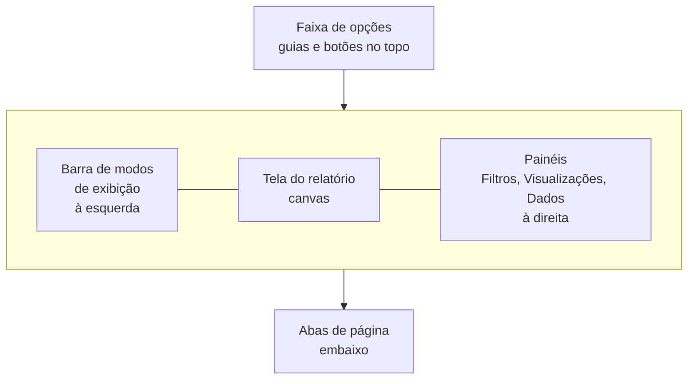

# Interface do Power BI Desktop

## Visão geral da tela

Na primeira vez que você abre o Power BI Desktop, a quantidade de botões assusta um pouco. A boa notícia é que a tela se divide em poucas regiões, e cada uma tem um papel claro:



O fluxo de trabalho também é sempre parecido: buscar os dados pela faixa de opções, ajustar o modelo nos modos de exibição da esquerda e montar o relatório na tela central usando os painéis da direita.

## Faixa de opções (ribbon)

É a barra no topo, organizada em guias. As que você mais vai usar:

| Guia               | Para que serve                     | Grupos e botões principais                                                                                                                                                                                  |
| ------------------ | ---------------------------------- | ----------------------------------------------------------------------------------------------------------------------------------------------------------------------------------------------------------- |
| **Página Inicial** | Ponto de partida do dia a dia      | **Dados** (Obter dados, Excel, SQL Server, Inserir dados), **Consultas** (Transformar dados, Atualizar), **Inserir** (novo visual, caixa de texto), **Cálculos** (Nova medida), **Compartilhar** (Publicar) |
| **Inserir**        | Acrescentar elementos ao relatório | Nova página, visuais, caixa de texto, botões, formas, imagens                                                                                                                                               |
| **Modelagem**      | Trabalhar o modelo semântico       | Gerenciar relações, nova medida, nova coluna, nova tabela, gerenciar funções (segurança em nível de linha)                                                                                                  |
| **Exibir**         | Aparência e painéis                | Temas, layout de celular, linhas de grade, mostrar ou ocultar painéis                                                                                                                                       |
| **Otimizar**       | Desempenho                         | Analisador de desempenho, pausar visuais                                                                                                                                                                    |
| **Ajuda**          | Documentação e comunidade          | Guia, treinamento, sobre a versão                                                                                                                                                                           |

Alguns botões só aparecem em contexto. Ao selecionar um visual surgem as guias de ferramentas de visual; ao selecionar uma tabela no painel Dados aparecem as **Ferramentas de tabela**, e ao selecionar uma coluna, as **Ferramentas de coluna** (tipo de dados, formato, classificar por coluna).

O botão **Transformar dados** abre outra janela, o Editor do Power Query, que tem a própria faixa de opções. Ele é assunto de [Power Query](/labs/data/power-bi/04-power-query/).

## Modos de exibição

Na barra vertical à esquerda ficam os ícones dos modos de exibição. Material mais antigo cita só três (Relatório, Dados e Modelo); hoje são cinco, e o antigo "Dados" foi renomeado para **Tabela**.


### Relatório

O modo padrão. É onde você arrasta campos para a tela, escolhe gráficos, formata e organiza as páginas. Tudo o que o usuário final vê nasce aqui.

### Tabela

Mostra as linhas que foram carregadas para o modelo, como uma planilha somente leitura. Serve para conferir se os dados chegaram certos, ver o tipo de cada coluna e criar colunas calculadas. Se a tabela estiver em modo DirectQuery, nenhuma linha aparece aqui, porque os dados não ficam guardados no arquivo (os modos de armazenamento estão em [Obter dados e modos de armazenamento](/labs/data/power-bi/03-obter-dados-e-modos-de-armazenamento/)).

### Modelo

Diagrama com as tabelas como caixas e os relacionamentos como linhas entre elas. É aqui que você cria relacionamentos arrastando uma coluna sobre a outra, ajusta cardinalidade e direção do filtro, oculta colunas e organiza o modelo em layouts. O painel **Propriedades** deste modo também mostra o modo de armazenamento de cada tabela. O conteúdo completo está em [Modelagem de dados](/labs/data/power-bi/05-modelagem-de-dados/).

### Exibição de consulta DAX

Um editor para escrever **consultas** DAX, que retornam dados do modelo, parecido com rodar um `SELECT` num banco. A consulta sempre tem um `EVALUATE` e pode ter um `DEFINE` para declarar medidas temporárias:

```dax
DEFINE
    MEASURE fVendas[Total Vendas] =
        SUMX ( fVendas, fVendas[Quantidade] * fVendas[ValorUnitario] )
EVALUATE
    SUMMARIZECOLUMNS ( dProduto[Categoria], "Total", [Total Vendas] )
ORDER BY [Total] DESC
```

Uma consulta não cria nada no relatório. Ela é ótima para testar uma medida antes de salvá-la no modelo: o editor mostra um atalho ("Atualizar modelo: Adicionar nova medida") acima de cada `DEFINE MEASURE`. Para quem já sabe SQL, a documentação oficial traz uma tabela de equivalências (`SELECT * FROM Vendas` vira `EVALUATE 'Vendas'`, `GROUP BY` vira `SUMMARIZECOLUMNS` e assim por diante). A sintaxe das fórmulas DAX é explicada em [DAX: fundamentos](/labs/data/power-bi/06-dax-fundamentos/).

### Exibição TMDL

TMDL (Tabular Model Definition Language) é uma linguagem de texto que descreve o modelo semântico: tabelas, colunas, medidas, relacionamentos. A exibição TMDL abre um editor de código onde você arrasta um objeto do painel Dados e recebe o script dele, edita e clica em **Aplicar**. Serve para tarefas repetitivas, como renomear dezenas de colunas com localizar e substituir, ou copiar uma tabela de calendário pronta de um arquivo para outro.

No Desktop, a exibição TMDL já está disponível de forma geral. Para quem está começando ela não é necessária, mas é bom saber que existe.

## Tela do relatório (canvas)

A área branca no centro do modo Relatório. Cada página do relatório é uma tela, e você posiciona visuais, caixas de texto, imagens e botões nela. Embaixo ficam as **abas de página**: o `+` cria uma página nova, clique duplo renomeia e clique com o botão direito permite duplicar, ocultar ou excluir.

## Painéis da direita

### Visualizações

Tem duas funções principais:

- **Criar visual**: a galeria de tipos de gráfico (barras, linhas, cartão, tabela, matriz, mapa...) e, logo abaixo, os campos do visual selecionado, como **Eixo X**, **Eixo Y**, **Legenda**, **Valores**, **Dicas de ferramenta**. Arrastar `dProduto[Categoria]` para o eixo e a medida `Total Vendas` para os valores já gera um gráfico de vendas por categoria.
- **Formatar visual**: título, cores, rótulos de dados, eixos, legenda, bordas, plano de fundo.

Também é nesse painel que fica a área de **drill-through**, onde você define que uma página pode ser aberta a partir de outra já filtrada por um campo.

Os tipos de visual e a formatação estão em [Visualizações e formatação](/labs/data/power-bi/08-visualizacoes-e-formatacao/); drill-through e interatividade, em [Filtros, segmentações e interatividade](/labs/data/power-bi/09-filtros-segmentacoes-e-interatividade/).

### Dados

Lista as tabelas do modelo com suas colunas e medidas (em versões antigas o painel se chamava **Campos**). Você marca a caixa ao lado de um campo para adicioná-lo ao visual selecionado, ou arrasta o campo para a tela. Ícones ajudam a identificar o que é cada item: a calculadora indica uma medida, o sigma (Σ) indica uma coluna numérica que será somada por padrão.

### Filtros

Fica ao lado do painel Visualizações e define filtros no nível do visual, da página ou do relatório inteiro.

## Primeiro contato com o cenário de vendas

Um roteiro curto para se localizar na interface:

1. **Página Inicial > Obter dados > Pasta de trabalho do Excel** e escolha o arquivo com as planilhas `fVendas`, `dProduto`, `dCliente`.
2. No **Navegador**, marque as planilhas e clique em **Transformar dados** (abre o Power Query) ou **Carregar** (vai direto para o modelo).
3. Abra o modo **Tabela** e confira se `Quantidade` veio como número inteiro e `Data` como data.
4. Abra o modo **Modelo** e veja se o Power BI criou sozinho os relacionamentos por `IdProduto` e `IdCliente`.
5. Volte ao modo **Relatório**, escolha um gráfico de colunas e arraste `dProduto[Categoria]` e `fVendas[Quantidade]` para ele.
6. **Arquivo > Salvar** gera o `.pbix`.

## Referências

- [Introdução ao Power BI Desktop](https://learn.microsoft.com/pt-br/power-bi/fundamentals/desktop-getting-started) - Microsoft Learn, pt-BR
- [Exibição de consulta DAX](https://learn.microsoft.com/pt-br/power-bi/transform-model/dax-query-view) - Microsoft Learn, pt-BR
- [Usar o modo de exibição TMDL no Power BI](https://learn.microsoft.com/pt-br/power-bi/transform-model/desktop-tmdl-view) - Microsoft Learn, pt-BR
