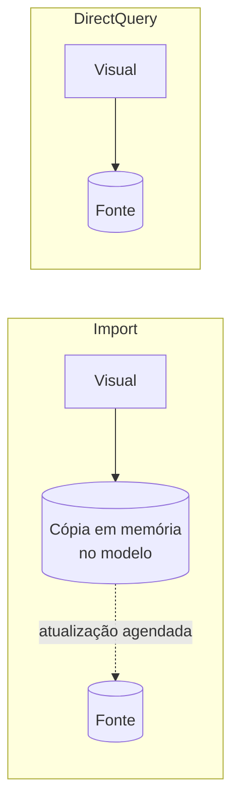
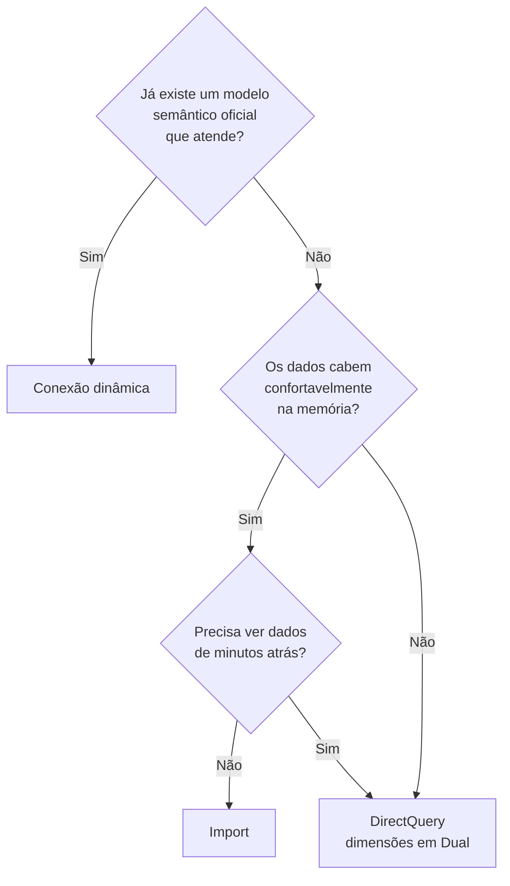

# Obter Dados e Modos de Armazenamento

## O que é uma fonte de dados

Fonte de dados é qualquer lugar de onde o Power BI consegue ler dados: um arquivo Excel na sua máquina, uma tabela num banco PostgreSQL, uma lista do SharePoint, uma API que devolve JSON. O Power BI se comunica com cada uma delas por meio de um **conector**, e existem centenas deles.

Escolher a fonte é só metade da decisão. A outra metade é **como** os dados vão chegar ao modelo: copiados para dentro do arquivo ou consultados na origem a cada clique. Isso é o modo de armazenamento, assunto da segunda parte desta nota.

## Categorias de fontes

Na janela **Obter dados > Mais...**, os conectores aparecem agrupados. Os mais comuns:

| Categoria        | Exemplos                                                                              |
| ---------------- | ------------------------------------------------------------------------------------- |
| Arquivo          | Excel, Texto/CSV, XML, JSON, Pasta (junta vários arquivos de uma pasta), PDF, Parquet |
| Banco de dados   | SQL Server, MySQL, PostgreSQL, Oracle, IBM Db2, Access                                |
| Microsoft Fabric | Modelos semânticos do Power BI, lakehouses, warehouses, fluxos de dados               |
| Azure            | Azure SQL Database, Azure Blob Storage, Azure Data Lake Storage, Azure Synapse        |
| Serviços online  | Pasta do SharePoint, lista do SharePoint, Salesforce, Google Analytics, Dynamics 365  |
| Outras           | Web, OData, ODBC, consulta em branco, script R, script Python                         |

Alguns conectores (como Google BigQuery ou Snowflake) ficam na categoria de banco de dados ou de nuvem, dependendo da versão. Use a caixa de busca da janela em vez de procurar categoria por categoria.

## Fluxo do "Obter dados"

1. **Escolher a fonte**: Página Inicial > Obter dados.
2. **Conectar**: para um arquivo, você indica o caminho; para um banco, o servidor e o nome do banco. Na primeira vez o Power BI pede credenciais (usuário do Windows, usuário do banco, conta Microsoft) e guarda essa configuração em **Arquivo > Opções e configurações > Configurações da fonte de dados**.
3. **Navegador**: mostra as tabelas, views ou planilhas disponíveis, com uma prévia das primeiras linhas.
4. **Carregar ou Transformar dados**: carregar leva os dados como estão; transformar abre o Power Query. No cenário de vendas, a recomendação é quase sempre **Transformar dados**, porque é raro uma fonte vir pronta (veja [Power Query](/labs/data/power-bi/04-power-query/)).

Para bancos relacionais, a mesma tela de conexão pergunta o **modo de conectividade de dados**: Importar ou DirectQuery. É aqui que entra a próxima seção.

## Modos de armazenamento

No Power BI, cada tabela do modelo semântico tem uma propriedade **Modo de armazenamento**. Ela decide se os dados ficam guardados na memória do modelo ou se são buscados na fonte quando um visual é carregado. Você confere isso no modo **Modelo**, selecionando a tabela e abrindo **Propriedades > Avançado > Modo de armazenamento**.

### Import (Importação)

O Power BI tira uma "foto" dos dados e guarda uma cópia comprimida dentro do modelo. Os visuais consultam essa cópia, que fica em memória, então tudo responde rápido. Funciona com praticamente qualquer fonte e libera todos os recursos do Power Query e do DAX.

O preço é que os dados só mudam quando o modelo é atualizado: se uma venda entrar no banco às 10h e a atualização agendada rodar às 12h, o relatório só mostra a venda depois das 12h. Arquivos muito grandes também pesam na memória e no tamanho do `.pbix`.

É o modo padrão e o recomendado para a maioria dos casos, inclusive para quem está aprendendo.

### DirectQuery

Nada fica guardado no modelo além da estrutura. A cada interação (abrir a página, clicar numa segmentação) o Power BI traduz a consulta DAX do visual para a linguagem da fonte, geralmente SQL, e manda para o banco. Os dados mostrados são os mais recentes possíveis.

Faz sentido quando os dados são grandes demais para importar, quando mudam o tempo todo e o relatório precisa refletir isso, ou quando uma regra da empresa impede copiar os dados para fora do banco.

As desvantagens:

- O relatório fica tão rápido quanto o banco. Fonte lenta, visual lento.
- Cada clique gera consultas na fonte, o que pode sobrecarregar um banco de produção.
- O Power Query aceita só transformações que possam ser convertidas em uma consulta nativa da fonte.
- Algumas funções DAX ficam restritas, principalmente em colunas calculadas, e o modo Tabela não mostra as linhas.
- Só funciona com fontes que dão suporte a esse modo (bancos relacionais e alguns serviços); arquivos como Excel e CSV não têm DirectQuery.

### Dual (Duplo)

Dual não é um terceiro jeito de se conectar a uma fonte. É um modo de armazenamento **por tabela**, usado em modelos que misturam Import e DirectQuery (os modelos compostos). Uma tabela Dual tem os dados importados **e** pode ser consultada em DirectQuery: o Power BI escolhe, em cada consulta, o caminho que der menos trabalho.

O uso típico é em tabelas de dimensão. Imagine que `fVendas` é enorme e fica em DirectQuery, enquanto `dProduto`, `dCliente` e `dCalendario` são pequenas. Com as dimensões em Dual:

- uma segmentação que só lista categorias de produto responde pelo cache, sem ir ao banco;
- um visual que soma vendas por categoria manda uma única consulta com `GROUP BY` para o banco, porque é mais barato o banco devolver os totais do que o Power BI trazer todas as linhas.

Isso também evita os chamados **relacionamentos limitados**, que surgem quando uma tabela Import se relaciona com uma tabela DirectQuery e a junção não pode ser feita na fonte. Quando você troca uma tabela DirectQuery para Import, o próprio Desktop oferece converter as dimensões relacionadas para Dual.

Tabelas Dual têm as mesmas restrições de M e DAX das tabelas DirectQuery.

### Conexão dinâmica (Live connection)

Quando você se conecta a um **modelo semântico do Power BI** já publicado (ou a um modelo do Analysis Services), o arquivo não tem modelo próprio. Ele só guarda as páginas do relatório, por isso também é chamado de **relatório fino**. O modelo remoto pode usar qualquer modo de armazenamento.

Nesse modo você não cria colunas calculadas nem tabelas calculadas, e o modo Modelo mostra informações limitadas. Mas dá para criar **medidas no nível do relatório**, que ficam salvas só naquele arquivo.

O cenário clássico é uma equipe de dados manter um modelo semântico oficial de vendas e as áreas de negócio criarem seus próprios relatórios em cima dele, sem duplicar dados nem regras de cálculo.

### Modelos compostos e DirectQuery para modelos semânticos

Um **modelo composto** é qualquer modelo com tabelas em mais de um modo de armazenamento. Além de misturar Import e DirectQuery de uma mesma fonte, você pode partir de uma conexão dinâmica e clicar em **Fazer alterações neste modelo**: o relatório deixa de ser fino, o modelo remoto passa a ser acessado em "DirectQuery para modelos semânticos do Power BI" e você pode acrescentar tabelas próprias (uma planilha de metas, por exemplo) e medidas novas.

Isso resolve o caso "o modelo oficial está quase perfeito, só falta a minha tabela de metas", mas adiciona complexidade. Use com moderação.

### Outros modos que você vai ver citados

- **Direct Lake**: modo do Microsoft Fabric que lê tabelas no formato Delta direto do OneLake, com velocidade próxima à do Import e sem precisar copiar os dados. Só existe para fontes do Fabric e foge do escopo de quem está começando.
- **Híbrido**: aparece com atualização incremental, quando a partição mais recente de uma tabela importada fica em DirectQuery para mostrar dados em tempo quase real.

### Import x DirectQuery

| Critério               | Import                          | DirectQuery                                     |
| ---------------------- | ------------------------------- | ----------------------------------------------- |
| Onde ficam os dados    | Cópia comprimida no modelo      | Na fonte                                        |
| Desempenho dos visuais | Rápido, consulta em memória     | Depende da fonte e da rede                      |
| Atualidade             | Até a última atualização        | Sempre a mais recente                           |
| Tamanho do arquivo     | Cresce com os dados             | Pequeno                                         |
| Carga na fonte         | Só durante a atualização        | A cada interação do usuário                     |
| Power Query e DAX      | Todos os recursos               | Transformações e funções limitadas              |
| Fontes suportadas      | Quase todas                     | Bancos e alguns serviços                        |
| Quando escolher        | Padrão para a maioria dos casos | Dados enormes, tempo real ou restrição de cópia |

## Boas práticas ao obter dados

- **Permissões e segurança**: use uma conta com acesso só de leitura ao banco e conexões criptografadas quando a fonte oferecer. Não compartilhe `.pbix` com credenciais pessoais embutidas em scripts.
- **Traga só o necessário**: no Navegador, marque apenas as tabelas que o relatório usa; no Power Query, remova colunas e filtre linhas logo nas primeiras etapas. Menos dados significa atualização mais rápida e modelo menor.
- **Confira os tipos de dados**: datas que chegam como texto e números com vírgula decimal lidos como texto são os erros mais comuns em arquivos CSV brasileiros. Corrigir no Power Query evita medidas quebradas depois.
- **Pré-visualize antes de carregar**: a prévia do Navegador e do Power Query mostra problemas (cabeçalho na linha errada, linhas de total no fim da planilha) antes de eles irem para o modelo.
- **Prefira views ou consultas prontas no banco**: se você tem acesso ao banco, uma view que já faz as junções e filtros costuma ser mais simples de manter do que repetir essa lógica no Power BI. A base de SQL para isso está em [Introdução ao SQL](/labs/data/sql/01-introducao-ao-sql/).

## Referências

- [Fontes de dados no Power BI Desktop](https://learn.microsoft.com/pt-br/power-bi/connect-data/desktop-data-sources) - Microsoft Learn, pt-BR
- [Modo de armazenamento de tabela em modelos semânticos do Power BI](https://learn.microsoft.com/pt-br/power-bi/transform-model/desktop-storage-mode) - Microsoft Learn, pt-BR
- [DirectQuery no Power BI](https://learn.microsoft.com/pt-br/power-bi/connect-data/desktop-directquery-about) - Microsoft Learn, pt-BR
- [Usar modelos compostos no Power BI Desktop](https://learn.microsoft.com/pt-br/power-bi/transform-model/desktop-composite-models) - Microsoft Learn, pt-BR
