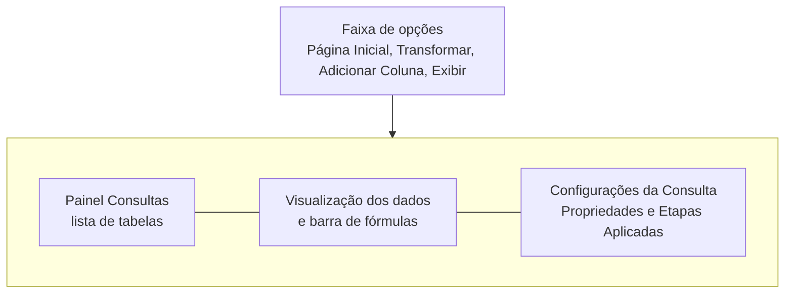
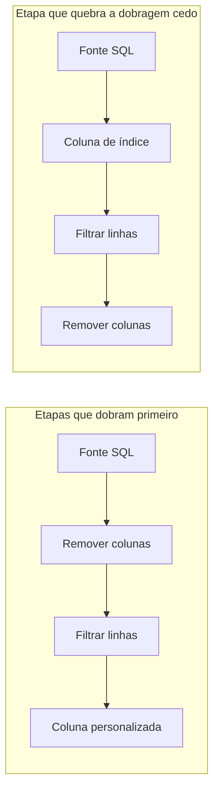

# Power Query

## O que é o Power Query

O Power Query é o motor de preparação de dados do Power BI, o "T" de ETL (extrair, transformar, carregar). Ele conecta nas fontes, limpa e remodela os dados e entrega o resultado pronto para o modelo. O mesmo Power Query existe no Excel, nos fluxos de dados do Fabric e em outros produtos da Microsoft, então o que você aprende aqui serve lá também.

A grande sacada é que você não escreve código para trabalhar com ele (embora possa). Cada clique, como remover uma coluna ou trocar um tipo, vira uma **etapa** gravada. Na próxima atualização, o Power Query refaz todas as etapas sozinho nos dados novos. É como gravar uma macro, só que legível e editável.

Você abre o Editor do Power Query pelo botão **Transformar dados** na Página Inicial do Desktop, ou escolhendo **Transformar dados** no Navegador ao conectar uma fonte.

## Interface do Editor



- **Faixa de opções**:
  - **Página Inicial**: fechar e aplicar, nova fonte, gerenciar colunas, reduzir linhas, mesclar e acrescentar consultas.
  - **Transformar**: altera a coluna existente (tipo, dividir, substituir valores, dinamizar).
  - **Adicionar Coluna**: cria colunas novas (personalizada, condicional, índice) sem mexer na original.
  - **Exibir**: barra de fórmulas, Editor Avançado, qualidade e distribuição das colunas.
- **Painel Consultas** (esquerda): cada consulta vira, em geral, uma tabela do modelo.
- **Visualização dos dados** (centro): prévia das primeiras linhas. O ícone no cabeçalho de cada coluna mostra o tipo (`ABC` texto, `123` inteiro, `1.2` decimal, calendário para data).
- **Configurações da Consulta** (direita): nome da consulta e a lista de **Etapas Aplicadas**.

Uma dica que poupa muita dor de cabeça: em **Exibir**, ligue **Qualidade da coluna** e **Distribuição de colunas**. Elas mostram, em cima de cada coluna, a porcentagem de valores válidos, com erro e vazios, além da contagem de valores distintos. Atenção, por padrão essas estatísticas olham só as primeiras 1.000 linhas; no rodapé dá para trocar para o conjunto de dados inteiro.

## Fluxo de trabalho


Quando terminar, **Página Inicial > Fechar e Aplicar** fecha o editor e carrega o resultado no modelo. Enquanto você não aplica, as alterações ficam pendentes e o Desktop mostra um aviso amarelo.

## Transformações comuns

No cenário de vendas, imagine que `fVendas` chega de um CSV exportado pelo sistema da loja, com cabeçalho repetido, linhas em branco, datas como texto e uma coluna `Produto - Categoria` misturada. A tabela abaixo reúne as transformações que resolvem isso e outras situações frequentes:

| Transformação                                              | Onde fica                          | Exemplo no cenário                                              |
| ---------------------------------------------------------- | ---------------------------------- | --------------------------------------------------------------- |
| Usar primeira linha como cabeçalho                         | Página Inicial ou Transformar      | O CSV veio com os nomes de coluna na primeira linha de dados    |
| Remover colunas / Remover outras colunas                   | Página Inicial > Gerenciar Colunas | Tirar `CodigoInternoERP`, que ninguém usa                       |
| Remover linhas (superiores, em branco, com erros)          | Página Inicial > Reduzir Linhas    | Apagar linhas vazias no fim do arquivo                          |
| Remover duplicatas                                         | Clique direito no cabeçalho        | `dCliente` com o mesmo `IdCliente` duas vezes                   |
| Filtrar linhas                                             | Seta no cabeçalho da coluna        | Manter só vendas a partir de 2023                               |
| Classificar                                                | Seta no cabeçalho                  | Ordenar por `Data`                                              |
| Alterar tipo de dados                                      | Ícone no cabeçalho ou Transformar  | `Data` de texto para data, `ValorUnitario` para decimal         |
| Substituir valores                                         | Transformar                        | Trocar `"SP "` (com espaço) por `"SP"`                          |
| Dividir coluna (por delimitador, por número de caracteres) | Transformar                        | Separar `Produto - Categoria` em duas colunas pelo `" - "`      |
| Mesclar colunas                                            | Transformar ou Adicionar Coluna    | Juntar `Cidade` e `UF` em `Cidade/UF`                           |
| Preencher (para baixo ou para cima)                        | Transformar                        | Planilha onde a categoria aparece só na primeira linha do grupo |
| Coluna dinâmica (pivot)                                    | Transformar                        | Transformar linhas de meses em colunas                          |
| Transformar colunas em linhas (unpivot)                    | Transformar                        | Planilha de metas com uma coluna por mês vira `Mes` e `Meta`    |
| Coluna personalizada                                       | Adicionar Coluna                   | `[Quantidade] * [ValorUnitario]`                                |
| Coluna condicional                                         | Adicionar Coluna                   | `Faixa = "Alto"` se o valor passar de 1.000                     |
| Coluna de índice                                           | Adicionar Coluna                   | Criar uma chave sequencial para uma dimensão                    |
| Agrupar por                                                | Página Inicial ou Transformar      | Total de quantidade por produto e mês                           |

O **unpivot** merece um destaque. Planilhas feitas para humanos lerem costumam ter uma coluna por mês (`Jan`, `Fev`, `Mar`...). Para o Power BI, o formato bom é o "longo": uma coluna `Mes` e uma coluna `Valor`. Selecione as colunas fixas (como `Categoria`), clique com o botão direito e use **Transformar outras colunas em linhas**. Assim, quando a planilha ganhar uma coluna `Abr`, a consulta continua funcionando.

## Etapas Aplicadas

Cada transformação vira uma linha no painel **Etapas Aplicadas**, executada de cima para baixo. A primeira costuma ser **Fonte** (a conexão) e a seguinte **Navegação** (qual tabela ou planilha).

- **Clicar numa etapa** mostra os dados como estavam naquele ponto. Ótimo para descobrir onde algo deu errado.
- **Engrenagem** ao lado da etapa reabre a janela de configuração (por exemplo, trocar o delimitador de uma divisão).
- **X** exclui a etapa.
- **Clique direito** permite renomear, inserir uma etapa depois, mover para cima ou para baixo e ver propriedades, onde dá para escrever uma descrição.

Cuidado ao excluir ou reordenar: etapas posteriores podem depender de uma coluna que a etapa removida criava, e aí aparece um erro do tipo "a coluna X não foi encontrada". Renomear as etapas com nomes que digam o que fazem (`Filtrar a partir de 2023` em vez de `Linhas Filtradas1`) ajuda muito quem for manter a consulta depois, inclusive você daqui a seis meses.

## Mesclar consultas (Merge)

Mesclar junta duas consultas lado a lado por uma coluna em comum. É o equivalente ao `PROCV`/`PROCX` do Excel ou ao `JOIN` do SQL (veja [Joins](/labs/data/sql/09-joins/)).

Exemplo: o arquivo de vendas tem `IdProduto`, mas você quer trazer a `Categoria` para fazer uma limpeza que depende dela. Em **Página Inicial > Mesclar Consultas**, escolha `fVendas` em cima, `dProduto` embaixo, clique em `IdProduto` nas duas e selecione o tipo de junção. O resultado é uma coluna nova com tabelas aninhadas; clique no ícone de expandir do cabeçalho e marque só as colunas que quer trazer.

| Tipo de junção   | O que retorna                                                  | Equivalente SQL                         |
| ---------------- | -------------------------------------------------------------- | --------------------------------------- |
| Externa esquerda | Todas as linhas da primeira, com as correspondentes da segunda | `LEFT JOIN`                             |
| Externa direita  | Todas as linhas da segunda, com as correspondentes da primeira | `RIGHT JOIN`                            |
| Externa completa | Todas as linhas das duas                                       | `FULL OUTER JOIN`                       |
| Interna          | Só as linhas que existem nas duas                              | `INNER JOIN`                            |
| Anti esquerda    | Só as linhas da primeira **sem** correspondência               | `LEFT JOIN ... WHERE direita IS NULL`   |
| Anti direita     | Só as linhas da segunda **sem** correspondência                | `RIGHT JOIN ... WHERE esquerda IS NULL` |

A junção **anti esquerda** é uma ótima ferramenta de auditoria: `fVendas` anti esquerda `dProduto` mostra vendas de produtos que não existem no cadastro. Também existe a opção de **correspondência difusa**, que tolera pequenas diferenças de grafia nas chaves de texto.

Um alerta: mesclar para "trazer a categoria para dentro da tabela de vendas" quase nunca é necessário no modelo final. Com um relacionamento entre `fVendas` e `dProduto`, o filtro por categoria já funciona sem duplicar texto em milhões de linhas. Use a mesclagem quando a transformação realmente precisar da coluna.

## Acrescentar consultas (Append)

Acrescentar empilha as linhas de duas ou mais consultas com as mesmas colunas, como um `UNION ALL` no SQL (veja [Subqueries e operadores de conjunto](/labs/data/sql/10-subqueries-e-operadores-de-conjunto/)). O caso clássico: a loja exporta um arquivo por ano (`Vendas2023.csv`, `Vendas2024.csv`) e você quer uma única `fVendas`.

As colunas são casadas pelo **nome**, não pela posição. Se um arquivo tiver `Valor` e o outro `ValorUnitario`, o resultado terá as duas colunas, cada uma com valores vazios onde não existia. Padronize os nomes antes de acrescentar.

Quando os arquivos ficam todos numa pasta, o conector **Pasta** faz isso automaticamente e ainda inclui os arquivos novos que aparecerem depois, sem você mexer na consulta.

Acrescentar não remove duplicatas. Se precisar, aplique **Remover duplicatas** depois.

## Referência x Duplicar consulta

Clicando com o botão direito numa consulta, no painel Consultas, aparecem duas opções que parecem iguais e não são:

- **Duplicar** copia todas as etapas para uma consulta nova e independente. Mudanças na original não afetam a cópia.
- **Referência** cria uma consulta nova cuja primeira etapa é "o resultado da consulta original". Se você corrigir a original, a referência herda a correção.

Exemplo: crie uma consulta `VendasBruto` com a conexão e a limpeza básica e desabilite o carregamento dela (clique direito > desmarcar **Habilitar carga**). Depois crie, por referência, `fVendas` (com as colunas de fato) e uma consulta auxiliar para auditoria. A limpeza fica num lugar só.

Para **renomear** uma consulta, clique duas vezes no nome dela no painel Consultas ou edite o campo **Nome** em Configurações da Consulta. O nome da consulta vira o nome da tabela no modelo, então vale padronizar desde já (`fVendas`, `dProduto`...).

## Editor Avançado e a linguagem M

Por trás das etapas existe código na **linguagem M** (o nome oficial é linguagem de fórmula do Power Query M). Você vê o código de uma etapa na barra de fórmulas e o script completo em **Exibir > Editor Avançado** (ou **Página Inicial > Editor Avançado**).

Uma consulta M tem sempre a estrutura `let ... in`: no `let`, cada etapa recebe um nome e uma expressão que, geralmente, usa a etapa anterior; no `in`, vem a etapa cujo resultado é a saída da consulta.

```powerquery
let
    Fonte = Csv.Document(
        File.Contents("C:\dados\vendas.csv"),
        [Delimiter = ";", Encoding = 65001]
    ),
    Cabecalhos = Table.PromoteHeaders(Fonte, [PromoteAllScalars = true]),
    Tipos = Table.TransformColumnTypes(
        Cabecalhos,
        {
            {"Data", type date},
            {"IdProduto", Int64.Type},
            {"Quantidade", Int64.Type},
            {"ValorUnitario", type number}
        },
        "pt-BR"
    ),
    #"Filtrar a partir de 2023" = Table.SelectRows(Tipos, each [Data] >= #date(2023, 1, 1)),
    Removidas = Table.RemoveColumns(#"Filtrar a partir de 2023", {"CodigoInternoERP"})
in
    Removidas
```

Detalhes que ajudam a ler esse código:

- Nomes de etapas com espaço ou acento ficam entre `#"..."`.
- `each [Data] >= ...` é uma função curta aplicada a cada linha; `[Data]` é a coluna da linha atual.
- O último argumento `"pt-BR"` em `Table.TransformColumnTypes` diz como interpretar datas e decimais vindos como texto (dia/mês/ano e vírgula decimal). Esquecer da cultura é a causa de datas trocadas em CSVs brasileiros.
- M diferencia maiúsculas de minúsculas: `Table.SelectRows` funciona, `table.selectrows` não.

Não é preciso decorar funções. A interface gera quase tudo, e o Editor Avançado fica para ajustes pontuais, como trocar um caminho de arquivo ou copiar a lógica de uma consulta para outra.

## Query folding (dobragem de consultas)

Quando a fonte é um banco de dados, o Power Query tenta **traduzir as etapas para a linguagem da fonte** (geralmente SQL) e mandar o banco fazer o trabalho. Isso é a dobragem de consultas, ou query folding. Um filtro por data e uma remoção de colunas, por exemplo, viram um `SELECT colunas FROM vendas WHERE data >= ...`, e só o resultado trafega pela rede.

Existem três resultados possíveis:

| Resultado         | O que acontece                                                                                 |
| ----------------- | ---------------------------------------------------------------------------------------------- |
| Dobragem completa | O banco executa todas as etapas; o Power Query só recebe o resultado                           |
| Dobragem parcial  | As primeiras etapas viram SQL; a partir de certa etapa o Power Query passa a processar sozinho |
| Sem dobragem      | O banco devolve os dados brutos e o Power Query faz tudo                                       |

Fontes sem mecanismo de consulta, como CSV e Excel, nunca dobram. Por isso a dobragem importa sobretudo com bancos, e em DirectQuery ela é obrigatória.



No segundo caso, a coluna de índice (que muitas fontes não conseguem traduzir) vem antes do filtro, então todas as linhas descem para o Power Query e só então são filtradas. Por isso a regra prática "filtre e remova colunas cedo": essas etapas costumam dobrar e reduzem o volume de dados antes das etapas que não dobram.

Para verificar no Desktop, clique com o botão direito numa etapa: se **Exibir Consulta Nativa** estiver habilitado, aquela etapa dobrou e você pode ver o SQL gerado. No Power Query Online (fluxos de dados, por exemplo) há também indicadores de dobragem ao lado de cada etapa. A opção "Exibir Consulta Nativa" depende do conector: em alguns, ela aparece desabilitada mesmo quando a etapa dobra, então use como indício, não como prova.

## Atalhos de teclado

Os atalhos variam entre o Power Query do Desktop e o Power Query Online, e várias listas que circulam por aí estão erradas (Alt+F4, por exemplo, só fecha a janela). Se quiser atalhos, consulte a [página oficial de atalhos de teclado do Power Query](https://learn.microsoft.com/pt-br/power-query/keyboard-shortcuts), que lista os confirmados. Os comandos mais úteis no dia a dia, de qualquer forma, estão no clique direito do cabeçalho da coluna.

## Boas práticas

- **Carregue só o que o modelo usa**: colunas sem uso aumentam o modelo e o tempo de atualização.
- **Filtre e remova colunas cedo**, nas primeiras etapas, para aproveitar a dobragem e reduzir volume.
- **Defina tipos explicitamente** e com a cultura certa (`pt-BR` para dados brasileiros). Evite deixar o tipo "Qualquer" (`ABC123`).
- **Uma limpeza, um lugar**: use consultas de referência em vez de repetir as mesmas etapas em várias consultas.
- **Desabilite a carga** de consultas auxiliares que só existem para alimentar outras.
- **Dê nomes claros** a consultas e etapas, e use a descrição das etapas para explicar regras de negócio ("remove pedidos cancelados, status = 9").
- **Prefira resolver na origem** quando possível: uma view no banco é mais fácil de reutilizar do que lógica espalhada em vários arquivos `.pbix`.

## Referências

- [O que é o Power Query?](https://learn.microsoft.com/pt-br/power-query/power-query-what-is-power-query) - Microsoft Learn, pt-BR
- [Visão geral de mesclagem de consultas](https://learn.microsoft.com/pt-br/power-query/merge-queries-overview) - Microsoft Learn, pt-BR
- [Acrescentar consultas](https://learn.microsoft.com/pt-br/power-query/append-queries) - Microsoft Learn, pt-BR
- [Noções básicas sobre avaliação de consulta e dobramento de consulta no Power Query](https://learn.microsoft.com/pt-br/power-query/query-folding-basics) - Microsoft Learn, pt-BR
- [Referência da linguagem M do Power Query](https://learn.microsoft.com/pt-br/powerquery-m/) - Microsoft Learn, pt-BR
