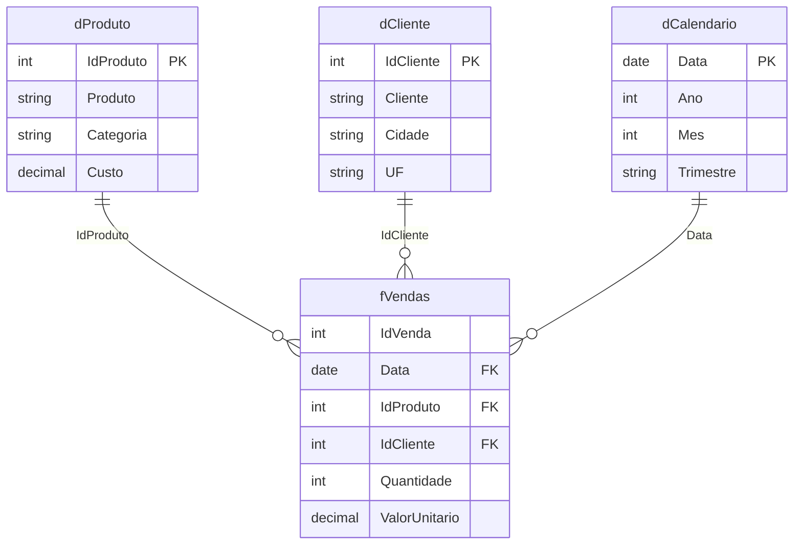
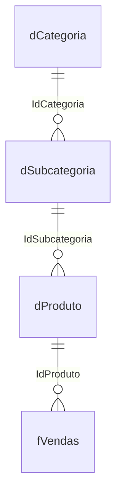
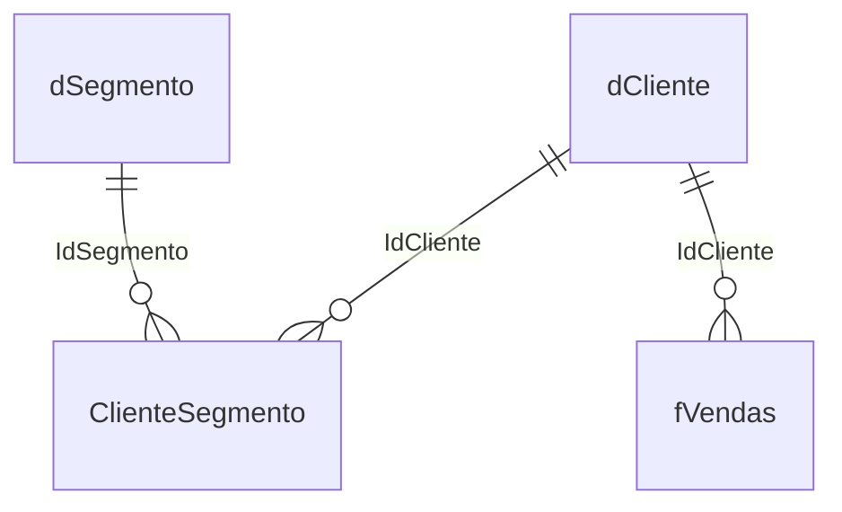
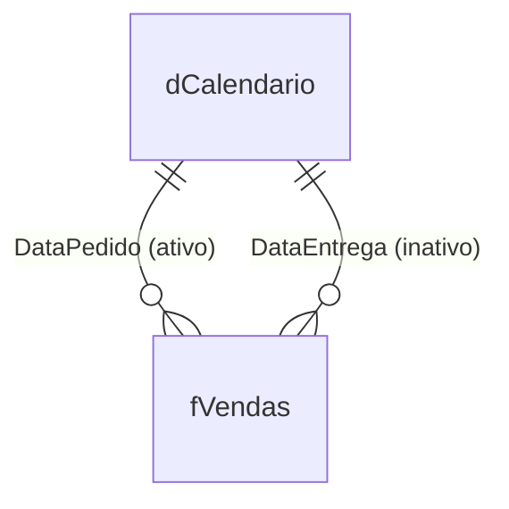

# Modelagem de Dados

## O que é um modelo de dados

Depois que o Power Query entrega as tabelas limpas, elas viram o **modelo semântico**: o conjunto de tabelas, os relacionamentos entre elas e os cálculos (medidas e colunas calculadas) que os relatórios usam. É o "cérebro" do arquivo. Os visuais só perguntam coisas ao modelo, e as respostas dependem de como ele foi montado.

Um modelo mal montado é a origem da maioria dos problemas que parecem ser de DAX: total que não bate, filtro que não filtra, relatório lento. Vale gastar tempo aqui antes de escrever qualquer medida.

Os componentes de um modelo:

| Componente         | O que é                                       | No cenário de vendas                              |
| ------------------ | --------------------------------------------- | ------------------------------------------------- |
| Tabelas            | Os dados carregados                           | `fVendas`, `dProduto`, `dCliente`, `dCalendario`  |
| Colunas            | Os campos de cada tabela                      | `fVendas[Quantidade]`, `dProduto[Categoria]`      |
| Relacionamentos    | Ligações entre tabelas por uma chave          | `dProduto[IdProduto]` 1 → \* `fVendas[IdProduto]` |
| Medidas            | Cálculos feitos na hora da consulta           | `Total Vendas`, `Ticket Médio`                    |
| Colunas calculadas | Colunas criadas com DAX e guardadas no modelo | `dCliente[Faixa Etária]`                          |
| Hierarquias        | Níveis de detalhe para navegar                | Ano > Trimestre > Mês > Data                      |

Medidas e colunas calculadas são escritas em DAX, assunto de [DAX: fundamentos](/labs/data/power-bi/06-dax-fundamentos/).

## Tabelas fato e tabelas dimensão

A modelagem para BI separa as tabelas em dois papéis:

- **Tabela fato** guarda os **eventos** que você quer medir: vendas, pedidos, visitas, pagamentos. Tem muitas linhas, colunas numéricas (quantidade, valor) e chaves que apontam para as dimensões. Em `fVendas`, cada linha é um item vendido.
- **Tabela dimensão** guarda o **contexto** desses eventos: quem comprou, o quê, quando, onde. Tem menos linhas, colunas descritivas (nome, categoria, cidade) e uma chave única por linha. `dProduto` tem um produto por linha.

Uma forma fácil de separar as duas: as perguntas de negócio costumam ter o formato "**[número]** por **[descrição]**". "Faturamento por categoria", "quantidade vendida por mês e UF". O número vem da fato; o "por" vem das dimensões.

Outro conceito que aparece junto é a **granularidade** (ou grão) da fato: o que exatamente uma linha representa. "Uma linha por item de pedido" é diferente de "uma linha por pedido", e misturar os dois na mesma tabela gera totais errados. Defina o grão antes de montar a fato.

## Esquema estrela (star schema)

O formato recomendado pela Microsoft para modelos do Power BI é o **esquema estrela**: a fato no centro e cada dimensão ligada diretamente a ela, como pontas de uma estrela.



Por que esse formato funciona tão bem:

- **Filtros andam numa direção só**, da dimensão para a fato. Escolher "Eletrônicos" em `dProduto` filtra `fVendas` sem ambiguidade.
- **Menos junções** por consulta, então o mecanismo do Power BI (o VertiPaq) responde mais rápido.
- **Fica fácil de entender** para quem monta o relatório: as descrições estão nas dimensões e os números na fato.
- **Medidas simples**: `SUM(fVendas[Quantidade])` responde certo por categoria, cliente ou mês sem nenhum truque.

### Esquema estrela x normalização

Se você estudou bancos relacionais, o esquema estrela vai parecer "errado": `dProduto` repete o texto da categoria em cada produto, quando a 3FN mandaria separar uma tabela de categorias. Ele é desnormalizado de propósito. Bancos transacionais normalizam para evitar anomalias de escrita (veja [Normalização](/labs/data/sql/12-normalizacao/)); um modelo analítico quase só lê, e aí juntar as descrições numa tabela larga deixa as consultas mais simples e rápidas. Repetir "Eletrônicos" em 300 linhas de produto não pesa nada, porque o Power BI comprime colunas com poucos valores distintos.

### Esquema floco de neve (snowflake)

No floco de neve, as dimensões são normalizadas em várias tabelas encadeadas:



Funciona, mas cobra um preço: mais relacionamentos para o filtro percorrer, mais tabelas no painel Dados para o usuário entender e mais chance de erro. A recomendação é achatar essas tabelas no Power Query (mesclando categoria e subcategoria dentro de `dProduto`) e deixar o floco de neve para casos específicos, como uma dimensão enorme em DirectQuery que você não pode transformar, ou uma tabela de nível mais alto que também se relaciona com outra fato (metas por categoria, por exemplo).

## Relacionamentos

Um relacionamento liga uma coluna de uma tabela a uma coluna de outra, e é por ele que os filtros se propagam. Sem relacionamento entre `dProduto` e `fVendas`, um gráfico de "quantidade por categoria" mostra o mesmo total geral em todas as barras, porque o filtro de categoria não chega até as vendas.

### Criar relacionamentos

Existem três jeitos:

1. **Detecção automática**: ao carregar várias tabelas juntas, o Power BI procura colunas com nomes e valores compatíveis e cria os relacionamentos sozinho. Ele também importa os relacionamentos de chave estrangeira que já existam no banco. Funciona bem quando as chaves têm o mesmo nome nas duas tabelas (`IdProduto` e `IdProduto`), por isso padronizar nomes no Power Query ajuda.
2. **Arrastar no modo Modelo**: arraste `fVendas[IdProduto]` até `dProduto[IdProduto]` no diagrama. A janela de relacionamento abre com as opções preenchidas.
3. **Gerenciar relações**: em **Modelagem > Gerenciar relações > Novo**, escolha as duas tabelas, as colunas e confirme.

Sempre confira o que a detecção automática criou. Ela às vezes liga colunas que só têm o nome parecido, como dois campos `Codigo` sem relação nenhuma.

Se aparecer o erro "Uma das colunas deve ter valores exclusivos" num relacionamento que deveria ser um para muitos, a dimensão tem chave duplicada. Investigue a origem em vez de só aplicar **Remover duplicatas**, porque a duplicata pode ser um cadastro com problema de verdade.

### Cardinalidade

Cardinalidade diz quantas linhas de cada lado podem ter o mesmo valor de chave:

| Cardinalidade                                  | Significado                               | Exemplo                                                                                                                          |
| ---------------------------------------------- | ----------------------------------------- | -------------------------------------------------------------------------------------------------------------------------------- |
| Um para muitos (1:\*) ou muitos para um (\*:1) | Valor único de um lado, repetido do outro | Um produto aparece em muitas vendas. É o tipo de quase todo relacionamento num esquema estrela                                   |
| Um para um (1:1)                               | Valor único dos dois lados                | `dProduto` e uma tabela `dProdutoFiscal` com uma linha por produto. Geralmente é sinal de que as duas deveriam ser uma tabela só |
| Muitos para muitos (\*:\*)                     | Valores repetidos dos dois lados          | Metas por categoria (`fMetas[Categoria]`) ligadas a `dProduto[Categoria]`                                                        |

"Um para muitos" e "muitos para um" são o mesmo relacionamento visto de lados diferentes. No diagrama, o lado "um" aparece com `1` e o lado "muitos" com `*`.

### Muitos para muitos: tabela ponte x cardinalidade \*:\*

Esse tópico confunde porque "muitos para muitos" tem dois sentidos no Power BI.

**Sentido 1, a situação de negócio.** Um cliente pode pertencer a vários segmentos (Varejo, Corporativo, Fidelidade) e cada segmento tem vários clientes. Como relacionar `dCliente` com `dSegmento`? A modelagem recomendada é uma **tabela ponte** (bridge) com uma linha por par cliente-segmento, e dois relacionamentos **um para muitos**:



Para o filtro de segmento chegar até `fVendas`, ele precisa atravessar a ponte "subindo" de `ClienteSegmento` para `dCliente`. Por isso **um** desses relacionamentos, o que liga `dCliente` à ponte, recebe direção de filtro **Ambas**. Oculte a ponte e as colunas de ID no relatório.

Um efeito que surpreende: as vendas por segmento **não somam** o total geral. Um cliente que está em dois segmentos tem as vendas contadas em cada um deles, mas só uma vez no total. Isso está correto, não é bug. Vale explicar no próprio relatório com uma caixa de texto.

**Sentido 2, a opção de cardinalidade \*:\*.** O Power BI permite criar um relacionamento com cardinalidade muitos para muitos, em que **nenhuma** das colunas precisa ter valores únicos. Ele não substitui a tabela ponte. O uso legítimo é relacionar uma fato com granularidade maior que a dimensão, como uma tabela de metas definida por categoria e ano ligada a `dProduto[Categoria]`. Nesse caso, a recomendação é direção única (da dimensão para a fato) e medidas que retornem vazio quando o usuário detalha abaixo do nível da meta. Relacionar duas dimensões diretamente com \*:\* não é recomendado.

### Direção do filtro cruzado

Define para que lado o filtro anda:

- **Única** (padrão em relacionamentos um para muitos): o filtro vai do lado "um" para o lado "muitos", da dimensão para a fato. Selecionar uma categoria filtra as vendas; selecionar uma venda não filtra a lista de categorias.
- **Ambas**: o filtro anda nos dois sentidos. É necessário em casos como a tabela ponte acima.


Use **Ambas** com parcimônia. Em modelos com várias fatos e dimensões compartilhadas ela cria caminhos ambíguos (o filtro pode chegar por dois lados), deixa o modelo mais lento e produz resultados difíceis de explicar. O Power BI chega a bloquear a opção quando ela geraria ambiguidade. Quando precisar do comportamento bidirecional em um cálculo só, prefira ligar isso dentro da medida com a função `CROSSFILTER`, deixando o relacionamento como única.

A interface só oferece **Única** e **Ambas**. Não existe uma opção "Nenhuma" na janela de relacionamento. Para impedir a propagação, você tem dois caminhos: deixar o relacionamento inativo ou, dentro de uma medida, usar `CROSSFILTER(coluna1, coluna2, NONE)`.

Existe ainda a caixa **Aplicar filtro de segurança em ambas as direções**, que só importa quando há segurança em nível de linha (RLS) e a direção é Ambas. A RLS é tratada em [Serviço, publicação e dashboards](/labs/data/power-bi/10-servico-publicacao-e-dashboards/).

### Relacionamentos ativos e inativos

Entre duas tabelas só pode haver **um caminho ativo** de filtro. Suponha que `fVendas` tenha duas datas, `DataPedido` e `DataEntrega`, e você ligue as duas a `dCalendario`. Um dos relacionamentos fica ativo (linha contínua no diagrama) e o outro, inativo (linha tracejada).



Por padrão, todo visual usa o ativo: "vendas por mês" significa vendas por mês do pedido. Para calcular por data de entrega, uma medida ativa o outro relacionamento temporariamente com `USERELATIONSHIP` dentro de um `CALCULATE`:

```dax
Vendas por Entrega =
CALCULATE (
    [Total Vendas],
    USERELATIONSHIP ( fVendas[DataEntrega], dCalendario[Data] )
)
```

`CALCULATE` e o contexto de filtro são explicados em [DAX: contexto, CALCULATE e inteligência de tempo](/labs/data/power-bi/07-dax-contexto-calculate-e-inteligencia-de-tempo/). A alternativa, quando os usuários precisam filtrar pelas duas datas ao mesmo tempo, é ter duas tabelas de calendário (uma para pedido, outra para entrega), cada uma com um relacionamento ativo. Isso se chama dimensão com função múltipla (role-playing dimension).

## Tabela de datas (calendário)

Quase todo relatório analisa algo ao longo do tempo, e a tabela de datas é a dimensão mais comum que existe. Ela tem uma linha por dia e colunas para agrupar e filtrar: ano, trimestre, mês, nome do mês, dia da semana, semana do ano.

### Por que não usar a coluna de data da fato

Você até consegue montar um gráfico por `fVendas[Data]`, mas perde três coisas: dias sem venda simplesmente não existem (o gráfico pula datas), não há colunas prontas de mês e trimestre, e as funções de inteligência de tempo do DAX, como acumulado no ano e mesmo período do ano anterior, exigem uma tabela de datas contínua.

### Requisitos

Para funcionar com inteligência de tempo, a tabela precisa de uma coluna do tipo **data** (ou data/hora) que:

- tenha valores únicos, sem vazios;
- não tenha dias faltando no intervalo;
- cubra anos completos (o ano fiscal também vale, não precisa ser de janeiro a dezembro).

### Como criar

Em ordem de preferência:

1. **Da fonte**: se o data warehouse já tem uma dimensão de data, use ela. É a mesma definição de tempo para a empresa toda.
2. **Com DAX**, como tabela calculada (**Modelagem > Nova tabela**):

```dax
dCalendario =
ADDCOLUMNS (
    CALENDAR ( DATE ( 2024, 1, 1 ), DATE ( 2026, 12, 31 ) ),
    "Ano", YEAR ( [Date] ),
    "Mes", MONTH ( [Date] ),
    "Nome do Mês", FORMAT ( [Date], "mmmm" ),
    "Trimestre", "T" & QUARTER ( [Date] ),
    "Ano-Mês", FORMAT ( [Date], "yyyy-mm" )
)
```

`CALENDAR` recebe início e fim; `CALENDARAUTO()` descobre sozinho o intervalo olhando as datas do modelo e sempre devolve anos completos. A coluna gerada por `CALENDAR` se chama `Date` (em inglês, mesmo com o Desktop em português); renomeie para `Data` se quiser manter o padrão.

3. **Com Power Query**, gerando uma lista de datas com `List.Dates` e expandindo colunas. Bom quando você quer a tabela pronta já na etapa de carga.

Depois de criar, ordene `Nome do Mês` pela coluna `Mes` (**Ferramentas de coluna > Classificar por coluna**). Senão os meses aparecem em ordem alfabética: abril, agosto, dezembro...

### Marcar como tabela de datas

Com a tabela selecionada, use **Ferramentas de tabela > Marcar como tabela de datas** e escolha a coluna de data. Isso avisa ao DAX qual tabela usar nas funções de inteligência de tempo clássicas e valida os requisitos acima. A Microsoft vem lançando uma inteligência de tempo baseada em calendários (em versão prévia) em que a marcação deixa de ser necessária na maioria dos casos; enquanto ela não estiver disponível de forma geral, marcar a tabela continua sendo o caminho seguro.

### Data/hora automática

Por padrão, o Desktop cria escondido uma tabela de datas para **cada coluna de data** do modelo. É por isso que, ao arrastar uma data para um visual, aparece a hierarquia Ano > Trimestre > Mês > Dia mesmo sem você ter criado nada.

É prático para uma exploração rápida, mas tem custos: cada coluna de data ganha sua própria tabela oculta (o modelo cresce) e essas tabelas não filtram outras fatos, então um filtro de ano feito por uma não vale para a outra. Num modelo com `dCalendario` própria, desligue em **Arquivo > Opções e configurações > Opções > Arquivo atual > Carregamento de dados > Data/hora automática**.

## Boas práticas de modelagem

- **Chaves inteiras**: relacionamentos por números inteiros são mais leves que por texto. Se a fonte só tiver chaves de texto longas (como um código `PROD-000123-SP`), considere criar uma **chave substituta** (surrogate key) inteira, por exemplo com uma coluna de índice na dimensão e uma mesclagem na fato. Esses conceitos de chave estão em [Constraints, chaves e relacionamentos](/labs/data/sql/03-constraints-chaves-e-relacionamentos/).
- **Oculte o que não é para o usuário**: chaves (`IdProduto` na fato), colunas técnicas e colunas numéricas que só servem de base para medidas. Clique direito > **Ocultar na exibição de relatório**. Quem monta o visual passa a usar a medida `Total Vendas` em vez de somar `ValorUnitario` por engano.
- **Nomes consistentes**: um padrão para tabelas (`fVendas`, `dProduto`) e nomes de colunas e medidas legíveis para o negócio (`Total Vendas`, não `SomaVlr`).
- **Documente**: o painel **Propriedades** do modo Modelo tem campo de **Descrição** para tabelas, colunas e medidas, e a descrição aparece como dica ao passar o mouse no painel Dados. Agrupe medidas em **pastas de exibição**.
- **Layouts do diagrama**: em modelos grandes, crie layouts separados no modo Modelo (um por fato, por exemplo) para não virar uma teia.
- **Formatos e resumos padrão**: defina o formato (moeda, porcentagem) e se a coluna deve ou não ser somada (**Resumo: Não resumir** em Ferramentas de coluna, para códigos e anos, que não fazem sentido somados).

### Grupos de cálculo

Para cenários mais avançados, existem os **grupos de cálculo** (calculation groups): em vez de criar `Total Vendas YTD`, `Total Custo YTD`, `Margem YTD` e assim por diante, você cria um grupo "Inteligência de tempo" com itens como YTD, Ano anterior e Variação, que se aplicam a qualquer medida. Hoje eles podem ser criados direto no Desktop, pelo modo Modelo. Vale conhecer depois de dominar o DAX básico.

## Analisador de desempenho

O **Analisador de desempenho** (Performance Analyzer) mede quanto tempo cada visual leva para carregar. Fica em **Otimizar > Analisador de desempenho** no modo Relatório:

1. Clique em **Iniciar gravação**.
2. Clique em **Atualizar visuais** (ou interaja com a página).
3. Expanda cada visual na lista para ver o tempo dividido em **consulta DAX**, **exibição do visual** e **outros**.
4. **Copiar consulta** ou **Executar na exibição de consulta DAX** leva a consulta gerada pelo visual para você investigar.

Se o tempo de consulta DAX domina, o problema está no modelo ou na medida; se domina a exibição, o visual tem pontos demais ou a página tem visuais demais.

## Problemas comuns e como corrigir

| Sintoma                                                              | Causa provável                                                                                                        | Correção                                                                                                            |
| -------------------------------------------------------------------- | --------------------------------------------------------------------------------------------------------------------- | ------------------------------------------------------------------------------------------------------------------- |
| Mesmo valor em todas as linhas de um visual (o total geral repetido) | Falta relacionamento entre a dimensão do eixo e a fato, ou ele está inativo                                           | Criar ou ativar o relacionamento no modo Modelo                                                                     |
| Total muito maior que o esperado                                     | Chave duplicada na dimensão, cardinalidade errada ou fato com grão misturado                                          | Verificar unicidade da chave; revisar o grão da fato                                                                |
| Linhas "(Em branco)" no visual                                       | Vendas com chave que não existe na dimensão                                                                           | Mesclagem anti esquerda no Power Query para achar os órfãos e corrigir o cadastro                                   |
| Relatório lento                                                      | Filtros bidirecionais, colunas de texto longas, muitas colunas calculadas, tabelas enormes importadas sem necessidade | Voltar para direção única, remover colunas, mover cálculos para o Power Query, medir com o Analisador de desempenho |
| Dados faltando num cálculo por segunda data                          | O relacionamento por essa data está inativo                                                                           | `USERELATIONSHIP` na medida ou tabela de datas separada                                                             |
| Meses em ordem alfabética                                            | Coluna de nome sem classificação                                                                                      | Classificar por coluna pelo número do mês                                                                           |
| Filtro de ano não afeta outro visual                                 | Data/hora automática criando calendários separados                                                                    | Usar `dCalendario` única e desligar a data/hora automática                                                          |

## Checklist do modelo

- [ ] Cada tabela tem papel claro: fato ou dimensão, com o grão da fato definido.
- [ ] O modelo segue o esquema estrela; dimensões em floco de neve foram achatadas quando possível.
- [ ] Toda dimensão tem chave única, de preferência inteira.
- [ ] Relacionamentos são um para muitos, com direção única, salvo exceções justificadas.
- [ ] Existe uma `dCalendario` contínua, marcada como tabela de datas, e a data/hora automática está desligada.
- [ ] Chaves e colunas técnicas estão ocultas.
- [ ] Nomes seguem um padrão e as medidas têm descrição.
- [ ] Colunas numéricas que não devem ser somadas estão com "Não resumir".
- [ ] Os visuais principais carregam em tempo aceitável no Analisador de desempenho.

## Referências

- [Entender o esquema em estrela e a importância para o Power BI](https://learn.microsoft.com/pt-br/power-bi/guidance/star-schema) - Microsoft Learn, pt-BR
- [Criar e gerenciar relações no Power BI Desktop](https://learn.microsoft.com/pt-br/power-bi/transform-model/desktop-create-and-manage-relationships) - Microsoft Learn, pt-BR
- [Diretrizes de relação muitos para muitos](https://learn.microsoft.com/pt-br/power-bi/guidance/relationships-many-to-many) - Microsoft Learn, pt-BR
- [Diretrizes de design para tabelas de datas no Power BI Desktop](https://learn.microsoft.com/pt-br/power-bi/guidance/model-date-tables) - Microsoft Learn, pt-BR
