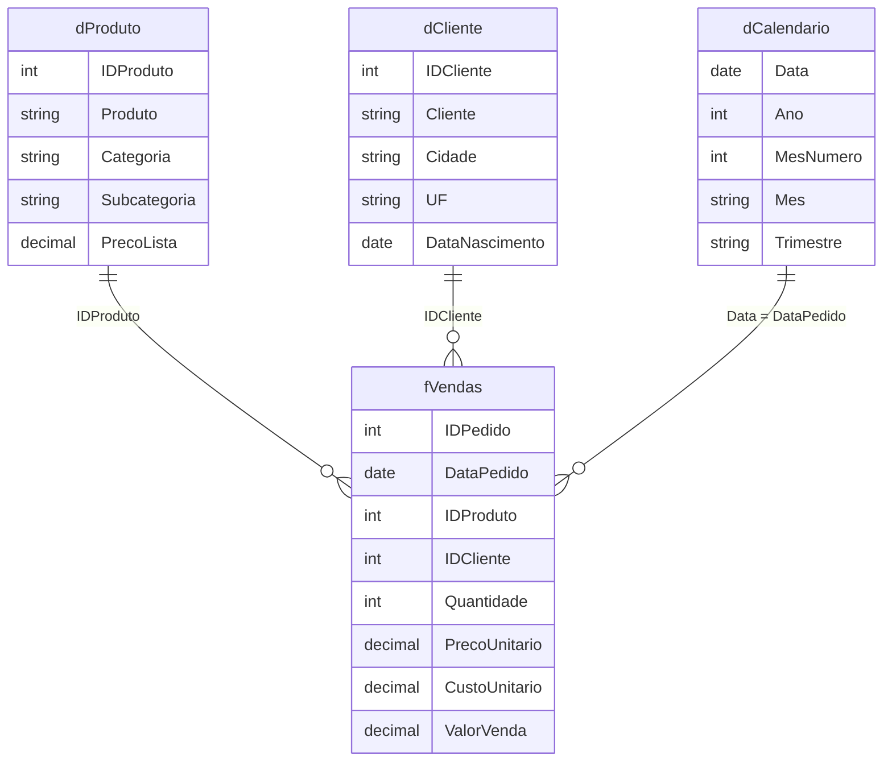
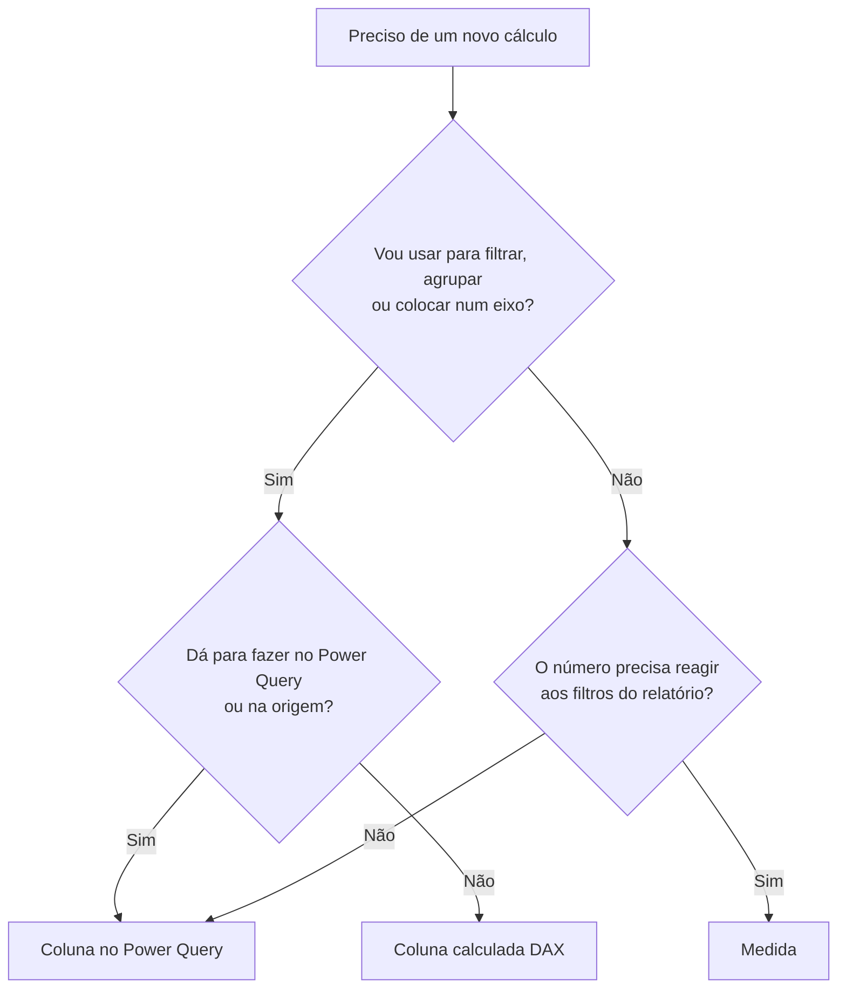
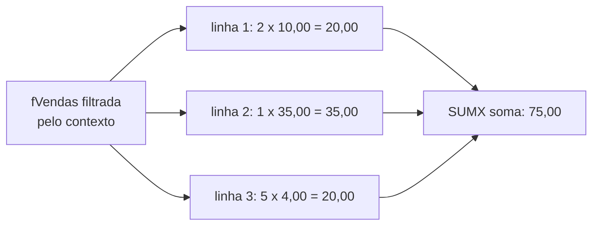

# DAX: fundamentos

## O que é DAX

DAX (Data Analysis Expressions) é a linguagem de fórmulas do Power BI. Se o Power Query (linguagem M) é a cozinha onde os dados são lavados e cortados, o DAX é o garçom que monta o prato na hora: ele calcula totais, médias, percentuais e comparações **em cima do modelo já carregado**, respeitando o que o usuário filtrou no relatório.

A sintaxe lembra fórmulas do Excel, e isso ajuda no começo. A grande diferença é que o DAX não trabalha com células (`A1`, `B2`), e sim com **tabelas e colunas** do modelo semântico, e o resultado de uma fórmula muda conforme o contexto em que ela é avaliada (mais sobre isso na nota de [contexto, CALCULATE e inteligência de tempo](/labs/data/power-bi/07-dax-contexto-calculate-e-inteligencia-de-tempo/)).

### Onde o DAX aparece

| Onde                              | Para que serve                                                           | Exemplo                                   |
| --------------------------------- | ------------------------------------------------------------------------ | ----------------------------------------- |
| Medidas                           | Cálculos agregados que reagem a filtros e segmentações                   | `Total Vendas = SUM(fVendas[ValorVenda])` |
| Colunas calculadas                | Uma coluna nova, calculada linha a linha e gravada na tabela             | `dCliente[Faixa Etária]`                  |
| Tabelas calculadas                | Uma tabela inteira gerada por fórmula                                    | uma `dCalendario` criada com `CALENDAR`   |
| Segurança em nível de linha (RLS) | Regras que escondem linhas de quem não pode vê-las                       | `dCliente[UF] = "CE"`                     |
| Consultas DAX                     | Perguntas ao modelo que devolvem uma tabela, na exibição de consulta DAX | `EVALUATE TOPN(5, dProduto)`              |

RLS é assunto da nota de [serviço, publicação e dashboards](/labs/data/power-bi/10-servico-publicacao-e-dashboards/). Aqui o foco são medidas, colunas e tabelas calculadas.

### O modelo usado nos exemplos

Todos os exemplos desta nota e das próximas usam o mesmo modelo de vendas em esquema estrela (montado na nota de [modelagem de dados](/labs/data/power-bi/05-modelagem-de-dados/)):



- `fVendas` é a tabela fato: uma linha por item de pedido. `ValorVenda` já chega calculada do Power Query (`Quantidade * PrecoUnitario`).
- `dProduto`, `dCliente` e `dCalendario` são dimensões, ligadas à fato por relacionamentos um para muitos.

## Sintaxe básica

Toda fórmula DAX segue o formato `Nome = expressão`:

```dax
Total Vendas = SUM ( fVendas[ValorVenda] )
```

- `Total Vendas` é o nome da medida (pode ter espaço e acento).
- `SUM` é a função. Os argumentos vão entre parênteses, separados por vírgula.
- `fVendas[ValorVenda]` é a referência à coluna `ValorVenda` da tabela `fVendas`. O padrão é sempre `Tabela[Coluna]`. Se o nome da tabela tiver espaço, use aspas simples: `'Vendas Loja'[Valor]`.
- Para chamar uma medida dentro de outra, use só o nome entre colchetes: `[Total Vendas]`. A convenção (recomendada pela SQLBI e pela Microsoft) é **sempre qualificar colunas com a tabela e nunca qualificar medidas**, assim dá para saber de longe o que é coluna e o que é medida.

Algumas regras rápidas:

- Os nomes de funções não diferenciam maiúsculas de minúsculas: `sum`, `Sum` e `SUM` funcionam igual. Escreva em maiúsculas por legibilidade.
- Comentários: `//` ou `--` para uma linha, `/* ... */` para várias.
- Textos ficam entre aspas duplas (`"Eletrônicos"`), datas podem ser criadas com `DATE(2024, 1, 31)`.
- Fórmulas longas podem quebrar linha à vontade (Shift+Enter na barra de fórmulas). Formatar bem é metade da depuração, e o [DAX Formatter](https://www.daxformatter.com/) da SQLBI faz isso de graça.

### Operadores

| Tipo                  | Operadores                         | Exemplo                                        |
| --------------------- | ---------------------------------- | ---------------------------------------------- |
| Aritméticos           | `+` `-` `*` `/` `^`                | `fVendas[Quantidade] * fVendas[PrecoUnitario]` |
| Concatenação de texto | `&`                                | `dCliente[Cidade] & " - " & dCliente[UF]`      |
| Comparação            | `=` `==` `<>` `>` `<` `>=` `<=`    | `dCalendario[Ano] >= 2024`                     |
| Lógicos               | `&&` (E), `\|\|` (OU), `IN`, `NOT` | `dCliente[UF] IN { "CE", "PE", "BA" }`         |

`=` compara tratando BLANK (o "vazio" do DAX) como zero ou texto vazio, enquanto `==` é a comparação estrita, em que BLANK só é igual a BLANK. Na dúvida, use `=`.

## Medidas, colunas calculadas e tabelas calculadas

Essa é a primeira grande decisão de quem escreve DAX, e errar aqui deixa o modelo pesado ou os números estranhos.

### Coluna calculada

Uma coluna calculada é avaliada **linha a linha, no momento da atualização dos dados**, e o resultado fica gravado no modelo, como se a coluna tivesse vindo da origem. Ela ocupa memória e cresce junto com a tabela.

```dax
// Coluna calculada em dCliente
Faixa Etária =
IF (
    dCliente[Idade] < 30,
    "Até 29",
    IF ( dCliente[Idade] < 50, "30 a 49", "50 ou mais" )
)
```

Use coluna quando precisar **filtrar, agrupar, fatiar ou relacionar** por aquele valor: colocar a "Faixa Etária" num eixo de gráfico, numa segmentação ou como chave de um relacionamento.

### Medida

Uma medida não é gravada em lugar nenhum. Ela é calculada **na hora da consulta**, para cada célula do visual, considerando os filtros ativos (ano selecionado, categoria clicada, linha da matriz). Por isso a mesma medida `[Total Vendas]` mostra um número diferente em cada barra do gráfico.

```dax
Ticket Médio =
DIVIDE ( [Total Vendas], DISTINCTCOUNT ( fVendas[IDPedido] ) )
```

Use medida para **números que precisam ser agregados e reagir a filtros**: totais, médias, percentuais, comparações com o ano anterior.

### Comparação lado a lado

|                                       | Coluna calculada                              | Medida                                            |
| ------------------------------------- | --------------------------------------------- | ------------------------------------------------- |
| Quando é calculada                    | Na atualização dos dados                      | No momento da consulta (cada interação)           |
| Fica armazenada?                      | Sim, ocupa memória                            | Não, só a fórmula é salva                         |
| Contexto natural                      | Contexto de linha (enxerga a linha atual)     | Contexto de filtro (enxerga os filtros do visual) |
| Reage a segmentações?                 | Não, o valor é fixo até a próxima atualização | Sim                                               |
| Pode ir em eixo, legenda, segmentação | Sim                                           | Não (só em Valores, salvo truques avançados)      |
| Pode ser chave de relacionamento      | Sim                                           | Não                                               |
| Uso típico                            | Categorizar, criar faixas, chaves             | Totais, médias, %, KPIs                           |

Um guia rápido de decisão:



Repare que a primeira sugestão para colunas é o Power Query. Existe uma máxima famosa na comunidade, a "Roche's Maxim": _transforme os dados o mais perto da origem possível e o mais longe possível do relatório_. Colunas criadas no Power Query (ou na própria view SQL) costumam ser comprimidas melhor pelo motor e não deixam o modelo dependente de fórmulas DAX para algo que é só preparação de dados. Coluna calculada DAX faz sentido quando o cálculo depende do modelo já montado, por exemplo de um `RELATED` ou de uma agregação de outra tabela.

> 💡 Um erro clássico de iniciante: criar a coluna calculada `fVendas[Margem %]` e somá-la no visual. Somar percentuais linha a linha dá um número sem sentido. Percentual é medida: `DIVIDE([Lucro], [Total Vendas])`.

### Tabela calculada

Uma tabela calculada é gerada por uma expressão DAX que devolve uma tabela. O uso mais comum para iniciantes é criar a tabela de datas:

```dax
dCalendario =
ADDCOLUMNS (
    CALENDAR ( DATE ( 2022, 1, 1 ), DATE ( 2025, 12, 31 ) ),
    "Ano", YEAR ( [Date] ),
    "MesNumero", MONTH ( [Date] ),
    "Mes", FORMAT ( [Date], "mmm" ),
    "Trimestre", "T" & QUARTER ( [Date] )
)
```

`CALENDAR` devolve uma coluna chamada `Date` com um dia por linha entre as duas datas, e `ADDCOLUMNS` acrescenta as colunas derivadas. Renomeie a coluna `Date` para `Data` se preferir, e lembre de **marcar a tabela como tabela de datas** (detalhes na nota de [contexto e inteligência de tempo](/labs/data/power-bi/07-dax-contexto-calculate-e-inteligencia-de-tempo/)). Também dá para criar a dimensão de datas no Power Query, e muita gente prefere assim pelo mesmo motivo da Roche's Maxim.

Tabelas calculadas são criadas em **Modelagem > Nova tabela**.

## Funções de agregação

São as primeiras funções que todo mundo aprende. Elas recebem uma coluna e devolvem um único valor, considerando as linhas visíveis no contexto atual.

| Função          | O que faz                              | Exemplo                             |
| --------------- | -------------------------------------- | ----------------------------------- |
| `SUM`           | Soma uma coluna numérica               | `SUM(fVendas[Quantidade])`          |
| `AVERAGE`       | Média aritmética                       | `AVERAGE(fVendas[PrecoUnitario])`   |
| `MIN` / `MAX`   | Menor e maior valor                    | `MAX(fVendas[DataPedido])`          |
| `COUNT`         | Conta valores não vazios de uma coluna | `COUNT(fVendas[IDPedido])`          |
| `COUNTROWS`     | Conta linhas de uma tabela             | `COUNTROWS(fVendas)`                |
| `DISTINCTCOUNT` | Conta valores distintos                | `DISTINCTCOUNT(fVendas[IDCliente])` |

Cuidado com a diferença entre `COUNTROWS(fVendas)` e `DISTINCTCOUNT(fVendas[IDPedido])`: como a fato tem uma linha por **item** de pedido, a primeira conta itens e a segunda conta pedidos. As duas estão "certas", só respondem perguntas diferentes.

Medidas base do nosso modelo:

```dax
Total Vendas = SUM ( fVendas[ValorVenda] )

Quantidade Total = SUM ( fVendas[Quantidade] )

Total Pedidos = DISTINCTCOUNT ( fVendas[IDPedido] )

Total Clientes = DISTINCTCOUNT ( fVendas[IDCliente] )

Itens Vendidos = COUNTROWS ( fVendas )
```

`Total Clientes` conta os clientes **que compraram** no contexto (no ano, na categoria...). Para contar o cadastro inteiro, seria `COUNTROWS(dCliente)`.

## Iteradores: as funções terminadas em X

`SUM` só sabe somar uma coluna que já existe. E se você quiser somar `Quantidade * CustoUnitario` sem criar uma coluna calculada para isso? Aí entram os iteradores: `SUMX`, `AVERAGEX`, `MINX`, `MAXX`, `COUNTX`, `RANKX` e companhia.

Um iterador recebe **uma tabela** e **uma expressão**. Ele percorre a tabela linha por linha, avalia a expressão em cada linha e no final agrega os resultados.

```dax
Custo Total =
SUMX ( fVendas, fVendas[Quantidade] * fVendas[CustoUnitario] )

Lucro = [Total Vendas] - [Custo Total]

Preço Médio Ponderado =
DIVIDE ( [Total Vendas], [Quantidade Total] )
```



Dentro do `SUMX`, a expressão consegue enxergar `fVendas[Quantidade]` "da linha atual" porque o iterador cria um **contexto de linha**. Esse conceito é a chave para entender DAX e está detalhado na nota de [contexto, CALCULATE e inteligência de tempo](/labs/data/power-bi/07-dax-contexto-calculate-e-inteligencia-de-tempo/).

Sobre `AVERAGE` x `AVERAGEX`: `AVERAGE(fVendas[PrecoUnitario])` é a média simples dos preços das linhas, e um item vendido 100 vezes pesa igual a um vendido uma vez. Muitas vezes o que o negócio quer é o preço médio ponderado (`Total Vendas / Quantidade Total`) ou a média por pedido:

```dax
Média por Pedido =
AVERAGEX ( VALUES ( fVendas[IDPedido] ), [Total Vendas] )
```

Aqui o `AVERAGEX` percorre a lista de pedidos distintos e calcula `[Total Vendas]` de cada um antes de tirar a média, o que dá o mesmo resultado do `Ticket Médio`.

## Funções lógicas

### IF

```dax
// Coluna calculada em dProduto
Tipo de Produto =
IF ( dProduto[Categoria] = "Eletrônicos", "Tecnologia", "Outros" )
```

`IF(condição, valor_se_verdadeiro, valor_se_falso)`. Se o terceiro argumento for omitido, o resultado é BLANK quando a condição é falsa.

### SWITCH

Quando os `IF` começam a se aninhar, `SWITCH` deixa a fórmula legível:

```dax
// Coluna calculada em dCalendario
Semestre =
SWITCH (
    dCalendario[Trimestre],
    "T1", "1º semestre",
    "T2", "1º semestre",
    "T3", "2º semestre",
    "T4", "2º semestre",
    "Desconhecido"
)
```

O truque `SWITCH(TRUE(), ...)` permite testar condições diferentes em sequência, e a primeira verdadeira vence:

```dax
Classificação Ticket =
SWITCH (
    TRUE (),
    [Ticket Médio] >= 500, "Alto",
    [Ticket Médio] >= 200, "Médio",
    "Baixo"
)
```

### DIVIDE

Divisão por zero quebra visual e gera `Infinito` ou erro. `DIVIDE(numerador, denominador, [alternativo])` devolve BLANK (ou o valor alternativo) quando o denominador é zero ou vazio:

```dax
Margem % = DIVIDE ( [Lucro], [Total Vendas] )
```

A documentação da Microsoft recomenda `DIVIDE` sempre que o denominador puder ser zero ou BLANK. Se o denominador for uma constante (`[Total Vendas] / 1000`), o operador `/` é mais simples e um pouco mais rápido.

## Funções de relacionamento

Os relacionamentos do modelo permitem que uma tabela "consulte" a outra.

### RELATED

Funciona dentro de um contexto de linha, do lado **muitos** para o lado **um** do relacionamento (da fato para a dimensão). É o PROCV do DAX, só que usando o relacionamento que já existe:

```dax
// Coluna calculada em fVendas
Categoria = RELATED ( dProduto[Categoria] )
```

Também é muito usado dentro de iteradores, sem criar coluna nenhuma:

```dax
Vendas Eletrônicos (iterador) =
SUMX (
    FILTER ( fVendas, RELATED ( dProduto[Categoria] ) = "Eletrônicos" ),
    fVendas[ValorVenda]
)
```

Essa fórmula funciona, mas na próxima nota você vai ver uma versão melhor com `CALCULATE`.

### RELATEDTABLE

O caminho inverso: do lado **um** para o lado **muitos**. Devolve a tabela de linhas relacionadas à linha atual.

```dax
// Coluna calculada em dCliente
Qtde Itens Comprados = COUNTROWS ( RELATEDTABLE ( fVendas ) )
```

### LOOKUPVALUE

Busca um valor em outra tabela pelos critérios informados, **sem precisar de relacionamento**:

```dax
// Coluna calculada em fVendas
Preço de Tabela =
LOOKUPVALUE (
    dProduto[PrecoLista],
    dProduto[IDProduto], fVendas[IDProduto]
)
```

Se existe relacionamento, prefira `RELATED`, que é mais simples e mais rápido. `LOOKUPVALUE` é útil quando a ligação não é um relacionamento do modelo (por exemplo, buscar uma meta numa tabela de metas por mês e UF). Se a busca encontrar mais de um valor diferente, a função dá erro, a menos que você informe um resultado alternativo.

`USERELATIONSHIP`, que ativa um relacionamento inativo, só funciona dentro de `CALCULATE` e aparece na próxima nota.

## Funções de tabela: FILTER e TOPN

Algumas funções não devolvem um número, e sim uma tabela. Elas são usadas como argumento de outras funções (iteradores, `CALCULATE`, `COUNTROWS`).

`FILTER(tabela, condição)` devolve as linhas da tabela em que a condição é verdadeira:

```dax
Pedidos Grandes =
COUNTROWS (
    FILTER ( VALUES ( fVendas[IDPedido] ), [Total Vendas] > 1000 )
)
```

`TOPN(n, tabela, expressão)` devolve as n linhas com maior valor da expressão:

```dax
Vendas Top 5 Produtos =
SUMX (
    TOPN ( 5, VALUES ( dProduto[Produto] ), [Total Vendas] ),
    [Total Vendas]
)
```

Repare que nas duas fórmulas a tabela iterada é pequena (`VALUES` de uma coluna, ou seja, a lista de valores distintos), e não a fato inteira. Iterar a `fVendas` com milhões de linhas quando bastava a lista de produtos é uma das causas mais comuns de medida lenta.

## Exemplos práticos

### Idade a partir da data de nascimento

Uma tentativa comum é `DATEDIFF(dCliente[DataNascimento], TODAY(), YEAR)`. Ela parece funcionar, mas `DATEDIFF` conta quantas **viradas de ano** existem entre as datas, e não anos completos: quem nasceu em 31/12/2000 aparece com 26 anos já em 01/01/2026, um dia depois de fazer 25. Para a idade exata, desconte 1 quando o aniversário ainda não chegou:

```dax
// Coluna calculada em dCliente
Idade =
VAR Nascimento = dCliente[DataNascimento]
VAR Hoje = TODAY ()
VAR AniversarioEsteAno =
    DATE ( YEAR ( Hoje ), MONTH ( Nascimento ), DAY ( Nascimento ) )
RETURN
    YEAR ( Hoje ) - YEAR ( Nascimento )
        - IF ( AniversarioEsteAno > Hoje, 1, 0 )
```

Lembre que coluna calculada só é recalculada na atualização: `TODAY()` aqui significa "o dia da última atualização do modelo".

### Agrupar categorias com IF

```dax
// Coluna calculada em dProduto
Grupo =
IF (
    dProduto[Categoria] IN { "Eletrônicos", "Informática" },
    "Tecnologia",
    "Casa e Outros"
)
```

### Medidas de negócio

```dax
Ticket Médio = DIVIDE ( [Total Vendas], [Total Pedidos] )

Itens por Pedido = DIVIDE ( [Quantidade Total], [Total Pedidos] )

Vendas por Cliente = DIVIDE ( [Total Vendas], [Total Clientes] )

Margem % = DIVIDE ( [Lucro], [Total Vendas] )
```

Repare como elas são construídas umas sobre as outras. Isso é intencional: se a regra de `[Total Vendas]` mudar (por exemplo, passar a descontar devoluções), todas as medidas derivadas acompanham. Medidas como "Vendas 2024", "Vendas do ano anterior" e "total acumulado" dependem de `CALCULATE` e estão na próxima nota.

## Variáveis: VAR e RETURN

Variáveis guardam um resultado intermediário dentro da fórmula. A Microsoft lista três ganhos: a fórmula fica mais legível, mais fácil de depurar e geralmente mais rápida, porque a expressão da variável é calculada uma vez só.

Sem variáveis:

```dax
Crescimento % =
DIVIDE (
    [Total Vendas] - CALCULATE ( [Total Vendas], SAMEPERIODLASTYEAR ( dCalendario[Data] ) ),
    CALCULATE ( [Total Vendas], SAMEPERIODLASTYEAR ( dCalendario[Data] ) )
)
```

Com variáveis (o `CALCULATE` e o `SAMEPERIODLASTYEAR` são explicados na próxima nota, aqui o que importa é a estrutura):

```dax
Crescimento % =
VAR VendasAtual = [Total Vendas]
VAR VendasAnoAnterior =
    CALCULATE ( [Total Vendas], SAMEPERIODLASTYEAR ( dCalendario[Data] ) )
RETURN
    DIVIDE ( VendasAtual - VendasAnoAnterior, VendasAnoAnterior )
```

Duas dicas:

- Para depurar, troque temporariamente o `RETURN` por uma das variáveis (`RETURN VendasAnoAnterior`) e veja no visual se ela tem o valor esperado.
- Uma variável é calculada **no ponto em que foi definida** e depois vira uma constante. Se você colocar uma variável dentro de um `CALCULATE` esperando que ela seja recalculada com o novo filtro, isso não acontece. Esse detalhe confunde muita gente e volta a aparecer na próxima nota.

## Criando e organizando medidas

1. No modo de exibição de Relatório, vá em **Modelagem > Nova medida** (ou clique com o botão direito numa tabela no painel **Dados** e escolha **Nova medida**).
2. Digite a fórmula na barra de fórmulas e pressione Enter.
3. Com a medida selecionada, ajuste o formato em **Ferramentas de medida** (moeda, percentual, casas decimais).
4. Arraste a medida para um visual e confira o resultado.

Para organizar:

- A medida "mora" na tabela que estava selecionada quando foi criada, mas isso é só organização: ela não pertence de verdade a tabela nenhuma. Muita gente cria uma tabela só para medidas (por exemplo, `_Medidas`) para achar tudo no mesmo lugar.
- Use **pastas de exibição** (propriedade da medida no modo Modelo) para agrupar: "Vendas", "Margem", "Tempo".
- Preencha a **descrição** da medida. Ela aparece como dica quando alguém passa o mouse no painel Dados.

## Exibição de consulta DAX e funções definidas pelo usuário

### Exibição de consulta DAX

O Power BI Desktop tem uma exibição dedicada (ícone na barra lateral esquerda) para escrever **consultas** DAX. Uma consulta começa com `EVALUATE` e devolve uma tabela, ótima para conferir números sem montar visual:

```dax
EVALUATE
SUMMARIZECOLUMNS (
    dProduto[Categoria],
    "Vendas", [Total Vendas],
    "Margem %", [Margem %]
)
ORDER BY [Vendas] DESC
```

Com `DEFINE MEASURE` você testa uma medida nova antes de salvá-la no modelo, e o próprio editor oferece o botão para gravá-la quando estiver pronta:

```dax
DEFINE
    MEASURE fVendas[Vendas Líquidas Teste] = [Total Vendas] * 0.95
EVALUATE
SUMMARIZECOLUMNS ( dCalendario[Ano], "Teste", [Vendas Líquidas Teste] )
```

Clicar com o botão direito numa tabela ou medida e escolher **Consultas rápidas** gera consultas prontas, como as 100 primeiras linhas de uma tabela.

### Funções definidas pelo usuário (UDFs)

Desde a versão de junho de 2026 do Power BI Desktop e do serviço, as funções DAX definidas pelo usuário estão disponíveis de forma geral (antes eram recurso em preview). Elas permitem escrever uma lógica uma vez e reutilizá-la em medidas, colunas calculadas e cálculos visuais, como se fosse uma função nativa:

```dax
DEFINE
    /// Aplica uma taxa sobre um valor (padrão: 10%)
    FUNCTION AplicarTaxa =
        ( valor : NUMERIC, taxa : NUMERIC = 0.1 ) =>
            valor * ( 1 + taxa )

EVALUATE
{ AplicarTaxa ( 100 ) }
```

Depois de salva no modelo (pela exibição de consulta DAX ou pela exibição TMDL), ela pode ser usada em qualquer medida: `Vendas com Taxa = AplicarTaxa([Total Vendas])`. As UDFs exigem nível de compatibilidade do modelo 1702 ou superior e têm limitações (sem recursão, sem sobrecarga). Para quem está começando, vale saber que existem, mas o foco agora é dominar medidas simples.

## Boas práticas

- **Medida explícita sempre.** Arrastar uma coluna numérica direto para o visual cria uma agregação implícita. Funciona, mas não dá para reutilizar, formatar uma vez só nem usar em outras fórmulas. Crie `Total Vendas = SUM(...)` e use a medida.
- **`DIVIDE` em vez de `/`** quando o denominador pode ser zero ou vazio.
- **Variáveis** para qualquer subexpressão usada mais de uma vez.
- **Nomes que o usuário de negócio entende**: `Ticket Médio`, não `Medida 7` nem `tkt_md`.
- **`FORMAT` com moderação.** `FORMAT` transforma número em texto: o visual perde a ordenação numérica e a medida fica mais lenta. Prefira o formato da medida (Ferramentas de medida) ou cadeias de formato dinâmicas.
- **Colunas no Power Query antes de colunas calculadas DAX**, sempre que possível.
- **Teste passo a passo**: monte uma tabela simples com a medida ao lado das colunas que a explicam, ou confira na exibição de consulta DAX.
- **Não use `CALCULATE` por hábito.** Envolver toda medida em `CALCULATE` sem filtro nenhum não muda o resultado na maioria dos casos e esconde a intenção. Use quando realmente for alterar o contexto de filtro (próxima nota).

## Referências

- [Visão geral do DAX](https://learn.microsoft.com/pt-br/dax/dax-overview) - Microsoft Learn, pt-BR
- [Tutorial: criar suas próprias medidas no Power BI Desktop](https://learn.microsoft.com/pt-br/power-bi/transform-model/desktop-tutorial-create-measures) - Microsoft Learn, pt-BR
- [Colunas calculadas no Power BI Desktop](https://learn.microsoft.com/pt-br/power-bi/transform-model/desktop-calculated-columns) - Microsoft Learn, pt-BR
- [Usar variáveis para melhorar fórmulas DAX](https://learn.microsoft.com/pt-br/dax/best-practices/dax-variables) e [DIVIDE x operador de divisão](https://learn.microsoft.com/pt-br/dax/best-practices/dax-divide-function-operator) - Microsoft Learn, pt-BR
- [Calculated columns and measures in DAX](https://www.sqlbi.com/articles/calculated-columns-and-measures-in-dax/) - SQLBI (Marco Russo e Alberto Ferrari), en
