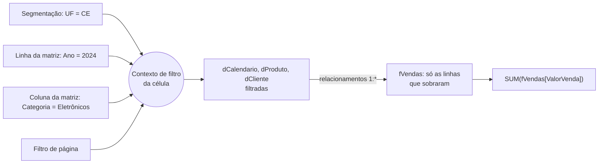

# DAX: contexto, CALCULATE e inteligência de tempo

## Por que a mesma fórmula dá números diferentes

Coloque a medida `Total Vendas = SUM(fVendas[ValorVenda])` (da nota de [fundamentos de DAX](/labs/data/power-bi/06-dax-fundamentos/)) numa matriz com os anos nas linhas. Cada linha mostra um valor diferente, e a linha de total mostra outro. A fórmula é a mesma; o que muda é o **contexto de avaliação**, ou seja, o conjunto de condições sob as quais o DAX calcula aquela célula.

Existem dois tipos de contexto, e entender a diferença entre eles é o que separa "copiar fórmula da internet" de "escrever DAX com confiança":

- **Contexto de filtro**: quais linhas do modelo estão visíveis naquele momento.
- **Contexto de linha**: qual é a linha atual de uma tabela que está sendo percorrida.

Os exemplos usam o mesmo modelo estrela das notas anteriores: `fVendas` ligada a `dProduto`, `dCliente` e `dCalendario`.

## Contexto de filtro

O contexto de filtro é o conjunto de filtros ativos quando uma medida é avaliada. Ele vem de vários lugares ao mesmo tempo:

- linhas, colunas e eixos do visual (a célula "2024 x Eletrônicos" filtra `dCalendario[Ano] = 2024` e `dProduto[Categoria] = "Eletrônicos"`);
- segmentações e filtros de visual, página e relatório;
- realce cruzado ao clicar em outro visual;
- regras de segurança em nível de linha (RLS);
- e, como você vai ver logo, o próprio `CALCULATE`.



Um ponto importante: o filtro é aplicado nas dimensões e **se propaga pelos relacionamentos** até a fato, sempre na direção do filtro cruzado (do lado um para o lado muitos, no padrão). Por isso filtrar `dProduto[Categoria]` reduz as linhas de `fVendas`. A direção do filtro e os relacionamentos estão na nota de [modelagem de dados](/labs/data/power-bi/05-modelagem-de-dados/).

Na linha de total da matriz, o filtro de ano não existe, por isso o total mostra todos os anos juntos. Não é uma soma das linhas de cima: é a medida recalculada num contexto com menos filtros. É por isso que medidas como `Ticket Médio` mostram no total a média geral, e não a soma das médias.

## Contexto de linha

O contexto de linha existe quando o DAX está percorrendo uma tabela, linha por linha. Ele aparece em dois lugares:

1. **Colunas calculadas**: a fórmula é avaliada uma vez para cada linha da tabela.
2. **Iteradores** (`SUMX`, `AVERAGEX`, `FILTER`, `RANKX`...): a expressão é avaliada para cada linha da tabela passada como argumento.

```dax
// Coluna calculada em fVendas: contexto de linha
Margem Item = fVendas[ValorVenda] - fVendas[Quantidade] * fVendas[CustoUnitario]

// Medida com iterador: o SUMX cria o contexto de linha
Custo Total = SUMX ( fVendas, fVendas[Quantidade] * fVendas[CustoUnitario] )
```

O detalhe que confunde todo mundo: **contexto de linha não filtra nada**. Ele só diz "qual é a linha atual" para que você possa ler `fVendas[Quantidade]` daquela linha. Veja esta coluna calculada em `dCliente`:

```dax
// Coluna calculada em dCliente - resultado ERRADO
Vendas do Cliente (errado) = SUM ( fVendas[ValorVenda] )
```

Ela mostra **o mesmo valor em todas as linhas**: o total geral de vendas. O contexto de linha sabe que você está na linha do cliente 42, mas isso não vira filtro sobre `fVendas`. Para transformar a linha atual em filtro, é preciso `CALCULATE`.

## CALCULATE: a função que altera o contexto de filtro

`CALCULATE` é a função mais importante do DAX. Ela avalia uma expressão num contexto de filtro **modificado**:

```dax
CALCULATE ( <expressão>, <filtro1>, <filtro2>, ... )
```

### Filtros simples (booleanos)

```dax
Vendas Eletrônicos =
CALCULATE ( [Total Vendas], dProduto[Categoria] = "Eletrônicos" )

Vendas 2024 =
CALCULATE ( [Total Vendas], dCalendario[Ano] = 2024 )

Vendas fora de 2024 =
CALCULATE ( [Total Vendas], dCalendario[Ano] <> 2024 )

Vendas Nordeste =
CALCULATE ( [Total Vendas], dCliente[UF] IN { "CE", "PE", "BA", "RN", "PB", "AL", "SE", "PI", "MA" } )
```

Compare `Vendas Eletrônicos` com a versão de iterador da nota anterior (`SUMX(FILTER(fVendas, RELATED(...)))`): o resultado é o mesmo, mas o `CALCULATE` filtra a dimensão e deixa o relacionamento fazer o resto, o que é mais legível e mais eficiente.

O que acontece por baixo, passo a passo:

1. `CALCULATE` copia o contexto de filtro atual (o da célula do visual).
2. Para cada argumento de filtro, ele **substitui** o filtro existente naquela coluna pelo novo. Se o visual filtrava `Categoria = "Móveis"`, dentro do `CALCULATE` passa a valer `Categoria = "Eletrônicos"`. Filtros em outras colunas (ano, UF) continuam valendo.
3. Avalia a expressão no novo contexto.

Esse comportamento de substituir é o que surpreende: numa matriz com categorias nas linhas, `Vendas Eletrônicos` mostra o valor de Eletrônicos **em todas as linhas**. Se a ideia era "Eletrônicos, mas só quando a linha também for Eletrônicos", use `KEEPFILTERS`, que mantém o filtro existente e faz a interseção:

```dax
Vendas Eletrônicos (interseção) =
CALCULATE ( [Total Vendas], KEEPFILTERS ( dProduto[Categoria] = "Eletrônicos" ) )
```

Vários argumentos de filtro se combinam com E. Para OU na mesma coluna, use `IN` ou `||` dentro do mesmo argumento.

### Filtros com FILTER

Um filtro booleano só pode olhar para colunas de uma tabela. Quando a condição envolve uma **medida**, use `FILTER` sobre uma tabela pequena:

```dax
Vendas de Clientes VIP =
CALCULATE (
    [Total Vendas],
    FILTER ( VALUES ( dCliente[IDCliente] ), [Total Vendas] > 5000 )
)
```

A regra prática da SQLBI: **filtre colunas, não tabelas**. `FILTER(fVendas, ...)` sobre a fato inteira funciona, mas além de lento ele aplica um filtro sobre todas as colunas da fato, com efeitos colaterais difíceis de prever. Prefira o filtro booleano sempre que der, e quando precisar de `FILTER`, passe só as colunas necessárias (`VALUES`, `ALL` de uma coluna).

### Removendo filtros: ALL, REMOVEFILTERS, ALLEXCEPT, ALLSELECTED

Essas funções, usadas como argumento do `CALCULATE`, tiram filtros do contexto. São a base de qualquer "percentual do total".

```dax
Vendas Total Geral =
CALCULATE ( [Total Vendas], REMOVEFILTERS () )

% do Total Geral =
DIVIDE ( [Total Vendas], [Vendas Total Geral] )

% da Categoria no Total =
DIVIDE (
    [Total Vendas],
    CALCULATE ( [Total Vendas], REMOVEFILTERS ( dProduto ) )
)

% do Produto na Categoria =
DIVIDE (
    [Total Vendas],
    CALCULATE ( [Total Vendas], ALLEXCEPT ( dProduto, dProduto[Categoria] ) )
)

% do Visível =
DIVIDE (
    [Total Vendas],
    CALCULATE ( [Total Vendas], ALLSELECTED ( dProduto ) )
)
```

| Função                                     | O que remove                                                                                                                        |
| ------------------------------------------ | ----------------------------------------------------------------------------------------------------------------------------------- |
| `REMOVEFILTERS()` sem argumento            | Todos os filtros do modelo                                                                                                          |
| `REMOVEFILTERS(dProduto)`                  | Todos os filtros da tabela `dProduto`                                                                                               |
| `REMOVEFILTERS(dProduto[Produto])`         | Só o filtro da coluna                                                                                                               |
| `ALL(...)`                                 | O mesmo que `REMOVEFILTERS` quando usado como filtro do `CALCULATE`; fora dele, `ALL` também devolve uma tabela com todas as linhas |
| `ALLEXCEPT(dProduto, dProduto[Categoria])` | Todos os filtros de `dProduto`, menos o da categoria                                                                                |
| `ALLSELECTED(dProduto)`                    | Os filtros vindos do próprio visual (linhas, colunas), mantendo os de segmentações e filtros externos                               |

`REMOVEFILTERS` foi criada justamente para deixar a intenção clara. Use-a quando o objetivo for só "tirar filtro", e reserve `ALL` para quando você precisa da tabela.

`% do Visível` com `ALLSELECTED` é o que a maioria dos usuários espera ver: se a segmentação deixou só três categorias, os percentuais dessas três somam 100%. Com `REMOVEFILTERS`, elas somariam menos de 100%, porque o denominador continuaria sendo o total de todas as categorias.

### Transição de contexto

Volte ao problema da coluna `Vendas do Cliente (errado)`. A versão certa:

```dax
// Coluna calculada em dCliente
Vendas do Cliente = CALCULATE ( SUM ( fVendas[ValorVenda] ) )
```

Um `CALCULATE` sem filtro nenhum resolveu. Isso acontece por causa da **transição de contexto**: quando `CALCULATE` é executado dentro de um contexto de linha, ele transforma a linha atual em filtro. Na linha do cliente 42, passa a valer o filtro `dCliente[IDCliente] = 42` (na verdade, um filtro com todas as colunas daquela linha), e esse filtro se propaga até `fVendas`.

E tem mais: **toda referência a uma medida tem um `CALCULATE` invisível em volta**. Então isto também funciona e é a forma mais comum de escrever:

```dax
// Coluna calculada em dCliente
Vendas do Cliente = [Total Vendas]
```

A transição de contexto é o que faz `AVERAGEX(VALUES(fVendas[IDPedido]), [Total Vendas])` calcular o total de **cada pedido**: o `AVERAGEX` cria o contexto de linha, a medida `[Total Vendas]` chama o `CALCULATE` implícito, e a linha do pedido vira filtro.

Dois cuidados:

- Transição de contexto num iterador sobre uma tabela grande é cara: cada linha gera um novo contexto de filtro. Itere listas pequenas (`VALUES` de uma coluna de dimensão), não a fato inteira.
- Numa tabela com linhas duplicadas (sem chave única), a linha atual vira um filtro que pega **todas** as linhas idênticas, e o resultado pode sair multiplicado. Mais um motivo para dimensões com chave única.

### Variáveis e CALCULATE

Uma variável é calculada uma vez, no contexto em que foi definida. Ela não é reavaliada dentro de um `CALCULATE` posterior:

```dax
Exemplo Armadilha =
VAR Vendas = [Total Vendas]
RETURN
    CALCULATE ( Vendas, dCalendario[Ano] = 2024 )   // devolve [Total Vendas] sem o filtro de 2024
```

Se o objetivo é aplicar o filtro, a medida precisa ser chamada dentro do `CALCULATE`: `CALCULATE([Total Vendas], dCalendario[Ano] = 2024)`.

## Relacionamentos dentro do CALCULATE

### USERELATIONSHIP

O modelo pode ter mais de um relacionamento entre duas tabelas, mas só um fica ativo. Suponha que `fVendas` tenha também a coluna `DataEntrega`, com um relacionamento **inativo** (linha tracejada no modo Modelo) para `dCalendario[Data]`. Para analisar vendas pela data de entrega:

```dax
Vendas por Data de Entrega =
CALCULATE (
    [Total Vendas],
    USERELATIONSHIP ( fVendas[DataEntrega], dCalendario[Data] )
)
```

Dentro desse `CALCULATE`, o relacionamento de entrega fica ativo e o de pedido é ignorado. Assim você usa uma única `dCalendario` para as duas análises (o padrão "role-playing dimension"). Quem tem RLS no modelo deve testar com cuidado: a documentação da Microsoft avisa que `USERELATIONSHIP` com RLS habilitado pode gerar erros.

### CROSSFILTER

`CROSSFILTER` muda a direção do filtro de um relacionamento só durante aquele cálculo. É o jeito recomendado de obter filtro bidirecional pontual, sem deixar o relacionamento "Ambas" no modelo (o que pode deixar tudo lento e ambíguo):

```dax
// Quantos produtos diferentes foram vendidos para os clientes filtrados
Produtos Comprados =
CALCULATE (
    COUNTROWS ( dProduto ),
    CROSSFILTER ( fVendas[IDProduto], dProduto[IDProduto], BOTH )
)
```

O terceiro argumento aceita `ONEWAY`, `BOTH` ou `NONE`. `NONE` desliga a propagação do filtro por aquele relacionamento, e é a única forma de obter esse efeito, já que a janela de relacionamento só oferece as direções Única e Ambas.

## Inteligência de tempo

Inteligência de tempo é o nome do grupo de funções que comparam períodos: acumulado do ano, mesmo período do ano anterior, mês anterior, média móvel. Elas economizam muita fórmula, mas têm pré-requisitos.

### Pré-requisitos: uma tabela de datas de verdade

- **Uma tabela de datas dedicada** (`dCalendario`), com uma linha por dia, **sem buracos** e cobrindo anos completos (de 1º de janeiro do primeiro ano a 31 de dezembro do último).
- Coluna de data do tipo **Data**, sem hora.
- **Marcada como tabela de datas** (no modo de Tabela ou Modelo: **Ferramentas de tabela > Marcar como tabela de datas**, escolhendo a coluna `Data`).
- Relacionamento entre `dCalendario[Data]` e a coluna de data da fato (`fVendas[DataPedido]`).
- Os visuais usam as colunas da `dCalendario` (Ano, Mês), nunca a data da fato.

Com uma tabela de datas própria, desative a **data/hora automática** (Arquivo > Opções e configurações > Opções > Carregamento de dados). Ela cria escondida uma tabela de datas para cada coluna de data do modelo, o que aumenta o tamanho do arquivo e não serve para comparar fatos diferentes. A criação da `dCalendario` (em DAX ou Power Query) está na nota de [fundamentos de DAX](/labs/data/power-bi/06-dax-fundamentos/) e na de [modelagem de dados](/labs/data/power-bi/05-modelagem-de-dados/).

### Acumulado do ano (YTD)

```dax
Vendas YTD = TOTALYTD ( [Total Vendas], dCalendario[Data] )

// Equivalente, com CALCULATE explícito
Vendas YTD (CALCULATE) =
CALCULATE ( [Total Vendas], DATESYTD ( dCalendario[Data] ) )

// Ano fiscal terminando em 30/06
Vendas YTD Fiscal =
TOTALYTD ( [Total Vendas], dCalendario[Data], "30/6" )
```

`DATESYTD` devolve a tabela de datas de 1º de janeiro até a última data do contexto, e `TOTALYTD` é um atalho para `CALCULATE` + `DATESYTD`. Existem as versões mensal e trimestral: `TOTALMTD`/`DATESMTD` e `TOTALQTD`/`DATESQTD`.

> ⚠️ O formato da data de fim do ano fiscal (`"30/6"` ou `"6/30"`) segue a localidade do arquivo. Teste no seu ambiente.

### Comparação com o ano anterior

```dax
Vendas AA =
CALCULATE ( [Total Vendas], SAMEPERIODLASTYEAR ( dCalendario[Data] ) )

Variação AA = [Total Vendas] - [Vendas AA]

Variação % AA =
DIVIDE ( [Total Vendas] - [Vendas AA], [Vendas AA] )
```

`SAMEPERIODLASTYEAR` desloca as datas do contexto um ano para trás. Numa linha "mar/2025", ela devolve os dias de março de 2024.

### Deslocamentos com DATEADD

`DATEADD` é a versão genérica: desloca as datas do contexto por N dias, meses, trimestres ou anos.

```dax
Vendas Mês Anterior =
CALCULATE ( [Total Vendas], DATEADD ( dCalendario[Data], -1, MONTH ) )

Variação % Mês =
DIVIDE ( [Total Vendas] - [Vendas Mês Anterior], [Vendas Mês Anterior] )

Vendas Trimestre Anterior =
CALCULATE ( [Total Vendas], DATEADD ( dCalendario[Data], -1, QUARTER ) )
```

`DATEADD(dCalendario[Data], -1, YEAR)` dá o mesmo resultado que `SAMEPERIODLASTYEAR` na maioria dos casos.

### Total acumulado (running total)

O acumulado desde o início do histórico não tem função pronta, mas sai com `CALCULATE`:

```dax
Vendas Acumuladas =
VAR UltimaData = MAX ( dCalendario[Data] )
RETURN
    CALCULATE (
        [Total Vendas],
        dCalendario[Data] <= UltimaData,
        REMOVEFILTERS ( dCalendario )
    )
```

A variável guarda a última data visível na célula (por exemplo, 31/03/2025 na linha de março). O `CALCULATE` então troca o filtro de datas por "tudo até essa data". O `REMOVEFILTERS(dCalendario)` garante que filtros em outras colunas da tabela de datas (Ano, Mês) também saiam; sem ele, o filtro de ano da linha continuaria valendo e o acumulado "reiniciaria" a cada ano. Quando a tabela está marcada como tabela de datas, o DAX já remove esses filtros automaticamente ao filtrar a coluna de data, mas deixar o `REMOVEFILTERS` explícito torna a intenção óbvia para quem ler depois.

Repare na diferença de contexto aqui: `MAX(dCalendario[Data])` é avaliado no contexto **original** (por isso vira a data da linha), e o filtro `<= UltimaData` vale no contexto **novo**.

### Média móvel de 3 meses

```dax
Média Móvel 3M =
CALCULATE (
    AVERAGEX ( VALUES ( dCalendario[AnoMes] ), [Total Vendas] ),
    DATESINPERIOD ( dCalendario[Data], MAX ( dCalendario[Data] ), -3, MONTH )
)
```

`DATESINPERIOD` devolve os dias dos três meses que terminam na última data do contexto, e o `AVERAGEX` tira a média das vendas mensais nesse intervalo. A coluna `dCalendario[AnoMes]` (por exemplo, `202503`) precisa existir na tabela de datas.

### O que vem por aí: inteligência de tempo baseada em calendário

Em setembro de 2025 a Microsoft lançou em **preview** a inteligência de tempo baseada em calendário: você define um ou mais calendários (fiscal, varejo 4-4-5, semanas ISO) sobre a tabela de datas, e as funções de tempo passam a respeitar essa estrutura, inclusive com cálculos por semana como `TOTALWTD`. Para testar, é preciso ativar em **Opções > Recursos de visualização**. Como recurso em preview pode mudar, confira o status atual na documentação antes de usar em produção. Para o calendário gregoriano comum, as funções clássicas desta nota continuam sendo o caminho.

## Cálculos visuais: uma alternativa para casos simples

Cálculos visuais são fórmulas DAX que vivem **dentro de um visual**, e não no modelo. Eles enxergam só o que o visual mostra (a "matriz visual"), então dispensam boa parte da ginástica de contexto. Selecione o visual e escolha **Novo cálculo visual**:

```dax
Acumulado = RUNNINGSUM ( [Total Vendas] )

Vs Mês Anterior = [Total Vendas] - PREVIOUS ( [Total Vendas] )

% do Total = DIVIDE ( [Total Vendas], COLLAPSEALL ( [Total Vendas], ROWS ) )

Média Móvel = MOVINGAVERAGE ( [Total Vendas], 3 )
```

Vantagens: fórmulas curtas, bom desempenho (trabalham sobre dados já agregados) e modelos prontos (soma acumulada, média móvel, percentual do total). Limitações: não podem ser reutilizados em outro visual, não podem ser fixados em dashboards, não funcionam com Publicar na Web e não usam funções de relacionamento como `RELATED` ou `USERELATIONSHIP`. Para uma métrica do negócio que vai aparecer em vários lugares, uma medida no modelo continua sendo a escolha certa.

## Grupos de cálculo (para quando o modelo crescer)

Imagine que você tem 10 medidas base e quer YTD, ano anterior e variação % para cada uma: são 30 medidas quase iguais. **Grupos de cálculo** resolvem isso: você escreve a lógica de tempo uma vez, usando `SELECTEDMEASURE()`, e ela se aplica a qualquer medida.

```dax
// Item de cálculo "YTD" dentro de um grupo de cálculo "Período"
CALCULATE ( SELECTEDMEASURE (), DATESYTD ( dCalendario[Data] ) )
```

Eles já podem ser criados direto no Power BI Desktop, no modo Modelo. É um recurso avançado: vale conhecer a ideia agora e voltar a ele quando a lista de medidas começar a se repetir.

## Erros comuns

| Sintoma                                             | Causa provável                                                          | Correção                                                  |
| --------------------------------------------------- | ----------------------------------------------------------------------- | --------------------------------------------------------- |
| Medida mostra o mesmo valor em todas as linhas      | `CALCULATE` substituindo o filtro da coluna do visual                   | Use `KEEPFILTERS` ou reveja se o filtro deveria estar ali |
| Coluna calculada mostra o total geral em toda linha | Falta de transição de contexto                                          | Use `[Medida]` ou `CALCULATE(...)`                        |
| Ano anterior em branco ou errado                    | Tabela de datas incompleta, não marcada ou visual usando a data da fato | Revise os pré-requisitos de inteligência de tempo         |
| Percentuais que não somam 100% com segmentação      | Denominador com `REMOVEFILTERS`                                         | Use `ALLSELECTED`                                         |
| Medida lenta                                        | `FILTER` ou iterador sobre a fato inteira                               | Filtre colunas; itere `VALUES` de dimensões               |
| Filtro na variável "não funciona"                   | Variável avaliada antes do `CALCULATE`                                  | Chame a medida dentro do `CALCULATE`                      |

## Referências

- [Função CALCULATE](https://learn.microsoft.com/pt-br/dax/calculate-function-dax) - Microsoft Learn, pt-BR
- [Funções de inteligência de dados temporais](https://learn.microsoft.com/pt-br/dax/time-intelligence-functions-dax) - Microsoft Learn, pt-BR
- [Visão geral dos cálculos visuais](https://learn.microsoft.com/pt-br/power-bi/transform-model/desktop-visual-calculations-overview) - Microsoft Learn, pt-BR
- [DAX Guide - CALCULATE](https://dax.guide/calculate/) - SQLBI, en
- [Understanding context transition in DAX](https://www.sqlbi.com/articles/understanding-context-transition/) - SQLBI (Marco Russo e Alberto Ferrari), en
