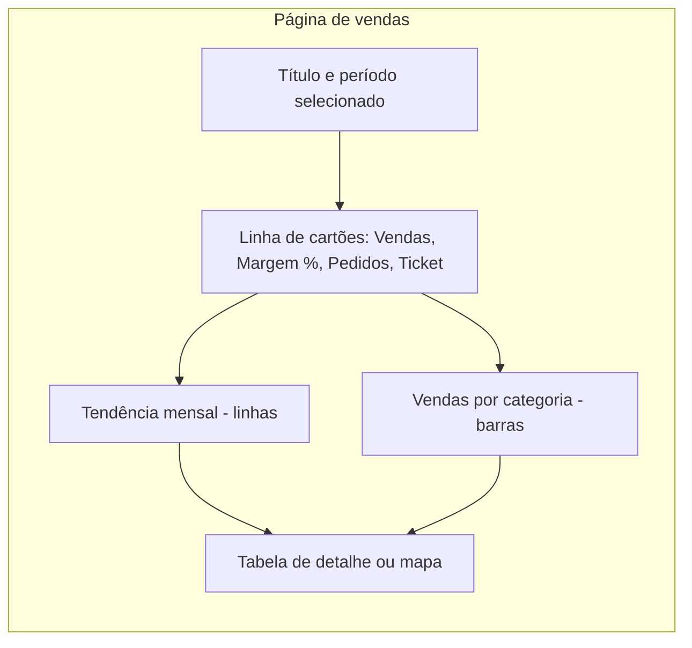

# Visualizações e formatação

## Do modelo para a tela

Com o modelo pronto e as medidas escritas (notas de [fundamentos de DAX](/labs/data/power-bi/06-dax-fundamentos/) e [contexto e inteligência de tempo](/labs/data/power-bi/07-dax-contexto-calculate-e-inteligencia-de-tempo/)), chega a parte que o usuário de negócio realmente vê: os visuais. Um visual é só uma pergunta feita ao modelo e desenhada na tela. "Quanto vendemos por mês?" vira um gráfico de linhas; "quais os 10 produtos que mais venderam?" vira um gráfico de barras.

Escolher o visual certo e formatá-lo com cuidado é o que separa um relatório que as pessoas usam de um que vira "aquele arquivo bonito que ninguém abre".

## Adicionando um visual

1. No modo de exibição de **Relatório**, clique numa área vazia da tela.
2. No painel **Visualizações**, na guia **Criar visual**, escolha o tipo (por exemplo, **Gráfico de colunas clusterizado**).
3. Arraste os campos do painel **Dados** para os poços de campos do visual: `dCalendario[Mes]` em **Eixo X**, a medida `[Total Vendas]` em **Eixo Y**, `dProduto[Categoria]` em **Legenda**, se quiser quebrar por cor.
4. Mude para a guia **Formatar visual** e ajuste títulos, rótulos e cores.
5. Redimensione e alinhe o visual na página.

Atalho útil: arrastar um campo direto para a tela já cria um visual (o Power BI escolhe o tipo, geralmente tabela ou colunas), e você troca o tipo depois clicando em outro ícone no painel.

Os nomes dos poços de campos mudam conforme o visual, mas a lógica é sempre a mesma:

| Poço                        | O que vai nele                                | Exemplo                                   |
| --------------------------- | --------------------------------------------- | ----------------------------------------- |
| Eixo X / Eixo Y / Categoria | A coluna que define os grupos                 | `dCalendario[Mes]`, `dProduto[Categoria]` |
| Valores                     | As medidas                                    | `[Total Vendas]`, `[Margem %]`            |
| Legenda                     | Uma coluna para quebrar a série por cor       | `dCliente[UF]`                            |
| Múltiplos pequenos          | Repete o visual para cada valor de uma coluna | um gráfico por `dCalendario[Ano]`         |
| Dicas de ferramenta         | Medidas extras que aparecem ao passar o mouse | `[Total Pedidos]`                         |

A regra que já apareceu nas notas de DAX vale aqui: **colunas de dimensão nos eixos, medidas nos valores**. Se você precisar arrastar uma coluna numérica da fato para Valores, crie antes a medida explícita.

## Catálogo de visuais

### Tabela e matriz

A **tabela** mostra dados em linhas e colunas, como uma planilha. É boa para detalhe: lista de pedidos, ranking de clientes com várias métricas lado a lado.

A **matriz** é a tabela dinâmica do Power BI: tem linhas, colunas e valores, subtotais e hierarquias que expandem (Ano > Trimestre > Mês). Use quando precisar cruzar duas dimensões, como `Categoria` nas linhas e `Ano` nas colunas.

Ambas aceitam formatação condicional (mais abaixo), o que transforma uma grade de números num mapa de calor fácil de ler.

### Cartão e KPI

O **cartão** exibe um número em destaque: "Total de vendas: R$ 4,2 mi". O visual de cartão atual (que estreou como "Cartão (novo)" e virou o padrão em novembro de 2025) aceita **várias medidas** e **categorias** no mesmo visual, com rótulos de referência (por exemplo, o valor do ano anterior embaixo do número principal) e imagens. Ele substitui os visuais antigos de cartão único e de **cartão de várias linhas**, que continuam disponíveis só por compatibilidade, em relatórios antigos.

O **KPI** mostra um valor, uma meta e a tendência: você informa a medida (Valor), a coluna de tempo (Eixo de tendência) e a medida da meta (Destino). O visual pinta de verde ou vermelho conforme o valor bate ou não a meta.

### Barras e colunas

O visual mais versátil que existe. **Colunas** (verticais) funcionam bem com o tempo no eixo (poucos períodos) e **barras** (horizontais) funcionam bem com categorias de nome longo, como produtos e clientes, porque o texto cabe na horizontal.

Variações: clusterizado (séries lado a lado), empilhado (séries uma sobre a outra, mostrando o total e a composição) e 100% empilhado (só a composição).

### Linhas e área

O **gráfico de linhas** é o padrão para **tendência no tempo**: vendas por mês, evolução do ticket médio. Comporta várias séries (este ano x ano anterior) sem virar bagunça, desde que sejam poucas.

O **gráfico de área** é uma linha com a região de baixo preenchida, útil para destacar volume. Na versão empilhada, mostra a composição ao longo do tempo. Existe também o combinado **linhas e colunas** (por exemplo, vendas em colunas e margem % em linha, com dois eixos).

### Pizza e rosca

Mostram a **parte de um todo**. Funcionam razoavelmente com 2 a 5 fatias. Com mais que isso, o olho humano não consegue comparar ângulos e áreas com precisão, e um gráfico de barras ordenado comunica muito melhor. A rosca é uma pizza com um furo no meio, mesma regra.

### Dispersão

O **gráfico de dispersão** posiciona cada item por duas medidas, uma em cada eixo, para revelar relação: cada ponto é um produto, com `[Quantidade Total]` no eixo X e `[Margem %]` no eixo Y. Adicionando uma terceira medida em **Tamanho**, ele vira um gráfico de bolhas.

### Mapas

Para dados geográficos: o **mapa** coloca bolhas sobre localizações e o **mapa preenchido** (coroplético) pinta as regiões, como estados por vendas. A Microsoft está migrando os visuais de mapa baseados em Bing Maps para o **Azure Maps**, então prefira o visual Azure Maps em relatórios novos (ele pode estar desabilitado pelo administrador do seu ambiente e não funciona com Publicar na Web). Para mapas, categorize a coluna corretamente no modo Tabela (**Ferramentas de coluna > Categoria de dados**: Cidade, Estado ou Província, País) e, de preferência, envie a localização completa (`"Fortaleza, CE, Brasil"`) para evitar que o Power BI coloque "Natal" no Natal errado.

### Treemap

Retângulos aninhados cujo tamanho é proporcional ao valor. Mostra **hierarquia e proporção** ao mesmo tempo (categoria > subcategoria) e aproveita bem o espaço. Fica ilegível com muitos itens pequenos.

### Medidor

O **medidor** (gauge) é um semicírculo que mostra o progresso de um valor em direção a uma meta: `[Total Vendas]` em Valor e `[Meta Vendas]` em Valor de destino. Ocupa bastante espaço para mostrar um número só, então use com moderação.

### Cascata

O **gráfico de cascata** (waterfall) explica **como se chega de um valor a outro**: parte do faturamento, desconta custos, impostos e devoluções, e termina no lucro. Também é ótimo para mostrar a variação entre dois períodos quebrada por categoria (o que aumentou, o que diminuiu).

### Funil

O **funil** mostra etapas sequenciais de um processo com perda entre elas: visitantes > carrinho > checkout > compra. Cada barra é uma etapa, e o visual mostra o percentual em relação à primeira.

## Qual visual usar

| Quero mostrar...                         | Visual recomendado                                    | Evite                                               |
| ---------------------------------------- | ----------------------------------------------------- | --------------------------------------------------- |
| Comparação entre categorias              | Barras ou colunas, ordenadas                          | Pizza com muitas fatias                             |
| Tendência no tempo                       | Linhas (ou colunas, se forem poucos períodos)         | Barras horizontais com datas                        |
| Parte de um todo                         | Barras empilhadas 100%, treemap, rosca (até 5 fatias) | Pizza com 12 fatias                                 |
| Relação entre duas medidas               | Dispersão                                             | Duas linhas com eixos diferentes sem explicação     |
| Distribuição geográfica                  | Mapa preenchido ou mapa de bolhas                     | Mapa quando a geografia não importa para a pergunta |
| Hierarquia                               | Treemap, matriz com drill                             | Tabela plana enorme                                 |
| Valor contra meta                        | KPI, cartão com rótulo de referência, medidor         | Medidor para cinco indicadores lado a lado          |
| Etapas de um processo                    | Funil                                                 | Pizza                                               |
| Aumentos e reduções que compõem um total | Cascata                                               | Barras empilhadas com valores negativos             |
| Detalhe exato de cada item               | Tabela                                                | Gráfico com 200 barras                              |

Na dúvida, comece pela barra. Ela quase nunca está errada.

## Formatação dos visuais

A guia **Formatar visual** do painel Visualizações tem duas abas: **Visual** (o que é específico do tipo de gráfico) e **Geral** (o que todo visual tem). As opções mais usadas:

- **Título**: texto, fonte, tamanho, alinhamento. Escreva títulos que respondem à pergunta ("Vendas por mês - 2025") em vez do padrão automático ("Total Vendas por Mes").
- **Rótulos de dados**: mostram o valor em cima de cada barra ou ponto. Ótimos com poucas barras; poluem com muitas.
- **Eixos X e Y**: título do eixo, unidades de exibição (mil, milhões), intervalo, linhas de grade. Se os rótulos de dados estão ligados, muitas vezes dá para desligar o eixo Y e as linhas de grade.
- **Legenda**: posição e se deve aparecer. Uma série só não precisa de legenda.
- **Cores**: cor padrão e cores por série ou por ponto de dados.
- **Plano de fundo, borda e sombra** (em Geral > Efeitos): use com parcimônia, para separar blocos, não para enfeitar.
- **Dica de ferramenta**: o que aparece ao passar o mouse. Medidas adicionadas ao poço **Dicas de ferramenta** aparecem aqui. Dicas de página inteira estão na nota de [filtros, segmentações e interatividade](/labs/data/power-bi/09-filtros-segmentacoes-e-interatividade/).

Para copiar a formatação de um visual para outro, use o **Pincel de formatação** na guia Página Inicial.

### Formatação condicional

A formatação condicional muda a aparência conforme o valor. Em tabelas e matrizes, clique na seta do campo em **Valores** (ou procure a opção na guia Formatar, em **Elementos de célula**) e escolha:

- **Cor da tela de fundo** e **Cor da fonte**: escala de cores (por exemplo, do vermelho ao verde) ou regras ("se `[Margem %]` < 10%, vermelho").
- **Barras de dados**: uma barra horizontal dentro da célula, proporcional ao valor. Transforma uma coluna de números num mini gráfico.
- **Ícones**: setas, semáforos, sinais, por regra ou faixa.
- **URL da Web**: transforma o valor num link.

Nos gráficos, a formatação condicional aparece no botão **fx** ao lado das opções de cor. Ele permite colorir pelo **valor de um campo**, o que abre uma porta: uma medida que devolve um código de cor.

```dax
Cor Margem =
SWITCH (
    TRUE (),
    [Margem %] < 0.10, "#C0392B",
    [Margem %] < 0.25, "#E67E22",
    "#27AE60"
)
```

Configure as cores das colunas com **fx > Estilo de formatação: Valor do campo > `[Cor Margem]`**, e cada coluna fica vermelha, laranja ou verde conforme a margem.

### Temas

Um tema define cores, fontes e formatação padrão de todos os visuais do relatório de uma vez, em vez de ajustar visual por visual.

- **Temas internos**: na guia **Exibir**, a galeria de temas traz vários prontos, incluindo opções pensadas para acessibilidade (com contraste maior e paletas amigáveis a daltônicos).
- **Personalizar tema atual**: na mesma galeria, ajuste nome e cores, texto, visuais, página e painel de filtros, e salve.
- **Arquivo JSON de tema**: o tema pode ser exportado e importado como um arquivo `.json`. É assim que empresas padronizam a identidade visual de todos os relatórios.

Um tema mínimo:

```json
{
  "name": "Caramelo Vendas",
  "dataColors": ["#C8752F", "#2F6FC8", "#7A7A7A", "#2FA87A", "#C82F5A"],
  "background": "#FFFFFF",
  "foreground": "#252423",
  "tableAccent": "#C8752F"
}
```

Importe em **Exibir > Temas > Procurar temas**. As cores de `dataColors` viram a paleta padrão dos visuais na ordem em que aparecem.

## Design da página

Formatação de visual é metade do trabalho. A outra metade é como os visuais convivem na página.



- **Hierarquia de leitura**: as pessoas leem do canto superior esquerdo para baixo e para a direita. Coloque os números mais importantes (cartões) no topo, as tendências no meio e o detalhe embaixo.
- **Poucos visuais por página**: entre 4 e 8 é uma boa faixa. Mais que isso cansa o leitor e deixa a página lenta, porque cada visual é pelo menos uma consulta ao modelo.
- **Alinhamento e espaçamento**: use as opções de **Formatar > Alinhar** e **Distribuir** e mantenha o mesmo espaço entre os visuais. Linhas de grade e "ajustar à grade" (guia Exibir) ajudam.
- **Cor para destacar, não para enfeitar**: use uma cor neutra para quase tudo e uma cor de destaque para o que merece atenção (a categoria que caiu, o mês recorde). Se tudo é colorido, nada se destaca.
- **Fontes**: uma família, dois ou três tamanhos (título, subtítulo, corpo). Nada de cinco fontes diferentes.
- **Plano de fundo**: imagens de fundo podem ser usadas para criar a "moldura" do relatório (cabeçalho, blocos), mas teste a legibilidade e o peso do arquivo.
- **Formas, ícones, caixas de texto e imagens** (guia **Inserir**) servem para títulos de seção, logotipo e explicações curtas ("Valores em R$, sem impostos").

### Acessibilidade

Relatório acessível é relatório que mais gente consegue usar, não só pessoas com deficiência. O Power BI segue as diretrizes WCAG e oferece ferramentas para o autor:

- **Contraste**: texto e elementos importantes precisam de contraste suficiente com o fundo. Cinza-claro sobre branco é a falha mais comum.
- **Não dependa só da cor**: use também rótulos, marcadores de formas diferentes nas linhas e ícones. Vermelho e verde lado a lado são indistinguíveis para muitas pessoas com daltonismo.
- **Texto alternativo**: em **Formatar > Geral > Texto alternativo**, descreva o que o visual mostra. Leitores de tela usam esse texto. Ele também aceita formatação condicional, então pode trazer o valor atual.
- **Ordem de tabulação**: no painel **Seleção** (guia Exibir), defina a ordem em que o teclado percorre os visuais e esconda da navegação os elementos decorativos.
- **Títulos e rótulos claros**: abreviações internas (`VL_VND_LIQ`) não dizem nada para quem lê.

## Boas práticas

- Comece pela pergunta de negócio e só depois escolha o visual.
- Ordene barras pelo valor (do maior para o menor), a menos que a ordem natural importe (meses, faixas etárias).
- Mostre contexto: um número sozinho ("R$ 4,2 mi") diz pouco; com o ano anterior ou a meta ao lado, ele vira informação.
- Formate as medidas no modelo (moeda, percentual, casas decimais), não em cada visual.
- Teste a página com dados filtrados e com tudo selecionado: um gráfico que fica lindo com 5 categorias pode virar uma parede de barras com 300.
- Use o **Analisador de Desempenho** (guia Exibir) se a página estiver lenta, para descobrir qual visual demora.

## Referências

- [Tipos de visualização no Power BI](https://learn.microsoft.com/pt-br/power-bi/visuals/power-bi-visualization-types-for-reports-and-q-and-a) - Microsoft Learn, pt-BR
- [Criar um visual de cartão no Power BI](https://learn.microsoft.com/pt-br/power-bi/visuals/power-bi-visualization-card) - Microsoft Learn, pt-BR
- [Usar temas de relatório no Power BI Desktop](https://learn.microsoft.com/pt-br/power-bi/create-reports/desktop-report-themes) - Microsoft Learn, pt-BR
- [Formatação condicional em tabelas](https://learn.microsoft.com/pt-br/power-bi/create-reports/desktop-conditional-table-formatting) - Microsoft Learn, pt-BR
- [Visão geral da acessibilidade no Power BI](https://learn.microsoft.com/pt-br/power-bi/create-reports/desktop-accessibility-overview) - Microsoft Learn, pt-BR
