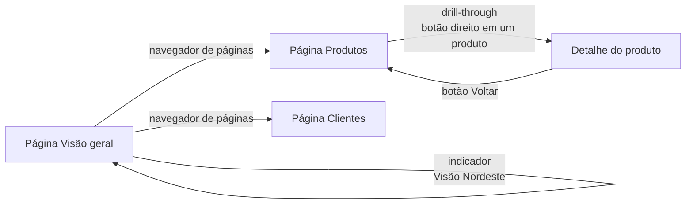

# Filtros, segmentações e interatividade

## Por que interatividade importa

Um relatório estático responde uma pergunta. Um relatório interativo deixa o usuário fazer as próprias perguntas: "e se eu olhar só o Nordeste?", "o que tem dentro dessa barra?", "como estava no ano passado?". O Power BI oferece várias ferramentas para isso, e todas mexem no **contexto de filtro** que você conheceu na nota de [contexto, CALCULATE e inteligência de tempo](/labs/data/power-bi/07-dax-contexto-calculate-e-inteligencia-de-tempo/). Clicar numa segmentação é, no fundo, acrescentar um filtro que todas as medidas da página vão respeitar.

Os exemplos usam o modelo de vendas das notas anteriores (`fVendas`, `dProduto`, `dCliente`, `dCalendario`).

## O painel Filtros

O painel **Filtros** fica ao lado da tela do relatório e organiza os filtros em níveis:

| Nível                       | Onde vale                               | Exemplo                                                      |
| --------------------------- | --------------------------------------- | ------------------------------------------------------------ |
| Filtros neste visual        | Só no visual selecionado                | Gráfico de produtos mostrando só `Categoria = Eletrônicos`   |
| Filtros nesta página        | Todos os visuais da página              | Página "Nordeste" com `dCliente[UF]` nos estados da região   |
| Filtros em todas as páginas | O relatório inteiro                     | Excluir pedidos de teste, `dCalendario[Ano] >= 2023`         |
| Drill-through               | A página de destino de um drill-through | Campo `dProduto[Produto]` na página de detalhe (veja abaixo) |

Para adicionar um filtro, arraste um campo do painel **Dados** para o nível desejado. Os campos que já estão no visual aparecem automaticamente no nível do visual.

Tipos de filtro disponíveis:

- **Filtragem básica**: uma lista de valores com caixas de seleção.
- **Filtragem avançada**: condições como "contém", "começa com", "é maior que", combinadas com E/OU.
- **N superior**: os N primeiros ou últimos itens por uma medida, como os 10 produtos com maior `[Total Vendas]`. Ótimo para rankings.
- **Data relativa**: "nos últimos 3 meses", "neste ano", que avança sozinho com o calendário.

Como autor, você controla o que o leitor vê no painel: dá para **bloquear** um filtro (o leitor vê, mas não altera), **ocultar** (o filtro vale, mas não aparece) e formatar a aparência do painel. Use o bloqueio para filtros que são regras de negócio (excluir pedidos cancelados) e deixe livres os que o usuário pode querer mudar.

> ⚠️ Filtro escondido não é segurança. Quem tiver acesso ao modelo consegue ver os dados por outros caminhos. Para impedir que alguém veja certas linhas, use segurança em nível de linha (RLS), explicada na nota de [serviço, publicação e dashboards](/labs/data/power-bi/10-servico-publicacao-e-dashboards/).

## Segmentações (slicers)

Uma segmentação é um filtro que mora **na tela do relatório**, como um visual. Ela deixa visível e a um clique de distância aquilo que o usuário mais filtra: período, região, categoria.

### Filtro x segmentação

|                           | Segmentação                                                  | Painel Filtros                                    |
| ------------------------- | ------------------------------------------------------------ | ------------------------------------------------- |
| Visibilidade              | Sempre na tela                                               | Escondido até o leitor abrir o painel             |
| Interação                 | Clique direto nos valores                                    | Precisa abrir o painel                            |
| Melhor para               | Filtros usados o tempo todo, relatórios para usuários finais | Regras fixas, filtros complexos, uso do autor     |
| Sincronizar entre páginas | Sim, com Sincronizar segmentações                            | Filtros de relatório já valem em todas as páginas |
| Ocupa espaço na página    | Sim                                                          | Não                                               |

Na prática, os dois convivem: 2 ou 3 segmentações para o que importa, e o painel Filtros para o resto.

### Tipos de segmentação

- **Segmentação (visual clássico)**: o visual versátil, que muda de forma conforme o campo e a configuração: **lista vertical**, **bloco** (botões lado a lado), **lista suspensa** e, para datas e números, **entre** (um controle deslizante com início e fim), **antes**, **depois** e **data relativa** ("últimos 12 meses").
- **Segmentação de botão**: mostra as opções como botões estilizados em grade, com suporte a imagens e ícones. Bom para poucas opções e relatórios com cara de aplicativo.
- **Segmentação de lista**: lista ou suspensa com imagens, rótulos, hierarquia, pesquisa e formatação condicional. Mostra as seleções atuais como "pílulas" removíveis.
- **Segmentação de entrada**: o usuário digita um texto ou número (com operadores como "contém" e "começa com"). Útil para buscar um cliente ou número de pedido específico.

### Como adicionar

1. Clique numa área vazia da página.
2. No painel **Visualizações**, escolha o tipo de segmentação.
3. Arraste o campo para o poço **Campo**: por exemplo, `dCalendario[Ano]` ou `dProduto[Categoria]`.
4. Em **Formatar visual > Configurações de segmentação**, escolha o estilo (lista, suspensa, entre) e a seleção (única, múltipla com Ctrl, opção "Selecionar tudo").

Use sempre colunas das **dimensões** na segmentação (`dCalendario[Ano]`, e não um ano extraído da fato), para que o filtro se propague pelos relacionamentos para todas as tabelas fato do modelo.

### Sincronizar segmentações entre páginas

Se o usuário escolheu "2025" na página de visão geral, ele espera continuar em 2025 ao mudar de página. Para isso:

1. Na guia **Exibir**, abra o painel **Sincronizar segmentações**.
2. Selecione a segmentação.
3. Na coluna **Sincronizar**, marque as páginas em que a seleção deve valer.
4. Na coluna **Visível**, marque as páginas em que a segmentação deve aparecer.

Uma segmentação pode estar sincronizada numa página sem estar visível nela: a página fica filtrada pela escolha feita em outra página, sem ocupar espaço.

### Botões Aplicar tudo e Limpar tudo

Em páginas com várias segmentações, cada clique dispara novas consultas em todos os visuais. Os botões **Aplicar todas as segmentações** e **Limpar todas as segmentações** (em **Inserir > Botões**) permitem que o usuário faça várias escolhas e aplique de uma vez, ou volte ao estado inicial com um clique.

## Interações entre visuais

Por padrão, clicar num ponto de um visual afeta os outros visuais da página. Clicar na barra "Eletrônicos" de um gráfico por categoria faz o resto da página reagir. Existem dois comportamentos:

- **Realce cruzado**: o outro visual mantém o total como "sombra" e destaca a parte que corresponde à seleção. É o padrão em gráficos de barras e colunas.
- **Filtro cruzado**: o outro visual passa a mostrar só os dados da seleção.

Para mudar isso, selecione o visual de origem e vá em **Formatar > Editar interações**. Aparecem ícones em cima de cada outro visual: **Filtrar**, **Realçar** ou **Nenhum**. Use **Nenhum** quando um visual deve ficar fixo, por exemplo um cartão com o total da empresa que não deve mudar ao clicar nas barras.

## Drill down, drill up e drill-through

### Drill down e drill up

Quando o eixo de um visual tem uma **hierarquia** (vários campos empilhados, como `Ano > Trimestre > Mês`, ou `Categoria > Subcategoria > Produto`), o visual ganha setas no cabeçalho:

- **Ativar detalhamento** (seta para baixo): clicar numa barra desce um nível só dentro dela (de 2025 para os trimestres de 2025).
- **Ir para o próximo nível**: desce um nível para todos os itens de uma vez.
- **Expandir todos**: desce mostrando os dois níveis juntos (2025 T1, 2025 T2...).
- **Fazer drill up** (seta para cima): volta um nível.

Montar boas hierarquias na `dCalendario` e na `dProduto` deixa os relatórios bem mais fáceis de explorar.

### Drill-through

O drill-through leva o usuário de um resumo para uma **página de detalhe** já filtrada. Exemplo: do gráfico de vendas por produto, clicar com o botão direito em "Notebook X" e ir para uma página que mostra tudo sobre esse produto.

Para configurar:

1. Crie a página de destino, por exemplo "Detalhe do produto", com os visuais de detalhe (vendas por mês, por UF, lista de pedidos).
2. Nessa página, no painel **Visualizações** (seção **Detalhamento**), arraste `dProduto[Produto]` para o poço **Detalhamento**.
3. O Power BI adiciona sozinho um botão **Voltar** no canto da página.
4. Em qualquer outra página, clique com o botão direito num visual que use `dProduto[Produto]` e escolha **Detalhamento > Detalhe do produto**.

A página de destino abre filtrada pelo produto clicado (e, se a opção **Manter todos os filtros** estiver ligada, também pelos outros filtros da origem). Dá para criar um botão com a ação **Detalhamento** para deixar o recurso mais visível, já que muita gente não descobre o clique com o botão direito.

## Dicas de ferramenta de página de relatório

A dica de ferramenta padrão mostra os valores do ponto em que o mouse está. Uma **dica de ferramenta de página** mostra uma página inteira, pequena, com seus próprios visuais.

1. Crie uma nova página e, em **Formatar página > Informações da página**, ative **Usar como dica de ferramenta**.
2. Em **Configurações de tela**, escolha o tipo **Dica de ferramenta** (uma página pequena).
3. Monte visuais compactos, por exemplo um minigráfico de vendas por mês e um cartão com a margem.
4. No visual de origem, em **Formatar > Geral > Dicas de ferramenta**, escolha o tipo **Página do relatório** e selecione a página criada.

Ao passar o mouse sobre uma barra de categoria, aparece o minigráfico daquela categoria. É um jeito elegante de mostrar detalhe sem ocupar espaço na página principal.

## Indicadores (bookmarks)

Um indicador salva um **estado** do relatório: a página, os filtros e segmentações aplicados, os visuais visíveis e ocultos, o drill atual. Ao clicar no indicador, o relatório volta para aquele estado.

### Criando

1. Deixe a página como quer salvar (filtros, segmentações, visuais ocultos pelo painel **Seleção**).
2. Na guia **Exibir**, abra o painel **Indicadores** e clique em **Adicionar**.
3. Renomeie com um nome claro, como "Visão Nordeste 2025".

### Opções do indicador

Clique nos três pontos do indicador para escolher o que ele guarda:

| Opção                                   | O que salva                                                               |
| --------------------------------------- | ------------------------------------------------------------------------- |
| Dados                                   | Filtros, segmentações, ordenação e drill                                  |
| Exibição                                | Visibilidade dos visuais (o que está oculto no painel Seleção) e destaque |
| Página atual                            | Se o indicador deve navegar para a página em que foi criado               |
| Todos os visuais / Visuais selecionados | Se vale para a página inteira ou só para alguns visuais                   |

Combinações úteis:

- Só **Exibição**, sem **Dados**: alternar entre "ver gráfico" e "ver tabela" sem mexer nos filtros que o usuário escolheu.
- **Dados** + **Página atual**: um botão "Visão padrão" que reseta a página.

Um uso clássico é o par de botões gráfico/tabela: dois visuais um em cima do outro, dois indicadores (cada um ocultando um dos visuais pelo painel Seleção) e dois botões apontando para eles.

## Botões e navegação

Botões fazem o relatório se comportar como um aplicativo. Em **Inserir > Botões** há formas prontas (seta, voltar, informação, indicador, em branco, navegadores) e os botões de segmentação (aplicar e limpar todas). Cada botão tem uma **ação**:

- **Voltar**: retorna à página anterior, muito usado em páginas de drill-through.
- **Indicador**: aplica um indicador.
- **Detalhamento**: faz o drill-through para uma página escolhida.
- **Navegação de página**: vai para outra página, sem precisar de indicador.
- **URL da Web**: abre um link externo (documentação, outro relatório).
- **Aplicar/Limpar todas as segmentações**.

Para um menu inteiro, use os **navegadores**: o **navegador de páginas** cria um botão para cada página do relatório automaticamente, e o **navegador de indicadores** faz o mesmo para um grupo de indicadores. Quando você adiciona ou renomeia uma página, o navegador se atualiza sozinho.

No Desktop, para testar um botão enquanto edita, segure **Ctrl** e clique. No serviço, no modo de leitura, um clique basta.

## Outros recursos de interatividade

- **Personalizar visuais**: se habilitado pelo autor (**Arquivo > Opções > Relatório atual**), o leitor pode trocar o tipo de visual ou os campos de um gráfico no serviço, sem editar o relatório, e salvar como indicador pessoal.
- **Narrativa inteligente**: um visual que gera um texto resumindo os dados da página ("As vendas cresceram X% em relação a...") e se atualiza com os filtros. Convive com a **narrativa com Copilot**, que usa IA e exige capacidade e licenciamento compatíveis com o Copilot.
- **P e R (Q&A)**: o visual em que o usuário digitava perguntas em linguagem natural está **descontinuado**. A Microsoft anunciou em dezembro de 2025 que não é mais possível criar novas experiências de P e R e que elas serão aposentadas por completo no fim de dezembro de 2026, quando os visuais existentes deixam de funcionar. O substituto indicado é o **Copilot** no Power BI. Se você encontrar P e R em material de estudo antigo, trate como histórico e não use em relatórios novos.

## Boas práticas

- Coloque as segmentações sempre no mesmo lugar em todas as páginas (topo ou lateral esquerda) e sincronize as que fazem sentido.
- Deixe claro o que está filtrado: um cartão ou título dinâmico com o período selecionado evita que alguém leia "2025" achando que é o histórico todo.
- Prefira poucas segmentações bem escolhidas a dez segmentações que ninguém entende.
- Revise as interações de cada página: o padrão nem sempre é o que a análise pede.
- Dê nomes de negócio a indicadores e botões ("Visão por região", não "Indicador 3").
- Teste o relatório como leitor (no serviço ou com Ctrl+clique): é fácil esquecer um botão sem ação ou uma página de drill-through sem botão Voltar.

## Referências

- [Visão geral das segmentações de dados no Power BI](https://learn.microsoft.com/pt-br/power-bi/visuals/power-bi-visualization-slicers) - Microsoft Learn, pt-BR
- [Adicionar um filtro a um relatório no Power BI](https://learn.microsoft.com/pt-br/power-bi/create-reports/power-bi-report-add-filter) - Microsoft Learn, pt-BR
- [Configurar o drill-through](https://learn.microsoft.com/pt-br/power-bi/create-reports/desktop-drillthrough) e [Dicas de ferramenta de página de relatório](https://learn.microsoft.com/pt-br/power-bi/create-reports/desktop-tooltips) - Microsoft Learn, pt-BR
- [Indicadores no Power BI](https://learn.microsoft.com/pt-br/power-bi/create-reports/desktop-bookmarks) - Microsoft Learn, pt-BR
- [Criar e configurar botões em relatórios do Power BI](https://learn.microsoft.com/pt-br/power-bi/create-reports/desktop-buttons) - Microsoft Learn, pt-BR
