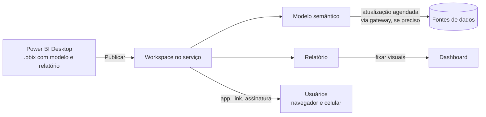
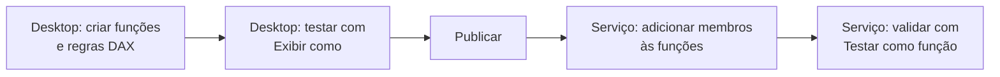

# Serviço do Power BI: publicação, compartilhamento e dashboards

## Do Desktop para o serviço

Até aqui tudo aconteceu no Power BI Desktop, no seu computador. Para que outras pessoas usem o relatório, ele precisa ir para o **serviço do Power BI** (app.powerbi.com), a parte em nuvem que hoje faz parte do Microsoft Fabric. É lá que o relatório é compartilhado, atualizado automaticamente, protegido com segurança por linha e transformado em dashboards e apps.



Quem pode publicar, compartilhar e consumir depende da licença (gratuita, Pro, Premium por Usuário ou capacidade Fabric/Premium), assunto da nota de [introdução e licenças](/labs/data/power-bi/01-introducao-e-licencas/). A regra de bolso: para compartilhar conteúdo e colaborar em workspaces, você precisa de Pro ou PPU; para que usuários com licença gratuita consumam o conteúdo, ele precisa estar numa capacidade Premium ou Fabric F64 ou maior.

## Publicando um relatório

1. Salve o arquivo `.pbix` no Desktop.
2. Na guia **Página Inicial**, clique em **Publicar** (ou **Arquivo > Publicar > Publicar no Power BI**).
3. Entre com a conta da organização, se ainda não estiver conectado.
4. Escolha o **workspace** de destino.
5. Ao final, o Desktop mostra um link para abrir o relatório no serviço.

A publicação cria **dois itens** no workspace: o **modelo semântico** (os dados, relacionamentos e medidas, antigamente chamado de "conjunto de dados" ou dataset) e o **relatório** (as páginas e visuais). Eles vivem separados: vários relatórios podem usar o mesmo modelo semântico, e a atualização de dados é configurada no modelo, não no relatório.

Se você publicar de novo com o mesmo nome no mesmo workspace, o Power BI pergunta se deve **substituir** o conteúdo existente. Os links e permissões continuam valendo.

## Workspaces

Um workspace é uma pasta colaborativa no serviço onde ficam relatórios, modelos semânticos, dashboards e outros itens do Fabric.

- **Meu workspace**: área pessoal de cada usuário. Serve para rascunhos e testes, não para conteúdo de equipe.
- **Workspaces** (compartilhados): criados para uma equipe, projeto ou assunto ("Vendas - Comercial"). São o lugar certo para conteúdo que outras pessoas vão usar.

Cada pessoa ou grupo adicionado a um workspace recebe uma função:

| Função        | Pode fazer                                                                                                                           |
| ------------- | ------------------------------------------------------------------------------------------------------------------------------------ |
| Administrador | Tudo, incluindo gerenciar o workspace, adicionar e remover pessoas de qualquer função e excluí-lo                                    |
| Membro        | Publicar, editar e excluir conteúdo, compartilhar itens, publicar e atualizar o app, adicionar pessoas com funções iguais ou menores |
| Colaborador   | Criar, editar e excluir conteúdo, publicar relatórios e configurar atualização dos itens que gerencia                                |
| Visualizador  | Apenas ver e interagir com o conteúdo, sem editar                                                                                    |

Dê a cada pessoa a menor função que resolve o trabalho dela. Quem só consome relatórios deveria ser Visualizador ou, melhor ainda, receber o conteúdo por um app. Prefira adicionar **grupos** (do Microsoft Entra ID) em vez de pessoas uma a uma: quando alguém entra ou sai da equipe, basta mexer no grupo.

### Apps

Um **app** do Power BI é um pacote de relatórios e dashboards publicado a partir de um workspace para um público mais amplo. Vantagens sobre dar acesso direto ao workspace:

- os consumidores veem uma versão estável, enquanto a equipe continua mexendo no workspace;
- dá para criar **públicos** diferentes, cada um vendo um subconjunto dos relatórios;
- tem navegação própria, com nome, logotipo e ordem das páginas.

É o jeito recomendado de distribuir relatórios para muita gente.

## Relatórios e dashboards

No dia a dia as palavras se misturam, mas no Power BI **relatório** e **dashboard** são coisas diferentes:

|                  | Relatório                                 | Dashboard                                             |
| ---------------- | ----------------------------------------- | ----------------------------------------------------- |
| Onde é criado    | Desktop ou serviço                        | Só no serviço                                         |
| Páginas          | Várias                                    | Uma só (uma tela)                                     |
| Fonte            | Um modelo semântico                       | Blocos fixados de um ou mais relatórios e modelos     |
| Interatividade   | Filtros, segmentações, drill, indicadores | Limitada: clicar num bloco abre o relatório de origem |
| Alertas de dados | Não                                       | Sim, em blocos de cartão, KPI e medidor               |
| Uso típico       | Análise e exploração                      | Monitoramento rápido dos principais números           |

### Como montar um dashboard

1. Abra um relatório no serviço.
2. Passe o mouse sobre um visual e clique no ícone de **fixar** (alfinete).
3. Escolha um dashboard existente ou crie um novo.
4. Repita com visuais de outros relatórios, se quiser juntar assuntos.

Cada visual fixado vira um **bloco** (tile). Também dá para fixar uma **página inteira** do relatório como um bloco interativo (**Fixar no dashboard** na barra do relatório), e adicionar blocos de texto, imagem, vídeo ou página da web pelo menu **Editar > Adicionar um bloco**.

Pelo menu de cada bloco você pode editar título e subtítulo, definir um link personalizado, abrir em modo foco, exportar os dados e configurar alertas. Os blocos guardam os filtros que estavam ativos no momento em que foram fixados.

### Alertas de dados

Em blocos de **cartão**, **KPI** e **medidor**, o menu **Gerenciar alertas** permite configurar uma regra como "avise quando `Total Vendas` do mês ficar abaixo de R$ 100 mil". O alerta é verificado quando os dados são atualizados e envia notificação no serviço e, opcionalmente, por e-mail. Alertas são pessoais: cada usuário configura os seus.

### Dashboards em tempo real

Em materiais antigos você vai encontrar dashboards em tempo real feitos com modelos semânticos de **streaming** do Power BI (push, streaming, PubNub e o bloco de streaming). Esse recurso está **em aposentadoria**: a Microsoft bloqueou a criação de novos modelos de streaming a partir de 31 de outubro de 2024 (com exceções pontuais) e prevê a aposentadoria dos existentes para outubro de 2027. O caminho atual para dados em tempo real é o **Real-Time Intelligence** do Microsoft Fabric. Para casos mais simples, relatórios em DirectQuery com **atualização automática de página** também mostram dados recentes sem streaming.

## Compartilhando e distribuindo

Há várias formas de colocar o conteúdo na frente das pessoas, com níveis diferentes de controle:

- **Acesso ao workspace**: para quem trabalha no conteúdo (funções vistas acima).
- **App**: para o público consumidor, como recomendado acima.
- **Compartilhar**: o botão **Compartilhar** de um relatório ou dashboard gera um link ou envia para pessoas específicas, com opções como permitir recompartilhar e permitir criar conteúdo com o modelo (permissão de Build).
- **Assinaturas por e-mail**: o usuário (ou o autor, para outras pessoas) recebe um instantâneo do relatório por e-mail num horário definido, por exemplo toda segunda às 8h.
- **Exportar**: para PDF, PowerPoint (imagem ou relatório ativo) e os dados de um visual para Excel/CSV, conforme o que o administrador permitir. **Analisar no Excel** cria uma tabela dinâmica conectada ao modelo semântico.
- **Incorporar**: em SharePoint Online, Teams ou em sites internos, respeitando a autenticação e as permissões de cada usuário.
- **Publicar na Web**: gera um link e um código de incorporação **públicos**. Qualquer pessoa na internet com o link vê o relatório, sem login e **sem nenhuma segurança**, nem RLS. Só use para dados que poderiam estar num site aberto (dados públicos, portfólio pessoal com dataset aberto). O administrador pode desativar o recurso, e muitas empresas fazem isso.

### Celular

Os apps do Power BI para **iOS** e **Android** abrem relatórios, dashboards e apps (o app para Windows foi aposentado no fim de 2023; no computador, use o navegador). Para que um relatório fique bom no celular, crie um **layout móvel** no Desktop (**Exibir > Layout móvel**): você arrasta os visuais da página para uma tela em formato de celular e os reorganiza. Dashboards também têm uma exibição móvel, editável no serviço.

## Atualização de dados

Um modelo em modo **Import** guarda uma cópia dos dados (veja a nota de [obter dados e modos de armazenamento](/labs/data/power-bi/03-obter-dados-e-modos-de-armazenamento/)). Depois de publicado, ele só mostra dados novos se for atualizado. Modelos em **DirectQuery** consultam a fonte a cada interação e não precisam de atualização de dados (só do cache).

Formas de atualizar um modelo no serviço:

- **Sob demanda**: botão **Atualizar agora** no modelo semântico.
- **Agendada**: nas configurações do modelo semântico, seção **Atualizar**, você escolhe frequência (diária ou semanal), horários e fuso. O limite é de **8 atualizações agendadas por dia** para modelos em capacidade compartilhada (o caso de quem usa Pro) e de **48 por dia** em capacidade Premium, PPU ou Fabric.
- Arquivos no **OneDrive ou SharePoint** são sincronizados automaticamente com o modelo, sem agendamento.

Pontos de atenção:

- **Credenciais**: o serviço precisa de credenciais próprias para cada fonte, configuradas em **Credenciais da fonte de dados** nas configurações do modelo.
- **Gateway**: fontes que o serviço não alcança pela internet (um SQL Server na rede da empresa, um arquivo numa pasta local) exigem um **gateway de dados local**, um programa instalado num computador da rede que faz a ponte. O gateway **corporativo** (padrão) é gerenciado por administradores e serve a vários usuários; o **pessoal** é só para quem publica sozinho e tem mais limitações. Fontes em nuvem, como Azure SQL, normalmente dispensam gateway.
- **Falhas**: o dono do modelo recebe e-mail quando uma atualização falha, e o agendamento é desativado depois de falhas consecutivas.
- **Inatividade**: se ninguém abrir nenhum relatório ou dashboard daquele modelo por **dois meses**, o Power BI pausa a atualização agendada e avisa o dono por e-mail.

Para tabelas fato muito grandes, a **atualização incremental** recarrega só o período mais recente (por exemplo, os últimos 7 dias) em vez da tabela inteira. É um tópico avançado, mas vale saber que existe.

## Segurança em nível de linha (RLS)

RLS faz com que **cada usuário veja só as linhas que pode ver**, usando o mesmo relatório. O gerente do Ceará vê as vendas do Ceará; a diretoria vê tudo. Sem RLS, você teria que manter um relatório por região.

Uma confusão comum: o RLS **não** é criado no serviço. O fluxo é:



### 1. Criar funções no Desktop

1. Na guia **Modelagem**, clique em **Gerenciar funções**.
2. Clique em **Novo** e dê um nome à função, por exemplo `Ceara`.
3. Selecione a tabela a filtrar (`dCliente`) e defina a regra. Dá para usar o editor padrão (listas suspensas) ou alternar para o **editor DAX**.

Uma regra é uma expressão DAX que devolve verdadeiro ou falso **para cada linha**. Só as linhas com resultado verdadeiro ficam visíveis, e o filtro se propaga pelos relacionamentos até `fVendas`:

```dax
// Regra da função "Ceara" na tabela dCliente (RLS estático)
[UF] = "CE"
```

O RLS estático exige uma função para cada região. O **RLS dinâmico** usa uma função só e descobre quem está logado com `USERPRINCIPALNAME()`, que no serviço devolve o login do usuário (geralmente o e-mail). Para isso, crie no modelo uma tabela de permissões, `dPermissao`, com as colunas `Email` e `UF`, sem relacionamento com as outras tabelas:

| Email             | UF  |
| ----------------- | --- |
| ana@empresa.com   | CE  |
| bruno@empresa.com | PE  |
| bruno@empresa.com | BA  |

E a regra, numa função chamada `PorRegiao`, na tabela `dCliente`:

```dax
// RLS dinâmico: o usuário vê os clientes das UFs liberadas para ele
[UF]
    IN CALCULATETABLE (
        VALUES ( dPermissao[UF] ),
        dPermissao[Email] = USERPRINCIPALNAME ()
    )
```

Oculte a tabela `dPermissao` no modo Modelo, para que ela não apareça para os leitores, e lembre que ela também precisa ser mantida: quem entra na equipe ganha uma linha nova.

### 2. Testar no Desktop

Na guia **Modelagem**, **Exibir como** permite ver o relatório como se você estivesse numa função (e, para RLS dinâmico, como outro usuário, informando o e-mail). Confira se os totais mudam como esperado.

### 3. Publicar e atribuir membros no serviço

1. Publique o relatório.
2. No workspace, abra o menu **Mais opções (...)** do **modelo semântico** e escolha **Segurança**.
3. Selecione a função e adicione pessoas ou grupos de segurança (por e-mail). Grupos do Microsoft 365 não são aceitos.
4. Use **Testar como função** para validar.

Detalhes que pegam muita gente:

- O RLS só se aplica a quem tem a função **Visualizador** no workspace (ou recebe o conteúdo por app ou compartilhamento). Administradores, Membros e Colaboradores têm permissão de edição no modelo e **veem todos os dados**.
- Um usuário que não está em nenhuma função não vê dado nenhum.
- Se a pessoa está em mais de uma função, as permissões se **somam**.
- RLS filtra **linhas**, não colunas. Para esconder colunas ou tabelas inteiras existe a segurança em nível de objeto (OLS), um recurso mais avançado.
- `USERELATIONSHIP` em medidas pode gerar erros em modelos com RLS, segundo a documentação. Teste as medidas de inteligência de tempo com as funções ativas.

## Casos de uso e layout de exemplo

Algumas ideias de dashboards e relatórios por área:

| Área      | Perguntas típicas                                                   | Números principais                             |
| --------- | ------------------------------------------------------------------- | ---------------------------------------------- |
| Vendas    | Estamos batendo a meta? Quais produtos e regiões puxam o resultado? | Vendas, meta, variação ano a ano, ticket médio |
| Marketing | Quais campanhas trazem clientes? Quanto custa cada cliente?         | Leads, conversão, custo por aquisição          |
| Finanças  | Como estão receita, custos e margem?                                | Receita, despesas, margem, fluxo de caixa      |
| Operações | Estamos entregando no prazo? Onde estão os gargalos?                | Prazo médio, pedidos atrasados, estoque        |
| RH        | Como está a rotatividade? Onde contratamos?                         | Headcount, turnover, tempo de contratação      |

Um layout de dashboard de vendas que funciona bem, de cima para baixo:

1. Linha de cartões: `Total Vendas`, `Variação % AA`, `Margem %`, `Ticket Médio`, com o KPI da meta.
2. Gráfico de linhas: vendas por mês, este ano x ano anterior.
3. Barras: vendas por categoria e top 10 produtos.
4. Mapa preenchido: vendas por UF.

Os números reais dependem dos seus dados; o que importa é a hierarquia: resultado primeiro, explicação depois.

## Checklist antes de publicar

- [ ] Medidas formatadas (moeda, percentual) e com nomes de negócio
- [ ] Colunas e tabelas técnicas ocultas (chaves, `dPermissao`)
- [ ] Tabela de datas marcada e data/hora automática desativada
- [ ] Títulos claros, segmentações sincronizadas, botões testados
- [ ] Layout móvel criado para as páginas principais
- [ ] Publicado no workspace certo, não em Meu workspace
- [ ] Credenciais e gateway configurados, atualização agendada testada
- [ ] RLS criado no Desktop, membros atribuídos e testados no serviço
- [ ] Consumidores com função Visualizador ou acesso pelo app
- [ ] Publicar na Web somente se os dados forem públicos

## Referências

- [Workspaces no Power BI](https://learn.microsoft.com/pt-br/power-bi/collaborate-share/service-new-workspaces) e [Funções em workspaces](https://learn.microsoft.com/pt-br/power-bi/collaborate-share/service-roles-new-workspaces) - Microsoft Learn, pt-BR
- [Dashboards para designers do Power BI](https://learn.microsoft.com/pt-br/power-bi/create-reports/service-dashboards) - Microsoft Learn, pt-BR
- [Atualizar dados no Power BI](https://learn.microsoft.com/pt-br/power-bi/connect-data/refresh-data) - Microsoft Learn, pt-BR
- [RLS (segurança em nível de linha) com o Power BI](https://learn.microsoft.com/pt-br/fabric/security/service-admin-row-level-security) - Microsoft Learn, pt-BR
- [Publicar na Web no Power BI](https://learn.microsoft.com/pt-br/power-bi/collaborate-share/service-publish-to-web) - Microsoft Learn, pt-BR
