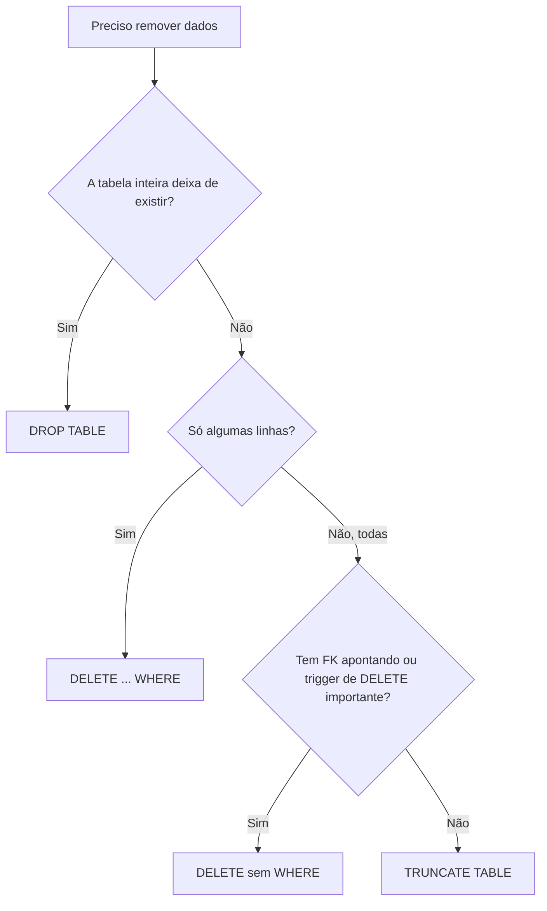

# Entrevista de SQL

Perguntas que aparecem com frequência em entrevistas para vagas de dados (analista, engenharia, ciência), agrupadas por assunto e com respostas curtas. Cada resposta já vem corrigida: muita lista de "perguntas e respostas" que circula por aí repete afirmações que só valem para um banco específico, ou que estão simplesmente erradas. Quando a resposta muda conforme o SGBD, isso está dito.

## Como usar

1. Leia a pergunta e tente responder em voz alta antes de olhar a resposta, como se estivesse na entrevista
2. Se travar, abra a nota teórica indicada no começo de cada assunto
3. Na parte prática, rode o script de esquema e escreva as queries antes de abrir o "Ver resposta"
4. Responda sempre citando o SGBD quando a resposta depender dele - entrevistador gosta de ouvir "no PostgreSQL é assim, no MySQL é diferente"

## Conceitos fundamentais

Teoria em [Introdução ao SQL](/labs/data/sql/01-introducao-ao-sql/).

**O que é SQL?**
Linguagem declarativa, padronizada pela ISO/IEC 9075, usada para definir, consultar e modificar dados em bancos relacionais. "Declarativa" quer dizer que você descreve _o que_ quer, e o banco decide _como_ buscar.

**Qual a diferença entre SQL e MySQL?**
SQL é a linguagem. MySQL é um SGBD (software de banco de dados) que entende SQL, assim como PostgreSQL, SQL Server e Oracle. Cada um tem seu "sotaque" (dialeto).

**DBMS x RDBMS?**
DBMS (SGBD) é qualquer software que gerencia um banco de dados. RDBMS (SGBD relacional) organiza os dados em tabelas (relações) ligadas por chaves, garante integridade com constraints e usa SQL. Existem SGBDs não relacionais, como MongoDB e Redis. Cuidado com a resposta "sistema de arquivos x MySQL": sistema de arquivos não é SGBD.

**Quais são as categorias de comandos SQL?**

| Categoria | Para quê          | Comandos                                             |
| --------- | ----------------- | ---------------------------------------------------- |
| DDL       | Definir estrutura | `CREATE`, `ALTER`, `DROP`, `TRUNCATE`                |
| DML       | Manipular dados   | `INSERT`, `UPDATE`, `DELETE`                         |
| DQL       | Consultar         | `SELECT` (algumas referências colocam dentro da DML) |
| DCL       | Permissões        | `GRANT`, `REVOKE`                                    |
| TCL       | Transações        | `COMMIT`, `ROLLBACK`, `SAVEPOINT`                    |

Esquecer o `SELECT` é um deslize comum nessa pergunta.

**O que é tabela, linha e coluna?**
Tabela é um conjunto de dados organizado em linhas e colunas. Cada linha é um registro (um funcionário, um pedido). Cada coluna é um atributo (nome, salário).

**O que é schema?**
Depende do SGBD. No PostgreSQL e no SQL Server, schema é um "namespace" dentro de um database, que agrupa tabelas, views etc. (ex.: `vendas.pedidos`). No MySQL, `SCHEMA` é só sinônimo de `DATABASE`.

**O que é metadado?**
Dado sobre dados: nomes de tabelas, colunas, tipos, constraints. Dá para consultar pelo `information_schema` (existe no MySQL, PostgreSQL e SQL Server) ou pelo catálogo do sistema.

**SQL diferencia maiúsculas de minúsculas?**
As palavras-chave nunca: `select` e `SELECT` funcionam igual em todos os SGBDs principais. O que varia são:

- Identificadores: o PostgreSQL converte nomes sem aspas para minúsculas (`Clientes` vira `clientes`; `"Clientes"` com aspas mantém). No MySQL, nomes de tabela dependem do sistema operacional e da variável `lower_case_table_names`; nomes de coluna não diferenciam.
- Dados: `'Ana' = 'ana'` depende da collation da coluna. As collations padrão do MySQL e do SQL Server costumam ignorar maiúsculas; o PostgreSQL diferencia.

**Por que SQL importa para quem trabalha com dados?**
Porque quase todo dado de empresa mora num banco relacional ou num data warehouse que fala SQL. Extrair, filtrar, juntar e agregar dados antes de levar para Python ou Power BI é o dia a dia da função.

## Tipos de dados

Teoria em [Bancos, tabelas e tipos de dados](/labs/data/sql/02-bancos-tabelas-e-tipos-de-dados/).

**INT x FLOAT?**
`INT` guarda inteiros. `FLOAT`/`DOUBLE`/`REAL` guardam números de ponto flutuante **aproximados**: `0.1 + 0.2` pode não dar exatamente `0.3`. Para dinheiro e salário, use `DECIMAL`/`NUMERIC`, que são exatos (ex.: `DECIMAL(10,2)`).

**O que é VARCHAR? E CHAR x VARCHAR?**
`VARCHAR(n)` guarda texto de tamanho variável até `n`. `CHAR(n)` tem tamanho fixo e completa com espaços à direita. A resposta "CHAR é mais rápido" não é regra: no PostgreSQL, a documentação diz que não há vantagem de desempenho e que `char(n)` costuma ser o mais lento dos três tipos de texto. `CHAR` faz sentido para códigos de tamanho fixo.

**Como o tipo DATE guarda a data?**
O literal aceito e o formato de exibição padrão seguem a ISO 8601 (`'2024-05-20'`). O armazenamento interno é outro assunto, e cada SGBD faz do seu jeito.

**NULL x 0?**
`0` é um valor numérico real. `NULL` é a ausência de valor ("não sei" ou "não se aplica"). Uma string vazia `''` também não é `NULL` (exceto no Oracle, que trata `''` como `NULL`).

**Que tipo usar para telefone?**
`VARCHAR`. Telefone não é número para fazer conta: pode começar com zero, ter `+` e passar do limite do `INT`. O padrão E.164 tem até 15 dígitos (ex.: `+5511999998888`).

**E para código de país ("BR", "US")?**
`CHAR(2)`, seguindo a ISO 3166-1 alfa-2. Aqui o tamanho fixo combina com o dado.

## NULL

Teoria em [Consultas com SELECT](/labs/data/sql/06-consultas-com-select/).

**Dá para comparar NULL com `=`?**
Não. `salario = NULL` resulta em UNKNOWN (nem verdadeiro, nem falso), então a linha não aparece. Até `NULL = NULL` dá UNKNOWN. Isso é a lógica de três valores do SQL. Use `IS NULL` e `IS NOT NULL`.

**Como tratar dados faltando?**
Depende do momento:

- Na estrutura: `NOT NULL` impede o vazio; `DEFAULT` preenche quando a coluna é omitida no `INSERT`.
- Na consulta: `COALESCE(salario, 0)` troca o `NULL` por `0` só na saída, sem alterar a tabela. Equivalentes: `IFNULL` (MySQL) e `ISNULL` (SQL Server).

**Se eu mandar NULL explícito numa coluna com DEFAULT, o default é aplicado?**
Não. O `DEFAULT` só entra quando a coluna é omitida (ou quando você escreve `DEFAULT` no `VALUES`). `NULL` explícito grava `NULL`, a menos que a coluna seja `NOT NULL`, aí dá erro.

## Constraints e chaves

Teoria em [Constraints, chaves e relacionamentos](/labs/data/sql/03-constraints-chaves-e-relacionamentos/).

**O que é constraint? Quais existem?**
Regra que o banco aplica para manter a integridade dos dados. As principais são `NOT NULL`, `UNIQUE`, `PRIMARY KEY`, `FOREIGN KEY`, `CHECK` e `DEFAULT`. Podem ser declaradas na coluna ou no nível da tabela (quando envolvem mais de uma coluna).

**O que é integridade de dados?**
Dados corretos e consistentes. Costuma ser dividida em integridade de entidade (cada linha identificável, via PK), de domínio (valores válidos, via tipo/`CHECK`/`NOT NULL`) e referencial (FK aponta para algo que existe).

**O que é primary key?**
Uma coluna **ou conjunto de colunas** que identifica cada linha. É `UNIQUE` + `NOT NULL` e cada tabela tem no máximo uma. Uma PK com várias colunas é uma chave composta, não "várias PKs".

**NULL pode fazer parte da PK?**
Não.

**Uma tabela pode existir sem PK?**
Pode, mas não é recomendado: fica difícil identificar, atualizar ou remover uma linha específica, e duplicatas passam despercebidas.

**Candidate key, alternate key, superkey?**
Superkey é qualquer conjunto de colunas que identifica as linhas (pode ter coluna sobrando). Candidate key é uma superkey **mínima**: se tirar qualquer coluna, deixa de identificar. Uma das candidatas vira a PK; as outras são alternate keys (normalmente recebem `UNIQUE`).

**Surrogate key x natural key? O e-mail deve ser PK se ele é único mas pode mudar?**
Natural key vem do mundo real (e-mail, CPF). Surrogate key é artificial, sem significado (um `id` autoincremento). Para o e-mail, a resposta esperada é: não use como PK. Use um `id` surrogate como PK e mantenha `UNIQUE` no e-mail. Assim, trocar o e-mail não exige atualizar todas as FKs que apontam para o usuário.

**Pode ter vários UNIQUE na mesma tabela? E combinação única de duas colunas?**
Sim, quantos precisar. Para a combinação, `UNIQUE (col1, col2)` ou uma PK composta.

**NULL pode entrar numa coluna UNIQUE?**
Pode, mas a quantidade depende do SGBD (veja o quadro mais abaixo). O padrão SQL deixa isso em aberto.

**O que acontece ao inserir PK duplicada?**
Erro de violação de constraint, e a linha não entra. Se a intenção é "insere ou atualiza" (upsert): `INSERT ... ON CONFLICT` (PostgreSQL), `INSERT ... ON DUPLICATE KEY UPDATE` (MySQL) ou `MERGE` (SQL Server).

**E se a FK for violada?**
Erro. Para definir o que acontece quando o registro "pai" é apagado ou alterado, existem as ações referenciais: `ON DELETE CASCADE` (apaga os filhos junto), `SET NULL` (zera a FK) e `RESTRICT`/`NO ACTION` (impede).

**Como garantir que todo funcionário pertence a um departamento válido?**
Foreign key de `funcionarios.departamento_id` para `departamentos.id`, de preferência `NOT NULL`.

**Como impedir duplicatas daqui para frente?**
Criar `UNIQUE` (ou PK). Pegadinha: se a tabela **já** tem duplicatas, o `ALTER TABLE ... ADD UNIQUE` falha. Primeiro limpe (tem exemplo na parte prática), depois crie a constraint.

**Como garantir idade maior que 18?**
`CHECK (idade > 18)`. Duas ressalvas que contam ponto:

- `NULL` passa no `CHECK`, porque a expressão vira UNKNOWN e o `CHECK` só rejeita FALSE. Combine com `NOT NULL`.
- No MySQL, o `CHECK` só é aplicado a partir da versão 8.0.16. Antes disso era aceito na sintaxe e ignorado.

## Normalização

Teoria em [Normalização](/labs/data/sql/12-normalizacao/).

**O que é normalização?**
Organizar as tabelas para reduzir redundância e evitar anomalias de inserção, atualização e exclusão (ex.: o endereço do cliente repetido em cada pedido, e você atualiza só metade das linhas).

**Quais são as formas normais?**

- 1FN: valores atômicos, sem listas dentro de uma célula nem grupos repetidos
- 2FN: estar na 1FN e não ter dependência parcial (coluna que depende só de parte de uma chave composta)
- 3FN: estar na 2FN e não ter dependência transitiva (coluna que depende de outra coluna que não é chave)

Existem ainda BCNF, 4FN e 5FN, mas em entrevista costuma bastar até a 3FN e saber que a BCNF existe.

**A tabela tem muitos dados repetidos. O que fazer?**
Normalizar: **separar** em tabelas relacionadas por chaves, eliminando a repetição.

**O que é desnormalização e quando usar?**
Introduzir redundância de propósito (colunas duplicadas, tabelas pré-agregadas) para acelerar leitura, como em relatórios e data warehouses. O preço é escrita mais cara e o risco de inconsistência.

## DELETE x TRUNCATE x DROP

Teoria em [Alterando a estrutura](/labs/data/sql/04-alterando-a-estrutura/) e [Inserindo, atualizando e excluindo dados](/labs/data/sql/05-inserindo-atualizando-e-excluindo-dados/).

Esse é o assunto mais repetido de qualquer lista de entrevista, com várias perguntas que no fundo são a mesma. A resposta completa:

|                                  | `DELETE`                        | `TRUNCATE`                          | `DROP`                               |
| -------------------------------- | ------------------------------- | ----------------------------------- | ------------------------------------ |
| O que remove                     | Linhas (todas ou as do `WHERE`) | Todas as linhas                     | A tabela inteira (estrutura e dados) |
| Aceita `WHERE`                   | Sim                             | Não                                 | Não                                  |
| Categoria                        | DML                             | DDL                                 | DDL                                  |
| Velocidade em tabela grande      | Mais lento, linha a linha       | Rápido                              | Rápido                               |
| Dispara trigger de `DELETE`      | Sim                             | Não                                 | Não                                  |
| Reinicia identity/autoincremento | Não                             | Depende do SGBD                     | -                                    |
| Tabela referenciada por FK       | Funciona (respeitando a FK)     | Falha (PostgreSQL só com `CASCADE`) | Falha                                |
| Rollback                         | Sim, dentro de transação        | Depende do SGBD                     | Depende do SGBD                      |

**Por que o TRUNCATE é mais rápido?**
Porque não apaga linha por linha: ele desaloca as páginas de dados da tabela. No SQL Server, o log registra só essas desalocações, não cada linha (então "TRUNCATE não gera log" está errado), e o comando usa menos locks.

**Dá para fazer rollback de TRUNCATE?**
Depende do SGBD, e a resposta "não, porque é auto-commit" está errada como regra geral. PostgreSQL e SQL Server revertem um `TRUNCATE` feito dentro de uma transação. MySQL (e Oracle) fazem commit implícito e não revertem. Tem um teste disso na parte prática.

**Quero apagar tudo rápido e manter a estrutura. Qual uso?**
`TRUNCATE`, desde que a tabela não seja referenciada por FK e você não dependa de trigger de `DELETE`. Para apagar só parte, `DELETE ... WHERE`. Para sumir com a tabela, `DROP`.



## Views e índices

Teoria em [Views, índices e triggers](/labs/data/sql/11-views-indices-e-triggers/).

**O que é view? Qual a diferença para uma tabela?**
View é uma consulta salva com nome, que você usa como se fosse tabela (uma "tabela virtual"). Normalmente ela não guarda dados: cada leitura executa a consulta de novo. As exceções são a materialized view (PostgreSQL, Oracle) e a indexed view (SQL Server), que armazenam o resultado.

**O que é índice?**
Estrutura auxiliar, geralmente uma B-tree, que acelera busca e ordenação por uma ou mais colunas, como o índice remissivo de um livro. Custa espaço em disco e deixa `INSERT`, `UPDATE` e `DELETE` mais lentos, porque o índice também precisa ser atualizado.

**A consulta que filtra por salário está lenta. O que fazer?**
Um índice em `salario` é a resposta esperada, mas a resposta boa vai além: ele ajuda quando o filtro é seletivo (retorna poucas linhas) ou quando há `ORDER BY salario`. Se o filtro retorna metade da tabela, o banco pode ignorar o índice. Confirme com o plano de execução (`EXPLAIN` no PostgreSQL e no MySQL, plano de execução no SQL Server).

## Transações

Teoria em [Transações e ACID](/labs/data/sql/13-transacoes-e-acid/).

**O que é transação?**
Uma unidade de trabalho atômica: ou todas as operações são gravadas, ou nenhuma é. O exemplo clássico é a transferência bancária (debitar de um lado e creditar do outro).

**O que é ACID?**

- Atomicidade: tudo ou nada
- Consistência: a transação leva o banco de um estado válido para outro, respeitando as constraints
- Isolamento: transações simultâneas não enxergam o trabalho pela metade uma da outra (o quanto enxergam depende do nível de isolamento)
- Durabilidade: depois do `COMMIT`, o dado sobrevive a queda de energia ou reinício

**COMMIT, ROLLBACK e SAVEPOINT?**
`COMMIT` grava de vez. `ROLLBACK` desfaz tudo desde o início da transação. `SAVEPOINT nome` marca um ponto intermediário, e `ROLLBACK TO SAVEPOINT nome` desfaz só o que veio depois dele. No SQL Server a sintaxe é `SAVE TRANSACTION nome` e `ROLLBACK TRANSACTION nome`.

**Preciso desfazer só parte de uma transação. Como?**
`SAVEPOINT` + `ROLLBACK TO SAVEPOINT`. Se alguém responder "use transações e ACID", faltou o essencial.

**O que é auto-commit?**
Modo da sessão em que cada comando vira uma transação e é confirmado sozinho. Vem ligado por padrão no MySQL, no PostgreSQL e no SQL Server, e pode ser desligado (ou contornado abrindo uma transação explícita com `BEGIN`).

**Apaguei registros sem querer. Dá para recuperar?**
Se ainda não houve `COMMIT` (ou seja, você estava numa transação explícita), `ROLLBACK`. Depois do commit, só restaurando backup ou usando recuperação até um ponto no tempo (point-in-time recovery). Prevenção: rodar o `SELECT` com o mesmo `WHERE` antes do `DELETE`, usar transação explícita em operações manuais e, quando fizer sentido, soft delete (uma coluna `excluido_em` em vez de apagar).

**Vários usuários alterando o mesmo dado ao mesmo tempo. Como o banco lida?**
Pelo isolamento: níveis de isolamento (`READ COMMITTED`, `REPEATABLE READ`, `SERIALIZABLE`...), locks e, em bancos como PostgreSQL e MySQL/InnoDB, MVCC (cada transação lê uma "foto" consistente dos dados). Responder só "transações" é incompleto.

## Consultas e agregações

Teoria em [Agregações, GROUP BY e HAVING](/labs/data/sql/08-agregacoes-group-by-e-having/), [Joins](/labs/data/sql/09-joins/) e [Subqueries e operadores de conjunto](/labs/data/sql/10-subqueries-e-operadores-de-conjunto/).

**WHERE x HAVING?**
`WHERE` filtra linhas **antes** do agrupamento e não aceita funções de agregação. `HAVING` filtra os grupos **depois** do `GROUP BY` (ex.: `HAVING COUNT(*) > 5`).

**COUNT(\*) x COUNT(coluna)?**
`COUNT(*)` conta linhas. `COUNT(coluna)` conta só as linhas em que a coluna não é `NULL`.

**Como mostrar funcionário e gerente na mesma linha?**
Self join: a tabela `funcionarios` aparece duas vezes, com aliases diferentes, ligando `manager_id` ao `id`. Use `LEFT JOIN` para não perder quem não tem gerente. Está na parte prática.

**Como achar o maior salário? E o segundo maior?**
Também na parte prática, junto com os empates, que são onde a maioria das respostas escorrega.

## Quadro "depende do SGBD"

Os pontos em que a resposta certa é "depende". Vale decorar pelo menos as linhas de `TRUNCATE`, `UNIQUE` e `LIMIT`.

| Assunto                                   | MySQL (8.x)                                  | PostgreSQL                                                                  | SQL Server                                          |
| ----------------------------------------- | -------------------------------------------- | --------------------------------------------------------------------------- | --------------------------------------------------- |
| Rollback de `TRUNCATE`                    | Não: commit implícito                        | Sim, dentro de transação                                                    | Sim, dentro de transação                            |
| `TRUNCATE` reinicia autoincremento        | Sim, sempre                                  | Só com `RESTART IDENTITY` (padrão é `CONTINUE IDENTITY`)                    | Sim, volta à semente da identity                    |
| `TRUNCATE` em tabela referenciada por FK  | Falha                                        | Falha, a menos que use `CASCADE` (que trunca as tabelas filhas também)      | Falha                                               |
| `NULL` em coluna `UNIQUE`                 | Vários `NULL` permitidos                     | Vários `NULL` permitidos; `NULLS NOT DISTINCT` (versão 15+) muda para um só | Só **um** `NULL` por constraint `UNIQUE`            |
| `CHECK`                                   | Aplicado desde a 8.0.16 (antes era ignorado) | Aplicado                                                                    | Aplicado                                            |
| Savepoint                                 | `SAVEPOINT s1` / `ROLLBACK TO SAVEPOINT s1`  | `SAVEPOINT s1` / `ROLLBACK TO SAVEPOINT s1`                                 | `SAVE TRANSACTION s1` / `ROLLBACK TRANSACTION s1`   |
| Abrir transação                           | `START TRANSACTION` ou `BEGIN`               | `BEGIN` ou `START TRANSACTION`                                              | `BEGIN TRANSACTION`                                 |
| Limitar linhas                            | `LIMIT 5`                                    | `LIMIT 5` ou `FETCH FIRST 5 ROWS ONLY`                                      | `TOP (5)` ou `OFFSET 0 ROWS FETCH NEXT 5 ROWS ONLY` |
| Top-N com empates                         | Não tem atalho, usar `RANK`/`DENSE_RANK`     | `FETCH FIRST 5 ROWS WITH TIES` (versão 13+)                                 | `TOP (5) WITH TIES`                                 |
| Onde fica o `NULL` em `ORDER BY ... DESC` | No fim                                       | **No começo** (use `NULLS LAST`)                                            | No fim                                              |
| Renomear coluna                           | `ALTER TABLE t RENAME COLUMN a TO b`         | `ALTER TABLE t RENAME COLUMN a TO b`                                        | `EXEC sp_rename 't.a', 'b', 'COLUMN'`               |
| Mudar tipo de coluna                      | `ALTER TABLE t MODIFY a DECIMAL(10,2)`       | `ALTER TABLE t ALTER COLUMN a TYPE DECIMAL(10,2)`                           | `ALTER TABLE t ALTER COLUMN a DECIMAL(10,2)`        |
| Upsert                                    | `ON DUPLICATE KEY UPDATE`                    | `ON CONFLICT ... DO UPDATE`                                                 | `MERGE`                                             |
| Trocar `NULL` por valor                   | `COALESCE` ou `IFNULL`                       | `COALESCE`                                                                  | `COALESCE` ou `ISNULL`                              |
| `SCHEMA`                                  | Sinônimo de `DATABASE`                       | Namespace dentro do database                                                | Namespace dentro do database                        |

## Prática

Os exercícios abaixo usam um esquema pequeno de propósito, para você conseguir conferir os resultados de cabeça. O script foi escrito para PostgreSQL e roda no MySQL 8 e no SQL Server com poucas mudanças (no SQL Server, troque `BEGIN` por `BEGIN TRANSACTION` nos exercícios de transação).

### Script do esquema

```sql
DROP TABLE IF EXISTS funcionarios;
DROP TABLE IF EXISTS usuarios;

CREATE TABLE funcionarios (
    id            INT PRIMARY KEY,
    nome          VARCHAR(50)  NOT NULL,
    departamento  VARCHAR(30)  NOT NULL,
    salario       DECIMAL(10,2) CHECK (salario > 0),
    manager_id    INT,
    status        VARCHAR(10)  NOT NULL DEFAULT 'ativo'
                  CHECK (status IN ('ativo', 'inativo')),
    data_admissao DATE         NOT NULL,
    -- FK no nível da tabela: versões do MySQL anteriores à 9.0 ignoram REFERENCES escrito direto na coluna
    FOREIGN KEY (manager_id) REFERENCES funcionarios (id)
);

-- Gerentes primeiro, porque manager_id aponta para a própria tabela
INSERT INTO funcionarios (id, nome, departamento, salario, manager_id, status, data_admissao) VALUES
    (1, 'Ana',    'Diretoria', 15000.00, NULL, 'ativo',   '2018-03-01'),
    (2, 'Bruno',  'TI',         9000.00, 1,    'ativo',   '2019-07-15'),
    (5, 'Elisa',  'Vendas',     9000.00, 1,    'ativo',   '2020-01-10'),
    (3, 'Carla',  'TI',         7000.00, 2,    'ativo',   '2021-05-03'),
    (4, 'Diego',  'TI',         7000.00, 2,    'inativo', '2021-09-20'),
    (6, 'Fábio',  'Vendas',     5000.00, 5,    'ativo',   '2022-02-14'),
    (7, 'Gabi',   'Vendas',     NULL,    5,    'ativo',   '2024-06-01'),
    (8, 'Hugo',   'RH',         6000.00, 1,    'inativo', '2019-11-11');

CREATE TABLE usuarios (
    id    INT PRIMARY KEY,
    nome  VARCHAR(50)  NOT NULL,
    email VARCHAR(100) NOT NULL
);

INSERT INTO usuarios (id, nome, email) VALUES
    (1, 'Ana',       'ana@exemplo.com'),
    (2, 'Bruno',     'bruno@exemplo.com'),
    (3, 'Ana Paula', 'ana@exemplo.com'),
    (4, 'Carla',     'carla@exemplo.com'),
    (5, 'Carlinha',  ' CARLA@exemplo.com'),
    (6, 'Diego',     'diego@exemplo.com');
```

Repare nas armadilhas plantadas: dois salários empatados em 9000 e dois em 7000, a Gabi com salário `NULL`, a Ana sem gerente e um e-mail duplicado "disfarçado" com espaço e maiúsculas.

### 1. Encontrar e-mails duplicados

Liste os e-mails que aparecem mais de uma vez em `usuarios`. Depois, refaça considerando que `' CARLA@exemplo.com'` e `'carla@exemplo.com'` são o mesmo e-mail.

<details><summary>Ver resposta</summary>

```sql
-- Duplicatas exatas: só ana@exemplo.com
SELECT email, COUNT(*) AS qtd
FROM usuarios
GROUP BY email
HAVING COUNT(*) > 1;

-- Normalizando: ana@exemplo.com e carla@exemplo.com
SELECT LOWER(TRIM(email)) AS email_normalizado, COUNT(*) AS qtd
FROM usuarios
GROUP BY LOWER(TRIM(email))
HAVING COUNT(*) > 1;
```

`GROUP BY` junta as linhas com o mesmo e-mail e o `HAVING` fica só com os grupos que têm mais de uma. No MySQL e no SQL Server, com a collation padrão, a primeira query já ignora a diferença de maiúsculas, mas não o espaço.

</details>

### 2. Remover duplicatas e impedir novas

Apague as duplicatas mantendo o usuário de menor `id` de cada e-mail (normalizado) e crie uma constraint que impeça o problema de voltar.

<details><summary>Ver resposta</summary>

```sql
-- ROW_NUMBER numera as linhas de cada e-mail; a de número 1 fica
DELETE FROM usuarios
WHERE id IN (
    SELECT id
    FROM (
        SELECT id,
               ROW_NUMBER() OVER (
                   PARTITION BY LOWER(TRIM(email))
                   ORDER BY id
               ) AS rn
        FROM usuarios
    ) t
    WHERE rn > 1
);

-- Padroniza o que sobrou e só então cria a constraint
UPDATE usuarios SET email = LOWER(TRIM(email));

ALTER TABLE usuarios ADD CONSTRAINT uq_usuarios_email UNIQUE (email);
```

Saem os ids 3 e 5. A ordem importa: se você tentar criar a `UNIQUE` antes de limpar, o banco recusa. `ROW_NUMBER()` é uma window function, explicada no exercício 4.

</details>

### 3. Os 2 maiores salários, com empates

Liste os 2 funcionários mais bem pagos. Depois, ajuste para que quem empatar com o segundo colocado também apareça.

<details><summary>Ver resposta</summary>

```sql
-- Ingênua: traz a Ana e só um entre Bruno e Elisa, escolhido de forma arbitrária
SELECT nome, salario
FROM funcionarios
WHERE salario IS NOT NULL
ORDER BY salario DESC
LIMIT 2;

-- PostgreSQL 13+: inclui todos os empatados com o último
SELECT nome, salario
FROM funcionarios
WHERE salario IS NOT NULL
ORDER BY salario DESC
FETCH FIRST 2 ROWS WITH TIES;

-- SQL Server
SELECT TOP (2) WITH TIES nome, salario
FROM funcionarios
WHERE salario IS NOT NULL
ORDER BY salario DESC;
```

O resultado com empates é Ana, Bruno e Elisa. O `WHERE salario IS NOT NULL` não é enfeite: no PostgreSQL, `ORDER BY ... DESC` coloca os `NULL` **primeiro**, e a Gabi apareceria como "maior salário". No MySQL, que não tem `WITH TIES`, use a solução com `DENSE_RANK` do próximo exercício.

</details>

### 4. Segundo maior salário

Encontre o segundo maior valor de salário e quem recebe esse valor.

<details><summary>Ver resposta</summary>

```sql
-- Com window function
SELECT nome, salario
FROM (
    SELECT nome, salario,
           DENSE_RANK() OVER (ORDER BY salario DESC) AS posicao
    FROM funcionarios
    WHERE salario IS NOT NULL
) t
WHERE posicao = 2;

-- Sem window function (só o valor)
SELECT MAX(salario) AS segundo_maior
FROM funcionarios
WHERE salario < (SELECT MAX(salario) FROM funcionarios);
```

O segundo maior salário é 9000, de Bruno e Elisa.

Uma window function calcula algo para cada linha olhando para um conjunto de linhas (a "janela"), sem agrupar como o `GROUP BY` faz. Aqui a janela é a tabela inteira ordenada por salário. As três funções de ranking diferem só no tratamento de empates:

| salario | `ROW_NUMBER` | `RANK` | `DENSE_RANK` |
| ------- | ------------ | ------ | ------------ |
| 15000   | 1            | 1      | 1            |
| 9000    | 2            | 2      | 2            |
| 9000    | 3            | 2      | 2            |
| 7000    | 4            | 4      | 3            |
| 7000    | 5            | 4      | 3            |
| 6000    | 6            | 6      | 4            |

`DENSE_RANK` é a escolha para "N-ésimo maior **valor**", porque não pula posições depois de um empate. Com `RANK`, não existiria posição 3. Funciona no MySQL 8+, PostgreSQL e SQL Server.

A versão com `MAX` em subquery é a que muita gente escreve na entrevista. Ela funciona para o segundo, mas fica feia para o terceiro ou o quinto, e é aí que o entrevistador puxa o `DENSE_RANK`.

</details>

### 5. Funcionário mais bem pago de cada departamento

Para cada departamento, mostre o funcionário (ou os funcionários, se houver empate) com maior salário.

<details><summary>Ver resposta</summary>

```sql
-- Com window function
SELECT departamento, nome, salario
FROM (
    SELECT departamento, nome, salario,
           RANK() OVER (PARTITION BY departamento ORDER BY salario DESC) AS posicao
    FROM funcionarios
    WHERE salario IS NOT NULL
) t
WHERE posicao = 1
ORDER BY departamento;

-- Com subquery correlacionada
SELECT f.departamento, f.nome, f.salario
FROM funcionarios f
WHERE f.salario = (
    SELECT MAX(f2.salario)
    FROM funcionarios f2
    WHERE f2.departamento = f.departamento
)
ORDER BY f.departamento;
```

Resultado: Diretoria - Ana, RH - Hugo, TI - Bruno, Vendas - Elisa. O `PARTITION BY departamento` reinicia o ranking a cada departamento. De novo o filtro de `NULL` evita que, no PostgreSQL, a Gabi seja a "mais bem paga" de Vendas.

Erro clássico: `SELECT departamento, nome, MAX(salario) FROM funcionarios GROUP BY departamento`. O PostgreSQL e o SQL Server recusam (`nome` não está no `GROUP BY`), e o MySQL, com o modo `ONLY_FULL_GROUP_BY` desligado, devolve um nome qualquer do grupo, não necessariamente o de quem ganha o máximo.

</details>

### 6. Funcionário e gerente

Liste cada funcionário com o nome do seu gerente. Quem não tem gerente também deve aparecer.

<details><summary>Ver resposta</summary>

```sql
SELECT f.nome AS funcionario,
       COALESCE(g.nome, '(sem gerente)') AS gerente
FROM funcionarios f
LEFT JOIN funcionarios g ON f.manager_id = g.id
ORDER BY f.id;
```

É um self join: a mesma tabela entra duas vezes, `f` no papel de funcionário e `g` no papel de gerente. Com `INNER JOIN`, a Ana sumiria do resultado, porque o `manager_id` dela é `NULL`.

</details>

### 7. Desfazer parte de uma transação com SAVEPOINT

Numa mesma transação: dê 10% de aumento para o TI, marque um savepoint, apague os funcionários inativos, desista só da exclusão e confirme o aumento.

<details><summary>Ver resposta</summary>

```sql
BEGIN;

UPDATE funcionarios
SET salario = salario * 1.10
WHERE departamento = 'TI';

SAVEPOINT antes_da_exclusao;

-- Hugo (RH) não tem subordinados; Diego (TI) também não
DELETE FROM funcionarios WHERE status = 'inativo';

ROLLBACK TO SAVEPOINT antes_da_exclusao;

COMMIT;
```

No fim, Bruno, Carla e Diego estão com 10% a mais e Diego e Hugo continuam na tabela. No SQL Server:

```sql
BEGIN TRANSACTION;
UPDATE funcionarios SET salario = salario * 1.10 WHERE departamento = 'TI';
SAVE TRANSACTION antes_da_exclusao;
DELETE FROM funcionarios WHERE status = 'inativo';
ROLLBACK TRANSACTION antes_da_exclusao;
COMMIT TRANSACTION;
```

Como o `COMMIT` grava as mudanças, rode o script do esquema de novo antes do próximo exercício.

</details>

### 8. TRUNCATE dentro de uma transação

Abra uma transação, execute `TRUNCATE` em `usuarios`, faça `ROLLBACK` e conte as linhas. O resultado muda conforme o SGBD?

<details><summary>Ver resposta</summary>

```sql
BEGIN;                 -- SQL Server: BEGIN TRANSACTION;
TRUNCATE TABLE usuarios;
SELECT COUNT(*) FROM usuarios;   -- 0
ROLLBACK;              -- SQL Server: ROLLBACK TRANSACTION;
SELECT COUNT(*) FROM usuarios;
```

- PostgreSQL e SQL Server: a última contagem volta para 6. O `TRUNCATE` foi desfeito junto com a transação.
- MySQL: a última contagem é 0. O `TRUNCATE` provoca um commit implícito, então o `ROLLBACK` não tem o que desfazer.

Esse é o exercício que desmonta a resposta decorada "TRUNCATE não tem rollback".

</details>

## Referências

- [TRUNCATE TABLE (Transact-SQL)](https://learn.microsoft.com/pt-br/sql/t-sql/statements/truncate-table-transact-sql) - Microsoft Learn, pt-BR
- [Restrições exclusivas e restrições de verificação](https://learn.microsoft.com/pt-br/sql/relational-databases/tables/unique-constraints-and-check-constraints) - Microsoft Learn, pt-BR
- [SAVE TRANSACTION (Transact-SQL)](https://learn.microsoft.com/pt-br/sql/t-sql/language-elements/save-transaction-transact-sql) - Microsoft Learn, pt-BR
- [TRUNCATE](https://www.postgresql.org/docs/current/sql-truncate.html) - PostgreSQL, en
- [TRUNCATE TABLE Statement](https://dev.mysql.com/doc/refman/8.4/en/truncate-table.html) - MySQL, en
