# 10 Projetos de Engenharia de Dados

## Por que construir projetos

Ler sobre data lake, streaming e orquestração ajuda, mas o conceito só "encaixa" quando você vê um pipeline quebrar às 3 da manhã porque o schema mudou. Projetos práticos dão essa experiência e ainda viram portfólio: quem avalia um currículo de engenharia de dados costuma olhar mais para um repositório com um pipeline funcionando do que para uma lista de certificados.

Cada projeto desta lista pratica um conjunto diferente de conceitos. A ideia não é fazer os dez de uma vez, e sim escolher um, entender o problema que ele resolve e construir uma versão pequena que funcione de ponta a ponta. Se ainda não viu a base, passe antes por [Avançando](/labs/data/fundamentos/03-avancando/), que apresenta pipelines ETL e limpeza de dados.

Todos os projetos seguem a mesma estrutura: objetivo, arquitetura, etapas sugeridas e conceitos praticados.

### Sobre custos de cloud 💸

A maioria das stacks aqui é de serviços pagos (AWS, Databricks, Snowflake, BigQuery, Fivetran). Quase todos têm camada gratuita ou período de teste, mas é fácil esquecer um cluster ligado e tomar um susto na fatura. Algumas regras de sobrevivência:

- Configure um alerta de orçamento na conta de cloud antes de criar qualquer recurso
- Use datasets pequenos (alguns MB) enquanto o pipeline não estiver pronto
- Desligue ou apague clusters e warehouses ao terminar a sessão de estudo

Se quiser zerar o custo, dá para reproduzir boa parte dos projetos localmente com Docker:

| Serviço na cloud                  | Alternativa local/gratuita          |
| --------------------------------- | ----------------------------------- |
| Amazon S3                         | MinIO (API compatível com S3)       |
| Athena, BigQuery, Snowflake       | DuckDB ou PostgreSQL                |
| Databricks, EMR                   | Apache Spark rodando em um container |
| dbt Cloud                         | dbt Core (open source)              |
| Fivetran                          | Airbyte (open source)               |
| Looker                            | Metabase ou Apache Superset         |

## 1. Data Lake com S3, Glue e Athena

Um **data lake** é um repositório que guarda dados brutos no formato original (CSV, JSON, Parquet, logs) em armazenamento barato. Diferente de um banco de dados, você não precisa definir as tabelas antes de gravar: o schema é aplicado só na hora da leitura, o que se chama **schema-on-read**.

O objetivo do projeto é jogar arquivos no S3 e conseguir consultá-los com SQL sem subir nenhum servidor de banco.

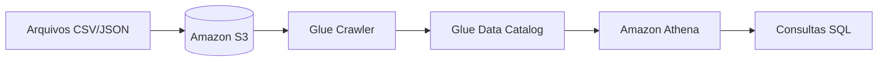

A peça que liga tudo é o **Glue Data Catalog**. O crawler lê os arquivos do bucket, deduz as colunas e os tipos, e grava esses metadados no catálogo. O Athena consulta o catálogo para saber onde os dados estão e como interpretá-los.

Etapas sugeridas:

1. Escolha um dataset público (dados abertos do governo, viagens de táxi de Nova York, etc.) e suba os arquivos para um bucket S3, organizados em pastas por data (`vendas/ano=2026/mes=09/`)
2. Crie um Glue Crawler apontando para o bucket e rode-o
3. Confira no Data Catalog as tabelas e colunas que ele detectou
4. Consulte os dados no Athena com `SELECT`, `GROUP BY` e filtros pela partição
5. Converta os arquivos para Parquet e compare o volume de dados lido por consulta (o Athena cobra por dado escaneado)

```sql
-- Filtrar pela partição faz o Athena ler só a pasta do mês
SELECT produto, SUM(valor) AS faturamento
FROM vendas
WHERE ano = '2026' AND mes = '09'
GROUP BY produto;
```

Conceitos praticados: data lake, schema-on-read, catálogo de metadados, particionamento e formatos colunares como Parquet.

## 2. Lakehouse com Databricks, Delta Lake e Unity Catalog

O data lake é barato e flexível, mas tem problemas chatos: se dois processos gravarem ao mesmo tempo, você pode acabar com arquivos pela metade, e não há como fazer `UPDATE` ou `DELETE` de forma confiável. O **lakehouse** junta o armazenamento barato do data lake com as garantias de um data warehouse.

Quem faz essa mágica é o **Delta Lake**, um formato de tabela que adiciona um log de transações por cima dos arquivos Parquet. Com ele você ganha:

- Transações **ACID**: uma gravação acontece por inteiro ou não acontece
- `UPDATE`, `DELETE` e `MERGE` direto nas tabelas do lake
- **Time travel**: consultar a tabela como ela estava numa versão ou data anterior

O **Unity Catalog** é a camada de governança do Databricks: controla quem pode ler cada tabela, registra a linhagem (de onde cada dado veio) e organiza tudo em `catálogo.schema.tabela`.

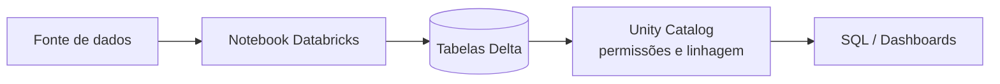

Etapas sugeridas:

1. Crie uma conta no Databricks (há uma edição gratuita para estudo)
2. Carregue um CSV e salve como tabela Delta
3. Faça um `MERGE` para aplicar atualizações vindas de um segundo arquivo
4. Use time travel para consultar a versão anterior à atualização
5. Crie um grupo de usuários no Unity Catalog com acesso só de leitura a uma tabela

```sql
-- Como a tabela estava antes do MERGE
SELECT * FROM clientes VERSION AS OF 0;
```

Conceitos praticados: lakehouse, table formats, transações ACID em data lake, time travel e governança de dados.

## 3. Pipeline ELT com Airbyte, Snowflake e dbt

### ETL vs. ELT

No **ETL** (Extract, Transform, Load) os dados são transformados antes de chegar ao destino. No **ELT** a ordem muda: os dados brutos são carregados primeiro no data warehouse e transformados lá dentro, com SQL. O ELT ficou popular porque warehouses em nuvem como Snowflake e BigQuery têm poder de processamento de sobra, e manter os dados brutos permite refazer transformações quando a regra de negócio muda.

### O projeto

O objetivo é montar um pipeline com uma ferramenta para cada letra:

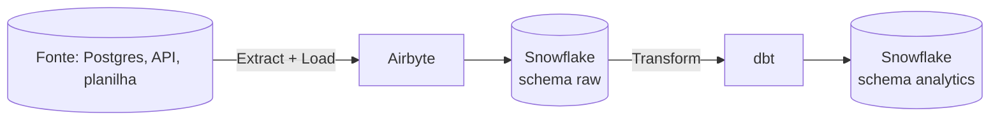

- **Airbyte** faz a ingestão com conectores prontos (centenas de fontes). Você configura origem e destino e ele copia os dados
- **Snowflake** é o data warehouse, onde os dados ficam armazenados e são processados
- **dbt** transforma os dados com arquivos SQL versionados no Git, com testes e documentação

Etapas sugeridas:

1. Suba um Postgres local com dados de exemplo e crie uma conta de teste no Snowflake
2. Configure uma conexão no Airbyte do Postgres para o Snowflake (schema `raw`)
3. Crie um projeto dbt com modelos em camadas: `staging` (limpeza e renomeação) e `marts` (tabelas prontas para análise)
4. Adicione testes básicos no dbt (`not_null`, `unique`)
5. Rode `dbt docs generate` e navegue pelo grafo de dependências

```sql
-- models/staging/stg_pedidos.sql
SELECT
    id AS pedido_id,
    cliente_id,
    CAST(criado_em AS DATE) AS data_pedido,
    valor_total
FROM {{ source('raw', 'pedidos') }}
WHERE status <> 'cancelado'
```

Conceitos praticados: ingestão com conectores, data warehouse, modelagem em camadas e transformação com SQL versionado.

## 4. Streaming em tempo real com Kafka, Spark Structured Streaming e Delta

### Batch vs. streaming

Em **batch** os dados são processados em lotes, de tempos em tempos (a cada hora, uma vez por dia). Em **streaming** eles são processados continuamente, conforme chegam. Pense em um relatório de vendas do dia anterior (batch) versus um alerta de fraude que precisa disparar segundos depois da compra (streaming).

### O projeto

O objetivo é processar eventos em tempo quase real e gravá-los em tabelas Delta.

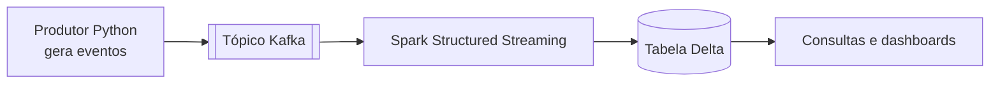

Um pouco de vocabulário do Kafka:

- **Tópico** é o "canal" onde os eventos são publicados, como uma fila com histórico
- **Produtor** é quem escreve eventos no tópico
- **Consumidor** é quem lê os eventos

O Spark Structured Streaming trata o fluxo como uma tabela que cresce sem parar e processa os dados em **micro-batches**. O **checkpoint** guarda até onde ele já leu, para retomar do ponto certo se o job cair.

Etapas sugeridas:

1. Suba Kafka com Docker Compose
2. Escreva um produtor em Python que publique eventos falsos (cliques, compras) a cada segundo
3. Crie um job Spark que leia o tópico, converta o JSON e grave em Delta
4. Adicione uma agregação por janela de tempo (compras por minuto)
5. Derrube o job no meio e reinicie para ver o checkpoint em ação

```python
eventos = (
    spark.readStream.format("kafka")
    .option("kafka.bootstrap.servers", "localhost:9092")
    .option("subscribe", "compras")
    .load()
)

(eventos.selectExpr("CAST(value AS STRING) AS json")
    .writeStream.format("delta")
    .option("checkpointLocation", "/tmp/checkpoints/compras")
    .start("/tmp/delta/compras"))
```

Conceitos praticados: tópicos, produtores e consumidores, micro-batches, janelas de tempo e checkpoints.

## 5. Arquitetura Medallion (bronze, silver, gold)

A **arquitetura medallion** é um padrão de design para organizar dados num lakehouse em três camadas, cada uma com qualidade maior que a anterior. O nome vem das medalhas olímpicas. Foi popularizado pela Databricks, mas funciona em qualquer lakehouse ou warehouse.

| Camada | O que guarda                                          | Exemplo                               |
| ------ | ----------------------------------------------------- | ------------------------------------- |
| Bronze | Dados brutos, do jeito que chegaram, sem validação    | JSON de pedidos copiado da API        |
| Silver | Dados limpos, validados, deduplicados e tipados       | Tabela de pedidos sem nulos e duplicatas |
| Gold   | Dados agregados e prontos para um consumidor específico | Faturamento diário por categoria    |

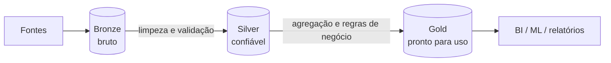

A vantagem é que a limpeza vira responsabilidade da plataforma, feita uma vez só. Sem esse padrão, cada analista acaba limpando os dados do seu jeito, e dois dashboards mostram números diferentes para a mesma métrica.

Etapas sugeridas:

1. Ingerir um dataset bruto na camada bronze, sem alterar nada (só adicionar data de ingestão)
2. Criar a camada silver: tipar colunas, remover duplicatas, separar registros inválidos numa tabela de quarentena
3. Criar a camada gold com duas ou três tabelas agregadas para perguntas de negócio concretas
4. Reprocessar a silver a partir da bronze para mostrar que nada se perde

Conceitos praticados: refinamento incremental da qualidade dos dados, reprocessamento e separação de responsabilidades entre camadas.

## 6. Orquestração de workflows com Airflow, dbt e Snowflake

### O que é orquestração

Um pipeline real tem várias etapas que dependem umas das outras: primeiro ingerir, depois transformar, depois testar, depois atualizar o dashboard. **Orquestrar** é garantir que isso rode na ordem certa, no horário certo, com novas tentativas quando algo falha e alerta quando falha de vez.

No Apache Airflow, um workflow é uma **DAG** (Directed Acyclic Graph, grafo acíclico dirigido): um conjunto de tarefas ligadas por setas de dependência, sem ciclos.

### O projeto

O objetivo é agendar o pipeline dbt no Airflow, com cada modelo aparecendo como uma tarefa separada. O jeito mais comum hoje é o **Astronomer Cosmos**, uma biblioteca open source que lê o projeto dbt e gera automaticamente uma tarefa do Airflow para cada modelo e teste.

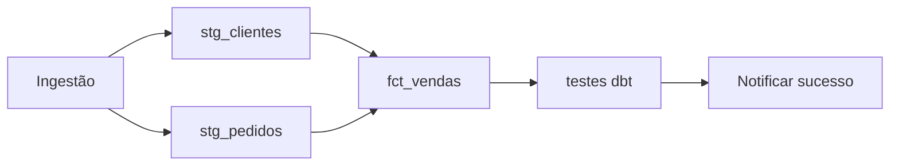

Etapas sugeridas:

1. Rode o Airflow localmente (a Astro CLI da Astronomer facilita)
2. Reaproveite o projeto dbt do projeto 3 e conecte ao Snowflake
3. Crie uma DAG com Cosmos que rode os modelos diariamente
4. Configure `retries` e force uma falha para ver a nova tentativa
5. Teste um **backfill**: rodar a DAG para datas passadas

Conceitos praticados: agendamento, dependências entre tarefas, retries, backfill e observabilidade de execuções.

## 7. Pipeline de CDC com Debezium, Kafka e Iceberg

### O que é Change Data Capture

**CDC** é a técnica de capturar cada mudança (insert, update, delete) feita num banco de dados e transmiti-la para outro sistema. Em vez de copiar a tabela inteira toda noite, você manda só o que mudou, quase em tempo real.

O **Debezium** faz isso lendo o log de transações do banco (o WAL no PostgreSQL, o binlog no MySQL), o mesmo arquivo que o banco usa internamente para se recuperar de falhas. Assim a captura não pesa nas consultas da aplicação.

### O projeto

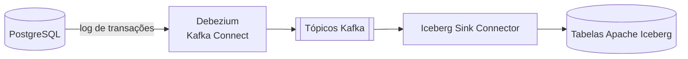

O **Apache Iceberg** é um table format aberto, parecido com o Delta Lake, suportado por vários motores (Spark, Trino, Flink, Athena, Snowflake).

Etapas sugeridas:

1. Suba PostgreSQL, Kafka e Kafka Connect com Docker Compose
2. Configure o conector Debezium para o Postgres e veja os eventos chegando no tópico
3. Faça inserts, updates e deletes e observe o formato dos eventos (campos `before`, `after` e `op`)
4. Configure o Iceberg Sink Connector para gravar os eventos em tabelas Iceberg

⚠️ Uma limitação importante: o Iceberg Sink Connector funciona bem para gravar eventos como novas linhas (append). Se você quiser que a tabela de destino reflita o estado atual do banco, aplicando updates e deletes (upsert), o caminho mais comum é adicionar uma etapa com Spark ou Flink depois do Kafka.

Conceitos praticados: log de transações, eventos de mudança, Kafka Connect e table formats abertos.

## 8. Processamento de big data com EMR, Spark e S3

Quando o volume de dados passa do que cabe na memória de uma máquina, entra o **processamento distribuído**: o Apache Spark divide os dados em partições e processa cada pedaço em paralelo, em várias máquinas de um cluster. O **Amazon EMR** é o serviço da AWS que cria e gerencia esse cluster para você.

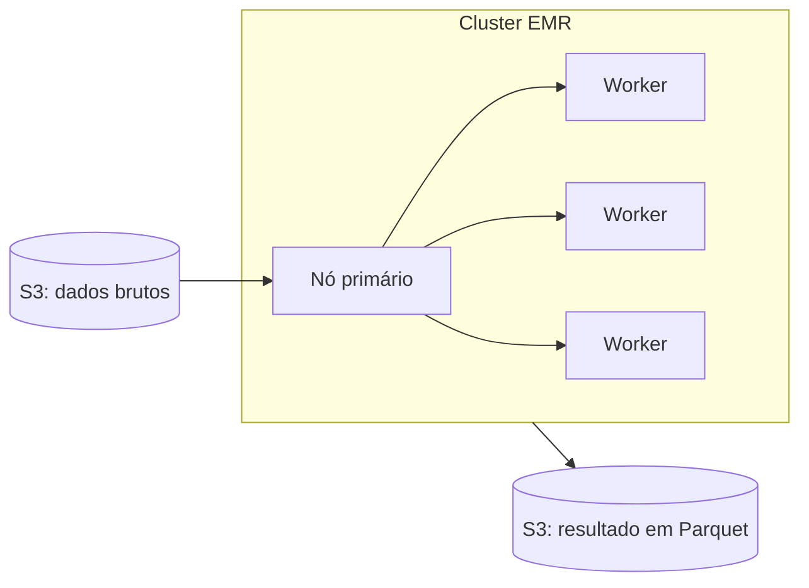

Etapas sugeridas:

1. Escolha um dataset grande (alguns GB), como as viagens de táxi de Nova York
2. Escreva um job PySpark que leia do S3, faça agregações e grave o resultado em Parquet particionado
3. Crie um cluster EMR, submeta o job como um **step** e acompanhe a execução no Spark UI
4. Configure o cluster para desligar sozinho ao terminar o step (cluster efêmero)
5. Compare o tempo de execução variando o número de workers

O cluster efêmero é o hábito mais importante aqui: você sobe o cluster, roda o job e ele desaparece. Os dados ficam no S3, então nada se perde, e você só paga pelos minutos de processamento.

Conceitos praticados: processamento distribuído, particionamento, clusters efêmeros e separação entre armazenamento e computação.

## 9. Qualidade e observabilidade de dados

Um pipeline que roda sem erro não garante dado certo. Pode chegar uma coluna toda nula, um valor negativo em `preco` ou metade das linhas de um dia sumir, e o job termina com sucesso mesmo assim. Testes de dados pegam esses problemas antes de chegarem ao dashboard.

O objetivo do projeto é colocar verificações em pontos diferentes do pipeline e avisar a equipe no Slack quando algo falhar.

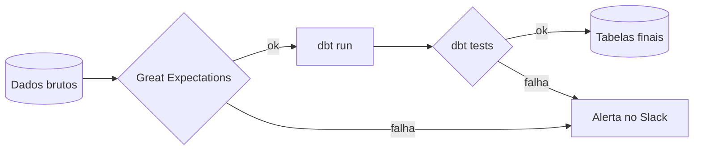

### Onde usar cada ferramenta

- **dbt tests** vivem junto dos modelos dbt e verificam as tabelas que o dbt constrói: `not_null`, `unique`, `accepted_values`, `relationships`. São simples de escrever em YAML
- **Great Expectations** (GX Core, open source) é uma biblioteca Python para validar qualquer dado, inclusive o que chega bruto antes do dbt. Você define "expectativas" como "a coluna `idade` deve estar entre 0 e 120"

Uma divisão prática: GX na entrada (dados ingeridos, que o dbt não conhece) e dbt tests nas transformações.

```yaml
# models/marts/schema.yml
models:
  - name: fct_vendas
    columns:
      - name: pedido_id
        data_tests:
          - unique
          - not_null
      - name: status
        data_tests:
          - accepted_values:
              values: ['pago', 'enviado', 'entregue']
```

Etapas sugeridas:

1. Adicione testes dbt nos modelos de um projeto anterior
2. Crie uma suíte do Great Expectations para validar os dados brutos
3. Crie um webhook no Slack e envie uma mensagem quando uma validação falhar
4. Injete dados ruins de propósito e confira se o alerta chega

Conceitos praticados: testes de dados, contratos entre etapas do pipeline, alertas e observabilidade.

## 10. Analytics de ponta a ponta com Fivetran, BigQuery, dbt e Looker

Este projeto junta tudo numa **modern data stack** completa: da fonte até o dashboard que alguém de negócio vai abrir.

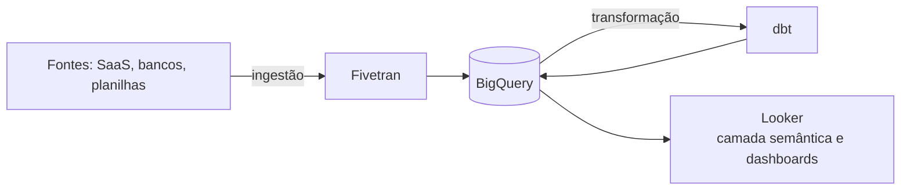

- **Fivetran** é uma ferramenta gerenciada de ingestão, parecida com o Airbyte do projeto 3
- **BigQuery** é o data warehouse serverless do Google Cloud: você não gerencia servidor, só paga pelo armazenamento e pelo volume consultado
- **dbt** transforma os dados, como nos projetos anteriores
- **Looker** é a ferramenta de BI. O diferencial é a **camada semântica** (LookML), onde você define uma vez o que significa "receita" ou "cliente ativo", e todos os dashboards usam a mesma definição

Uma curiosidade de mercado: a Fivetran e a dbt Labs concluíram a fusão das duas empresas em junho de 2026. O dbt Core continua open source.

Etapas sugeridas:

1. Conecte uma fonte no Fivetran (planilha do Google Sheets serve) com destino no BigQuery
2. Modele os dados com dbt em staging e marts
3. Defina as métricas principais no LookML
4. Monte um dashboard que responda a 3 ou 4 perguntas de negócio claras
5. Escreva no README qual pergunta cada gráfico responde

Conceitos praticados: modern data stack, integração entre ferramentas, camada semântica e comunicação de resultados.

## Por onde começar

Uma ordem que funciona para quem está começando, indo do mais simples ao mais complexo:

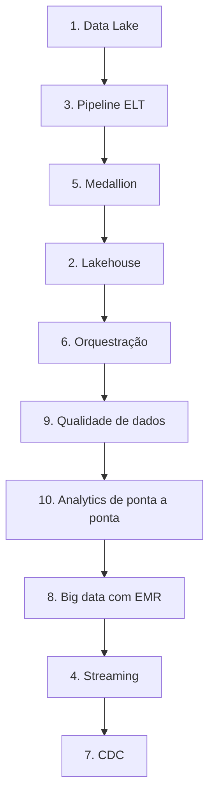

Os projetos de streaming e CDC ficam por último porque envolvem mais peças rodando ao mesmo tempo (Kafka, conectores, jobs contínuos) e são mais difíceis de depurar.

### Documentando o projeto no GitHub

Um projeto sem explicação vale bem menos no portfólio. Para cada um, inclua no README:

- O problema que o pipeline resolve, em uma ou duas frases
- Um diagrama da arquitetura (Mermaid funciona direto no GitHub)
- Como rodar localmente, passo a passo
- As decisões que você tomou e por quê: "usei Parquet porque reduziu o custo das consultas em X%" diz muito mais do que a lista de ferramentas
- O que você faria diferente ou melhoraria numa próxima versão

## Referências

- [Integração com o AWS Glue - Amazon Athena](https://docs.aws.amazon.com/pt_br/athena/latest/ug/glue-athena.html) - AWS, pt-BR
- [O que é a arquitetura medallion lakehouse? - Azure Databricks](https://learn.microsoft.com/pt-br/azure/databricks/lakehouse/medallion) - Microsoft Learn, pt-BR
- [Introdução ao BigQuery](https://cloud.google.com/bigquery/docs/introduction?hl=pt-br) - Google Cloud, pt-BR
- [O que é o Amazon EMR?](https://docs.aws.amazon.com/pt_br/emr/latest/ManagementGuide/emr-what-is-emr.html) - AWS, pt-BR
- [Debezium documentation](https://debezium.io/documentation/) - Debezium, en
- [Kafka Connect - Apache Iceberg](https://iceberg.apache.org/docs/nightly/kafka-connect/) - Apache Iceberg, en
- [Orchestrate dbt Core projects with Airflow and Cosmos](https://www.astronomer.io/docs/learn/airflow-dbt) - Astronomer, en
- [Add data tests to your DAG](https://docs.getdbt.com/docs/build/data-tests) - dbt Labs, en
