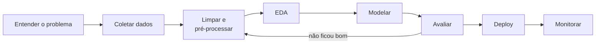
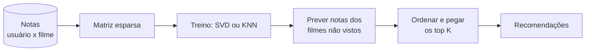
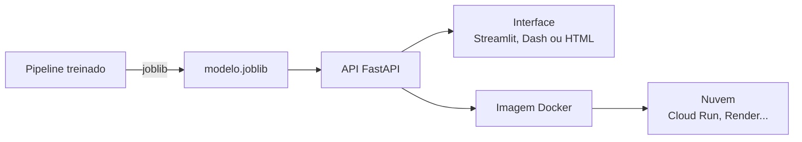
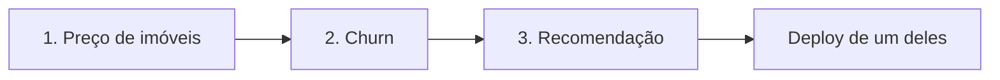

# 3 Projetos de Ciência de Dados de Ponta a Ponta

## Por que projetos de ponta a ponta

Dá para passar meses fazendo exercícios isolados: um gráfico aqui, um `GridSearchCV` ali. O que falta nesses exercícios é a costura. Num projeto de verdade, a decisão tomada na limpeza muda o resultado do modelo, a métrica escolhida muda o que você entrega, e o modelo só vale alguma coisa se alguém conseguir usá-lo.

Os três projetos desta nota passam pelo fluxo inteiro, do dataset bruto até uma API funcionando. Cada um pratica um tipo diferente de problema:

| Projeto                   | Tipo de problema        | O que ele ensina de mais importante                          |
| ------------------------- | ----------------------- | ------------------------------------------------------------ |
| 1. Preço de imóveis       | Regressão               | Feature engineering, transformação do alvo, métricas de erro |
| 2. Churn de clientes      | Classificação binária   | Classes desbalanceadas, escolha de métrica e de limiar       |
| 3. Recomendação de filmes | Sistema de recomendação | Dados esparsos, filtragem colaborativa, avaliação de ranking |

Todos seguem a mesma estrutura: objetivo, dataset sugerido, etapas e conceitos praticados. Se ainda não viu a base, comece por [O que é ciência de dados](/labs/data/ciencia-de-dados/01-o-que-e-ciencia-de-dados/) e [Ambiente Python e bibliotecas](/labs/data/ciencia-de-dados/02-ambiente-python-e-bibliotecas/).

## O fluxo de um projeto



A seta de volta de "Avaliar" para "Limpar" não é enfeite. É normal descobrir na avaliação que uma feature está vazando informação ou que um tratamento de nulos atrapalhou, e voltar algumas etapas.

### Sobre números de resultado 📏

Você vai encontrar na internet muitos tutoriais desses mesmos projetos com tabelas do tipo "Random Forest: R² de 0,9". Desconfie: muitos desses números são ilustrativos, outros vêm de avaliações com vazamento de dados, e todos dependem de como o split foi feito. Esta nota não traz resultados prontos de propósito. O seu número é o que sair da sua avaliação, feita do jeito certo, e o que importa no portfólio é explicar como você chegou nele e comparar com um **baseline** simples (prever a média, prever sempre a classe majoritária, recomendar os filmes mais populares).

## 1. Previsão de preço de imóveis (regressão)

### Objetivo

Estimar o preço de venda de um imóvel a partir das características dele (área, número de quartos, ano de construção, bairro, qualidade do acabamento). É o "olá, mundo" da regressão com dados tabulares, mas com sujeira suficiente para dar trabalho de verdade.

### Dataset sugerido

- **[House Prices - Advanced Regression Techniques](https://www.kaggle.com/c/house-prices-advanced-regression-techniques)** (Kaggle): cerca de 80 colunas sobre casas vendidas em Ames, Iowa (EUA), com o preço de venda (`SalePrice`) como alvo. Tem muitos nulos, colunas categóricas e outliers, ou seja, ótimo para praticar limpeza
- Alternativa sem cadastro: o **California Housing**, que já vem no scikit-learn (`fetch_california_housing`). É menor e mais limpo, e é o dataset usado nos exemplos de [Deploy com FastAPI e Docker](/labs/data/ml-em-producao/01-deploy-com-fastapi-e-docker/)

### Etapas sugeridas

1. **Entender o alvo**: plote a distribuição de `SalePrice`. Ela é assimétrica (poucas casas muito caras puxam a cauda para a direita). Teste modelar `log(SalePrice)`, que costuma deixar a distribuição mais simétrica. A própria competição do Kaggle avalia o RMSE entre o log do preço previsto e o log do real
2. **EDA**: correlação das variáveis numéricas com o preço, box plots do preço por bairro e por qualidade, gráfico de dispersão de área x preço para achar outliers. Veja [Análise exploratória](/labs/data/ciencia-de-dados/05-analise-exploratoria/) e [Visualização de dados](/labs/data/ciencia-de-dados/06-visualizacao-de-dados/)
3. **Limpeza**: leia a descrição das colunas antes de imputar. Em vários campos desse dataset, nulo significa "não tem" (sem piscina, sem garagem), e não "dado faltando". Trate cada caso de um jeito
4. **Feature engineering**: crie features como área total (soma das áreas), idade do imóvel na data da venda, total de banheiros
5. **Pré-processamento num `Pipeline`**: `ColumnTransformer` com imputação e `OneHotEncoder` para as categóricas e imputação e escalonamento para as numéricas, tudo ajustado só no treino. Detalhes em [Limpeza e pré-processamento](/labs/data/ciencia-de-dados/04-limpeza-e-pre-processamento/)
6. **Modelos**: comece pela regressão linear (com regularização Ridge ou Lasso), depois Random Forest e um gradient boosting (XGBoost, LightGBM ou o `HistGradientBoostingRegressor` do scikit-learn). Os algoritmos estão em [Algoritmos de machine learning](/labs/data/machine-learning/01-algoritmos-de-machine-learning/)
7. **Avaliação**: compare os modelos com validação cruzada usando MAE, RMSE e R², sempre contra o baseline "prever a média". Ajuste hiperparâmetros do melhor com `RandomizedSearchCV`. Ver [Métricas de avaliação](/labs/data/machine-learning/02-metricas-de-avaliacao/) e [Validação, tuning e regularização](/labs/data/machine-learning/03-validacao-tuning-e-regularizacao/)
8. **Interpretação**: quais features mais pesam? Use a importância por permutação (`sklearn.inspection.permutation_importance`) e escreva no README se o resultado faz sentido para o negócio

Um esqueleto do pipeline, considerando que `X` e `y` já foram carregados do CSV:

```python
import numpy as np
from sklearn.compose import ColumnTransformer, TransformedTargetRegressor
from sklearn.ensemble import HistGradientBoostingRegressor
from sklearn.impute import SimpleImputer
from sklearn.model_selection import cross_val_score
from sklearn.pipeline import make_pipeline
from sklearn.preprocessing import OneHotEncoder

numericas = X.select_dtypes("number").columns
categoricas = X.select_dtypes(exclude="number").columns

preprocessamento = ColumnTransformer([
    ("num", SimpleImputer(strategy="median"), numericas),
    ("cat", make_pipeline(
        SimpleImputer(strategy="constant", fill_value="Nenhum"),
        OneHotEncoder(handle_unknown="ignore"),
    ), categoricas),
])

modelo = TransformedTargetRegressor(
    regressor=make_pipeline(preprocessamento, HistGradientBoostingRegressor(random_state=42)),
    func=np.log1p,
    inverse_func=np.expm1,
)

scores = cross_val_score(modelo, X, y, cv=5, scoring="neg_root_mean_squared_error")
print(f"RMSE médio: {-scores.mean():,.0f}")
```

O `TransformedTargetRegressor` aplica o log no alvo durante o treino e desfaz a transformação na previsão, então o RMSE sai na escala original do preço.

Conceitos praticados: regressão, feature engineering, tratamento de nulos com significado, encoding, transformação do alvo, validação cruzada e interpretação de modelos.

## 2. Previsão de churn de clientes (classificação)

### Objetivo

**Churn** é quando o cliente cancela o serviço. O objetivo é prever quais clientes têm mais chance de cancelar, para o time de retenção agir antes (oferecer desconto, ligar, mudar o plano). O modelo não decide nada sozinho: ele gera uma lista priorizada.

### Dataset sugerido

- **[Telco Customer Churn](https://www.kaggle.com/datasets/blastchar/telco-customer-churn)** (Kaggle): cerca de 7 mil clientes de uma operadora fictícia, com dados de contrato, serviços contratados, forma de pagamento, tempo de casa e a coluna `Churn` (Yes/No). Cerca de um quarto dos clientes cancelou, então as classes são desbalanceadas

### Etapas sugeridas

1. **Limpeza**: a coluna `TotalCharges` vem como texto e tem alguns valores em branco (clientes recém-chegados). Converta com `pd.to_numeric(..., errors="coerce")` e decida o que fazer com os nulos. Remova o `customerID`, que não é feature
2. **EDA**: taxa de churn por tipo de contrato, por forma de pagamento e por tempo de casa. Esses gráficos sozinhos já contam uma história que o time de negócio entende
3. **Split estratificado**: `train_test_split(..., stratify=y)` para manter a proporção de churn no treino e no teste
4. **Modelos**: regressão logística (ótima como baseline e fácil de explicar), árvore de decisão, Random Forest e XGBoost
5. **Classes desbalanceadas**: compare o modelo sem tratamento, com `class_weight="balanced"` e com SMOTE (aplicado só no treino, dentro do `Pipeline` do `imbalanced-learn`). Veja [Dados desbalanceados](/labs/data/machine-learning/04-dados-desbalanceados/)
6. **Métricas**: accuracy engana aqui (um modelo que diz "ninguém cancela" acerta cerca de 3 em cada 4). Use precision, recall, F1, ROC-AUC e PR-AUC, e olhe a matriz de confusão
7. **Limiar de decisão**: o limiar padrão de 0,5 raramente é o melhor. Pergunte qual erro custa mais: oferecer desconto para quem não ia sair (falso positivo) ou perder um cliente que dava para salvar (falso negativo)? Escolha o limiar com base nisso
8. **Entrega**: em vez de "sim/não", entregue uma lista de clientes ordenada por probabilidade de churn, com as principais razões (features) por trás

```python
from sklearn.metrics import precision_recall_curve

probabilidades = modelo.predict_proba(X_teste)[:, 1]
precisao, recall, limiares = precision_recall_curve(y_teste, probabilidades)

# Exemplo de regra de negócio: o maior limiar que ainda captura 80% dos clientes que saem
limiar = limiares[recall[:-1] >= 0.8].max()
print(f"Limiar escolhido: {limiar:.2f}")
```

Para conferir esse limiar sem enviesar a avaliação, escolha-o num conjunto de validação separado do teste final.

Conceitos praticados: classificação binária, split estratificado, desbalanceamento, métricas de classificação, escolha de limiar e comunicação de resultado para o negócio.

## 3. Sistema de recomendação de filmes

### Objetivo

Sugerir filmes que um usuário provavelmente vai gostar, com base nas notas que ele e outros usuários deram. É a ideia por trás das recomendações de streaming e de e-commerce.

### Dataset sugerido

- **MovieLens** (GroupLens, Universidade de Minnesota): notas de 0,5 a 5 dadas por usuários a filmes. A versão "small" (cerca de 100 mil avaliações) roda tranquila no notebook; a "100K" clássica vem embutida na biblioteca Surprise

### Abordagens

- **Filtragem colaborativa baseada em usuário (user-based)**: acha usuários com gosto parecido com o seu e recomenda o que eles gostaram e você ainda não viu
- **Filtragem colaborativa baseada em item (item-based)**: acha filmes parecidos com os que você avaliou bem, olhando quem avaliou os dois
- **Fatoração de matrizes (SVD)**: representa cada usuário e cada filme como um vetor de "fatores latentes" (algo como "quanto esse filme é de ação", "quanto esse usuário gosta de ação") e prevê a nota pelo produto dos vetores. Lida melhor com a matriz esparsa, já que cada usuário avalia uma fração mínima do catálogo
- **Baseline**: recomendar os filmes mais populares ou com melhor média. Parece bobo, mas é difícil de bater em alguns cenários e tem que estar na comparação



### Etapas sugeridas

1. **EDA**: quantas avaliações por usuário e por filme? A distribuição tem cauda longa: poucos filmes concentram muitas avaliações e muitos têm quase nenhuma
2. **Baseline de popularidade**: os filmes com mais avaliações (ou melhor média com um mínimo de avaliações)
3. **Modelos com a Surprise**: KNN user-based e item-based (`KNNBasic` com `user_based=True` ou `False`) e `SVD`, comparados com validação cruzada
4. **Avaliação da nota**: RMSE e MAE mostram o erro na nota prevista
5. **Avaliação do ranking**: o usuário não vê a nota prevista, vê uma lista. Calcule **Precision@K** (dos K filmes recomendados, quantos ele avaliou bem) e **Recall@K** (dos filmes que ele avaliou bem, quantos apareceram nos K). A documentação da Surprise tem um exemplo de como calcular as duas no FAQ
6. **Cold start**: o que recomendar para um usuário novo, sem nenhuma nota? Escreva no README como o sistema lida com isso (popularidade, pedir que avalie alguns filmes no cadastro)

```python
from surprise import SVD, Dataset
from surprise.model_selection import cross_validate

dados = Dataset.load_builtin("ml-100k")  # baixa o MovieLens 100K na primeira execução
cross_validate(SVD(random_state=42), dados, measures=["RMSE", "MAE"], cv=5, verbose=True)
```

⚠️ A biblioteca Surprise (pacote `scikit-surprise`) recebe pouca manutenção e pode falhar ao instalar com as versões mais novas do Python e do NumPy. Se acontecer, tente instalar pelo conda-forge (`conda install -c conda-forge scikit-surprise`) ou crie um ambiente separado com uma versão de Python um pouco mais antiga. Outra saída é implementar a fatoração com `TruncatedSVD` do scikit-learn sobre a matriz usuário x filme, o que também ajuda a entender o que acontece por dentro.

Conceitos praticados: filtragem colaborativa, similaridade, fatoração de matrizes, dados esparsos, métricas de ranking e cold start.

## Levando para produção

Um projeto de portfólio fica muito mais forte quando o modelo pode ser usado por alguém. O caminho, aplicável aos três projetos:



1. Salve o `Pipeline` inteiro com `joblib` (pré-processamento junto com o modelo)
2. Crie uma API com FastAPI e validação com Pydantic, como em [Deploy com FastAPI e Docker](/labs/data/ml-em-producao/01-deploy-com-fastapi-e-docker/)
3. Opcional: uma interface simples para quem não sabe usar uma API. Streamlit é o caminho mais rápido; um dashboard com Dash, como em [Dashboards com Dash](/labs/data/ciencia-de-dados/07-dashboards-com-dash/), também serve
4. Empacote em Docker e publique numa plataforma de nuvem
5. Para ir além: registre os experimentos no MLflow ([MLOps](/labs/data/ml-em-producao/02-mlops/)), adicione métricas e um relatório de drift ([Monitoramento e observabilidade](/labs/data/ml-em-producao/04-monitoramento-e-observabilidade/)) e documente as decisões de arquitetura ([Design de sistemas de ML](/labs/data/ml-em-producao/03-design-de-sistemas-de-ml/))

Se o projeto precisar de dados atualizados com frequência (o churn é um bom candidato, com uma tabela de clientes que muda todo dia), a parte de ingestão e orquestração está em [Projetos de engenharia de dados](/labs/data/projetos/01-projetos-de-engenharia-de-dados/).

## Por onde começar

A ordem que costuma funcionar melhor:



O de imóveis vem primeiro porque regressão é o caso mais direto para entender pré-processamento e métricas. O de churn acrescenta desbalanceamento e a conversa sobre custo de erro. O de recomendação é o mais diferente dos três, com outro formato de dado e outra forma de avaliar. Não precisa fazer deploy dos três: escolha um e faça bem.

### Documentando o projeto no GitHub

Para cada projeto, o README deve trazer:

- O problema de negócio em uma ou duas frases (não "apliquei XGBoost", e sim "prever quais clientes vão cancelar para priorizar ações de retenção")
- De onde vêm os dados e a licença de uso
- As principais descobertas da EDA, com um ou dois gráficos
- A comparação dos modelos com o baseline, explicando como a avaliação foi feita (split, validação cruzada, métrica e por que essa métrica)
- As limitações: o que o modelo não faz bem e o que você faria numa próxima versão
- Como rodar localmente, passo a passo

## Referências

- [Curso intensivo de machine learning](https://developers.google.com/machine-learning/crash-course?hl=pt-br) - Google for Developers, pt-BR
- [Common pitfalls and recommended practices](https://scikit-learn.org/stable/common_pitfalls.html) - scikit-learn, en
- [imbalanced-learn User Guide](https://imbalanced-learn.org/stable/user_guide.html) - imbalanced-learn, en
- [Surprise documentation](https://surprise.readthedocs.io/en/stable/) - Surprise, en
- [MovieLens](https://grouplens.org/datasets/movielens/) - GroupLens Research, en
