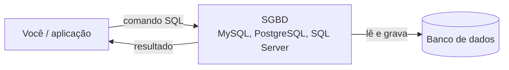
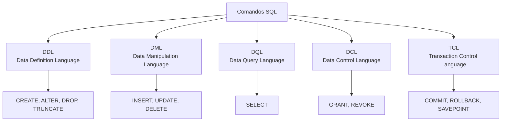

# Introdução ao SQL

## O que é SQL

SQL (Structured Query Language, "linguagem de consulta estruturada") é a linguagem usada para conversar com bancos de dados relacionais. Com ela você cria tabelas, grava registros, altera, apaga e, principalmente, pergunta coisas para os dados: "quais clientes compraram mais de três vezes este ano?", "qual foi o faturamento por mês?".

Duas características ajudam a entender o jeito do SQL:

- **É declarativa.** Você descreve _o que_ quer, não _como_ buscar. Em vez de escrever um laço que percorre linha por linha, você diz "me traga os clientes de São Paulo" e o banco decide o melhor caminho para encontrar esses dados.
- **É padronizada.** Existe um padrão internacional, o ISO/IEC 9075, revisado de tempos em tempos (a versão mais recente é a SQL:2023). Os bancos seguem esse padrão em boa parte, mas cada um adiciona e muda algumas coisas.

O dia a dia com SQL gira em torno das quatro operações básicas sobre dados, conhecidas pela sigla **CRUD**: Create (criar), Read (ler), Update (atualizar) e Delete (excluir).

```sql
SELECT 'Hello World';
```

Esse é o "Olá, mundo" do SQL: um `SELECT` que não lê nenhuma tabela, só devolve um texto. Funciona em MySQL, PostgreSQL e SQL Server.

### Por que analistas e cientistas de dados usam SQL

A maior parte dos dados de uma empresa mora em bancos relacionais: vendas, cadastros, estoque, financeiro. Saber SQL significa conseguir buscar esses dados sozinho, sem depender de alguém que exporte uma planilha para você. Na prática, SQL serve para:

- extrair exatamente o recorte de dados que a análise precisa;
- agregar e cruzar tabelas direto no banco, que costuma ser muito mais rápido do que fazer isso numa planilha;
- montar as consultas que alimentam relatórios e dashboards (como os do Power BI).

## Banco de dados, SGBD e o "SQL vs MySQL"

Três termos costumam se misturar no começo:

| Termo                                                           | O que é                                                                  | Exemplo                                                           |
| --------------------------------------------------------------- | ------------------------------------------------------------------------ | ----------------------------------------------------------------- |
| Banco de dados                                                  | Coleção organizada de dados, guardada em tabelas, views e outros objetos | O banco `loja`, com as tabelas `clientes`, `pedidos` e `produtos` |
| SGBD (Sistema Gerenciador de Banco de Dados, ou DBMS em inglês) | O software que armazena, protege e entrega os dados                      | MySQL, PostgreSQL, SQL Server, Oracle, SQLite                     |
| SQL                                                             | A linguagem que você usa para pedir coisas ao SGBD                       | `SELECT nome FROM clientes;`                                      |

Uma frase resume bem: **SQL é a linguagem, MySQL é o software**. Perguntar "SQL ou MySQL?" é como perguntar "português ou Word?".

O fluxo é sempre o mesmo: você escreve um comando, o SGBD interpreta, vai até os dados e devolve a resposta.



### SGBD relacional (RDBMS)

Um SGBD relacional organiza os dados em **tabelas** (o nome técnico é "relações") formadas por linhas e colunas, ligadas entre si por chaves. Ele também garante regras de integridade, como "todo pedido precisa pertencer a um cliente que existe". MySQL, PostgreSQL, SQL Server, Oracle e SQLite são relacionais e usam SQL.

Existem também bancos **não relacionais** (NoSQL), como MongoDB (documentos) e Redis (chave-valor). Eles resolvem outros problemas e não são o foco desta seção. Um erro comum em material de entrevista é dizer que "um SGBD comum é um sistema de arquivos": pastas e arquivos não são SGBD, porque não oferecem linguagem de consulta, controle de acesso concorrente nem regras de integridade.

### Tabela, linha e coluna

- **Tabela**: conjunto de dados sobre um mesmo assunto, como uma planilha bem comportada. Exemplo: `clientes`.
- **Linha** (registro): um item da tabela. Exemplo: a cliente Ana, de Fortaleza.
- **Coluna** (atributo ou campo): uma característica, sempre do mesmo tipo em todas as linhas. Exemplo: `cidade`.

| id  | nome       | cidade    | estado |
| --- | ---------- | --------- | ------ |
| 1   | Ana Souza  | Fortaleza | CE     |
| 2   | Bruno Lima | São Paulo | SP     |
| 3   | Carla Dias | Recife    | PE     |

### Schema e metadados

**Metadados** são "dados sobre dados": o nome das tabelas, os tipos das colunas, quais chaves existem. Todo SGBD guarda isso num catálogo interno, e o padrão SQL define uma forma comum de consultá-lo, o `information_schema`:

```sql
SELECT table_name, column_name, data_type
FROM information_schema.columns
WHERE table_name = 'clientes';
```

Já a palavra **schema** muda de sentido conforme o SGBD:

| SGBD       | O que é um schema                                                |
| ---------- | ---------------------------------------------------------------- |
| MySQL      | Sinônimo de banco de dados (`CREATE SCHEMA` = `CREATE DATABASE`) |
| PostgreSQL | Um "namespace" dentro do banco; o padrão se chama `public`       |
| SQL Server | Também um namespace dentro do banco; o padrão se chama `dbo`     |

No PostgreSQL e no SQL Server você pode ter, no mesmo banco, `vendas.pedidos` e `financeiro.pedidos` sem conflito.

## Dialetos: MySQL, PostgreSQL e SQL Server

Todo SGBD fala SQL, mas cada um tem seu **dialeto**: funções próprias, tipos de dados diferentes e pequenas variações de sintaxe. O núcleo (`SELECT`, `WHERE`, `JOIN`, `GROUP BY`, `INSERT`...) é praticamente igual em todos. As diferenças aparecem em detalhes como limitar resultados, trabalhar com datas e gerar IDs automáticos.

|                     | MySQL                                              | PostgreSQL                                                      | SQL Server                                            |
| ------------------- | -------------------------------------------------- | --------------------------------------------------------------- | ----------------------------------------------------- |
| Quem mantém         | Oracle (Community Edition é gratuita, licença GPL) | Comunidade (PostgreSQL Global Development Group), licença livre | Microsoft (edições Express e Developer são gratuitas) |
| Extensão procedural | Stored procedures próprias do MySQL                | PL/pgSQL                                                        | T-SQL (Transact-SQL)                                  |
| Limitar linhas      | `LIMIT 10`                                         | `LIMIT 10` ou `FETCH FIRST 10 ROWS ONLY`                        | `TOP 10` ou `OFFSET ... FETCH`                        |
| ID automático       | `AUTO_INCREMENT`                                   | `GENERATED ... AS IDENTITY`                                     | `IDENTITY(1,1)`                                       |
| Data e hora atual   | `NOW()`                                            | `NOW()` ou `CURRENT_TIMESTAMP`                                  | `GETDATE()` ou `CURRENT_TIMESTAMP`                    |

Nas notas desta seção, os exemplos usam sintaxe que funciona nos três sempre que possível. Quando não dá, aparece um quadro comparativo como o de cima. Os outros SGBDs (Oracle, SQLite, DuckDB) seguem a mesma lógica, com seus próprios detalhes.

Qual escolher para estudar? Qualquer um dos três serve. O MySQL é muito usado em aplicações web e tem material de sobra para iniciantes; o PostgreSQL segue o padrão SQL mais de perto e é bastante usado em dados; o SQL Server é comum em empresas que já usam o ecossistema Microsoft (inclusive com Power BI). Depois que você aprende um, migrar para outro é questão de consultar o quadro de diferenças.

## Preparando o ambiente

Para praticar você precisa de duas peças: o **servidor** (o SGBD em si, que guarda os dados) e um **cliente** (o programa onde você escreve e executa os comandos).

| SGBD       | Servidor                          | Cliente gráfico oficial             | Cliente de terminal |
| ---------- | --------------------------------- | ----------------------------------- | ------------------- |
| MySQL      | MySQL Server (Community)          | MySQL Workbench                     | `mysql`             |
| PostgreSQL | PostgreSQL                        | pgAdmin                             | `psql`              |
| SQL Server | SQL Server (Express ou Developer) | SQL Server Management Studio (SSMS) | `sqlcmd`            |

Alternativas que funcionam com vários bancos: **DBeaver** (gratuito, conecta em MySQL, PostgreSQL, SQL Server e muitos outros) e o **VS Code** com extensões de banco de dados.

Se você já usa Docker, subir um banco para estudo leva um comando:

```bash
# PostgreSQL
docker run --name pg-estudos -e POSTGRES_PASSWORD=estudos -p 5432:5432 -d postgres

# MySQL
docker run --name mysql-estudos -e MYSQL_ROOT_PASSWORD=estudos -p 3306:3306 -d mysql
```

A senha `estudos` é só para um banco local de testes; nunca use algo assim num servidor exposto.

### O MySQL Workbench por dentro

Como muito material para iniciantes usa o MySQL Workbench, vale conhecer suas áreas principais:

- **Editor de consultas**: onde você escreve o SQL. Pode ter vários comandos no mesmo arquivo.
- **Execute (raio)**: executa o script inteiro ou só o trecho selecionado.
- **Execute Statement (raio com cursor)**: executa apenas o comando onde o cursor está.
- **Result Grid**: mostra o resultado de um `SELECT` em formato de tabela.
- **Output**: registra cada comando executado, se deu certo ou errado, quantas linhas foram afetadas e quanto tempo levou. Quando algo der erro, é aqui que você lê a mensagem.

O fluxo básico é: abrir o Workbench, conectar ao servidor, escrever o comando, executar e conferir o resultado no Result Grid ou a mensagem no Output. pgAdmin, SSMS e DBeaver têm áreas equivalentes, com outros nomes.

## Convenções de sintaxe

### Maiúsculas, minúsculas e ponto e vírgula

Palavras-chave do SQL (`SELECT`, `FROM`, `WHERE`) **não diferenciam maiúsculas de minúsculas** em nenhum dos SGBDs principais: `select` e `SELECT` funcionam igual. A convenção de escrever palavras-chave em MAIÚSCULAS e nomes de tabelas e colunas em minúsculas existe só para facilitar a leitura.

```sql
-- As duas consultas são equivalentes
SELECT nome, cidade FROM clientes WHERE estado = 'CE';
select nome, cidade from clientes where estado = 'CE';
```

O ponto e vírgula marca o fim de cada instrução. Em ferramentas que executam vários comandos de uma vez, ele é o que separa um do outro, então crie o hábito de sempre usá-lo.

O que **pode** diferenciar maiúsculas depende do SGBD:

- **Nomes de tabelas e colunas**: o PostgreSQL converte para minúsculas todo nome escrito sem aspas (`Clientes` vira `clientes`); se você criar uma tabela como `"Clientes"`, com aspas, vai precisar das aspas para sempre. No MySQL, nomes de tabela podem diferenciar maiúsculas dependendo do sistema operacional (configuração `lower_case_table_names`), mas nomes de coluna não diferenciam. O SQL Server segue a collation do banco, que por padrão não diferencia.
- **Os dados em si**: se `'ana' = 'ANA'` é verdadeiro depende da **collation** (regra de comparação de texto) configurada. No MySQL e no SQL Server as collations padrão não diferenciam maiúsculas; no PostgreSQL a comparação diferencia.

A dica prática: use sempre nomes em minúsculas com `_` separando palavras (`data_pedido`, `cliente_id`) e você evita quase todos esses problemas.

### Comentários

| Sintaxe            | Onde funciona              | Observação                                         |
| ------------------ | -------------------------- | -------------------------------------------------- |
| `-- comentário`    | Padrão SQL, todos os SGBDs | No MySQL é obrigatório um espaço depois de `--`    |
| `/* comentário */` | Padrão SQL, todos os SGBDs | Pode ocupar várias linhas                          |
| `# comentário`     | Só MySQL                   | Evite se quiser que o script rode em outros bancos |

```sql
-- Clientes do Nordeste
SELECT nome, estado
FROM clientes
WHERE estado IN ('CE', 'PE', 'BA'); /* outros estados podem entrar depois */
```

## Categorias de comandos SQL

Os comandos SQL costumam ser divididos em grupos conforme o que fazem. Saber essa classificação ajuda a ler documentação e é pergunta frequente em entrevista.



| Categoria                    | Para que serve                                                 | Comandos                              | Onde estudar                                                                                                                                              |
| ---------------------------- | -------------------------------------------------------------- | ------------------------------------- | --------------------------------------------------------------------------------------------------------------------------------------------------------- |
| DDL (definição de dados)     | Criar e alterar a _estrutura_: bancos, tabelas, views, índices | `CREATE`, `ALTER`, `DROP`, `TRUNCATE` | [Bancos, tabelas e tipos de dados](/labs/data/sql/02-bancos-tabelas-e-tipos-de-dados/), [Alterando a estrutura](/labs/data/sql/04-alterando-a-estrutura/) |
| DML (manipulação de dados)   | Mexer no _conteúdo_: inserir, alterar e apagar linhas          | `INSERT`, `UPDATE`, `DELETE`          | [Inserindo, atualizando e excluindo dados](/labs/data/sql/05-inserindo-atualizando-e-excluindo-dados/)                                                    |
| DQL (consulta de dados)      | Ler dados                                                      | `SELECT`                              | [Consultas com SELECT](/labs/data/sql/06-consultas-com-select/)                                                                                           |
| DCL (controle de acesso)     | Dar e tirar permissões                                         | `GRANT`, `REVOKE`                     | [Transações e ACID](/labs/data/sql/13-transacoes-e-acid/)                                                                                                 |
| TCL (controle de transações) | Confirmar ou desfazer um conjunto de alterações                | `COMMIT`, `ROLLBACK`, `SAVEPOINT`     | [Transações e ACID](/labs/data/sql/13-transacoes-e-acid/)                                                                                                 |

Duas observações sobre essa tabela:

- Algumas referências não separam a DQL e colocam o `SELECT` dentro da DML. As duas classificações aparecem por aí; o importante é saber que o `SELECT` lê e não altera nada.
- `TRUNCATE` apaga todas as linhas de uma tabela, mas é classificado como DDL, porque age sobre a tabela como um todo em vez de remover linha por linha. A diferença entre `DELETE`, `TRUNCATE` e `DROP` aparece em [Alterando a estrutura](/labs/data/sql/04-alterando-a-estrutura/).

Uma forma simples de lembrar: **DDL mexe na forma, DML mexe no conteúdo**. `ALTER TABLE` muda a "planilha" (adiciona uma coluna, por exemplo); `UPDATE` muda o que está escrito nas células.

## Referências

- [Bancos de dados (SQL Server)](https://learn.microsoft.com/pt-br/sql/relational-databases/databases/databases) - Microsoft Learn, pt-BR
- [Tutorial - A linguagem SQL (documentação do PostgreSQL)](https://halleyoliv.gitlab.io/pgdocptbr/tutorial-sql.html) - tradução de Halley Pacheco de Oliveira da documentação oficial, pt-BR
- [MySQL Tutorial](https://dev.mysql.com/doc/refman/8.4/en/tutorial.html) - Oracle/MySQL, en
- [Comments](https://dev.mysql.com/doc/refman/8.4/en/comments.html) - Oracle/MySQL, en
