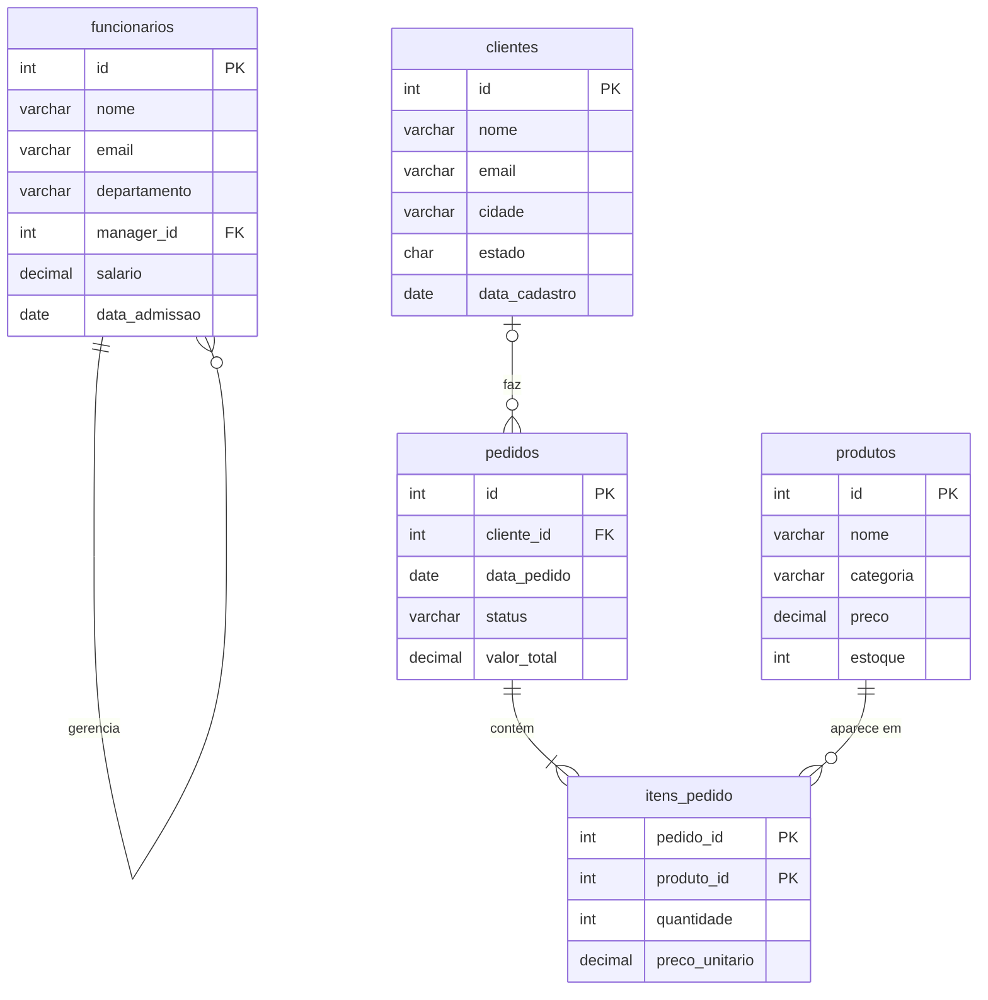

# Constraints, chaves e relacionamentos

## Integridade de dados

Integridade de dados é a garantia de que o que está no banco é correto e consistente: não há dois clientes com o mesmo ID, nenhum pedido aponta para um cliente que não existe, nenhum produto tem preço negativo. Você poderia tentar garantir isso no código da aplicação, mas qualquer script, importação ou pessoa com acesso ao banco passaria por cima. Quando a regra está no próprio banco, ninguém escapa dela.

A integridade costuma ser dividida em três tipos:

| Tipo        | Pergunta que responde                                       | Como o banco garante                         |
| ----------- | ----------------------------------------------------------- | -------------------------------------------- |
| De entidade | Cada linha é identificável sem ambiguidade?                 | `PRIMARY KEY`                                |
| De domínio  | O valor da coluna é válido?                                 | Tipo de dado, `NOT NULL`, `CHECK`, `DEFAULT` |
| Referencial | O relacionamento entre tabelas aponta para algo que existe? | `FOREIGN KEY`                                |

As ferramentas para isso são as **constraints** (restrições): regras declaradas junto com a tabela que o SGBD verifica a cada `INSERT`, `UPDATE` e `DELETE`. Se a operação quebrar uma regra, ela é recusada com erro.

## Constraints de coluna

### NOT NULL

Impede que a coluna fique vazia. Use em tudo que é obrigatório.

```sql
nome VARCHAR(100) NOT NULL
```

Lembre que `NULL` não é zero nem texto vazio: é "valor ausente ou desconhecido". Um salário `0` diz que a pessoa ganha zero; um salário `NULL` diz que você não sabe quanto ela ganha. Como o `NULL` se comporta nas consultas está em [Consultas com SELECT](/labs/data/sql/06-consultas-com-select/).

### UNIQUE

Impede valores repetidos na coluna. Uma tabela pode ter várias constraints `UNIQUE`, ao contrário da chave primária.

```sql
email VARCHAR(150) UNIQUE
```

Também dá para exigir que uma **combinação** de colunas seja única, mesmo que cada coluna sozinha se repita:

```sql
-- O mesmo CPF pode aparecer em lojas diferentes, mas não duas vezes na mesma loja
UNIQUE (loja_id, cpf)
```

#### NULL em coluna UNIQUE: depende do SGBD

O padrão SQL deixou esse comportamento em aberto, e cada banco decidiu de um jeito:

|                                    | MySQL   | PostgreSQL                                                                                              | SQL Server                  |
| ---------------------------------- | ------- | ------------------------------------------------------------------------------------------------------- | --------------------------- |
| Vários `NULL` numa coluna `UNIQUE` | Permite | Permite (na versão 15 em diante, `UNIQUE NULLS NOT DISTINCT` passa a tratar `NULL` como valor repetido) | Permite **um único** `NULL` |

No SQL Server, se você precisa de uma coluna opcional e única (como um CPF que nem todo cliente informou), a saída é um índice único filtrado: `CREATE UNIQUE INDEX ... WHERE cpf IS NOT NULL`.

### DEFAULT

Define o valor usado quando o `INSERT` não informa a coluna.

```sql
estoque INT DEFAULT 0,
status  VARCHAR(20) DEFAULT 'pendente'
```

Detalhe que confunde muita gente: o `DEFAULT` só entra quando a coluna é **omitida** do `INSERT`. Se você mandar `NULL` explicitamente, o banco grava `NULL` (ou dá erro, se a coluna for `NOT NULL`).

Para registrar automaticamente o momento de criação:

| MySQL                                           | PostgreSQL                          | SQL Server                                  |
| ----------------------------------------------- | ----------------------------------- | ------------------------------------------- |
| `criado_em TIMESTAMP DEFAULT CURRENT_TIMESTAMP` | `criado_em TIMESTAMP DEFAULT NOW()` | `criado_em DATETIME2 DEFAULT SYSDATETIME()` |

### CHECK

Valida o valor com uma condição.

```sql
preco DECIMAL(10, 2) CHECK (preco >= 0),
status VARCHAR(20) CHECK (status IN ('pendente', 'pago', 'enviado', 'cancelado'))
```

Dois cuidados:

- **`NULL` passa no `CHECK`.** A condição `idade >= 18` com idade `NULL` não é verdadeira nem falsa, é "desconhecida", e o `CHECK` só recusa o que for falso. Se o valor é obrigatório, combine com `NOT NULL`: `idade INT NOT NULL CHECK (idade >= 18)`.
- **MySQL antigo ignorava o `CHECK`.** Até a versão 8.0.15, o MySQL aceitava a sintaxe e simplesmente não aplicava a regra. Desde a 8.0.16 ela é aplicada de verdade. Se você trabalha com uma instalação antiga, desconfie.

### Dando nome às constraints

Toda constraint recebe um nome. Se você não escolher, o SGBD gera um (algo como `produtos_chk_1` ou `CK__produtos__preco__3B75D760`). Nomear facilita entender a mensagem de erro e remover a constraint depois:

```sql
CONSTRAINT ck_produtos_preco CHECK (preco >= 0)
```

## Chaves

### Chave primária (PRIMARY KEY)

A chave primária identifica cada linha de forma única. Ela é uma coluna **ou um conjunto de colunas** que:

- não se repete (é `UNIQUE`);
- nunca é `NULL`;
- existe no máximo uma por tabela.

```sql
CREATE TABLE clientes (
    id   INT PRIMARY KEY,
    nome VARCHAR(100) NOT NULL
);
```

Uma tabela **pode** existir sem chave primária; o banco deixa. Mas não é recomendado: sem ela, você não consegue apontar com segurança para uma linha específica, duplicatas entram sem aviso e outras tabelas não têm como se relacionar com essa. Na prática, toda tabela deveria ter uma.

Tentar inserir uma chave que já existe gera erro de violação de chave primária. Se a intenção era "insira ou, se já existir, atualize" (o famoso _upsert_), cada SGBD tem um comando próprio, mostrado em [Inserindo, atualizando e excluindo dados](/labs/data/sql/05-inserindo-atualizando-e-excluindo-dados/).

### Chave primária composta

Quando nenhuma coluna sozinha identifica a linha, a chave pode combinar várias. O exemplo clássico são os itens de um pedido: o mesmo produto aparece em vários pedidos, e um pedido tem vários produtos, mas o par (pedido, produto) é único.

```sql
CREATE TABLE itens_pedido (
    pedido_id  INT,
    produto_id INT,
    quantidade INT NOT NULL,
    PRIMARY KEY (pedido_id, produto_id)
);
```

Repare que a chave composta é declarada como constraint **de tabela**, depois das colunas.

### Candidata, alternativa e superchave

Esses nomes vêm da teoria relacional e aparecem bastante em entrevistas. Pense na tabela `funcionarios`, com `id`, `email` e `cpf`, todos únicos:

| Termo             | Definição                                                                       | No exemplo                              |
| ----------------- | ------------------------------------------------------------------------------- | --------------------------------------- |
| Superchave        | Qualquer conjunto de colunas que identifica a linha, mesmo com colunas sobrando | `(id)`, `(id, nome)`, `(email, cpf)`... |
| Chave candidata   | Uma superchave **mínima**: se tirar qualquer coluna, ela deixa de identificar   | `(id)`, `(email)`, `(cpf)`              |
| Chave primária    | A candidata escolhida para ser a identificação oficial                          | `(id)`                                  |
| Chave alternativa | As candidatas que não foram escolhidas                                          | `(email)` e `(cpf)`, que viram `UNIQUE` |

### Surrogate key x natural key

- **Natural key** (chave natural): um dado do mundo real que já é único, como CPF, e-mail ou ISBN.
- **Surrogate key** (chave substituta ou artificial): um identificador sem significado, criado só para ser chave, geralmente um número sequencial.

Parece tentador usar o e-mail como chave primária dos clientes, já que ele é único. O problema é que e-mail muda. Se ele for a chave, trocar o e-mail de um cliente obriga a atualizar todas as tabelas que apontam para ele. Com uma surrogate key, o `id` nunca muda e o e-mail fica numa coluna `UNIQUE`, livre para ser alterado. Essa é a escolha mais comum em sistemas transacionais.

Para não ter que inventar os números na mão, o banco pode gerá-los:

| MySQL                               | PostgreSQL                                                               | SQL Server                         |
| ----------------------------------- | ------------------------------------------------------------------------ | ---------------------------------- |
| `id INT AUTO_INCREMENT PRIMARY KEY` | `id INT GENERATED ALWAYS AS IDENTITY PRIMARY KEY` (ou o antigo `SERIAL`) | `id INT IDENTITY(1,1) PRIMARY KEY` |

Com isso, o `INSERT` omite o `id` e o banco preenche com o próximo número.

## Chave estrangeira e relacionamentos

A chave estrangeira (`FOREIGN KEY`) é uma coluna que aponta para a chave primária de outra tabela. Ela cria o relacionamento e garante a integridade referencial.

```sql
CREATE TABLE pedidos (
    id          INT PRIMARY KEY,
    cliente_id  INT NOT NULL,
    data_pedido DATE NOT NULL,
    FOREIGN KEY (cliente_id) REFERENCES clientes (id)
);
```

Aqui `clientes` é a **tabela pai** (a referenciada) e `pedidos` é a **tabela filha** (a que referencia). A partir daí o banco recusa:

- inserir um pedido com `cliente_id = 99` se não existe cliente 99;
- mudar o `cliente_id` de um pedido para um cliente inexistente;
- apagar um cliente que ainda tem pedidos (a não ser que você configure outra ação, veja abaixo).

No MySQL, declare a chave estrangeira como constraint de tabela (`FOREIGN KEY (...) REFERENCES ...`), como no exemplo. Durante muito tempo o MySQL aceitou a forma abreviada na própria coluna (`cliente_id INT REFERENCES clientes(id)`) sem aplicar a regra, e a forma de tabela funciona em todos os SGBDs.

Um caso especial é a chave estrangeira que aponta para a **própria tabela**. Em `funcionarios`, a coluna `manager_id` (o gerente) aponta para o `id` de outro funcionário. É isso que permite o self join, visto em [Joins](/labs/data/sql/09-joins/).

### Ações referenciais: o que acontece quando o pai muda

Quando você apaga ou altera a chave de uma linha pai que tem filhos, o banco segue a ação definida em `ON DELETE` e `ON UPDATE`:

| Ação                     | O que faz com os filhos                                                         | Exemplo de uso                                            |
| ------------------------ | ------------------------------------------------------------------------------- | --------------------------------------------------------- |
| `RESTRICT` / `NO ACTION` | Recusa a operação no pai enquanto houver filhos                                 | Não deixar apagar cliente com pedidos                     |
| `CASCADE`                | Repete a operação nos filhos (apaga ou atualiza junto)                          | Apagar o pedido apaga seus itens                          |
| `SET NULL`               | Coloca `NULL` na chave estrangeira dos filhos (a coluna precisa aceitar `NULL`) | Departamento extinto: funcionários ficam sem departamento |
| `SET DEFAULT`            | Coloca o valor padrão da coluna                                                 | Raro; o MySQL (InnoDB) rejeita essa opção                 |

```sql
FOREIGN KEY (pedido_id) REFERENCES pedidos (id) ON DELETE CASCADE
```

Se você não escrever nada, o padrão é `NO ACTION`, que na prática bloqueia a operação. Diferenças entre SGBDs:

|                                              | MySQL (InnoDB) | PostgreSQL                                                                      | SQL Server                                                        |
| -------------------------------------------- | -------------- | ------------------------------------------------------------------------------- | ----------------------------------------------------------------- |
| `RESTRICT` x `NO ACTION`                     | Equivalentes   | Quase iguais: `NO ACTION` pode ter a verificação adiada para o fim da transação | Não existe a palavra `RESTRICT`; use `NO ACTION`                  |
| `SET DEFAULT`                                | Não suportado  | Suportado                                                                       | Suportado                                                         |
| `CASCADE`/`SET NULL` em FK da própria tabela | Permitido      | Permitido                                                                       | Não permitido (erro de "ciclos ou múltiplos caminhos de cascata") |

`CASCADE` é prático, mas use com consciência: um `DELETE` em `clientes` com cascata em `pedidos` e em `itens_pedido` pode apagar milhares de linhas com um único comando.

## O esquema de exemplo das notas de SQL

As notas desta seção usam uma lojinha fictícia com cinco tabelas. O script abaixo foi escrito para rodar em MySQL 8.0.16+, PostgreSQL e SQL Server sem alterações (por isso usa IDs explícitos em vez de `AUTO_INCREMENT`/`IDENTITY`).



```sql
CREATE TABLE funcionarios (
    id            INT PRIMARY KEY,
    nome          VARCHAR(100) NOT NULL,
    email         VARCHAR(150) UNIQUE,
    departamento  VARCHAR(50),
    manager_id    INT,
    salario       DECIMAL(10, 2) CHECK (salario > 0),
    data_admissao DATE NOT NULL,
    FOREIGN KEY (manager_id) REFERENCES funcionarios (id)
);

CREATE TABLE clientes (
    id            INT PRIMARY KEY,
    nome          VARCHAR(100) NOT NULL,
    email         VARCHAR(150) NOT NULL UNIQUE,
    cidade        VARCHAR(60),
    estado        CHAR(2),
    data_cadastro DATE NOT NULL
);

CREATE TABLE produtos (
    id        INT PRIMARY KEY,
    nome      VARCHAR(100) NOT NULL,
    categoria VARCHAR(50),
    preco     DECIMAL(10, 2) NOT NULL CHECK (preco >= 0),
    estoque   INT NOT NULL DEFAULT 0 CHECK (estoque >= 0)
);

CREATE TABLE pedidos (
    id          INT PRIMARY KEY,
    cliente_id  INT,
    data_pedido DATE NOT NULL,
    status      VARCHAR(20) NOT NULL DEFAULT 'pendente'
                CHECK (status IN ('pendente', 'pago', 'enviado', 'cancelado')),
    valor_total DECIMAL(10, 2) NOT NULL DEFAULT 0,
    FOREIGN KEY (cliente_id) REFERENCES clientes (id)
);

CREATE TABLE itens_pedido (
    pedido_id      INT,
    produto_id     INT,
    quantidade     INT NOT NULL CHECK (quantidade > 0),
    preco_unitario DECIMAL(10, 2) NOT NULL,
    PRIMARY KEY (pedido_id, produto_id),
    FOREIGN KEY (pedido_id) REFERENCES pedidos (id) ON DELETE CASCADE,
    FOREIGN KEY (produto_id) REFERENCES produtos (id)
);
```

Algumas decisões que valem notar:

- A ordem de criação importa: uma tabela só pode referenciar outra que já existe. Por isso `clientes` vem antes de `pedidos` e `produtos` antes de `itens_pedido`.
- `pedidos.cliente_id` aceita `NULL` de propósito: representa uma venda de balcão, sem cliente identificado. A chave estrangeira continua valendo para os valores preenchidos, e esse pedido "órfão" é útil para ver a diferença entre os tipos de join.
- `itens_pedido` guarda o `preco_unitario` do momento da compra. Se o preço do produto mudar amanhã, o pedido antigo continua com o valor que foi cobrado.
- `pedidos.valor_total` repete uma informação que dá para calcular somando os itens. É uma desnormalização intencional, para simplificar consultas de faturamento; o custo é ter que manter os dois valores coerentes (veja [Normalização](/labs/data/sql/12-normalizacao/)).
- O departamento ficou como texto em `funcionarios` para manter os exemplos curtos. Num sistema real ele viraria uma tabela `departamentos` referenciada por chave estrangeira.
- `manager_id` não tem `ON DELETE SET NULL` porque o SQL Server não aceita ações em cascata numa chave que aponta para a própria tabela. No MySQL e no PostgreSQL você poderia adicionar.
- Os dados de exemplo (os `INSERT` dessas tabelas) estão em [Inserindo, atualizando e excluindo dados](/labs/data/sql/05-inserindo-atualizando-e-excluindo-dados/).

Para adicionar ou remover constraints de uma tabela que já existe, use `ALTER TABLE`, assunto de [Alterando a estrutura](/labs/data/sql/04-alterando-a-estrutura/).

## Referências

- [Restrições de chave primária e chave estrangeira](https://learn.microsoft.com/pt-br/sql/relational-databases/tables/primary-and-foreign-key-constraints) - Microsoft Learn, pt-BR
- [Restrições exclusivas e restrições de verificação](https://learn.microsoft.com/pt-br/sql/relational-databases/tables/unique-constraints-and-check-constraints) - Microsoft Learn, pt-BR
- [Restrições (documentação do PostgreSQL)](https://halleyoliv.gitlab.io/pgdocptbr/ddl-constraints.html) - tradução de Halley Pacheco de Oliveira da documentação oficial, pt-BR
- [FOREIGN KEY Constraints](https://dev.mysql.com/doc/refman/8.4/en/create-table-foreign-keys.html) - Oracle/MySQL, en
- [Constraints](https://www.postgresql.org/docs/current/ddl-constraints.html) - PostgreSQL Global Development Group, en
