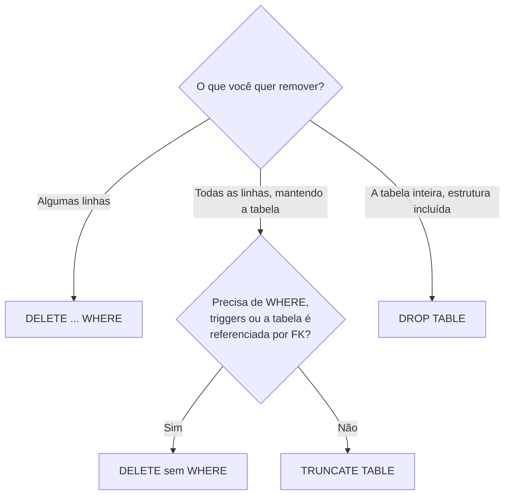

# Alterando a estrutura

## ALTER TABLE: mudando uma tabela que já existe

Tabelas evoluem. Um mês depois de criar `clientes`, alguém pede para guardar o telefone; depois descobre que `nome VARCHAR(50)` ficou curto. Em vez de apagar e recriar a tabela (perdendo os dados), você usa `ALTER TABLE`, um comando DDL que muda a estrutura e mantém as linhas.

Aqui está a parte do SQL em que os dialetos mais divergem. A operação é a mesma, mas a sintaxe muda bastante entre MySQL, PostgreSQL e SQL Server.

### Adicionar coluna

| MySQL | PostgreSQL | SQL Server |
| ----- | ---------- | ---------- |
| `ALTER TABLE clientes ADD COLUMN telefone VARCHAR(20);` | `ALTER TABLE clientes ADD COLUMN telefone VARCHAR(20);` | `ALTER TABLE clientes ADD telefone VARCHAR(20);` |

No SQL Server não se escreve a palavra `COLUMN` no `ADD`. As linhas que já existem ficam com `NULL` na coluna nova, ou com o valor de `DEFAULT`, se você declarar um:

```sql
ALTER TABLE produtos ADD COLUMN ativo BOOLEAN DEFAULT TRUE;  -- MySQL / PostgreSQL
```

Se a coluna nova for `NOT NULL`, informe um `DEFAULT`; caso contrário o banco não tem o que colocar nas linhas antigas e recusa a alteração.

O MySQL deixa escolher a posição da coluna, coisa que os outros não fazem:

```sql
-- Só MySQL
ALTER TABLE clientes ADD COLUMN telefone VARCHAR(20) AFTER email;
ALTER TABLE clientes ADD COLUMN codigo INT FIRST;
```

A ordem física das colunas raramente importa: num `SELECT` você escolhe a ordem que quiser.

### Mudar o tipo de uma coluna

| MySQL | PostgreSQL | SQL Server |
| ----- | ---------- | ---------- |
| `ALTER TABLE clientes MODIFY COLUMN nome VARCHAR(150) NOT NULL;` | `ALTER TABLE clientes ALTER COLUMN nome TYPE VARCHAR(150);` | `ALTER TABLE clientes ALTER COLUMN nome VARCHAR(150) NOT NULL;` |

Pontos de atenção:

- No MySQL e no SQL Server você redeclara a coluna inteira. Se esquecer o `NOT NULL`, a coluna passa a aceitar nulos.
- No PostgreSQL, tipo e obrigatoriedade são alterados separadamente: `ALTER COLUMN nome SET NOT NULL` ou `DROP NOT NULL`.
- Diminuir o tamanho (`VARCHAR(150)` para `VARCHAR(20)`) ou trocar para um tipo incompatível falha se algum dado não couber. Confira antes com uma consulta, como `SELECT MAX(CHAR_LENGTH(nome)) FROM clientes;` (funções de texto em [Funções de texto e data](/labs/data/sql/07-funcoes-de-texto-e-data/)).

### Renomear coluna

| MySQL 8.0+ | PostgreSQL | SQL Server |
| ---------- | ---------- | ---------- |
| `ALTER TABLE clientes RENAME COLUMN nome TO nome_completo;` | `ALTER TABLE clientes RENAME COLUMN nome TO nome_completo;` | `EXEC sp_rename 'clientes.nome', 'nome_completo', 'COLUMN';` |

O MySQL também tem `CHANGE COLUMN`, que renomeia e muda o tipo de uma vez: `ALTER TABLE clientes CHANGE COLUMN nome nome_completo VARCHAR(150) NOT NULL;`.

Renomear uma coluna quebra tudo que usava o nome antigo: consultas salvas, views, relatórios do Power BI, código da aplicação. Faça uma busca antes.

### Remover coluna

```sql
ALTER TABLE clientes DROP COLUMN telefone;
```

Funciona igual nos três. Os dados da coluna somem junto. No SQL Server, se a coluna tiver um `DEFAULT` ou outra constraint, é preciso remover a constraint antes.

### Adicionar e remover constraints

```sql
-- Adicionar (igual nos três)
ALTER TABLE clientes ADD CONSTRAINT uq_clientes_email UNIQUE (email);
ALTER TABLE produtos ADD CONSTRAINT ck_produtos_preco CHECK (preco >= 0);
ALTER TABLE pedidos ADD CONSTRAINT fk_pedidos_clientes
    FOREIGN KEY (cliente_id) REFERENCES clientes (id);
```

| Remover | MySQL | PostgreSQL e SQL Server |
| ------- | ----- | ----------------------- |
| Qualquer constraint | `DROP CONSTRAINT nome` (8.0.19+) | `DROP CONSTRAINT nome` |
| Chave estrangeira | `DROP FOREIGN KEY fk_pedidos_clientes` | `DROP CONSTRAINT fk_pedidos_clientes` |
| `UNIQUE` | `DROP INDEX uq_clientes_email` | `DROP CONSTRAINT uq_clientes_email` |

Criar uma constraint numa tabela com dados falha se os dados atuais já quebram a regra. Adicionar `UNIQUE (email)` numa tabela com e-mails repetidos dá erro: primeiro encontre e resolva as duplicatas (com `GROUP BY ... HAVING COUNT(*) > 1`, visto em [Agregações, GROUP BY e HAVING](/labs/data/sql/08-agregacoes-group-by-e-having/)), depois crie a constraint.

Os nomes `uq_`, `ck_` e `fk_` são só uma convenção, mas ajudam muito quando aparece um erro como "violates constraint fk_pedidos_clientes".

### Várias alterações de uma vez

MySQL e PostgreSQL aceitam várias ações separadas por vírgula num único `ALTER TABLE`:

```sql
ALTER TABLE clientes
    ADD COLUMN telefone VARCHAR(20),
    ADD COLUMN data_nascimento DATE,
    DROP COLUMN cidade;
```

No SQL Server é possível adicionar várias colunas num só `ADD` (`ADD telefone VARCHAR(20), data_nascimento DATE`), mas tipos diferentes de ação (adicionar e remover, por exemplo) vão em comandos separados.

## Renomeando uma tabela

| MySQL | PostgreSQL | SQL Server |
| ----- | ---------- | ---------- |
| `RENAME TABLE clientes TO compradores;` ou `ALTER TABLE clientes RENAME TO compradores;` | `ALTER TABLE clientes RENAME TO compradores;` | `EXEC sp_rename 'clientes', 'compradores';` |

`ALTER TABLE ... RENAME TO` é a forma mais portável. As chaves estrangeiras que apontavam para a tabela continuam funcionando, porque o banco as liga ao objeto, não ao nome. Consultas e views que usam o nome antigo, não.

## Antes de alterar: boas práticas

Alterar estrutura em produção é uma das operações mais arriscadas do dia a dia. Algumas precauções:

- **Confira a estrutura atual** com `DESCRIBE`, `\d` ou `sp_help` (veja [Bancos, tabelas e tipos de dados](/labs/data/sql/02-bancos-tabelas-e-tipos-de-dados/)).
- **Faça backup** da tabela ou do banco. Um jeito rápido de guardar uma cópia é `CREATE TABLE clientes_backup AS SELECT * FROM clientes;` (MySQL e PostgreSQL) ou `SELECT * INTO clientes_backup FROM clientes;` (SQL Server).
- **Teste num ambiente de desenvolvimento** antes.
- **Cuidado com tabelas grandes**: em alguns casos o `ALTER TABLE` reescreve a tabela inteira e pode travar leituras e escritas enquanto roda.
- **Versione as alterações** em scripts (as chamadas *migrations*), para saber o que mudou e quando.

## DROP x TRUNCATE x DELETE

Os três "apagam", mas em níveis bem diferentes. Essa comparação é uma das perguntas mais repetidas em entrevistas de SQL.



```sql
DELETE FROM pedidos WHERE status = 'cancelado';  -- remove linhas escolhidas
TRUNCATE TABLE log_acessos;                       -- esvazia a tabela
DROP TABLE log_acessos;                           -- a tabela deixa de existir
```

### O que vale em qualquer SGBD

| | `DELETE` | `TRUNCATE` | `DROP` |
| - | -------- | ---------- | ------ |
| Categoria | DML | DDL | DDL |
| O que remove | As linhas que casam com o `WHERE` (ou todas, sem `WHERE`) | Todas as linhas | A tabela: dados, estrutura, índices, constraints, permissões |
| Aceita `WHERE` | Sim | Não | Não |
| A tabela continua existindo | Sim | Sim | Não |
| Velocidade em tabela grande | Mais lento: remove e registra linha por linha | Muito mais rápido: libera as páginas de dados de uma vez | Rápido |

É comum ler que "`TRUNCATE` não gera log". Não é bem assim: no SQL Server, por exemplo, ele registra as desalocações de páginas, em vez de cada linha removida. Por isso é rápido e usa menos locks, mas não é "sem registro".

### O que muda conforme o SGBD

| | MySQL | PostgreSQL | SQL Server |
| - | ----- | ---------- | ---------- |
| `TRUNCATE` pode ser desfeito com `ROLLBACK`? | Não: faz commit implícito | Sim, dentro de uma transação | Sim, dentro de uma transação |
| `DROP TABLE` pode ser desfeito? | Não: commit implícito | Sim, dentro de uma transação | Sim, dentro de uma transação |
| `TRUNCATE` numa tabela referenciada por FK de outra tabela | Erro | Erro, a menos que use `TRUNCATE ... CASCADE` (que esvazia as filhas também) | Erro, mesmo que as filhas estejam vazias |
| `TRUNCATE` dispara triggers de `DELETE`? | Não | Não (há triggers específicos `ON TRUNCATE`) | Não |
| `TRUNCATE` reinicia o contador do ID automático? | Sim | Só com `TRUNCATE ... RESTART IDENTITY` | Sim, volta ao valor inicial |
| `DELETE` sem `WHERE` reinicia o contador? | Não | Não | Não |

A resposta "não dá para fazer rollback de `TRUNCATE` na maioria dos bancos", que aparece em muito material de entrevista, está errada como regra geral: PostgreSQL e SQL Server desfazem `TRUNCATE` dentro de uma transação. Quem não desfaz é o MySQL (e o Oracle). Transações e `ROLLBACK` estão em [Transações e ACID](/labs/data/sql/13-transacoes-e-acid/).

```sql
-- PostgreSQL: o TRUNCATE é desfeito
BEGIN;
TRUNCATE TABLE itens_pedido;
ROLLBACK;
SELECT COUNT(*) FROM itens_pedido;  -- as linhas continuam lá
```

### Qual usar em cada cenário

| Cenário | Comando |
| ------- | ------- |
| Apagar os pedidos cancelados | `DELETE ... WHERE status = 'cancelado'` |
| Esvaziar uma tabela de staging antes de uma nova carga | `TRUNCATE TABLE` |
| Esvaziar uma tabela que outras referenciam, ou que tem trigger de auditoria | `DELETE` sem `WHERE` (mais lento, mas respeita FKs e triggers) |
| A tabela não é mais necessária | `DROP TABLE` |
| Apagar o banco inteiro | `DROP DATABASE` |

Os detalhes de `DELETE` (e do perigo de esquecer o `WHERE`) estão em [Inserindo, atualizando e excluindo dados](/labs/data/sql/05-inserindo-atualizando-e-excluindo-dados/).

## Referências

- [ALTER TABLE (Transact-SQL)](https://learn.microsoft.com/pt-br/sql/t-sql/statements/alter-table-transact-sql) - Microsoft Learn, pt-BR
- [TRUNCATE TABLE (Transact-SQL)](https://learn.microsoft.com/pt-br/sql/t-sql/statements/truncate-table-transact-sql) - Microsoft Learn, pt-BR
- [Modificação de tabelas (documentação do PostgreSQL)](https://halleyoliv.gitlab.io/pgdocptbr/ddl-alter.html) - tradução de Halley Pacheco de Oliveira da documentação oficial, pt-BR
- [ALTER TABLE Statement](https://dev.mysql.com/doc/refman/8.4/en/alter-table.html) - Oracle/MySQL, en
- [TRUNCATE TABLE Statement](https://dev.mysql.com/doc/refman/8.4/en/truncate-table.html) - Oracle/MySQL, en
