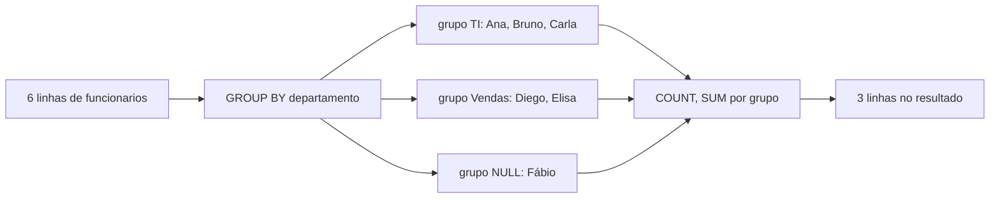
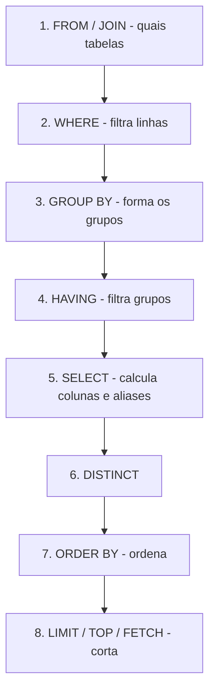

# Agregações, GROUP BY e HAVING

Até aqui, cada linha do resultado de um `SELECT` correspondia a uma linha da tabela. Com agregações a conversa muda: em vez de listar pedidos, você pergunta "quantos pedidos foram feitos?", "qual o faturamento por cidade?" ou "quais departamentos têm mais de 5 pessoas?". É aqui que o SQL começa a virar ferramenta de análise de verdade. 📊

## Tabelas usadas nos exemplos

As notas desta trilha usam o mesmo esquema de exemplo (criado em [Bancos, tabelas e tipos de dados](/labs/data/sql/02-bancos-tabelas-e-tipos-de-dados/)). Nesta nota aparecem principalmente estas duas tabelas:

```sql
CREATE TABLE pedidos (
    id           INT PRIMARY KEY,
    cliente_id   INT,              -- NULL = venda de balcão, sem cadastro
    data_pedido  DATE NOT NULL,
    status       VARCHAR(20) NOT NULL,
    valor_total  DECIMAL(10,2)
);

CREATE TABLE funcionarios (
    id            INT PRIMARY KEY,
    nome          VARCHAR(100) NOT NULL,
    departamento  VARCHAR(50),
    salario       DECIMAL(10,2),
    manager_id    INT
);
```

Para os exemplos ficarem fáceis de conferir de cabeça, imagine a tabela `funcionarios` com estes dados:

| id  | nome  | departamento | salario | manager_id |
| --- | ----- | ------------ | ------- | ---------- |
| 1   | Ana   | TI           | 9000.00 | NULL       |
| 2   | Bruno | TI           | 6000.00 | 1          |
| 3   | Carla | TI           | NULL    | 1          |
| 4   | Diego | Vendas       | 5000.00 | 1          |
| 5   | Elisa | Vendas       | 4000.00 | 4          |
| 6   | Fábio | NULL         | 3000.00 | 1          |

Repare que a Carla ainda não tem salário cadastrado e o Fábio não tem departamento. Esses `NULL` vão fazer diferença nos resultados.

## Funções de agregação

Uma função de agregação recebe **várias linhas** e devolve **um único valor**. As cinco que aparecem em praticamente todo SGBD são:

| Função    | O que calcula                   | Exemplo                      |
| --------- | ------------------------------- | ---------------------------- |
| `COUNT()` | Quantidade de linhas ou valores | `COUNT(*)`, `COUNT(salario)` |
| `SUM()`   | Soma                            | `SUM(valor_total)`           |
| `AVG()`   | Média aritmética                | `AVG(salario)`               |
| `MIN()`   | Menor valor                     | `MIN(data_pedido)`           |
| `MAX()`   | Maior valor                     | `MAX(salario)`               |

`SUM` e `AVG` só fazem sentido com números. `MIN` e `MAX` funcionam também com texto (ordem alfabética, conforme a collation) e datas (a mais antiga e a mais recente).

```sql
SELECT
    COUNT(*)      AS total_funcionarios,
    SUM(salario)  AS folha_total,
    AVG(salario)  AS salario_medio,
    MIN(salario)  AS menor_salario,
    MAX(salario)  AS maior_salario
FROM funcionarios;
```

Com os dados acima, o resultado é uma linha só:

| total_funcionarios | folha_total | salario_medio | menor_salario | maior_salario |
| ------------------ | ----------- | ------------- | ------------- | ------------- |
| 6                  | 27000.00    | 5400.00       | 3000.00       | 9000.00       |

Esse exemplo já mostra uma coisa que confunde muita gente: a média deu 5400, e não 4500. Por quê? Veja a próxima seção.

### Agregações ignoram NULL

Todas as funções de agregação **ignoram `NULL`**, com uma exceção: `COUNT(*)`. No exemplo, `SUM(salario)` somou cinco salários (27000) e `AVG(salario)` dividiu por cinco, não por seis. O salário da Carla não entrou na conta, nem como zero.

Se a regra de negócio diz que salário ausente deve contar como zero na média, você precisa dizer isso explicitamente com `COALESCE` (visto em [Consultas com SELECT](/labs/data/sql/06-consultas-com-select/)):

```sql
SELECT AVG(COALESCE(salario, 0)) AS media_com_zeros   -- 27000 / 6 = 4500
FROM funcionarios;
```

Nenhuma das duas está "errada". São perguntas diferentes, e cabe a você saber qual delas está respondendo.

> ⚠️ Se **todas** as linhas forem `NULL` (ou a tabela estiver vazia), `SUM`, `AVG`, `MIN` e `MAX` devolvem `NULL`, não zero. Já `COUNT` devolve `0`. Um `COALESCE(SUM(valor_total), 0)` resolve quando o relatório precisa mostrar zero.

### COUNT(\*) x COUNT(coluna) x COUNT(DISTINCT coluna)

São três perguntas diferentes:

- `COUNT(*)` conta **linhas**, não importa o conteúdo delas.
- `COUNT(coluna)` conta as linhas em que aquela coluna **não é `NULL`**.
- `COUNT(DISTINCT coluna)` conta os **valores diferentes** não nulos.

```sql
SELECT
    COUNT(*)                     AS linhas,              -- 6
    COUNT(salario)               AS com_salario,         -- 5
    COUNT(departamento)          AS com_departamento,    -- 5
    COUNT(DISTINCT departamento) AS departamentos        -- 2 (TI e Vendas)
FROM funcionarios;
```

Um truque útil: `COUNT(*) - COUNT(coluna)` dá a quantidade de valores ausentes numa coluna, um jeito rápido de medir qualidade de dados.

## GROUP BY: uma linha por grupo

Agregar a tabela inteira responde perguntas gerais. Mas quase sempre a pergunta é "por alguma coisa": por departamento, por cliente, por mês. É isso que o `GROUP BY` faz: junta as linhas que têm o mesmo valor nas colunas indicadas e aplica a agregação **dentro de cada grupo**.

```sql
SELECT
    departamento,
    COUNT(*)     AS pessoas,
    SUM(salario) AS folha
FROM funcionarios
GROUP BY departamento;
```

| departamento | pessoas | folha    |
| ------------ | ------- | -------- |
| TI           | 3       | 15000.00 |
| Vendas       | 2       | 9000.00  |
| NULL         | 1       | 3000.00  |

Duas observações:

- `NULL` vira **um grupo próprio**. Para efeito de agrupamento, todos os `NULL` são tratados como iguais (diferente do `WHERE`, onde `NULL = NULL` não é verdadeiro).
- A ordem das linhas no resultado não é garantida. Se a ordem importa, use `ORDER BY`.



### Agrupando por mais de uma coluna

Você pode agrupar por várias colunas. Cada combinação distinta vira um grupo. Exemplo com pedidos: faturamento por cliente e status.

```sql
SELECT
    cliente_id,
    status,
    COUNT(*)         AS qtd_pedidos,
    SUM(valor_total) AS faturamento
FROM pedidos
GROUP BY cliente_id, status
ORDER BY cliente_id, status;
```

### Agrupando por uma expressão

Dá para agrupar por algo calculado, como o ano e o mês do pedido. A função de extrair partes da data muda de SGBD para SGBD (as funções de data estão em [Funções de texto e data](/labs/data/sql/07-funcoes-de-texto-e-data/)):

| SGBD       | Faturamento por ano                                                                                                    |
| ---------- | ---------------------------------------------------------------------------------------------------------------------- |
| MySQL      | `SELECT YEAR(data_pedido) AS ano, SUM(valor_total) FROM pedidos GROUP BY YEAR(data_pedido);`                           |
| PostgreSQL | `SELECT EXTRACT(YEAR FROM data_pedido) AS ano, SUM(valor_total) FROM pedidos GROUP BY EXTRACT(YEAR FROM data_pedido);` |
| SQL Server | `SELECT YEAR(data_pedido) AS ano, SUM(valor_total) FROM pedidos GROUP BY YEAR(data_pedido);`                           |

MySQL e PostgreSQL também aceitam `GROUP BY ano` (o alias do `SELECT`), mas o SQL Server não. Repetir a expressão funciona nos três.

### A regra das colunas não agregadas

Esta é a regra que mais gera erro no começo: **toda coluna do `SELECT` que não está dentro de uma agregação precisa estar no `GROUP BY`**.

```sql
-- ❌ Erro: nome não está no GROUP BY nem dentro de uma agregação
SELECT departamento, nome, COUNT(*)
FROM funcionarios
GROUP BY departamento;
```

Faz sentido quando você pensa no resultado: o grupo TI tem três nomes (Ana, Bruno, Carla). Qual deles o banco deveria mostrar numa única linha? Não há resposta, por isso o erro.

- **PostgreSQL** e **SQL Server** rejeitam essa consulta. O PostgreSQL só libera se a coluna agrupada for a chave primária da tabela, porque aí as outras colunas dependem funcionalmente dela.
- **MySQL** rejeita desde a versão 5.7, por causa do modo `ONLY_FULL_GROUP_BY`, ativo por padrão. Em versões antigas ou com esse modo desligado, o MySQL aceitava e devolvia um nome qualquer do grupo, o que gerava relatórios silenciosamente errados.

> 💡 Existe um mito de que "toda agregação precisa de `GROUP BY`". Não precisa. Os primeiros exemplos desta nota agregaram a tabela inteira sem `GROUP BY`, e nesse caso a tabela toda é tratada como um único grupo. O que é obrigatório é a regra acima.

## HAVING: filtrando grupos

O `WHERE` filtra **linhas** antes do agrupamento. Mas e se o filtro depende do resultado da agregação, como "departamentos com folha acima de 10 mil"? O `WHERE` não consegue, porque no momento em que ele roda a soma ainda não existe. Para isso existe o `HAVING`, que filtra **grupos** depois da agregação.

```sql
SELECT departamento, SUM(salario) AS folha
FROM funcionarios
GROUP BY departamento
HAVING SUM(salario) > 10000;
```

| departamento | folha    |
| ------------ | -------- |
| TI           | 15000.00 |

### WHERE x HAVING

Os dois podem aparecer na mesma consulta, cada um com seu papel:

```sql
-- Departamentos com pelo menos 2 pessoas ganhando acima de 4500
SELECT departamento, COUNT(*) AS pessoas
FROM funcionarios
WHERE salario > 4500          -- filtra linhas: quem ganha mais de 4500
GROUP BY departamento
HAVING COUNT(*) >= 2;         -- filtra grupos: só departamentos com 2 ou mais
```

O `WHERE` descarta Carla (salário `NULL`), Elisa e Fábio. Sobram Ana e Bruno (TI) e Diego (Vendas). O `HAVING` então descarta Vendas, que ficou com uma pessoa só. Resultado: TI com 2.

| Característica           | WHERE               | HAVING                            |
| ------------------------ | ------------------- | --------------------------------- |
| Filtra                   | Linhas              | Grupos                            |
| Quando roda              | Antes do `GROUP BY` | Depois do `GROUP BY`              |
| Pode usar agregação?     | Não                 | Sim                               |
| Funciona sem `GROUP BY`? | Sim                 | Sim (a tabela inteira é um grupo) |

Regra prática: se o filtro não depende de agregação, coloque no `WHERE`. Além de ser mais claro, descartar linhas cedo reduz o trabalho do agrupamento.

### Exemplo clássico: encontrar duplicatas

Uma pergunta frequente em entrevistas e no dia a dia: quais e-mails aparecem mais de uma vez na tabela de clientes?

```sql
SELECT LOWER(TRIM(email)) AS email_normalizado, COUNT(*) AS ocorrencias
FROM clientes
GROUP BY LOWER(TRIM(email))
HAVING COUNT(*) > 1;
```

O `LOWER(TRIM(...))` pega duplicatas "disfarçadas", como `Ana@Email.com ` e `ana@email.com`.

## Ordem lógica de execução

O SQL é escrito numa ordem, mas o banco o **avalia logicamente** em outra. Entender isso explica quase todos os erros desta nota:



Consequências práticas:

- O `WHERE` não enxerga agregações porque roda antes do `GROUP BY`.
- O `WHERE` não enxerga aliases do `SELECT` porque roda antes dele. `WHERE folha > 10000` falha; `HAVING SUM(salario) > 10000` funciona.
- O `ORDER BY` roda depois do `SELECT`, então pode usar o alias: `ORDER BY folha DESC` funciona em todos os SGBDs.
- Usar alias no `HAVING` depende do banco: MySQL aceita `HAVING folha > 10000`, PostgreSQL e SQL Server não. Repetir a expressão é o caminho portável.

Essa é a ordem **lógica**, a que define o significado da consulta. O otimizador pode executar fisicamente em outra ordem, desde que o resultado seja o mesmo.

## Juntando tudo: um relatório de vendas

Um exemplo que usa todas as peças, com pedidos de 2026:

```sql
SELECT
    cliente_id,
    COUNT(*)              AS pedidos,
    SUM(valor_total)      AS faturamento,
    AVG(valor_total)      AS ticket_medio,
    MAX(data_pedido)      AS ultimo_pedido
FROM pedidos
WHERE status <> 'cancelado'
  AND data_pedido >= '2026-01-01'
GROUP BY cliente_id
HAVING SUM(valor_total) >= 1000
ORDER BY faturamento DESC;
```

Lendo na ordem lógica: pega os pedidos, joga fora os cancelados e os anteriores a 2026, agrupa por cliente, calcula as métricas, mantém só quem gastou pelo menos 1000 e ordena do maior para o menor. Para mostrar o **nome** do cliente em vez do `cliente_id`, você precisa juntar com a tabela `clientes`, assunto de [Joins](/labs/data/sql/09-joins/).

Agregações também podem ser usadas sem "esmagar" as linhas, com window functions (`SUM(...) OVER (...)`), mas isso é assunto para um nível mais avançado.

## Referências

- [Funções de agregação (Transact-SQL)](https://learn.microsoft.com/pt-br/sql/t-sql/functions/aggregate-functions-transact-sql) - Microsoft Learn, pt-BR
- [SELECT - GROUP BY (Transact-SQL)](https://learn.microsoft.com/pt-br/sql/t-sql/queries/select-group-by-transact-sql) - Microsoft Learn, pt-BR
- [SELECT - HAVING (Transact-SQL)](https://learn.microsoft.com/pt-br/sql/t-sql/queries/select-having-transact-sql) - Microsoft Learn, pt-BR
- [Aggregate Functions (tutorial)](https://www.postgresql.org/docs/current/tutorial-agg.html) - PostgreSQL Global Development Group, en
- [MySQL Handling of GROUP BY](https://dev.mysql.com/doc/refman/8.4/en/group-by-handling.html) - Oracle/MySQL, en
