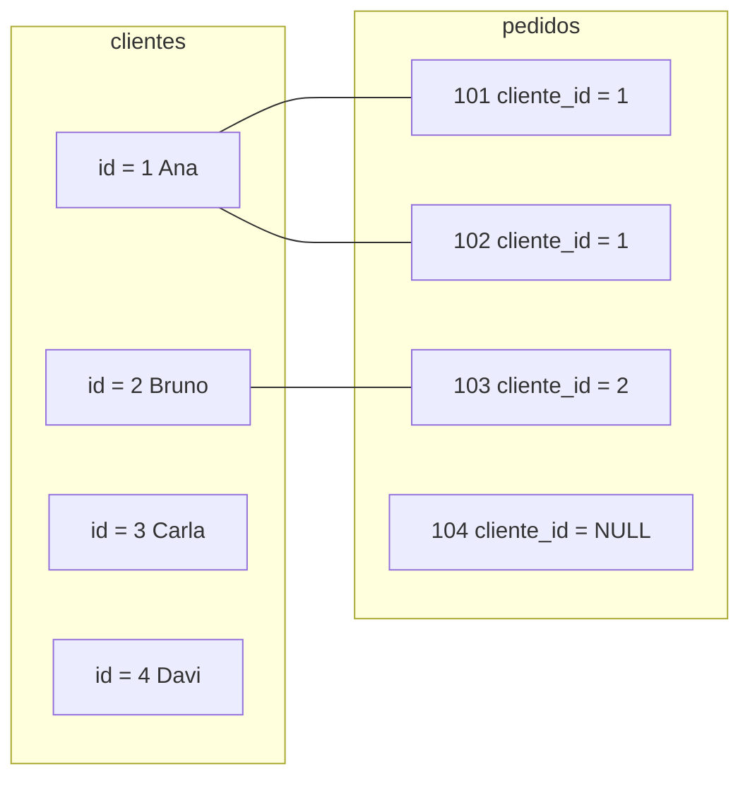

# Joins

Em um banco relacional bem modelado, a informação fica espalhada de propósito: os dados do cliente moram em `clientes`, os pedidos moram em `pedidos`, e a ligação entre os dois é a coluna `cliente_id` (a chave estrangeira vista em [Constraints, chaves e relacionamentos](/labs/data/sql/03-constraints-chaves-e-relacionamentos/)). Um **join** é a forma de juntar essas peças de volta numa consulta só, combinando linhas de tabelas diferentes a partir de uma coluna relacionada. 🧩

## Dados de exemplo

Para os resultados ficarem fáceis de conferir, vamos usar poucas linhas:

**clientes**

| id  | nome       | cidade    |
| --- | ---------- | --------- |
| 1   | Ana Souza  | Fortaleza |
| 2   | Bruno Lima | Recife    |
| 3   | Carla Dias | Fortaleza |
| 4   | Davi Rocha | Natal     |

**pedidos**

| id  | cliente_id | valor_total |
| --- | ---------- | ----------- |
| 101 | 1          | 250.00      |
| 102 | 1          | 90.00       |
| 103 | 2          | 400.00      |
| 104 | NULL       | 60.00       |

Repare: Carla e Davi ainda não compraram nada, e o pedido 104 foi uma venda de balcão, sem cliente cadastrado. São justamente esses casos "sem par" que diferenciam um tipo de join do outro.

## Anatomia de um join

```sql
SELECT c.nome, p.id AS pedido, p.valor_total
FROM clientes AS c
JOIN pedidos  AS p
  ON p.cliente_id = c.id;
```

- `FROM clientes AS c` define a tabela da esquerda e dá a ela um **alias** curto (`c`).
- `JOIN pedidos AS p` traz a tabela da direita, com alias `p`.
- `ON p.cliente_id = c.id` é a **condição de junção**: diz quais linhas de uma tabela combinam com quais da outra.

Os aliases não são obrigatórios, mas viram necessidade rápido: quando duas tabelas têm uma coluna com o mesmo nome (`id`, por exemplo), você precisa dizer de qual delas está falando. Escrever `c.id` e `p.id` deixa isso claro. No SQL Server e no PostgreSQL o `AS` antes do alias de tabela é opcional; no Oracle ele nem é aceito para tabelas, então muita gente simplesmente omite: `FROM clientes c`.



## INNER JOIN

O `INNER JOIN` devolve só as linhas que **têm par dos dois lados**. Escrever só `JOIN` é a mesma coisa que `INNER JOIN`.

```sql
SELECT c.nome, p.id AS pedido, p.valor_total
FROM clientes c
INNER JOIN pedidos p ON p.cliente_id = c.id;
```

| nome       | pedido | valor_total |
| ---------- | ------ | ----------- |
| Ana Souza  | 101    | 250.00      |
| Ana Souza  | 102    | 90.00       |
| Bruno Lima | 103    | 400.00      |

Carla e Davi somem (não têm pedido) e o pedido 104 some também (não tem cliente). A Ana aparece duas vezes, uma para cada pedido. Isso é esperado: o join gera uma linha para **cada combinação** que satisfaz o `ON`.

## LEFT JOIN

O `LEFT JOIN` (ou `LEFT OUTER JOIN`) mantém **todas as linhas da tabela da esquerda**. Quando não há par na direita, as colunas da direita vêm como `NULL`.

```sql
SELECT c.nome, p.id AS pedido, p.valor_total
FROM clientes c
LEFT JOIN pedidos p ON p.cliente_id = c.id;
```

| nome       | pedido | valor_total |
| ---------- | ------ | ----------- |
| Ana Souza  | 101    | 250.00      |
| Ana Souza  | 102    | 90.00       |
| Bruno Lima | 103    | 400.00      |
| Carla Dias | NULL   | NULL        |
| Davi Rocha | NULL   | NULL        |

Esse é provavelmente o join mais usado em análise, porque responde perguntas do tipo "todos os clientes, com ou sem compra".

### Encontrando quem não tem par

Um padrão que vale decorar: `LEFT JOIN` + `WHERE coluna_da_direita IS NULL` encontra as linhas da esquerda **sem correspondência**. É o chamado anti-join.

```sql
-- Clientes que nunca fizeram pedido
SELECT c.nome
FROM clientes c
LEFT JOIN pedidos p ON p.cliente_id = c.id
WHERE p.id IS NULL;
```

Resultado: Carla Dias e Davi Rocha. Teste o `IS NULL` numa coluna que nunca é nula na tabela da direita (a chave primária é a escolha segura). A mesma pergunta pode ser feita com `NOT EXISTS`, que aparece em [Subqueries e operadores de conjunto](/labs/data/sql/10-subqueries-e-operadores-de-conjunto/).

### Contando com LEFT JOIN

Quando você agrega depois de um `LEFT JOIN`, a diferença entre `COUNT(*)` e `COUNT(coluna)` (vista em [Agregações, GROUP BY e HAVING](/labs/data/sql/08-agregacoes-group-by-e-having/)) passa a importar muito:

```sql
SELECT c.nome,
       COUNT(*)    AS errado,       -- Carla e Davi aparecem com 1
       COUNT(p.id) AS pedidos       -- Carla e Davi aparecem com 0
FROM clientes c
LEFT JOIN pedidos p ON p.cliente_id = c.id
GROUP BY c.id, c.nome;
```

`COUNT(*)` conta a linha "vazia" que o `LEFT JOIN` criou para Carla e Davi. `COUNT(p.id)` ignora o `NULL` e dá o número certo.

### Filtro no ON x filtro no WHERE

Com `INNER JOIN` tanto faz colocar uma condição extra no `ON` ou no `WHERE`. Com `LEFT JOIN`, **muda o resultado**:

```sql
-- A) Filtro no ON: mantém todos os clientes, junta só pedidos acima de 100
SELECT c.nome, p.id
FROM clientes c
LEFT JOIN pedidos p ON p.cliente_id = c.id AND p.valor_total > 100;

-- B) Filtro no WHERE: o filtro roda depois do join e descarta as linhas com p NULL
SELECT c.nome, p.id
FROM clientes c
LEFT JOIN pedidos p ON p.cliente_id = c.id
WHERE p.valor_total > 100;
```

A consulta A devolve os quatro clientes (Ana com o pedido 101, Bruno com o 103, Carla e Davi com `NULL`). A consulta B devolve só Ana e Bruno, porque `NULL > 100` não é verdadeiro e as linhas de Carla e Davi caem no `WHERE`. Na prática, B virou um `INNER JOIN` disfarçado. Esse é um dos bugs mais comuns em relatórios.

## RIGHT JOIN

O `RIGHT JOIN` é o espelho do `LEFT`: mantém todas as linhas da tabela da **direita**.

```sql
SELECT c.nome, p.id AS pedido, p.valor_total
FROM clientes c
RIGHT JOIN pedidos p ON p.cliente_id = c.id;
```

| nome       | pedido | valor_total |
| ---------- | ------ | ----------- |
| Ana Souza  | 101    | 250.00      |
| Ana Souza  | 102    | 90.00       |
| Bruno Lima | 103    | 400.00      |
| NULL       | 104    | 60.00       |

Todo `RIGHT JOIN` pode ser reescrito como `LEFT JOIN` trocando a ordem das tabelas (`FROM pedidos p LEFT JOIN clientes c ...`). Muita equipe prefere usar só `LEFT` para que todas as consultas sejam lidas no mesmo sentido.

## FULL OUTER JOIN

O `FULL OUTER JOIN` (ou `FULL JOIN`) mantém **tudo dos dois lados**: as linhas com par, as da esquerda sem par e as da direita sem par.

```sql
SELECT c.nome, p.id AS pedido, p.valor_total
FROM clientes c
FULL OUTER JOIN pedidos p ON p.cliente_id = c.id;
```

| nome       | pedido | valor_total |
| ---------- | ------ | ----------- |
| Ana Souza  | 101    | 250.00      |
| Ana Souza  | 102    | 90.00       |
| Bruno Lima | 103    | 400.00      |
| Carla Dias | NULL   | NULL        |
| Davi Rocha | NULL   | NULL        |
| NULL       | 104    | 60.00       |

É útil para reconciliar duas fontes ("o que existe em uma e não na outra?"). O detalhe é que **o MySQL não tem `FULL OUTER JOIN`**. Lá, a saída é combinar um `LEFT` e um `RIGHT` com `UNION` (operador explicado em [Subqueries e operadores de conjunto](/labs/data/sql/10-subqueries-e-operadores-de-conjunto/)):

| SGBD       | FULL OUTER JOIN                                                                                                                                |
| ---------- | ---------------------------------------------------------------------------------------------------------------------------------------------- |
| PostgreSQL | Suportado: `FROM clientes c FULL JOIN pedidos p ON ...`                                                                                        |
| SQL Server | Suportado: `FROM clientes c FULL OUTER JOIN pedidos p ON ...`                                                                                  |
| MySQL      | Não suportado. Simule com `SELECT ... FROM clientes c LEFT JOIN pedidos p ON ... UNION SELECT ... FROM clientes c RIGHT JOIN pedidos p ON ...` |

Na simulação do MySQL, o `UNION` remove as linhas repetidas que aparecem nas duas metades (os pares encontrados). Se as linhas legítimas puderem se repetir, a versão segura usa `UNION ALL` e, na segunda metade, filtra só quem não tem par (`WHERE c.id IS NULL`).

## CROSS JOIN

O `CROSS JOIN` combina **cada linha de uma tabela com cada linha da outra**, sem condição. É o produto cartesiano: 4 clientes x 10 produtos = 40 linhas.

```sql
-- Todas as combinações cliente x produto (base para uma matriz de recomendação)
SELECT c.nome, pr.nome AS produto
FROM clientes c
CROSS JOIN produtos pr;
```

Use com consciência: duas tabelas de 10 mil linhas geram 100 milhões de combinações. Casos legítimos incluem gerar todas as combinações de dimensões (loja x mês, por exemplo) para depois preencher com `LEFT JOIN` os meses sem venda.

Um aviso: esquecer o `ON`, ou escrever um `ON` que sempre é verdadeiro, produz um produto cartesiano sem querer. Se o número de linhas do resultado explodiu, desconfie da condição de junção.

## Self join: a tabela com ela mesma

Self join é juntar **uma tabela a ela mesma**. O exemplo clássico é a hierarquia de funcionários, em que `manager_id` aponta para o `id` de outro funcionário da mesma tabela:

| id  | nome  | manager_id |
| --- | ----- | ---------- |
| 1   | Ana   | NULL       |
| 2   | Bruno | 1          |
| 3   | Carla | 1          |
| 4   | Diego | 1          |
| 5   | Elisa | 4          |
| 6   | Fábio | 1          |

O truque é usar dois aliases, como se fossem duas cópias da tabela: `f` para o funcionário e `g` para o gerente.

```sql
SELECT f.nome AS funcionario,
       g.nome AS gerente
FROM funcionarios f
LEFT JOIN funcionarios g ON f.manager_id = g.id;
```

| funcionario | gerente |
| ----------- | ------- |
| Ana         | NULL    |
| Bruno       | Ana     |
| Carla       | Ana     |
| Diego       | Ana     |
| Elisa       | Diego   |
| Fábio       | Ana     |

O `LEFT JOIN` é proposital: a Ana é a diretora e não tem gestor. Com `INNER JOIN` ela desapareceria do resultado.

Dá para subir mais um nível juntando a tabela uma terceira vez:

```sql
SELECT f.nome AS funcionario,
       g.nome AS gerente,
       gg.nome AS gerente_do_gerente
FROM funcionarios f
LEFT JOIN funcionarios g  ON f.manager_id = g.id
LEFT JOIN funcionarios gg ON g.manager_id = gg.id;
```

Para a Elisa, o resultado é Diego como gerente e Ana como gerente do gerente. Para hierarquias de profundidade variável, a ferramenta certa é uma CTE recursiva (`WITH RECURSIVE`), que fica para um nível mais avançado.

## Juntando a mesma tabela duas vezes

Um caso parecido, mas diferente: uma tabela intermediária com **duas chaves estrangeiras apontando para a mesma tabela**. Imagine um programa de mentoria:

```sql
CREATE TABLE mentorias (
    mentor_id    INT NOT NULL REFERENCES funcionarios(id),
    mentorado_id INT NOT NULL REFERENCES funcionarios(id),
    PRIMARY KEY (mentor_id, mentorado_id)
);
-- Ana mentora Bruno; Diego mentora Elisa
INSERT INTO mentorias VALUES (1, 2), (4, 5);
```

Para mostrar os nomes, você junta `funcionarios` duas vezes, cada uma com um papel:

```sql
SELECT mentor.nome    AS mentor,
       mentorado.nome AS mentorado
FROM mentorias m
JOIN funcionarios mentor    ON m.mentor_id    = mentor.id
JOIN funcionarios mentorado ON m.mentorado_id = mentorado.id;
```

| mentor | mentorado |
| ------ | --------- |
| Ana    | Bruno     |
| Diego  | Elisa     |

Esse padrão às vezes é chamado de self join em material de estudo, mas o nome não é bem esse: aqui são três tabelas no join (`mentorias` e duas "cópias" de `funcionarios`), e a ligação passa pela tabela intermediária. No self join de verdade, a própria tabela tem a coluna que aponta para ela mesma. O mecanismo (aliases diferentes para a mesma tabela) é o mesmo nos dois casos. O exemplo também mostra que joins se encadeiam: cada novo `JOIN ... ON` junta mais uma tabela ao resultado acumulado.

## Atalhos de sintaxe e variações por SGBD

Além da forma `JOIN ... ON`, existem outras que você vai encontrar em código alheio:

```sql
-- USING: quando a coluna tem o mesmo nome nas duas tabelas
-- (imagine uma tabela entregas com uma coluna pedido_id, e pedidos também com pedido_id)
SELECT * FROM pedidos JOIN entregas USING (pedido_id);

-- Join implícito com vírgula (sintaxe antiga, equivale a INNER JOIN)
SELECT c.nome, p.id
FROM clientes c, pedidos p
WHERE p.cliente_id = c.id;
```

| Recurso                | MySQL | PostgreSQL | SQL Server |
| ---------------------- | ----- | ---------- | ---------- |
| `INNER`/`LEFT`/`RIGHT` | Sim   | Sim        | Sim        |
| `FULL OUTER JOIN`      | Não   | Sim        | Sim        |
| `CROSS JOIN`           | Sim   | Sim        | Sim        |
| `USING (coluna)`       | Sim   | Sim        | Não        |
| `NATURAL JOIN`         | Sim   | Sim        | Não        |

Prefira `JOIN ... ON` explícito. O join com vírgula mistura condição de junção com filtro no `WHERE`, e basta esquecer uma linha para gerar um produto cartesiano. O `NATURAL JOIN` junta automaticamente por todas as colunas de mesmo nome, o que quebra em silêncio quando alguém adiciona uma coluna `criado_em` nas duas tabelas.

## Referências

- [Junções (SQL Server)](https://learn.microsoft.com/pt-br/sql/relational-databases/performance/joins) - Microsoft Learn, pt-BR
- [Junções entre tabelas (tutorial)](https://halleyoliv.gitlab.io/pgdocptbr/tutorial-join.html) - tradução da documentação do PostgreSQL por Halley Pacheco de Oliveira, pt-BR
- [JOIN Clause](https://dev.mysql.com/doc/refman/8.4/en/join.html) - Oracle/MySQL, en
- [Table Expressions (joined tables)](https://www.postgresql.org/docs/current/queries-table-expressions.html) - PostgreSQL Global Development Group, en
