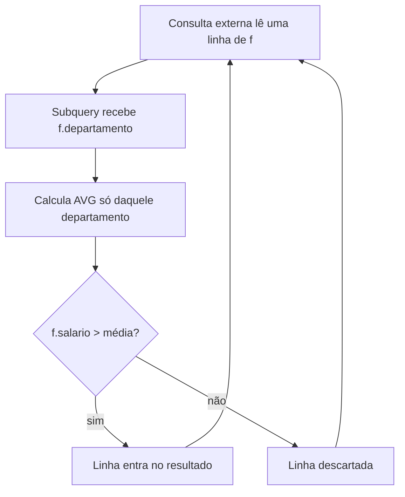
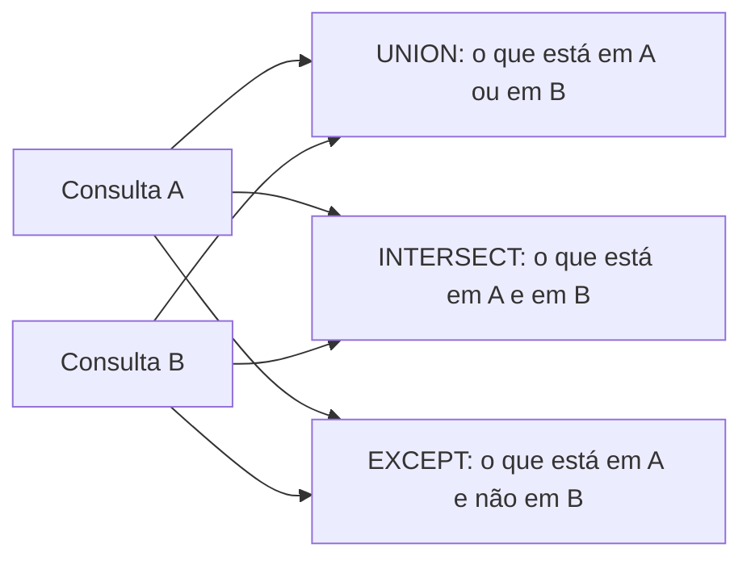

# Subqueries e operadores de conjunto

Algumas perguntas não cabem numa consulta "plana". "Quem ganha acima da média?" exige saber a média antes. "Quais clientes nunca compraram?" exige olhar para outra tabela sem trazer as linhas dela. Para isso existem as **subqueries** (consultas dentro de consultas). Na segunda parte da nota entram os **operadores de conjunto** (`UNION`, `INTERSECT`, `EXCEPT`), que combinam o resultado de consultas inteiras, empilhando ou comparando linhas. 🪆

Os exemplos usam as mesmas tabelas e dados de [Agregações, GROUP BY e HAVING](/labs/data/sql/08-agregacoes-group-by-e-having/) (funcionários) e de [Joins](/labs/data/sql/09-joins/) (clientes e pedidos). Vale lembrar alguns detalhes desses dados: a Carla não tem salário cadastrado, o Fábio não tem departamento, e o pedido 104 tem `cliente_id` nulo.

## O que é uma subquery

Uma subquery é um `SELECT` entre parênteses usado dentro de outra instrução. O banco resolve a de dentro e usa o resultado na de fora.

```sql
SELECT nome, salario
FROM funcionarios
WHERE salario > (SELECT AVG(salario) FROM funcionarios);
```

A subquery calcula a média (5400, lembrando que o `NULL` da Carla fica de fora) e a consulta externa filtra quem ganha mais que isso: Ana (9000) e Bruno (6000).

Subqueries podem aparecer em vários lugares, e o tipo de resultado que elas devolvem define onde podem ser usadas:

| Tipo de subquery      | Devolve                 | Onde costuma aparecer                    |
| --------------------- | ----------------------- | ---------------------------------------- |
| Escalar               | 1 linha, 1 coluna       | `SELECT`, `WHERE` com `=`, `>`, `<` etc. |
| De lista (uma coluna) | N linhas, 1 coluna      | `WHERE ... IN (...)`, `ANY`, `ALL`       |
| De tabela             | N linhas, N colunas     | `FROM` (tabela derivada)                 |
| De existência         | Só importa se há linhas | `WHERE EXISTS (...)`                     |

## Subquery escalar

Uma subquery escalar devolve **exatamente um valor**. Por isso pode ser comparada com `=`, `>`, `<`, ou aparecer como coluna no `SELECT`:

```sql
SELECT nome,
       salario,
       salario - (SELECT AVG(salario) FROM funcionarios) AS diferenca_da_media
FROM funcionarios;
```

Dois cuidados:

- Se a subquery devolver **mais de uma linha**, o banco dá erro em tempo de execução (algo como "subquery returns more than 1 row"). Uma consulta que funciona hoje pode quebrar amanhã quando aparecer uma segunda linha. Funções de agregação sem `GROUP BY` sempre devolvem uma linha, então são uma aposta segura.
- Se a subquery devolver **nenhuma linha**, o resultado é `NULL`, e a comparação com `NULL` não é verdadeira. A linha some do resultado sem erro nenhum.

Um caso clássico de entrevista é "quem tem o maior salário?". Com subquery, empates aparecem naturalmente:

```sql
SELECT nome, salario
FROM funcionarios
WHERE salario = (SELECT MAX(salario) FROM funcionarios);
```

Já `ORDER BY salario DESC LIMIT 1` traz uma única pessoa mesmo que duas empatem no topo.

## Subquery com IN

Quando a subquery devolve uma **lista de valores** (uma coluna, várias linhas), use `IN`:

```sql
-- Clientes que fizeram pelo menos um pedido acima de 200
SELECT nome
FROM clientes
WHERE id IN (SELECT cliente_id FROM pedidos WHERE valor_total > 200);
```

Resultado: Ana Souza e Bruno Lima. Diferente de um `JOIN`, o `IN` não duplica o cliente quando ele tem vários pedidos que batem com o filtro.

### Armadilha: NOT IN com NULL

Esta é das boas. Tente listar os clientes sem pedido com `NOT IN`:

```sql
SELECT nome
FROM clientes
WHERE id NOT IN (SELECT cliente_id FROM pedidos);
```

Você esperaria Carla e Davi. O resultado é **vazio**. 😱

O motivo é o pedido 104, com `cliente_id` nulo. A lista da subquery fica `(1, 1, 2, NULL)`, e `3 NOT IN (1, 1, 2, NULL)` equivale a `3 <> 1 AND 3 <> 1 AND 3 <> 2 AND 3 <> NULL`. A última comparação dá `UNKNOWN` (lógica de três valores do `NULL`), e um `AND` com `UNKNOWN` nunca é verdadeiro. Nenhuma linha passa.

Duas saídas:

```sql
-- 1) Tirar os NULL da lista
WHERE id NOT IN (SELECT cliente_id FROM pedidos WHERE cliente_id IS NOT NULL)

-- 2) Usar NOT EXISTS (recomendado), explicado logo abaixo
```

### ANY e ALL

Menos comuns, mas aparecem: `> ANY (subquery)` é verdadeiro se a comparação vale para **pelo menos um** valor da lista; `> ALL (subquery)` exige que valha para **todos**.

```sql
-- Funcionários que ganham mais que todo mundo de Vendas
SELECT nome
FROM funcionarios
WHERE salario > ALL (SELECT salario FROM funcionarios WHERE departamento = 'Vendas');
```

Resultado: Ana e Bruno (acima de 5000 e de 4000). `= ANY` é o mesmo que `IN`. O mesmo problema do `NULL` vale aqui: se a lista do `ALL` tiver um `NULL`, nada passa.

## Subqueries correlacionadas

Até agora a subquery rodava de forma independente: dava para executá-la sozinha. Uma subquery **correlacionada** referencia uma coluna da consulta externa, então o resultado dela muda para cada linha de fora.

```sql
-- Funcionários que ganham acima da média do PRÓPRIO departamento
SELECT f.nome, f.departamento, f.salario
FROM funcionarios f
WHERE f.salario > (
    SELECT AVG(f2.salario)
    FROM funcionarios f2
    WHERE f2.departamento = f.departamento   -- f vem da consulta externa
);
```

| nome  | departamento | salario |
| ----- | ------------ | ------- |
| Ana   | TI           | 9000.00 |
| Diego | Vendas       | 5000.00 |

Para cada funcionário `f`, a subquery calcula a média do departamento dele: 7500 para TI e 4500 para Vendas. O Fábio, sem departamento, nunca aparece: `f2.departamento = NULL` não casa com ninguém, a média vira `NULL` e a comparação falha.



Conceitualmente a subquery roda uma vez por linha externa, mas os otimizadores modernos costumam reescrever isso como join. Mesmo assim, em tabelas grandes vale comparar com a versão usando tabela derivada (próxima seção) ou window function.

## Subquery no FROM (tabela derivada)

Uma subquery no `FROM` funciona como uma tabela temporária, que existe só durante a consulta. É útil para agregar em duas etapas:

```sql
-- Média dos faturamentos por cliente
SELECT AVG(total_cliente) AS media_por_cliente
FROM (
    SELECT cliente_id, SUM(valor_total) AS total_cliente
    FROM pedidos
    WHERE cliente_id IS NOT NULL
    GROUP BY cliente_id
) AS faturamento;
```

A subquery gera uma linha por cliente (Ana com 340, Bruno com 400) e a consulta externa tira a média dessas linhas (370).

O alias da tabela derivada (`AS faturamento`) é **obrigatório** no MySQL e no SQL Server, e era no PostgreSQL até a versão 15 (ficou opcional na 16). Coloque sempre, que funciona em todo lugar.

Quando a tabela derivada fica grande, uma **CTE** deixa a consulta mais legível. É a mesma ideia, com nome, declarada antes:

```sql
WITH faturamento AS (
    SELECT cliente_id, SUM(valor_total) AS total_cliente
    FROM pedidos
    WHERE cliente_id IS NOT NULL
    GROUP BY cliente_id
)
SELECT AVG(total_cliente) AS media_por_cliente
FROM faturamento;
```

`WITH` funciona em PostgreSQL, SQL Server e MySQL 8.0 ou mais recente.

## EXISTS e NOT EXISTS

`EXISTS (subquery)` é verdadeiro se a subquery devolver **pelo menos uma linha**. O conteúdo das linhas não importa, por isso é comum escrever `SELECT 1` dentro.

```sql
-- Clientes com pelo menos um pedido
SELECT c.nome
FROM clientes c
WHERE EXISTS (
    SELECT 1 FROM pedidos p WHERE p.cliente_id = c.id
);

-- Clientes sem nenhum pedido
SELECT c.nome
FROM clientes c
WHERE NOT EXISTS (
    SELECT 1 FROM pedidos p WHERE p.cliente_id = c.id
);
```

O primeiro devolve Ana e Bruno; o segundo, Carla e Davi. Repare que o `NOT EXISTS` acerta mesmo com o pedido 104 de `cliente_id` nulo, ao contrário do `NOT IN` lá de cima. Isso acontece porque `EXISTS` só devolve verdadeiro ou falso, nunca `UNKNOWN`.

`EXISTS` quase sempre é correlacionado (a subquery referencia a linha externa) e o banco pode parar de procurar assim que encontra a primeira linha.

### IN, EXISTS ou JOIN?

As três formas resolvem "clientes que têm pedido", com diferenças:

| Forma    | Duplica linhas?     | Lida bem com NULL?          | Quando preferir                                   |
| -------- | ------------------- | --------------------------- | ------------------------------------------------- |
| `JOIN`   | Sim, uma por pedido | Sim                         | Quando você precisa de colunas das duas tabelas   |
| `IN`     | Não                 | `NOT IN` quebra com `NULL`  | Listas pequenas ou valores fixos                  |
| `EXISTS` | Não                 | Sim, inclusive `NOT EXISTS` | Testes de existência, principalmente "não existe" |

Em desempenho, os otimizadores atuais de PostgreSQL, SQL Server e MySQL 8 costumam gerar planos equivalentes para `IN` e `EXISTS`. Escolha pela clareza e pela semântica, e confirme com `EXPLAIN` se a consulta estiver lenta (veja [Views, índices e triggers](/labs/data/sql/11-views-indices-e-triggers/)).

> ℹ️ Restrição do MySQL: ele não aceita `LIMIT` dentro de subquery usada com `IN`, `ALL`, `ANY` ou `SOME`. Se precisar, envolva a subquery em uma tabela derivada.

## Operadores de conjunto

Joins combinam tabelas **lado a lado** (mais colunas). Operadores de conjunto combinam resultados **um embaixo do outro** (mais ou menos linhas), tratando cada resultado como um conjunto.



Regras que valem para todos:

- As consultas precisam ter o **mesmo número de colunas**, na **mesma ordem**, com **tipos compatíveis**.
- Os **nomes das colunas** do resultado vêm da primeira consulta.
- `ORDER BY` só pode aparecer **uma vez, no final**, e ordena o resultado combinado.
- Para comparar linhas, `NULL` é tratado como igual a `NULL` (diferente do `=` no `WHERE`).

### UNION x UNION ALL

`UNION` junta os resultados e **remove linhas duplicadas**. `UNION ALL` junta e **mantém tudo**.

```sql
-- Lista única de contatos da empresa
SELECT nome, 'cliente' AS tipo FROM clientes
UNION ALL
SELECT nome, 'funcionario' AS tipo FROM funcionarios
ORDER BY nome;
```

Aqui `UNION ALL` é a escolha certa: a coluna `tipo` já garante que não haverá duplicata entre as duas partes, e remover duplicatas tem custo, porque o banco precisa ordenar ou montar um hash de todas as linhas para comparar. Use `UNION` quando você quer, de fato, eliminar repetições:

```sql
-- Cidades onde a empresa tem clientes ou lojas, sem repetição
-- (imagine uma tabela lojas com uma coluna cidade)
SELECT cidade FROM clientes
UNION
SELECT cidade FROM lojas;
```

Regra prática: comece pensando em `UNION ALL` e só troque por `UNION` se duplicatas forem um problema real.

### INTERSECT

`INTERSECT` devolve as linhas que aparecem **nos dois** resultados. Um uso analítico típico é retenção:

```sql
-- Clientes que compraram em 2025 E voltaram a comprar em 2026
SELECT cliente_id FROM pedidos WHERE data_pedido BETWEEN '2025-01-01' AND '2025-12-31'
INTERSECT
SELECT cliente_id FROM pedidos WHERE data_pedido BETWEEN '2026-01-01' AND '2026-12-31';
```

### EXCEPT

`EXCEPT` devolve as linhas do primeiro resultado que **não aparecem** no segundo. A ordem das consultas importa: `A EXCEPT B` é diferente de `B EXCEPT A`.

```sql
-- Clientes que compraram em 2025 e NÃO voltaram em 2026 (candidatos a churn)
SELECT cliente_id FROM pedidos WHERE data_pedido BETWEEN '2025-01-01' AND '2025-12-31'
EXCEPT
SELECT cliente_id FROM pedidos WHERE data_pedido BETWEEN '2026-01-01' AND '2026-12-31';
```

`EXCEPT` faz o mesmo trabalho de um `NOT EXISTS`, mas compara a linha inteira e já trata `NULL` como igual. Para comparar duas tabelas com as mesmas colunas ("o que mudou entre a carga de ontem e a de hoje?"), ele é bem mais curto.

Quando há vários operadores na mesma consulta, `INTERSECT` tem precedência maior que `UNION` e `EXCEPT`, que são avaliados da esquerda para a direita. Use parênteses para deixar a intenção explícita.

### Suporte por SGBD

| Recurso                        | MySQL                   | PostgreSQL | SQL Server |
| ------------------------------ | ----------------------- | ---------- | ---------- |
| `UNION` / `UNION ALL`          | Sim                     | Sim        | Sim        |
| `INTERSECT` / `EXCEPT`         | Sim, a partir da 8.0.31 | Sim        | Sim        |
| `INTERSECT ALL` / `EXCEPT ALL` | Sim, a partir da 8.0.31 | Sim        | Não        |

No Oracle, o `EXCEPT` se chamava historicamente `MINUS` (que continua aceito). Em versões do MySQL anteriores à 8.0.31, a saída é reescrever `INTERSECT` com `EXISTS` (ou `IN`) e `EXCEPT` com `NOT EXISTS`.

## Referências

- [Subconsultas (SQL Server)](https://learn.microsoft.com/pt-br/sql/relational-databases/performance/subqueries) - Microsoft Learn, pt-BR
- [Operadores de conjunto - EXCEPT e INTERSECT (Transact-SQL)](https://learn.microsoft.com/pt-br/sql/t-sql/language-elements/set-operators-except-and-intersect-transact-sql) - Microsoft Learn, pt-BR
- [Operadores de conjunto - UNION (Transact-SQL)](https://learn.microsoft.com/pt-br/sql/t-sql/language-elements/set-operators-union-transact-sql) - Microsoft Learn, pt-BR
- [Subquery Expressions](https://www.postgresql.org/docs/current/functions-subquery.html) - PostgreSQL Global Development Group, en
- [Combining Queries (UNION, INTERSECT, EXCEPT)](https://www.postgresql.org/docs/current/queries-union.html) - PostgreSQL Global Development Group, en
