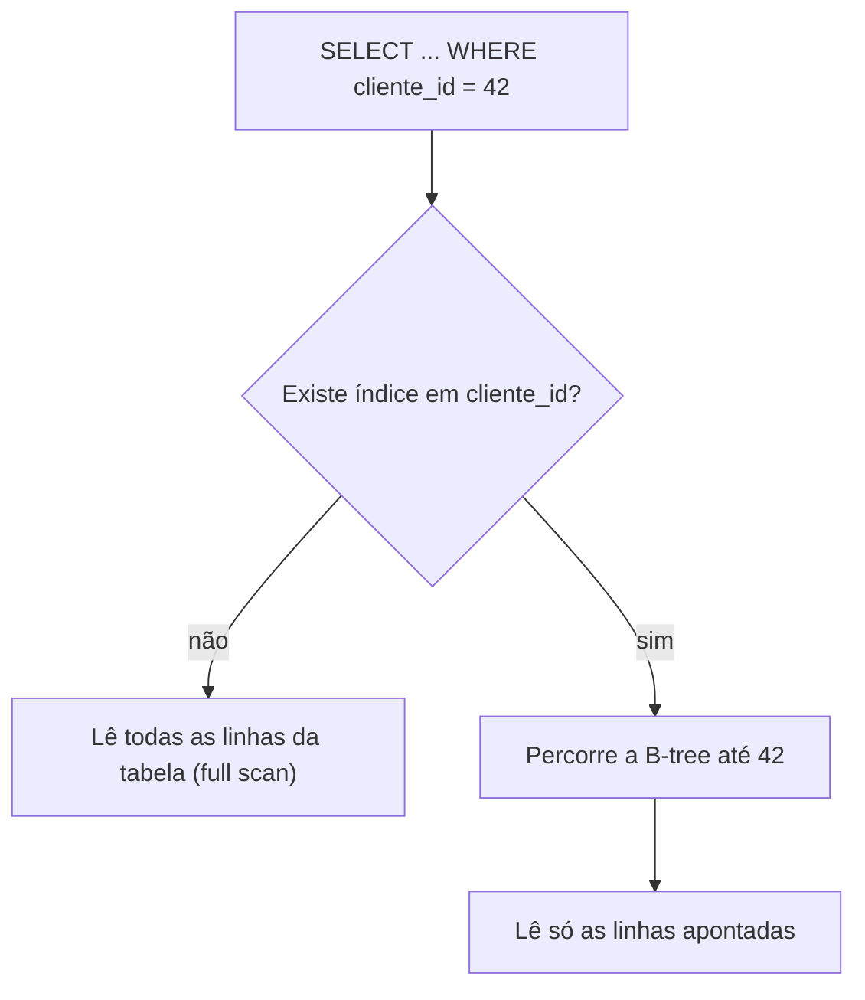
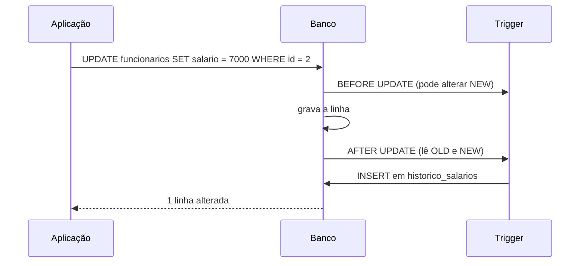

# Views, índices e triggers

Esta nota junta três objetos que vivem dentro do banco, ao lado das tabelas, e que mudam a forma como você consulta e protege os dados:

- **views** guardam uma consulta com nome, para reaproveitar e controlar o que cada um enxerga;
- **índices** são estruturas auxiliares que deixam buscas e ordenações mais rápidas;
- **triggers** são rotinas que o banco executa sozinho quando uma tabela sofre `INSERT`, `UPDATE` ou `DELETE`.

Os três têm sintaxe parecida no núcleo e diferenças importantes entre MySQL, PostgreSQL e SQL Server, que aparecem nos quadros ao longo da nota. Os exemplos usam as tabelas `clientes`, `pedidos` e `funcionarios` das notas anteriores.

## Views

Uma **view** é uma consulta armazenada no banco com um nome. Depois de criada, você a usa no `FROM` como se fosse uma tabela, por isso o apelido de "tabela virtual". Uma view comum **não guarda dados**: toda vez que alguém a consulta, o banco executa a consulta por trás dela e devolve o resultado atual.

```sql
CREATE VIEW vw_faturamento_por_cliente AS
SELECT c.id,
       c.nome,
       c.cidade,
       COUNT(p.id)                     AS pedidos,
       COALESCE(SUM(p.valor_total), 0) AS faturamento
FROM clientes c
LEFT JOIN pedidos p ON p.cliente_id = c.id
GROUP BY c.id, c.nome, c.cidade;
```

A partir daí, quem precisa do relatório escreve uma consulta curta, sem repetir o join e o agrupamento (vistos em [Joins](/labs/data/sql/09-joins/) e em [Agregações, GROUP BY e HAVING](/labs/data/sql/08-agregacoes-group-by-e-having/)):

```sql
SELECT nome, faturamento
FROM vw_faturamento_por_cliente
WHERE cidade = 'Fortaleza'
ORDER BY faturamento DESC;
```

### Para que servem

- **Simplificar**: uma consulta com cinco joins vira um nome legível, e a regra de negócio ("pedido cancelado não conta como faturamento") fica escrita num lugar só.
- **Segurança**: você pode dar acesso à view sem dar acesso à tabela. Uma view `vw_funcionarios_publico` com `id`, `nome` e `departamento`, sem a coluna `salario`, permite que um time consulte o organograma sem ver salários (permissões com `GRANT` aparecem em [Transações e ACID](/labs/data/sql/13-transacoes-e-acid/)).
- **Estabilidade**: se a estrutura das tabelas mudar, você ajusta a view e as consultas que dependem dela continuam funcionando.

### Alterando e removendo

```sql
-- Recria a view com a nova definição (MySQL e PostgreSQL)
CREATE OR REPLACE VIEW vw_funcionarios_publico AS      -- SQL Server 2016 SP1+: CREATE OR ALTER VIEW
SELECT id, nome, departamento
FROM funcionarios;

DROP VIEW IF EXISTS vw_funcionarios_publico;
```

| Operação        | MySQL                    | PostgreSQL                 | SQL Server                    |
| --------------- | ------------------------ | -------------------------- | ----------------------------- |
| Criar ou trocar | `CREATE OR REPLACE VIEW` | `CREATE OR REPLACE VIEW`\* | `CREATE OR ALTER VIEW`        |
| Alterar         | `ALTER VIEW`             | `CREATE OR REPLACE VIEW`\* | `ALTER VIEW`                  |
| Remover         | `DROP VIEW IF EXISTS`    | `DROP VIEW IF EXISTS`      | `DROP VIEW IF EXISTS` (2016+) |

\* No PostgreSQL, `CREATE OR REPLACE VIEW` só aceita **adicionar colunas no final**. Para remover ou renomear colunas da view, é preciso `DROP VIEW` e criar de novo.

### Views atualizáveis

Algumas views aceitam `INSERT`, `UPDATE` e `DELETE`, que o banco repassa para a tabela de origem. Em geral, isso só funciona com views **simples**: baseadas em uma única tabela (ou, no SQL Server e no MySQL, alterando colunas de uma tabela só), sem agregação, `DISTINCT`, `GROUP BY`, `HAVING`, `UNION` ou `LIMIT`. Cada linha da view precisa corresponder a exatamente uma linha da tabela, senão o banco não sabe o que alterar.

```sql
CREATE VIEW vw_funcionarios_ti AS
SELECT id, nome, departamento, salario
FROM funcionarios
WHERE departamento = 'TI'
WITH CHECK OPTION;

-- Funciona: a linha alterada continua satisfazendo o WHERE da view
UPDATE vw_funcionarios_ti SET salario = 6500 WHERE id = 2;

-- Rejeitado por causa do WITH CHECK OPTION: a linha "sumiria" da view
UPDATE vw_funcionarios_ti SET departamento = 'Vendas' WHERE id = 2;
```

O `WITH CHECK OPTION` impede alterações que tirariam a linha do filtro da view. Sem ele, o segundo `UPDATE` passaria e o Bruno simplesmente desapareceria de `vw_funcionarios_ti`.

A `vw_faturamento_por_cliente` lá de cima **não** é atualizável: ela agrega com `GROUP BY`, então uma linha da view resume várias linhas de `pedidos`. Quando você realmente precisa escrever através de uma view complexa, PostgreSQL e SQL Server permitem triggers `INSTEAD OF` (assunto do fim desta nota).

### Views materializadas

Uma **view materializada** guarda o resultado da consulta em disco, como uma tabela. A leitura fica rápida (não refaz joins nem agregações a cada consulta), mas os dados podem ficar desatualizados até a próxima atualização. É a escolha comum para dashboards e relatórios pesados que toleram dados de algumas horas atrás.

| SGBD       | Recurso                      | Como atualiza                                                                      |
| ---------- | ---------------------------- | ---------------------------------------------------------------------------------- |
| PostgreSQL | `CREATE MATERIALIZED VIEW`   | Manual: `REFRESH MATERIALIZED VIEW nome;`                                          |
| SQL Server | Indexed view (view indexada) | Automática: o banco mantém o índice a cada alteração nas tabelas                   |
| MySQL      | Não tem nativo               | Simula-se com uma tabela comum recarregada por um job (`CREATE EVENT`) ou pipeline |

Exemplo no PostgreSQL:

```sql
CREATE MATERIALIZED VIEW mv_faturamento_mensal AS
SELECT date_trunc('month', data_pedido) AS mes,
       SUM(valor_total)                 AS faturamento
FROM pedidos
WHERE status <> 'cancelado'
GROUP BY date_trunc('month', data_pedido);

-- Recalcula tudo (bloqueia leituras durante a atualização)
REFRESH MATERIALIZED VIEW mv_faturamento_mensal;

-- Sem bloquear leituras: exige um índice UNIQUE na view materializada
CREATE UNIQUE INDEX ON mv_faturamento_mensal (mes);
REFRESH MATERIALIZED VIEW CONCURRENTLY mv_faturamento_mensal;
```

No SQL Server, a view precisa ser criada `WITH SCHEMABINDING` (o que impede alterar as tabelas de base de um jeito que a quebre) e recebe um índice clusterizado único. A partir daí, o banco guarda o resultado e o mantém em dia sozinho, com custo extra em cada escrita nas tabelas de origem.

## Índices

Pense no índice remissivo no fim de um livro técnico: em vez de folhear as 400 páginas procurando "chave estrangeira", você vai ao índice, acha o termo em ordem alfabética e pula direto para a página. Um índice de banco é isso: uma **estrutura auxiliar, mantida em ordem**, que aponta para as linhas da tabela. Sem índice, para achar os pedidos do cliente 42 o banco precisa ler a tabela inteira (o chamado _full table scan_).

A estrutura mais comum é a **B-tree** (árvore balanceada), padrão em MySQL/InnoDB, PostgreSQL e SQL Server. Ela é boa para igualdade (`=`), faixas (`>`, `<`, `BETWEEN`), `ORDER BY` e `LIKE 'prefixo%'`.

```sql
-- Mesma sintaxe nos três SGBDs
CREATE INDEX idx_pedidos_cliente ON pedidos (cliente_id);
```



### Clustered x non-clustered

Essa distinção aparece muito em entrevista, e o comportamento depende do SGBD:

- Um índice **clusterizado** (_clustered_) define a **ordem física** em que as linhas da tabela são guardadas. As folhas da árvore _são_ as linhas. Por isso só pode existir **um** por tabela.
- Um índice **não clusterizado** (_non-clustered_, ou secundário) é uma estrutura separada, com a coluna indexada e um ponteiro para a linha. Uma tabela pode ter vários.

| SGBD           | Como funciona                                                                                                                                                                                                     |
| -------------- | ----------------------------------------------------------------------------------------------------------------------------------------------------------------------------------------------------------------- |
| MySQL (InnoDB) | A tabela é sempre organizada pela **chave primária** (índice clusterizado). Sem PK, usa o primeiro `UNIQUE NOT NULL`; sem nenhum, cria uma chave oculta. Índices secundários guardam o valor da PK como ponteiro. |
| SQL Server     | Você escolhe: `CREATE CLUSTERED INDEX` ou `CREATE NONCLUSTERED INDEX`. A `PRIMARY KEY` cria um clusterizado por padrão, se a tabela ainda não tiver um. Tabela sem clusterizado é um _heap_.                      |
| PostgreSQL     | Não tem índice clusterizado mantido automaticamente. A tabela é um _heap_ e todos os índices são secundários. O comando `CLUSTER` reordena a tabela uma vez, mas a ordem não é mantida nas escritas seguintes.    |

Uma consequência prática no MySQL: como todo índice secundário carrega a PK junto, uma PK enorme (um `VARCHAR(255)`, por exemplo) deixa todos os índices maiores. É mais um motivo para usar surrogate keys inteiras (veja [Constraints, chaves e relacionamentos](/labs/data/sql/03-constraints-chaves-e-relacionamentos/)).

### Índices compostos e únicos

Um índice pode ter mais de uma coluna. A **ordem das colunas importa**: o índice abaixo ajuda filtros por `cliente_id` e por `cliente_id` + `data_pedido`, mas não ajuda um filtro só por `data_pedido`, do mesmo jeito que uma lista telefônica ordenada por sobrenome e nome não ajuda a achar todo mundo chamado "Carla".

```sql
CREATE INDEX idx_pedidos_cliente_data ON pedidos (cliente_id, data_pedido);
```

`CREATE UNIQUE INDEX` também garante que não haverá valores repetidos. Na prática, as constraints `PRIMARY KEY` e `UNIQUE` criam um índice único por baixo dos panos, então não é preciso criar outro para elas.

### Quando criar um índice

Bons candidatos:

- colunas de chave estrangeira usadas em joins (`pedidos.cliente_id`); o MySQL cria esse índice sozinho ao declarar a FK, PostgreSQL e SQL Server **não**;
- colunas que aparecem com frequência em `WHERE`, `JOIN`, `ORDER BY` ou `GROUP BY`;
- colunas **seletivas**, em que um filtro devolve uma fração pequena da tabela (CPF, e-mail, data de um dia específico).

Maus candidatos:

- colunas com pouquíssimos valores distintos, como `status` com três opções, quando o filtro traz metade da tabela (o banco tende a preferir o full scan);
- tabelas pequenas, que já cabem inteiras em poucas páginas;
- tabelas com escrita muito intensa e pouca leitura.

E alguns jeitos de escrever a consulta **impedem** o uso do índice, porque o banco precisaria aplicar a função a todas as linhas antes de comparar:

```sql
-- ❌ Não usa índice em data_pedido: a função é aplicada à coluna
WHERE YEAR(data_pedido) = 2026

-- ✅ Usa: compara a coluna "crua" com uma faixa
WHERE data_pedido >= '2026-01-01' AND data_pedido < '2027-01-01'
```

O mesmo vale para `LIKE '%texto'` (curinga no começo) e para conversões de tipo implícitas.

### O custo de um índice

Índice não é de graça:

- **ocupa espaço** em disco e em memória;
- **deixa as escritas mais lentas**: cada `INSERT`, `UPDATE` ou `DELETE` precisa atualizar a tabela e todos os índices afetados;
- precisa de **manutenção** (estatísticas atualizadas, reconstrução em casos de fragmentação).

Por isso a resposta para "a consulta por salário está lenta, o que fazer?" não é só "criar um índice em `salario`". Primeiro, veja o plano de execução e confirme se o filtro é seletivo ou se a consulta ordena por essa coluna. Depois de criar o índice, veja o plano de novo para confirmar que ele está sendo usado.

| SGBD       | Ver o plano de execução                                                                                                               |
| ---------- | ------------------------------------------------------------------------------------------------------------------------------------- |
| MySQL      | `EXPLAIN SELECT ...;` ou `EXPLAIN ANALYZE SELECT ...;` (executa de verdade, 8.0.18+)                                                  |
| PostgreSQL | `EXPLAIN SELECT ...;` ou `EXPLAIN ANALYZE SELECT ...;` (executa de verdade)                                                           |
| SQL Server | No SSMS, "Exibir plano de execução estimado" (Ctrl+L) ou "Incluir plano de execução real" (Ctrl+M); por T-SQL, `SET SHOWPLAN_XML ON;` |

Para remover um índice, a sintaxe muda: `DROP INDEX idx ON tabela;` no MySQL e no SQL Server, `DROP INDEX idx;` no PostgreSQL (lá o nome do índice é único no schema).

## Triggers

Um **trigger** (gatilho) é um bloco de código associado a uma tabela que o banco executa **automaticamente** quando ocorre um `INSERT`, `UPDATE` ou `DELETE` nela. Ninguém chama um trigger diretamente: ele dispara como efeito colateral da escrita.

Usos comuns:

- **auditoria**: gravar quem mudou o quê e quando;
- **histórico**: guardar a versão antiga de uma linha antes de ela mudar ou sumir;
- **validações e ajustes** que constraints não cobrem, como padronizar um e-mail em minúsculas antes de gravar.

### BEFORE e AFTER, OLD e NEW

Dois conceitos aparecem em quase todo trigger:

- **Momento**: `BEFORE` roda antes da alteração ser aplicada (dá para modificar ou barrar os valores); `AFTER` roda depois que a alteração aconteceu (bom para registrar o que de fato ocorreu).
- **Valores da linha**: `OLD` é a linha como era antes da operação, `NEW` é a linha como vai ficar. Em `INSERT` só existe `NEW`; em `DELETE` só existe `OLD`; em `UPDATE` existem os dois.



O trigger roda **dentro da mesma transação** da instrução que o disparou. Se o trigger falhar, a alteração original também é desfeita (mais sobre isso em [Transações e ACID](/labs/data/sql/13-transacoes-e-acid/)).

### Exemplo: histórico de salários

Vamos registrar toda mudança de salário numa tabela de histórico:

```sql
CREATE TABLE historico_salarios (
    id              INT AUTO_INCREMENT PRIMARY KEY,  -- MySQL; PostgreSQL: INT GENERATED ALWAYS AS IDENTITY PRIMARY KEY; SQL Server: INT IDENTITY PRIMARY KEY
    funcionario_id  INT NOT NULL,
    salario_antigo  DECIMAL(10,2),
    salario_novo    DECIMAL(10,2),
    alterado_em     TIMESTAMP NOT NULL    -- SQL Server: DATETIME2 (lá TIMESTAMP não é data/hora)
);
```

A ideia é a mesma nos três bancos, mas a sintaxe é bem diferente.

**MySQL**: o corpo vai direto no `CREATE TRIGGER`, e `FOR EACH ROW` é obrigatório (o MySQL só tem triggers por linha). Clientes como o `mysql` e o Workbench precisam do `DELIMITER` para não confundir o `;` de dentro do bloco com o fim do comando.

```sql
DELIMITER //
CREATE TRIGGER trg_funcionarios_salario
AFTER UPDATE ON funcionarios
FOR EACH ROW
BEGIN
    IF NOT (OLD.salario <=> NEW.salario) THEN    -- <=> compara tratando NULL como valor
        INSERT INTO historico_salarios (funcionario_id, salario_antigo, salario_novo, alterado_em)
        VALUES (OLD.id, OLD.salario, NEW.salario, NOW());
    END IF;
END//
DELIMITER ;
```

**PostgreSQL**: primeiro se cria uma **função de trigger** (que devolve o tipo `trigger`) e depois o trigger que a chama. O PostgreSQL aceita `FOR EACH ROW` e `FOR EACH STATEMENT`.

```sql
CREATE OR REPLACE FUNCTION fn_registra_salario() RETURNS trigger AS $$
BEGIN
    IF OLD.salario IS DISTINCT FROM NEW.salario THEN
        INSERT INTO historico_salarios (funcionario_id, salario_antigo, salario_novo, alterado_em)
        VALUES (OLD.id, OLD.salario, NEW.salario, now());
    END IF;
    RETURN NEW;   -- em AFTER o retorno é ignorado; em BEFORE, devolver NULL cancela a operação
END;
$$ LANGUAGE plpgsql;

CREATE TRIGGER trg_funcionarios_salario
AFTER UPDATE ON funcionarios
FOR EACH ROW
EXECUTE FUNCTION fn_registra_salario();   -- antes da versão 11: EXECUTE PROCEDURE
```

**SQL Server**: não existe `BEFORE`, nem `OLD`/`NEW`. O trigger dispara **uma vez por instrução** (não por linha) e enxerga as tabelas virtuais `deleted` (valores antigos) e `inserted` (valores novos), que podem ter várias linhas. Por isso o código é escrito como um join entre elas:

```sql
CREATE OR ALTER TRIGGER trg_funcionarios_salario
ON funcionarios
AFTER UPDATE
AS
BEGIN
    SET NOCOUNT ON;
    INSERT INTO historico_salarios (funcionario_id, salario_antigo, salario_novo, alterado_em)
    SELECT d.id, d.salario, i.salario, SYSDATETIME()
    FROM deleted d
    JOIN inserted i ON i.id = d.id
    WHERE EXISTS (SELECT d.salario EXCEPT SELECT i.salario);  -- "mudou?", tratando NULL
END;
```

O `EXISTS (SELECT ... EXCEPT SELECT ...)` é um jeito idiomático de comparar valores que podem ser `NULL`, já que o `EXCEPT` trata `NULL` como igual a `NULL` (veja [Subqueries e operadores de conjunto](/labs/data/sql/10-subqueries-e-operadores-de-conjunto/)).

| Característica     | MySQL                | PostgreSQL                                  | SQL Server                       |
| ------------------ | -------------------- | ------------------------------------------- | -------------------------------- |
| Momentos           | `BEFORE`, `AFTER`    | `BEFORE`, `AFTER`, `INSTEAD OF` (views)     | `AFTER` (ou `FOR`), `INSTEAD OF` |
| Granularidade      | Só por linha         | Por linha ou por instrução                  | Só por instrução                 |
| Acesso aos valores | `OLD.col`, `NEW.col` | `OLD.col`, `NEW.col` (em triggers de linha) | Tabelas `deleted` e `inserted`   |
| Onde fica o código | No próprio trigger   | Numa função separada                        | No próprio trigger               |

### Exemplo: arquivar funcionários desligados

Outro uso clássico é copiar a linha para uma tabela de ex-funcionários antes que ela suma. Prefira `AFTER DELETE` a `BEFORE DELETE` para isso: o `AFTER` só roda se a exclusão realmente aconteceu (uma FK, por exemplo, pode barrar o `DELETE` depois que um `BEFORE` já tiver gravado o histórico, e você ficaria dependendo do rollback para desfazer). Versão MySQL:

```sql
CREATE TRIGGER trg_funcionarios_arquiva
AFTER DELETE ON funcionarios
FOR EACH ROW
INSERT INTO ex_funcionarios (id, nome, departamento, salario, desligado_em)
VALUES (OLD.id, OLD.nome, OLD.departamento, OLD.salario, NOW());
```

### Cuidados com triggers

Triggers são poderosos e, justamente por serem invisíveis, dão dor de cabeça quando usados demais:

- quem lê `DELETE FROM funcionarios WHERE id = 6` não vê que uma linha foi parar em outra tabela. Documente os triggers existentes;
- cada linha alterada paga o custo do trigger, então uma carga de um milhão de linhas pode ficar bem mais lenta;
- triggers que alteram outras tabelas com triggers próprios criam cadeias difíceis de depurar;
- `TRUNCATE` não dispara triggers de `DELETE` em nenhum dos três bancos (o PostgreSQL tem um gatilho próprio, `ON TRUNCATE`; detalhes em [Alterando a estrutura](/labs/data/sql/04-alterando-a-estrutura/)).

Uma boa regra: use trigger para o que **precisa** acontecer em qualquer caminho de escrita (auditoria, histórico) e deixe regra de negócio comum na aplicação ou em constraints.

## Referências

- [Exibições (Views)](https://learn.microsoft.com/pt-br/sql/relational-databases/views/views) - Microsoft Learn, pt-BR
- [Guia de design e de arquitetura de índices do SQL Server](https://learn.microsoft.com/pt-br/sql/relational-databases/sql-server-index-design-guide) - Microsoft Learn, pt-BR
- [Gatilhos DML](https://learn.microsoft.com/pt-br/sql/relational-databases/triggers/dml-triggers) - Microsoft Learn, pt-BR
- [Indexes](https://www.postgresql.org/docs/current/indexes.html) - PostgreSQL Global Development Group, en
- [CREATE TRIGGER Statement](https://dev.mysql.com/doc/refman/8.4/en/create-trigger.html) - Oracle/MySQL, en
