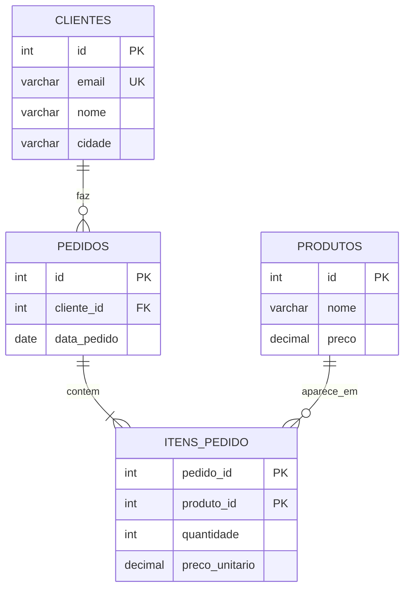

# Normalização

Quase todo mundo que trabalha com dados já recebeu uma planilha assim: uma linha por pedido, com o nome do cliente, o e-mail, a cidade, a lista de produtos separada por vírgula e o preço de cada um. Funciona até o dia em que a cliente muda de e-mail e você precisa corrigir 37 linhas, esquece uma, e o relatório passa a mostrar duas "Anas". **Normalização** é o processo de organizar as tabelas para que cada fato fique guardado em um lugar só, eliminando redundância e as inconsistências que vêm com ela. 🧹

As tabelas `clientes`, `pedidos` e `produtos` usadas nas outras notas desta trilha são, justamente, o resultado de normalizar uma planilha como essa. Esta nota mostra o caminho.

## O problema: redundância e anomalias

Considere esta tabela única de vendas:

| pedido_id | data_pedido | cliente_email   | cliente_nome | cliente_cidade | produtos       | precos        |
| --------- | ----------- | --------------- | ------------ | -------------- | -------------- | ------------- |
| 101       | 2026-03-02  | ana@email.com   | Ana Souza    | Fortaleza      | Teclado, Mouse | 150.00, 50.00 |
| 102       | 2026-03-05  | ana@email.com   | Ana Souza    | Fortaleza      | Monitor        | 900.00        |
| 103       | 2026-03-07  | bruno@email.com | Bruno Lima   | Recife         | Mouse          | 50.00         |

Os dados da Ana aparecem repetidos, e o preço do mouse também. Essa **redundância** causa três tipos de problema, chamados de **anomalias**:

- **Anomalia de atualização**: a Ana se muda para Natal. Se você atualizar só a linha 101, a tabela passa a dizer que ela mora em duas cidades ao mesmo tempo.
- **Anomalia de inserção**: você quer cadastrar um produto novo, uma webcam, que ainda ninguém comprou. Não tem onde colocar: toda linha é um pedido.
- **Anomalia de exclusão**: o Bruno cancela o pedido 103 e você apaga a linha. Junto com ela some a única informação de que o Bruno existe e mora em Recife.

As **formas normais** são regras progressivas que eliminam esses problemas. Cada uma pressupõe a anterior.


## Um conceito antes: dependência funcional

As formas normais falam muito em "dependência". A ideia é simples: a coluna B **depende funcionalmente** da coluna A (escreve-se `A → B`) quando, sabendo o valor de A, você sabe o valor de B. Se você me diz o e-mail `ana@email.com`, eu sei que o nome é "Ana Souza". Então `cliente_email → cliente_nome`.

Também vale lembrar o que é uma **chave candidata**: o conjunto mínimo de colunas que identifica cada linha de forma única (revisado em [Constraints, chaves e relacionamentos](/labs/data/sql/03-constraints-chaves-e-relacionamentos/)).

## Primeira forma normal (1FN)

Uma tabela está na **1FN** quando:

- cada coluna guarda **um valor atômico** (indivisível) por linha, sem listas como "Teclado, Mouse";
- não há **grupos repetidos** de colunas (`produto1`, `produto2`, `produto3`...);
- existe uma chave que identifica cada linha.

A tabela de vendas viola a 1FN nas colunas `produtos` e `precos`. Com listas dentro de uma célula, perguntas simples ficam difíceis: "quantos mouses vendemos?" exige quebrar texto, e nada garante que o terceiro preço corresponda ao terceiro produto.

A correção é ter **uma linha por item do pedido**:

| pedido_id | produto_id | data_pedido | cliente_email   | cliente_nome | cliente_cidade | produto_nome | preco  | quantidade |
| --------- | ---------- | ----------- | --------------- | ------------ | -------------- | ------------ | ------ | ---------- |
| 101       | 1          | 2026-03-02  | ana@email.com   | Ana Souza    | Fortaleza      | Teclado      | 150.00 | 1          |
| 101       | 2          | 2026-03-02  | ana@email.com   | Ana Souza    | Fortaleza      | Mouse        | 50.00  | 1          |
| 102       | 3          | 2026-03-05  | ana@email.com   | Ana Souza    | Fortaleza      | Monitor      | 900.00 | 1          |
| 103       | 2          | 2026-03-07  | bruno@email.com | Bruno Lima   | Recife         | Mouse        | 50.00  | 1          |

A chave agora é composta: `(pedido_id, produto_id)`. A tabela está na 1FN, mas a redundância piorou (a Ana aparece três vezes). As próximas formas normais resolvem isso.

> 💡 "Atômico" depende do uso. Um endereço inteiro numa coluna `endereco` pode ser atômico para um sistema que só imprime etiquetas e não ser para outro que filtra por CEP. A pergunta é: você vai precisar consultar ou alterar só um pedaço desse valor?

## Segunda forma normal (2FN)

Uma tabela está na **2FN** quando está na 1FN e **nenhuma coluna que não é chave depende de só uma parte da chave composta**. Esse problema, chamado de **dependência parcial**, só existe quando a chave tem mais de uma coluna.

Na tabela acima, a chave é `(pedido_id, produto_id)`. Veja as dependências:

- `data_pedido`, `cliente_email`, `cliente_nome` e `cliente_cidade` dependem **só de `pedido_id`**;
- `produto_nome` e `preco` dependem **só de `produto_id`**;
- `quantidade` depende da chave **inteira** (quantos mouses tem no pedido 101).

A correção é separar cada grupo na tabela da parte da chave de que ele depende:

```sql
CREATE TABLE produtos (
    id     INT PRIMARY KEY,
    nome   VARCHAR(100) NOT NULL,
    preco  DECIMAL(10,2) NOT NULL
);

CREATE TABLE pedidos (
    id              INT PRIMARY KEY,
    data_pedido     DATE NOT NULL,
    cliente_email   VARCHAR(255) NOT NULL,
    cliente_nome    VARCHAR(100) NOT NULL,
    cliente_cidade  VARCHAR(100)
);

CREATE TABLE itens_pedido (
    pedido_id       INT REFERENCES pedidos(id),
    produto_id      INT REFERENCES produtos(id),
    quantidade      INT NOT NULL,
    preco_unitario  DECIMAL(10,2) NOT NULL,
    PRIMARY KEY (pedido_id, produto_id)
);
```

A anomalia de inserção do produto sumiu: a webcam pode ser cadastrada em `produtos` sem pedido nenhum.

Repare no `preco_unitario` em `itens_pedido`. Parece repetir `produtos.preco`, mas não repete: é o **preço praticado naquela venda**. Se o mouse subir para 60 amanhã, o pedido 101 continua tendo sido vendido a 50. Esse valor depende da chave inteira (aquele produto, naquele pedido), então está no lugar certo. Distinguir "dado repetido" de "fato diferente que por acaso tem o mesmo valor" é boa parte do trabalho de modelagem.

## Terceira forma normal (3FN)

Uma tabela está na **3FN** quando está na 2FN e **nenhuma coluna que não é chave depende de outra coluna que não é chave**. Essa é a **dependência transitiva**: a chave determina A, e A determina B.

Em `pedidos`, a chave `id` determina `cliente_email`, e `cliente_email` determina `cliente_nome` e `cliente_cidade`:

```text
pedidos.id → cliente_email → cliente_nome, cliente_cidade
```

Os dados da Ana continuam repetidos em cada pedido dela, e a anomalia de atualização da mudança de cidade continua lá. A correção é tirar o cliente para uma tabela própria e deixar em `pedidos` só a referência:

```sql
CREATE TABLE clientes (
    id      INT PRIMARY KEY,
    email   VARCHAR(255) NOT NULL UNIQUE,
    nome    VARCHAR(100) NOT NULL,
    cidade  VARCHAR(100)
);

CREATE TABLE pedidos (
    id           INT PRIMARY KEY,
    cliente_id   INT REFERENCES clientes(id),
    data_pedido  DATE NOT NULL
);
```

Agora a mudança de cidade da Ana é um `UPDATE` em uma linha, e o Bruno continua existindo em `clientes` mesmo que o pedido dele seja apagado. Também usamos uma surrogate key (`clientes.id`) em vez do e-mail como chave, porque e-mail muda, e mantivemos o e-mail com `UNIQUE`.

Um jeito informal de lembrar das três primeiras formas normais é a frase clássica: toda coluna não chave deve depender **da chave** (1FN), **da chave inteira** (2FN) e **de nada além da chave** (3FN).

O modelo final fica assim:



Para recuperar a "planilha" original, basta juntar as tabelas com joins (veja [Joins](/labs/data/sql/09-joins/)), e uma view pode deixar essa consulta pronta (veja [Views, índices e triggers](/labs/data/sql/11-views-indices-e-triggers/)).

## Forma normal de Boyce-Codd (BCNF)

A **BCNF** é uma versão mais rígida da 3FN: **todo determinante precisa ser uma chave candidata**. Em outras palavras, se `A → B`, então A tem que identificar a linha inteira.

Na maioria das tabelas, quem está na 3FN já está na BCNF. A diferença aparece em casos com mais de uma chave candidata que se sobrepõem. Um exemplo: cada cliente é atendido por um consultor por categoria de produto, e cada consultor cuida de **uma única** categoria.

| cliente_id | categoria   | consultor |
| ---------- | ----------- | --------- |
| 1          | Informática | Marta     |
| 2          | Informática | Marta     |
| 1          | Móveis      | Otávio    |
| 3          | Informática | Paulo     |

A chave é `(cliente_id, categoria)`. Mas existe a dependência `consultor → categoria` (sabendo que é a Marta, você sabe que a categoria é Informática), e `consultor` sozinho não é chave. A tabela está na 3FN (porque `categoria` faz parte de uma chave candidata, e a 3FN tolera isso) mas não na BCNF. O sintoma: a informação "Marta atende Informática" se repete para cada cliente dela.

A correção é separar a dependência:

```text
consultores (consultor PK, categoria)
atendimentos (cliente_id, consultor) - PK (cliente_id, consultor)
```

Essa separação tem um preço que vale conhecer: a regra "um cliente tem só um consultor por categoria" deixa de ser garantida por uma chave e passa a depender de validação extra (na aplicação ou num trigger). Por isso, em alguns casos, as equipes param conscientemente na 3FN.

Existem ainda a **4FN** e a **5FN**, que tratam de dependências multivaloradas e de junção. Elas aparecem pouco no dia a dia; para a maioria dos sistemas, chegar à 3FN (ou BCNF) é o objetivo.

## Desnormalização

Normalizar reduz redundância, mas tem preço: para montar um relatório, o banco precisa juntar várias tabelas, e em volumes grandes esses joins pesam. **Desnormalização** é introduzir redundância **de propósito**, de forma controlada, para acelerar a leitura.

Exemplos comuns:

- guardar `valor_total` em `pedidos`, mesmo que ele possa ser calculado somando `itens_pedido`. A tabela `pedidos` das outras notas desta trilha faz exatamente isso;
- copiar `cliente_cidade` para a tabela de pedidos de um relatório regional, evitando o join;
- manter tabelas pré-agregadas (faturamento por dia e loja) ou views materializadas;
- modelos dimensionais (esquema estrela) em data warehouses e ferramentas de BI, em que as dimensões são propositalmente desnormalizadas (veja [Modelagem de dados no Power BI](/labs/data/power-bi/05-modelagem-de-dados/)).

O custo é que agora você é responsável por manter as cópias em sincronia: se um item for adicionado ao pedido, alguém precisa atualizar o `valor_total`. Isso costuma ficar a cargo da aplicação, de um trigger ou de um job de carga.

| Aspecto             | Normalizado (OLTP)                        | Desnormalizado (analítico)             |
| ------------------- | ----------------------------------------- | -------------------------------------- |
| Foco                | Escritas corretas e consistentes          | Leituras rápidas e consultas simples   |
| Redundância         | Mínima                                    | Intencional                            |
| Joins nas consultas | Muitos                                    | Poucos                                 |
| Risco               | Consultas mais complexas                  | Dados inconsistentes se a carga falhar |
| Onde aparece        | Sistemas transacionais (vendas, cadastro) | Data warehouse, dashboards, relatórios |

A regra prática é normalizar primeiro e desnormalizar depois, quando houver um problema de desempenho medido. Desnormalizar "por precaução" costuma trazer as anomalias de volta sem ganho real.

## Referências

- [Descrição dos conceitos básicos de normalização de banco de dados](https://learn.microsoft.com/pt-br/office/troubleshoot/access/database-normalization-description) - Microsoft Learn, pt-BR
- [Normalização de banco de dados](https://pt.wikipedia.org/wiki/Normaliza%C3%A7%C3%A3o_de_dados) - Wikipédia, pt-BR
- [Database normalization](https://en.wikipedia.org/wiki/Database_normalization) - Wikipedia, en
