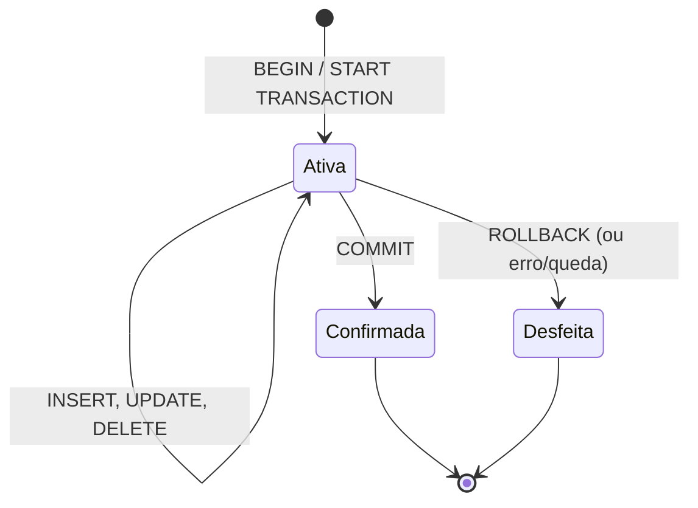

# Transações e ACID

Imagine o fechamento de um pedido numa loja on-line: o banco precisa gravar o pedido, gravar os itens e dar baixa no estoque dos produtos. Se a energia cair entre o segundo e o terceiro passo, o estoque fica errado e ninguém percebe. Uma **transação** resolve isso: ela agrupa várias instruções numa **unidade de trabalho atômica**. Ou tudo acontece, ou nada acontece. 🔒

Esta nota cobre os comandos de controle de transação (TCL), as propriedades ACID, uma noção dos níveis de isolamento e, no fim, os comandos de permissão (DCL), que fecham as categorias de comandos SQL apresentadas em [Introdução ao SQL](/labs/data/sql/01-introducao-ao-sql/).

## Transação: tudo ou nada

Uma transação começa, executa uma ou mais instruções e termina de um de dois jeitos:

- **`COMMIT`**: confirma tudo. As alterações ficam permanentes e visíveis para as outras sessões.
- **`ROLLBACK`**: desfaz tudo o que foi feito desde o início da transação.



O exemplo do pedido, considerando uma tabela `produtos` com a coluna `estoque` e a tabela `itens_pedido` vista em [Normalização](/labs/data/sql/12-normalizacao/):

```sql
START TRANSACTION;   -- PostgreSQL: BEGIN; SQL Server: BEGIN TRANSACTION;

INSERT INTO pedidos (id, cliente_id, data_pedido, status, valor_total)
VALUES (105, 3, '2026-03-10', 'pago', 200.00);

INSERT INTO itens_pedido (pedido_id, produto_id, quantidade, preco_unitario)
VALUES (105, 2, 4, 50.00);

UPDATE produtos SET estoque = estoque - 4 WHERE id = 2;

COMMIT;
```

Se qualquer passo falhar (por exemplo, uma constraint `CHECK (estoque >= 0)` barrar a baixa), a aplicação executa `ROLLBACK` e o pedido 105 nunca existiu.

### Sintaxe por SGBD

| Ação                      | MySQL                            | PostgreSQL                       | SQL Server                               |
| ------------------------- | -------------------------------- | -------------------------------- | ---------------------------------------- |
| Iniciar                   | `START TRANSACTION;` ou `BEGIN;` | `BEGIN;` ou `START TRANSACTION;` | `BEGIN TRANSACTION;` (ou `BEGIN TRAN;`)  |
| Confirmar                 | `COMMIT;`                        | `COMMIT;`                        | `COMMIT TRANSACTION;` (ou `COMMIT;`)     |
| Desfazer                  | `ROLLBACK;`                      | `ROLLBACK;`                      | `ROLLBACK TRANSACTION;` (ou `ROLLBACK;`) |
| Criar ponto de salvamento | `SAVEPOINT nome;`                | `SAVEPOINT nome;`                | `SAVE TRANSACTION nome;`                 |
| Voltar ao ponto           | `ROLLBACK TO SAVEPOINT nome;`    | `ROLLBACK TO SAVEPOINT nome;`    | `ROLLBACK TRANSACTION nome;`             |
| Liberar o ponto           | `RELEASE SAVEPOINT nome;`        | `RELEASE SAVEPOINT nome;`        | Não existe                               |

### Auto-commit

Se você nunca escreveu `BEGIN` e mesmo assim seus `UPDATE` ficaram gravados, é por causa do **auto-commit**: um **modo da sessão** em que cada instrução avulsa vira uma transação própria, confirmada automaticamente ao terminar. Ele vem ligado por padrão em MySQL, PostgreSQL e SQL Server. Abrir uma transação explícita suspende o auto-commit até o `COMMIT` ou `ROLLBACK`.

Dá para desligar:

- MySQL: `SET autocommit = 0;` (a partir daí, nada é gravado sem `COMMIT`);
- PostgreSQL: no `psql`, `\set AUTOCOMMIT off`; em drivers, é uma opção da conexão;
- SQL Server: `SET IMPLICIT_TRANSACTIONS ON;` (a primeira instrução abre uma transação que fica aberta até o `COMMIT`).

Ferramentas gráficas como DBeaver e MySQL Workbench também têm um botão de auto-commit. Vale saber em qual modo você está antes de rodar um `DELETE` em produção.

### Rede de segurança para alterações manuais

Uma transação é o melhor seguro para `UPDATE` e `DELETE` feitos à mão (vistos em [Inserindo, atualizando e excluindo dados](/labs/data/sql/05-inserindo-atualizando-e-excluindo-dados/)):

```sql
BEGIN;
UPDATE funcionarios SET salario = salario * 1.10 WHERE departamento = 'TI';
SELECT nome, salario FROM funcionarios WHERE departamento = 'TI';  -- conferir
-- Se o número de linhas ou os valores estiverem estranhos: ROLLBACK;
COMMIT;
```

E se você **já** confirmou um `DELETE` errado? Depois do `COMMIT` não existe "desfazer" em SQL. A recuperação depende de backup ou de _point-in-time recovery_ (restaurar o banco até um instante antes do erro), recursos de administração do servidor. Por isso muitos sistemas usam **soft delete**: em vez de apagar, marcam a linha (`ativo = false` ou `excluido_em = now()`).

## SAVEPOINT: desfazendo só uma parte

Um `SAVEPOINT` marca um ponto dentro da transação. `ROLLBACK TO SAVEPOINT` desfaz o que veio **depois** dele, mantendo o que veio antes, e a transação continua aberta.

```sql
BEGIN;

INSERT INTO pedidos (id, cliente_id, data_pedido, status, valor_total)
VALUES (106, 1, '2026-03-11', 'pago', 900.00);

SAVEPOINT antes_do_brinde;

INSERT INTO itens_pedido (pedido_id, produto_id, quantidade, preco_unitario)
VALUES (106, 99, 1, 0.00);          -- brinde que não deveria entrar

ROLLBACK TO SAVEPOINT antes_do_brinde;   -- SQL Server: ROLLBACK TRANSACTION antes_do_brinde;

COMMIT;   -- grava o pedido 106, sem o brinde
```

Repare: `ROLLBACK TO SAVEPOINT` **não encerra** a transação. Só o `COMMIT` ou um `ROLLBACK` sem nome encerram.

No PostgreSQL, savepoints têm um uso extra importante: quando qualquer instrução dá erro dentro de uma transação, ela fica em estado de falha e todo comando seguinte é recusado ("current transaction is aborted") até um `ROLLBACK`. Um `ROLLBACK TO SAVEPOINT` permite recuperar a transação a partir do ponto salvo. MySQL e SQL Server, por padrão, só desfazem a instrução que falhou e deixam a transação seguir (no SQL Server, `SET XACT_ABORT ON` muda isso para desfazer tudo, configuração recomendada pela própria Microsoft em muitos cenários).

## ACID

ACID é a sigla das quatro garantias que um banco transacional dá:

| Propriedade      | Significa                                                                                   | No exemplo do pedido                                                |
| ---------------- | ------------------------------------------------------------------------------------------- | ------------------------------------------------------------------- |
| **A**tomicidade  | A transação é indivisível: tudo ou nada                                                     | Não existe pedido gravado sem a baixa de estoque                    |
| **C**onsistência | A transação leva o banco de um estado válido a outro, respeitando constraints, FKs e regras | Um `CHECK (estoque >= 0)` impede vender o que não existe            |
| **I**solamento   | Transações simultâneas não enxergam o trabalho pela metade umas das outras                  | Um relatório rodando ao mesmo tempo não vê o pedido sem os itens    |
| **D**urabilidade | Depois do `COMMIT`, a alteração sobrevive a quedas de energia e reinícios                   | Se o servidor cair um segundo após o `COMMIT`, o pedido continua lá |

Algumas notas sobre cada uma:

- A **atomicidade** e a **durabilidade** são garantidas por um log gravado em disco antes dos dados (o _write-ahead log_ no PostgreSQL, o _redo log_ no InnoDB, o _transaction log_ no SQL Server). Ao reiniciar após uma queda, o banco lê o log, refaz o que foi confirmado e desfaz o que ficou pela metade.
- A **consistência** depende também de você: o banco só garante as regras que foram declaradas como constraints (veja [Constraints, chaves e relacionamentos](/labs/data/sql/03-constraints-chaves-e-relacionamentos/)). Uma regra que só existe na cabeça do time não é protegida.
- O **isolamento** é a propriedade com mais nuances, porque isolamento total custa desempenho. Por isso existem níveis.

### DDL dentro de transação

Um detalhe que pega muita gente de surpresa: no **MySQL**, comandos DDL como `CREATE TABLE`, `ALTER TABLE`, `DROP TABLE` e `TRUNCATE` fazem um **commit implícito**: confirmam o que estava pendente na transação e não podem ser desfeitos com `ROLLBACK`. No **PostgreSQL** e no **SQL Server**, a maior parte do DDL é transacional, e um `DROP TABLE` dentro de um `BEGIN` pode ser revertido. Os efeitos disso no `TRUNCATE` estão em [Alterando a estrutura](/labs/data/sql/04-alterando-a-estrutura/).

## Concorrência e níveis de isolamento

Quando várias sessões leem e escrevem os mesmos dados ao mesmo tempo, aparecem fenômenos indesejados. O padrão SQL define três clássicos:

- **Leitura suja** (_dirty read_): a transação A lê uma alteração da transação B que ainda não foi confirmada. Se B fizer `ROLLBACK`, A usou um dado que nunca existiu.
- **Leitura não repetível** (_non-repeatable read_): A lê o salário da Ana (9000), B altera para 9500 e confirma, A lê de novo e vê 9500. A mesma consulta, na mesma transação, deu resultados diferentes.
- **Leitura fantasma** (_phantom read_): A conta os funcionários de TI (3), B insere um novo funcionário em TI e confirma, A conta de novo e vê 4. Apareceu uma linha "fantasma".

Os **níveis de isolamento** definem quais desses fenômenos são tolerados. Quanto mais restritivo, menos anomalias e menos concorrência:

| Nível              | Leitura suja | Leitura não repetível | Leitura fantasma |
| ------------------ | ------------ | --------------------- | ---------------- |
| `READ UNCOMMITTED` | Possível     | Possível              | Possível         |
| `READ COMMITTED`   | Não          | Possível              | Possível         |
| `REPEATABLE READ`  | Não          | Não                   | Possível\*       |
| `SERIALIZABLE`     | Não          | Não                   | Não              |

\* O padrão permite fantasmas em `REPEATABLE READ`, mas tanto o PostgreSQL (com snapshots) quanto o InnoDB do MySQL (com bloqueios de intervalo nas leituras com lock) os evitam na prática na maior parte dos casos.

Cada SGBD tem seu padrão e seus detalhes:

| SGBD           | Nível padrão      | Observações                                                                                                                                                                                                                   |
| -------------- | ----------------- | ----------------------------------------------------------------------------------------------------------------------------------------------------------------------------------------------------------------------------- |
| MySQL (InnoDB) | `REPEATABLE READ` | Leituras comuns usam um snapshot do início da transação                                                                                                                                                                       |
| PostgreSQL     | `READ COMMITTED`  | `READ UNCOMMITTED` é aceito mas se comporta como `READ COMMITTED`: leitura suja nunca acontece. Em `REPEATABLE READ` e `SERIALIZABLE`, a transação pode falhar com erro de serialização e precisa ser repetida pela aplicação |
| SQL Server     | `READ COMMITTED`  | Por padrão usa bloqueios (leitores esperam escritores). Com a opção `READ_COMMITTED_SNAPSHOT` (padrão no Azure SQL Database), usa versões de linha. Tem ainda o nível `SNAPSHOT`                                              |

Para mudar o nível:

```sql
-- MySQL: vale para a próxima transação da sessão
SET TRANSACTION ISOLATION LEVEL SERIALIZABLE;
START TRANSACTION;

-- PostgreSQL: direto no BEGIN
BEGIN ISOLATION LEVEL SERIALIZABLE;

-- SQL Server: vale para a sessão até ser alterado
SET TRANSACTION ISOLATION LEVEL SERIALIZABLE;
BEGIN TRANSACTION;
```

Na maioria das aplicações, o nível padrão do banco é suficiente. Suba o nível quando houver uma regra que realmente dependa disso, e prepare a aplicação para repetir transações que falharem.

### Por baixo dos panos: locks e MVCC

Os bancos usam dois mecanismos, muitas vezes combinados, para implementar o isolamento:

- **Locks (bloqueios)**: quem vai escrever numa linha a bloqueia; quem chega depois espera. Simples, mas gera espera e, às vezes, **deadlocks** (A espera B, que espera A), que o banco resolve abortando uma das transações.
- **MVCC** (controle de concorrência multiversão): o banco mantém versões antigas das linhas, e cada transação lê a versão que era válida no seu snapshot. Leitores não bloqueiam escritores e vice-versa. PostgreSQL e InnoDB funcionam assim; o SQL Server usa MVCC quando o snapshot está habilitado.

Escritas na mesma linha sempre se bloqueiam, em qualquer nível. Um problema clássico é a **atualização perdida**: duas sessões leem o estoque (10), cada uma calcula 10 - 1 na aplicação e grava 9, quando o certo seria 8. Duas saídas comuns:

```sql
-- 1) Deixar o banco fazer a conta de forma atômica
UPDATE produtos SET estoque = estoque - 1 WHERE id = 2 AND estoque >= 1;

-- 2) Ler já bloqueando a linha até o fim da transação (MySQL e PostgreSQL)
BEGIN;
SELECT estoque FROM produtos WHERE id = 2 FOR UPDATE;
-- ... lógica da aplicação ...
UPDATE produtos SET estoque = 9 WHERE id = 2;
COMMIT;
```

No SQL Server, o equivalente ao `FOR UPDATE` é a dica de tabela `WITH (UPDLOCK)` no `SELECT`.

Mantenha transações **curtas**. Uma transação aberta enquanto o usuário pensa, ou esperando uma API externa, segura locks (ou versões antigas de linhas) e trava o resto do sistema.

## DCL: controlando permissões

A **DCL** (_Data Control Language_) define **quem pode fazer o quê** no banco. Os dois comandos centrais são:

- **`GRANT`**: concede um privilégio (`SELECT`, `INSERT`, `UPDATE`, `DELETE`, `EXECUTE`, entre outros) sobre um objeto a um usuário ou papel (_role_);
- **`REVOKE`**: retira um privilégio concedido.

A ideia que guia tudo é o **princípio do menor privilégio**: cada usuário recebe só o necessário. Um analista de dados precisa ler, raramente precisa apagar.

```sql
-- Dar ao analista leitura nas tabelas de vendas e acesso a uma view sem salários
GRANT SELECT ON pedidos  TO analista;
GRANT SELECT ON clientes TO analista;
GRANT SELECT ON vw_funcionarios_publico TO analista;

-- Retirar um privilégio
REVOKE SELECT ON clientes FROM analista;
```

Dar acesso a uma view em vez da tabela, como em `vw_funcionarios_publico`, é a forma clássica de esconder colunas sensíveis (veja [Views, índices e triggers](/labs/data/sql/11-views-indices-e-triggers/)).

A criação de usuários e o escopo dos privilégios mudam bastante entre os bancos:

| Tarefa                         | MySQL                                                       | PostgreSQL                                                                                               | SQL Server                                                                                                 |
| ------------------------------ | ----------------------------------------------------------- | -------------------------------------------------------------------------------------------------------- | ---------------------------------------------------------------------------------------------------------- |
| Criar usuário                  | `CREATE USER 'analista'@'%' IDENTIFIED BY '<senha>';`       | `CREATE ROLE analista LOGIN PASSWORD '<senha>';`                                                         | `CREATE LOGIN analista WITH PASSWORD = '<senha>';` e, no banco, `CREATE USER analista FOR LOGIN analista;` |
| Leitura em todo o banco/schema | `GRANT SELECT ON loja.* TO 'analista'@'%';`                 | `GRANT USAGE ON SCHEMA public TO analista;` e `GRANT SELECT ON ALL TABLES IN SCHEMA public TO analista;` | `GRANT SELECT ON SCHEMA::dbo TO analista;`                                                                 |
| Agrupar permissões             | `CREATE ROLE leitura;` e `GRANT leitura TO 'analista'@'%';` | `CREATE ROLE leitura;` e `GRANT leitura TO analista;`                                                    | `CREATE ROLE leitura;` e `ALTER ROLE leitura ADD MEMBER analista;`                                         |
| Negar explicitamente           | Não existe                                                  | Não existe                                                                                               | `DENY SELECT ON funcionarios TO analista;`                                                                 |

Alguns detalhes:

- no MySQL, o usuário é identificado por nome **e** origem (`'analista'@'%'` é diferente de `'analista'@'localhost'`);
- no PostgreSQL, `GRANT ... ON ALL TABLES` vale só para as tabelas que já existem; para as futuras, use `ALTER DEFAULT PRIVILEGES`;
- no SQL Server, `DENY` vence qualquer `GRANT`, inclusive os herdados de um papel;
- em vez de dar permissões pessoa a pessoa, crie papéis (`leitura`, `escrita_vendas`) e coloque as pessoas neles. Fica muito mais fácil revisar e retirar acesso quando alguém muda de time.

## Referências

- [Transações (Transact-SQL)](https://learn.microsoft.com/pt-br/sql/t-sql/language-elements/transactions-transact-sql) - Microsoft Learn, pt-BR
- [SAVE TRANSACTION (Transact-SQL)](https://learn.microsoft.com/pt-br/sql/t-sql/language-elements/save-transaction-transact-sql) - Microsoft Learn, pt-BR
- [SET TRANSACTION ISOLATION LEVEL (Transact-SQL)](https://learn.microsoft.com/pt-br/sql/t-sql/statements/set-transaction-isolation-level-transact-sql) - Microsoft Learn, pt-BR
- [Transaction Isolation](https://www.postgresql.org/docs/current/transaction-iso.html) - PostgreSQL Global Development Group, en
- [Transaction Isolation Levels (InnoDB)](https://dev.mysql.com/doc/refman/8.4/en/innodb-transaction-isolation-levels.html) - Oracle/MySQL, en
